<p align="center">
  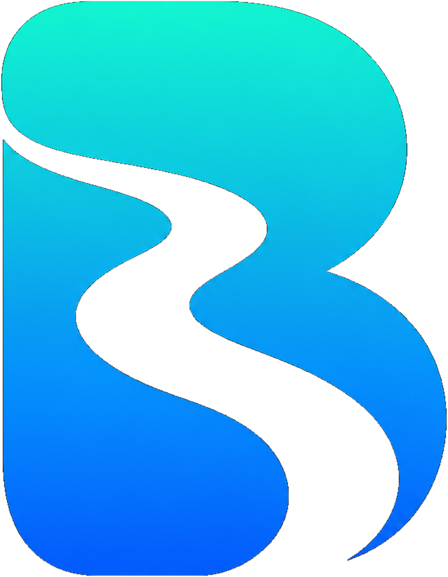

</p>

<h1 align="center">Brook OS</h1>

<h3 align="center">A hobby x86-64 operating system built from scratch</h3>

<p align="center">
  UEFI · C++ · Clang/LLVM · SMP · Wayland · OpenGL · Vulkan · Networking · Nix
</p>

---

<p align="center">
  <a href="docs/images/brook_quake2_gl3_demo_1080.png">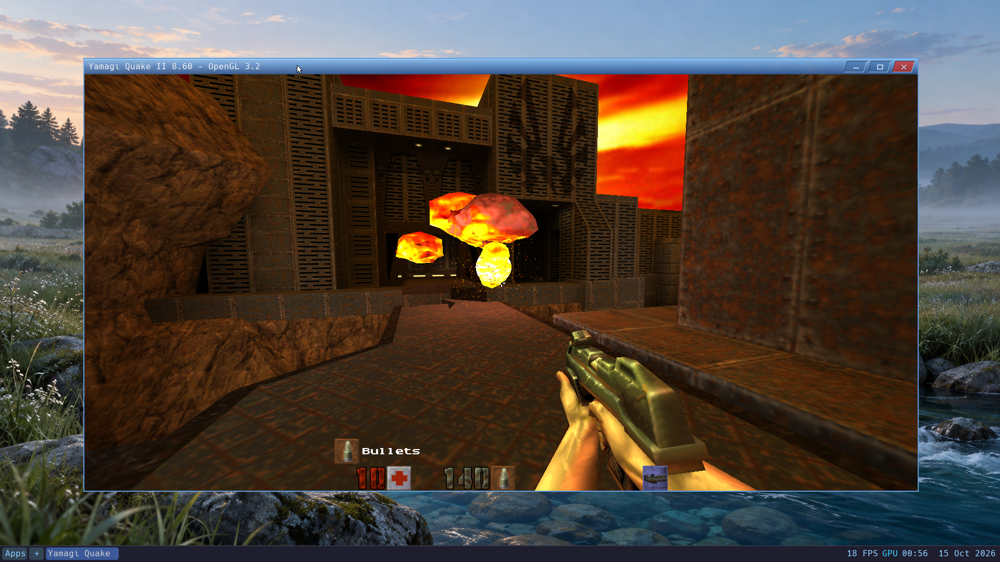</a>
</p>

<p align="center"><em>Quake II's Installation demo through hardware virgl GL3 — a 1600×800 game window on Brook's native 1920×1080 desktop</em></p>

## What is Brook?

Brook is a hobby operating system for x86-64, written from scratch in C++ with
a unified Clang/LLVM toolchain. It boots via UEFI, runs on multiple CPU cores,
has a compositing window manager with a Wayland compositor, and implements
an expanding subset of the Linux syscall ABI to run
unmodified Linux binaries — including web browsers, GTK apps, and games.

This is my second OS project (the first being
[Enkel](https://github.com/IanNorris/Enkel)). Where Enkel was about getting
things working, Brook is about doing it **right** — clean architecture,
modular drivers, and a codebase that's a pleasure to work in.

## Confirmed Working Software

Brook runs Linux ELF binaries using both musl and glibc, including Nix
closures. Some applications use Brook compatibility builds or launchers;
the table distinguishes tested behavior from remaining limitations.

| Software | Version | Status | Notes |
|----------|---------|--------|-------|
| [bash](https://www.gnu.org/software/bash/) | 5.2 / 5.3 | ✅ Working | Bundled shell and Nix Bash closures; readline, job control and scripting |
| [DOOM](https://github.com/ozkl/doomgeneric) | 1.9 | ✅ Working | Runs in a WM window or full-screen, with keyboard input |
| [Quake 2 / Yamagi](https://www.yamagi.org/quake2/) | 8.60 | ✅ Gameplay | Software and hardware virgl GL3 renderers, startup demo, OSS audio and OGG music; [GPU resource retirement/repeated launches](docs/gpu-resource-lifetime.md), mouse capture and intermittent audio timing remain open |
| [GLtron](https://www.gltron.org/) | 0.70 | ⚠️ Experimental | Compatibility launcher installs through guest `nix-install`; hardware virgl menu and light-cycle gameplay verified, with sound disabled |
| [SuperTuxKart](https://supertuxkart.net/) | 1.5 | ⚠️ Experimental | Guest installation and hardware virgl races verified; current ownership build accepts race input and [reclaims backing after close](docs/gpu-resource-lifetime.md#gpu-workload-transition-acceptance), with clean subsequent Gallery/browser surfaces; launcher sound is disabled, memory pressure and mixed-game acceptance remain open |
| Vulkan / Mesa Venus | 26.0.6 | ✅ vkcube + vkmark | Intel hardware compute, rendering and direct Wayland DMA-BUF presentation; automatic staging with CPU composition. Repeated window lifecycle and concurrent GL verified. [Results and limits](docs/vulkan-desktop.md) |
| [busybox](https://busybox.net/) | 1.36 | ✅ Working | ls, cat, echo, wc, head, tail, grep, and many more |
| [TCC](https://bellard.org/tcc/) | 0.9.27 | ✅ Working | Compiles and runs C programs natively on Brook |
| [CoreMark](https://www.eembc.org/coremark/) | 1.0 | ✅ Working | CPU benchmark, runs to completion |
| [musl libc](https://musl.libc.org/) | 1.2 | ✅ Working | Standard C library, dynamically linked |
| [Go](https://go.dev/) runtime | 1.22 | ✅ Working | Static Go binaries (lazy PROT_NONE heap + on-demand mprotect) |
| Nix binaries | — | ✅ Working | Stock NixOS closures fetched via `nix-install` (cowsay, coreutils, curl, …) |
| [NetSurf](https://www.netsurf-browser.org/) | 3.11 | ✅ Working | Web browser rendering HTML/CSS via custom framebuffer surface |
| [Ladybird](https://ladybird.dev/) | 2026-04-04 | ⚠️ Experimental | HTTPS Google search and Amazon navigation verified; loading/input/scrolling performance remains limited |
| [Firefox](https://www.mozilla.org/firefox/) | 150.0.1 | ⚠️ Experimental | Included in fresh experiment images; software Wayland HTTPS/JavaScript and YouTube audio through the normal launcher, including pause/resume; synthetic site storage survives reboot; hardware child-surface rendering and local video/PCM capture now verified; low video framerate and intermittent audio gaps remain |
| [Chromium](https://www.chromium.org/) | 148.0.7778.96 | ⚠️ Experimental | Software-rendered Wayland browsing and 480p YouTube video/audio; long pause/resume and seeking verified under normal autoplay rules; browser sandbox disabled |
| [OpenTTD](https://www.openttd.org/) | 15.3 | ⚠️ Experimental | World creation and cold-boot save/load verified; music output, normal quit and forced-exit cleanup checked; longer-session gameplay remains experimental |
| [VSCodium](https://vscodium.com/) | 1.112.01907 | ⚠️ Experimental | Brook-user editing, cold save/reopen and normal exit verified alongside Firefox and Chromium in a 4 GiB VM; startup remains slow; Electron sandbox disabled |
| [Blender](https://www.blender.org/) | 5.1.1 | 🚧 Blocked | Guest installation and LLVM dependency correction verified; audio initialization and EGL rendering remain blocked |
| Wine64 | 11.0 | ✅ Basic apps | Console command and Windows Notepad: keyboard input, save, normal close and cold-boot reopen as Brook. Broader Windows coverage remains limited. [Evidence and screenshot](docs/wine-smoke.md#console-and-notepad-acceptance--19-october) |
| Wine + DXVK | 11.0 / 2.7.1 | ⚠️ Experimental D3D11 | Hardware Venus shader/readback probe and Windows SDL3 Snake; keyboard input, resize, maximize, minimize/restore and repeated launch/close verified. Per-app Unity audio also verified; standalone Proton GE has a separate smoke test. [Results](docs/wine-dxvk.md), [Unity smoke test](docs/wine-unity.md) |
| Proton GE | 11-10 / DXVK 3.1.1 | ⚠️ Experimental | Standalone Helltaker at 720p: first-puzzle input/reset, captured audio and normal exit verified. Steam client integration remains untested. [Results](docs/proton.md) |
| Steam | Native64 client | ⚠️ Experimental | QR sign-in, Library, downloads and verification tested through SteamRT. Native64 Stardew gameplay and save/reload across reboot work; game audio and bounded timing-fault recovery verified. Startup remains slow and variable. [Game results](docs/stardew-native64.md), [client limits](docs/steam-library-stability.md) |
| Stardew Valley | 1.6.15 native64 | ⚠️ Experimental | Launched through Steam; older-save loading, movement, sleep-to-save and day-2 reload after a clean VM reboot verified. Startup is slow and variable; host recording load affects performance. [Results](docs/stardew-native64.md) |
| D3D12 / VKD3D-Proton | 3.1.0 | ⚠️ Experimental | Hardware shader/readback, event fences, 720p swapchain resize, Windows SDL3 Snake and Veloren 3D singleplayer through Proton GE. Per-game native shader compiler required for Veloren. [Results and screenshots](docs/d3d12.md) |
| SpaceVenture (Windows) | 2.08.12 / Unity 2022.3 | ⚠️ Experimental | D3D11/DXVK main menu, opening sequence and first-room interaction; clocked ALSA PCM captured. [Screenshot and limits](docs/wine-unity.md#spaceventure--unity-2022362f2) |
| Helltaker (Windows) | Unity 2019.2.9f1 | ⚠️ Experimental | 720p D3D11/DXVK first-puzzle gameplay, keyboard movement/restart, minimize/restore and normal exit; clocked ALSA audio captured. [Screenshot and scope](docs/wine-unity.md) |
| [Qalculate!](https://qalculate.github.io/) | — | ✅ Working | GTK3 calculator via Wayland (CSD decorations) |
| [GIMP](https://www.gimp.org/) | 3.0.8 | ⚠️ Experimental | Painting, XCF save/reopen (including cold boot) and PNG export/import verified; Brook-owned legacy profile, settings and saved images verified across reboot; optional plugin discovery still has faults |
| [LibreOffice](https://www.libreoffice.org/) | 25.8.5.2 | ⚠️ Experimental | Writer save/reopen across cold boot and full native-close cleanup verified as Brook; startup and broader suite coverage remain experimental |
| [VLC](https://www.videolan.org/vlc/) | 3.0.23-2 | ⚠️ Experimental | 720p OSS playback; Wayland black flashes fixed; cold 55-second minimize/restore, normal close and SIGKILL audio cleanup verified; audio timing still experimental |

## Recent progress

- **Steam:** authenticated Library browsing, game download and verification,
  and individual Xwayland windows with focus, move, resize, maximize and
  minimize/restore. SteamRT startup now uses its companion launcher service;
  retained file descriptors and resource-limit reporting fixes support the
  client. Stardew Valley's native64 build now reaches its interactive title/menu
  through Steam, with older-save loading and a sleep/save/reboot/reload round trip
  checked. Hard links and inode indexing reduce one measured startup from 334
  to 128 seconds; later runs remain slow and variable. Game audio and recovery
  after a forced timing gap work in bounded tests; longer sessions remain open. The tested i386 game still
  requires architecture support. [Game results](docs/stardew-native64.md) and
  [remaining work](docs/backlog.md#stardew-valley-native64-acceptance-24-october).

- **D3D12:** Proton GE's VKD3D renders a shader triangle with verified GPU
  readback and a resized 720p window; Windows SDL3 Snake also runs with its
  D3D12 renderer forced. Veloren's Windows build reaches 3D singleplayer with
  character creation and movement using a per-app native shader compiler.
  [Checkpoints, screenshots and limits](docs/d3d12.md).

- **Hardware Vulkan:** vkcube and vkmark run through Mesa Venus with direct
  DMA-BUF presentation, queue synchronization and retained compositor images.
  Ordinary launches select direct presentation with GPU composition or staging
  with CPU composition. Repeated resize, minimize/restore and relaunch tests
  pass alongside hardware GL, with clean resource retirement and saved-data
  checks. The [measured Intel configuration and comparison](docs/vulkan-desktop.md)
  are documented.

- **Windows D3D11:** Wine and DXVK render through hardware Venus. A shader
  probe verifies pixel readback through repeated launches, resize and window
  controls; the Windows SDL3 Snake example also runs with its D3D11 renderer.
  Wine cleanup, committed viewport geometry and resize acknowledgement fixes
  support the path. [Acceptance and limitations](docs/wine-dxvk.md) cover the
  tested configuration. [Unity game smoke tests](docs/wine-unity.md) now cover
  Helltaker and SpaceVenture, including captured audio. A separate
  [standalone Proton GE test](docs/proton.md) now runs Helltaker too. Full Steam
  integration remains future work.

- **Native editor:** VSCodium renders its workbench, accepts keyboard input,
  saves and reopens text files, and exits through its window controls. Nested
  epoll readiness and timeout fixes unblock Electron's event loop. The current
  launcher uses software Wayland and a persistent profile; startup remains slow.
  Byte-identical executable pages now share COW frames across independent
  launches; Chromium and Codium passed concurrent editing/browsing in a 4 GiB
  guest. Fatal-signal group cancellation fixes retained shutdown helpers;
  three native close cycles, including a reboot, release every tested helper.
  Broader memory-pressure testing and startup performance work remain.
  Firefox, Chromium and VSCodium have now also passed a three-app cold-persistence
  and clean-exit check on the permission kernel; [results and limitations](docs/browser-trio.md#permission-kernel-refresh).

- **Modern browsers:** stock Firefox and Chromium render real HTTPS websites
  with working input and JavaScript. Chromium now plays YouTube video and audio,
  including long pause/resume and seeking, without an autoplay workaround.
  Connected Unix socket shutdown, anonymous memory discard and descriptor
  capacity fixes support these workloads. The default experiment Firefox package
  now plays YouTube through its normal launcher after fixing 48-kHz ALSA
  negotiation. Pause stops output and resume restores it; one early capture
  contained a 290-ms silent interval, while subsequent captures had none.
  Fresh experiment images now include both browsers and pass a controlled
  48-kHz Opus playback check. Both browsers retain synthetic site-storage
  markers across VM restart after fixing filesystem capacity reporting. Browser
  performance, intermittent audio stalls and real-site profile persistence remain
  under investigation. See [filesystem capacity acceptance](docs/filesystem-space.md).
  A [timerfd clock-domain repair](docs/timerfd-clock.md) restores roughly
  23–24 video callbacks per page second on the controlled 24-fps local clip;
  concurrent playback still slows down. In the latest [network-recovery rerun](docs/package-pipeline.md#late-tx-completion-follow-up-18-october),
  Firefox playback progressed but Chromium's controlled clip stayed at its first
  frame. A subsequent [Chromium audio-route correction](docs/audio-clock.md#chromium-recovery-route--18-october-2026)
  lets both controlled clips advance with audio in a bounded concurrent check;
  playback still loses time under contention. [Presentation diagnostics](docs/firefox-presentation.md)
  distinguish media progress, callback counters and VM display output.
  Earlier browser acceptance runs use software rendering. Hardware-mode Firefox
  now renders retained child surfaces and local video with captured PCM; video
  framerate remains low. [Retained GPU surface-tree work](docs/gpu-resource-lifetime.md#wayland-scene-tree-adoption)
  is in progress. The generic public package index still lists stock packages.
  See [workload validation](docs/workloads.md) for tested configurations and
  remaining limits. At the pinned `37cccf60` permission checkpoint, both [full bootstrap paths](docs/bootstrap.md#40-suite-bootstrap-refresh-after-permission-checks-2026-10-18)
  passed all 40 native suites three times, including under their guest-built
  kernels. The clean image installed its SDK through `nix-install` in 245 seconds;
  building the kernel, modules and bare-metal tests took 52–54 seconds.
  The [virtio-net TX ownership fix](docs/package-pipeline.md) reduced
  the measured clean-image SDK install from 732 to 236 seconds; compilation
  remains about 50 seconds. Current host validation covers 52 suites; both full
  bootstrap paths still need renewal beyond that pinned 40-suite checkpoint.

- **Desktop identity and package registration:** new apps and Terminal run as
  `brook` by default, with persistent `/data/home`. The installer preserves
  package manifest rows when appending; Firefox's menu launch, HTTPS rendering
  and normal exit have been rechecked with this identity. Permission enforcement
  is still being audited before adding login/accounts. See [identity](docs/identity.md)
  and [append acceptance](docs/append-writes.md). [Retained-directory checks](docs/dirfd-identity.md)
  cover long paths, ext2 rename/replacement and fd-safe cleanup.

- **Desktop appearance:** application icons in window chrome, an icon taskbar,
  and a launcher that updates after package installation/removal. Settings
  previews and saves three desktop themes and native desktop scaling at
  100%, 150% or 200%, and uses Brook's native titlebar. Application content
  retains its existing scale; see [scaling status](docs/desktop-scaling.md).
  Launcher loading now runs on a worker, with animated pending taskbar entries,
  a busy cursor badge and visible failure notices. See [desktop settings](docs/desktop-settings.md)
  and [launch feedback](docs/launch-feedback.md).
- **App Gallery:** search the package index and install, repair or remove
  packages from the shared desktop profile. A real install, executable launch,
  reboot persistence and removal passed as Brook. Stop and close-during-install
  finish the active archive safely; cancelled downloads can be reused on retry.
  Fresh-image launcher deployment and a larger VLC install also passed.
  See [Gallery status](docs/app-gallery.md)
  for recovery and deployment work still open.
- **VM control bridge:** screenshots returned as artifact references, VM input,
  recoverable command jobs with separate output and exit status, native/Wayland
  window controls, installed-app discovery and recoverable launcher activation;
  selectable frame/window/task/launch/diagnostic bundles; logs, CPU/context-switch profiles,
  OS statistics, silent-output PCM capture,
  bounded direct [video/audio recording](docs/vm-recording.md),
  and bounded post-panic memory/register inspection. See the
  [bridge tools](tools/vm_bridge/README.md). An optional
  [network-independent flush/status channel](docs/orderly-shutdown.md) now works
  with the VM network disconnected. The launcher and `vm_lifecycle` now share
  orderly shutdown/restart: save-dialog handling, cancellation before service
  teardown, process/cleanup drain and a final write barrier. Q35 restart and
  network-disconnected poweroff passed isolated-disk acceptance; real-hardware
  power management remains unsupported.
- **Real workloads:** Ladybird browsing, hardware GL3 Quake demos, Wayland
  office applications, and guest-installed VLC playback. App-specific limits
  and the actual validation evidence are recorded in
  [experiment notes](docs/experiments.md).
- **Self-hosting:** Both clean-image and prepared-SDK paths passed at pinned
  revision `ead55379`. The clean image installs its SDK through `nix-install`;
  both clone and build Brook, pass all 44 native suites twice, then boot their
  guest-built kernels and pass the suites again. Checked shutdown and offline
  FAT/ext2 checks passed for both boots; see [bootstrap testing](docs/bootstrap.md)
  for the validation scope.
- **Storage correctness and speed:** unlink-while-open, rename-overwrite,
  directory removal and inode reuse now have guest lifetime checks plus offline
  filesystem verification. A short eight-worker RAM-backed
  [I/O gate](docs/io-benchmark.md) combines large writes, small files,
  reboot persistence, reclamation and timings.

## Features

### Kernel
- **UEFI bootloader** — custom bootloader loads ELF kernel at high virtual addresses
- **SMP** — symmetric multiprocessing with per-CPU context and idle threads; the default round-robin policy uses a shared ready queue. [Late-CPU startup admission](docs/smp-startup.md) preserves dense CPU membership for TLB barriers and profiling.
- **Scheduling** — round robin remains the default. An optional MLFQ module has a [safety audit and integration blockers](docs/mlfq-safety.md)
- **Virtual memory** — 4-level paging, per-PID ownership tracking, guard pages, demand-zero private anonymous mmap, on-demand mprotect, sparse ELF segments and COW reuse of initialized executable pages
- **Kernel heap** — first-fit kmalloc/kfree allocator with coalescing; kmutex, krwlock, ksemaphore
- **Loadable kernel modules** — drivers compiled separately and loaded from disk at boot (Phase 1 from initrd, Phase 2 from /boot/drivers)
- **VFS with FAT and ext2** — virtio-blk backed storage with full read/write support, metadata cache, mount points
- **USB (xHCI)** — USB 3.0 host controller with keyboard, mouse, and mass storage support; interrupt-driven I/O
- **Sampling profiler** — per-CPU ring buffers, ISR hot path, timestamped output files, Speedscope-compatible JSON export
- **Panic decoder** — kernel panics render a scannable QR code with a stack-trace payload that Brook's companion `EnkelCrashDecoder` can read
- **Boot self-test** — cross-checks LAPIC tick rate against a PIT-gated wall-clock window at boot to catch calibration drift
- **Debug socket** — runtime heap + per-PID PMM dumps over a unix-domain socket, for post-hoc inspection without a debugger

### Networking
- **Multi-interface stack** — up to 4 NICs, per-IF ARP, routing, broadcast handling
- **virtio-net driver** — init/TX/RX with feature negotiation
- **DHCP + static IP** — `NET0_MODE=static` / `NET0_IP` / `NET0_NETMASK` / `NET0_GATEWAY` / `NET0_DNS` in `/boot/BROOK.CFG`
- **TCP/UDP** — BSD sockets (socket, bind, connect, listen, accept, send/recv, setsockopt) with loopback and refcounted close
- **DNS** — resolver wired through the UDP stack
- **VDE pair demo** — two Brook VMs on a virtual switch playing Quake 2 LAN deathmatch

### Audio
- **Intel HDA driver** — codec enumeration, DAC/pin discovery, cyclic DMA output (44.1 kHz / 16-bit stereo)
- **OGG Vorbis decoder** — stb_vorbis-based music playback (Q2 OST streams off disk)

### Package Manager (Nix userspace)
- **Nix store** — `/store` laid out as on a real NixOS system, consumed by the Brook dynamic linker
- **`nix-install` helper** — fetches cached closures from a remote binary cache (HTTPS + HTTP) and unpacks NARs
- **Real Nix binaries** — cowsay, coreutils, curl, bash, etc. run unmodified

### Linux Compatibility
- **Linux x86-64 syscall compatibility** — open, read, write, mmap (lazy/PROT_NONE), mprotect, fork, execve, clone, pipe, dup/dup2/dup3, ioctl, poll, select, epoll (create/ctl/wait), socket family (bind, connect, listen, accept, send/recv, setsockopt, sendmsg/recvmsg with **SCM_RIGHTS** fd passing), futex, clock_gettime, nanosleep, rt_sigaction/rt_sigprocmask, signalfd (standard-signal read/poll and child-status acceptance), eventfd, timerfd, SysV semaphores (including timed operations and exit undo), **memfd_create**, dirfd-aware *at syscalls, symlinkat/readlinkat, TCGETS2/TCSETS, and more
- **ELF loader** — standard Linux ELF64 with dynamic linking (musl ld.so, glibc closures from Nix)
- **Signals** — full rt_sigaction lifecycle, SIGINT/QUIT/TSTP/CONT/KILL/PIPE/CHLD with signal-safe TTY + AF_UNIX read (SIGCHLD doesn't spuriously EINTR)
- **IPC** — anonymous pipes, **AF_UNIX stream sockets with SCM_RIGHTS**, memfd-backed shared memory (backs `wl_shm`), full address-space cloning on fork
- **Go runtime** — Go binaries run (lazy PROT_NONE reservations, mprotect on demand, thread-shared mmap cursor)

### Window Manager
- **Compositing WM** — desktop wallpaper, window chrome with title bars, z-ordered rendering, drag + resize + maximize (VFB resizes with window)
- **Wayland compositor** — `waylandd` user-mode daemon implements wl_compositor, xdg_shell, wl_seat, wl_shm, wl_output, xdg-decoration; GTK3 apps render natively
- **Terminal emulator** — VT100/ANSI escape sequences (16-colour palette, full CSI A/B/C/D/G/H/J/K/L), cell-grid scrollback, mouse-wheel scroll, connected to bash via a pipe pair
- **Mouse + keyboard** — cursor rendering, click-to-focus, virtio-input absolute positioning, USB HID keyboard/mouse, PS/2 IntelliMouse wheel, Ctrl+C/Z/\ signal keys
- **Per-process framebuffers** — each window renders to its own VFB
- **Upscaling** — configurable per-window scale factor (DOOM renders at 4× to fill the screen)
- **Taskbar** — shows all windows with click-to-raise/minimize, app launcher with desktop entry icons

### Userspace / bundled apps
- **Games** — DOOM (`doomgeneric`), **Quake 2** (single-player + LAN multiplayer over VDE), 2048
- **Web browsers** — Firefox (software and hardware Wayland, experimental) and Chromium (software Wayland, experimental), Ladybird (Wayland, experimental), NetSurf (custom framebuffer surface)
- **GTK apps** — Qalculate! (calculator), Mousepad (text editor), GIMP (experimental)
- **Shells / tools** — bash, busybox, TCC
- **Brook-native apps** — file browser (`brook-files`), calculator, Wayland smoke tests
- **Smoke tests** — fork/exec, pipe, signals, SCM_RIGHTS fd passing, symlink, epoll, TCP, Wayland client stub

### Drivers (loadable modules)
| Module | Description |
|--------|-------------|
| `xhci` | USB 3.0 host controller — keyboard, mouse, mass storage |
| `bochs_display` | BGA/bochs VBE display driver (1920×1080) |
| `ps2_kbd` | PS/2 keyboard — Shift, Ctrl, Alt, CapsLock |
| `ps2_mouse` | PS/2 mouse driver |
| `virtio_blk` | Virtio block device for disk I/O |
| `virtio_input` | Virtio input tablet for absolute mouse positioning |
| `virtio_net` | Virtio-net — TX/RX, multi-queue ready |
| `virtio_rng` | Virtio entropy source |
| `intel_hda` | Intel HDA audio controller (DAC + pin output) |
| `sched_mlfq` | Multi-level feedback queue scheduling policy |

## Gallery

Click any screenshot to open its original pixels. README previews are smaller
than the captured desktop; UI text is clearest in the full-resolution image.
New captures use native 1920×1080 without upscaling. See
[showcase capture and demo plans](docs/showcase.md).

<p align="center">
  <a href="docs/images/brook_stardew_valley_1080.png">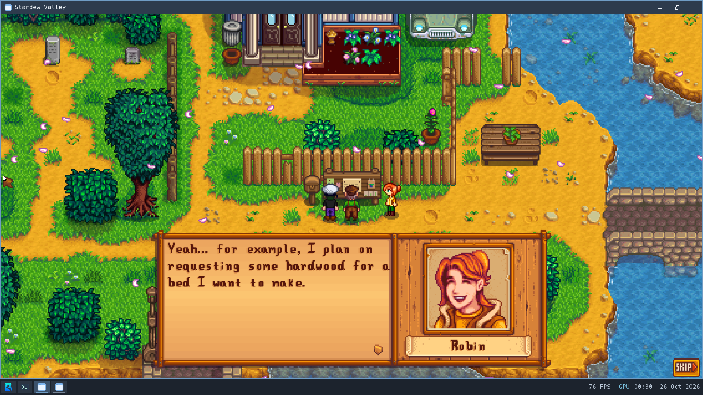</a>
</p>

<p align="center"><em>Stardew Valley — native64 Linux build launched through Steam, after loading an older save. Native 1920×1080 capture.</em></p>

<p align="center">
  <a href="docs/images/brook_steam_library_1080.png">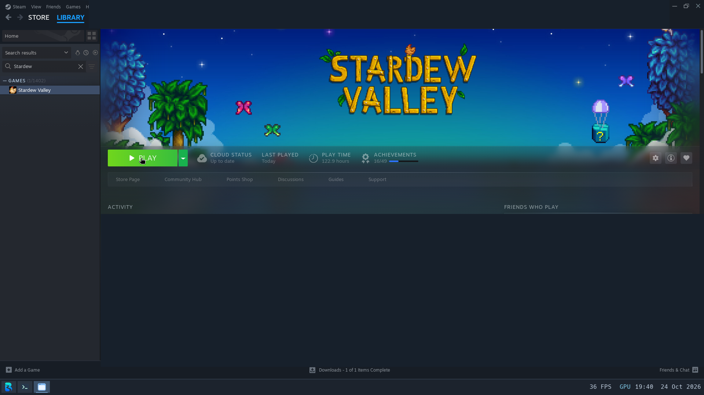</a>
</p>

<p align="center"><em>Steam Library after downloading and verifying Stardew Valley. Native 1920×1080 capture; account and community information masked. Stardew's native64 title/menu now launches through Steam.</em></p>

<p align="center">
  <a href="docs/images/brook_wine_spaceventure_1080.png">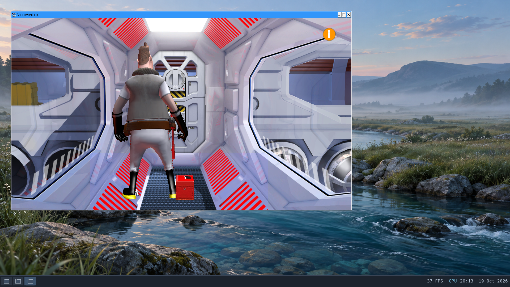</a>
</p>

<p align="center"><em>SpaceVenture — Windows Unity 2022, D3D11 through DXVK/Venus, first-room interaction and captured audio. 720p game window; native 1920×1080 capture.</em></p>

<p align="center">
  <a href="docs/images/brook_proton_helltaker_1080.png">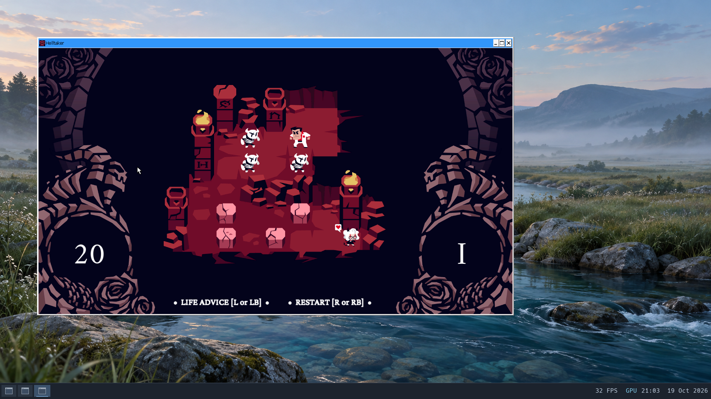</a>
</p>

<p align="center"><em>Helltaker — Windows Unity 2019 puzzle gameplay through standalone Proton GE 11 and DXVK 3.1.1, with keyboard input and captured audio. Native 1920×1080 capture.</em></p>

<p align="center">
  <a href="docs/images/brook_chromium_youtube_1080.png">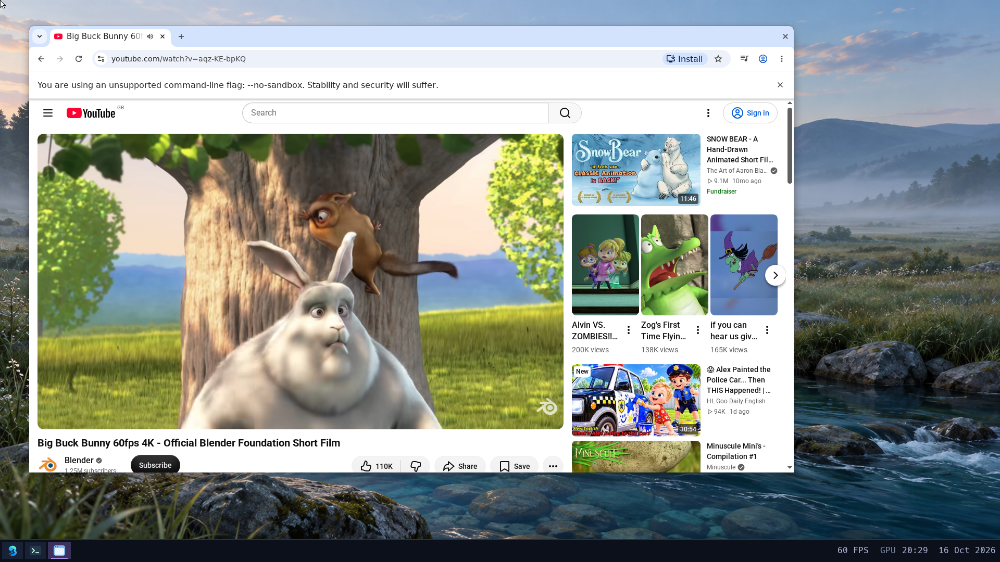</a>
</p>

<p align="center"><em>Chromium playing YouTube at 480p with audio — software rendering, native 1920×1080 capture</em></p>

<p align="center">
  <a href="docs/images/brook_firefox_hardware_video_1080.png">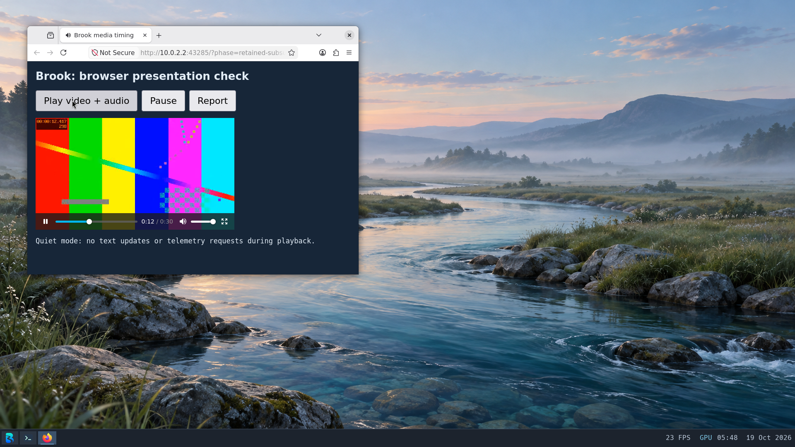</a>
</p>

<p align="center"><em>Firefox hardware child-surface rendering with local video and captured PCM. Native 1920×1080; video performance and audio gaps remain open.</em></p>

<p align="center">
  <a href="docs/images/brook_firefox_youtube_audio_1080.png">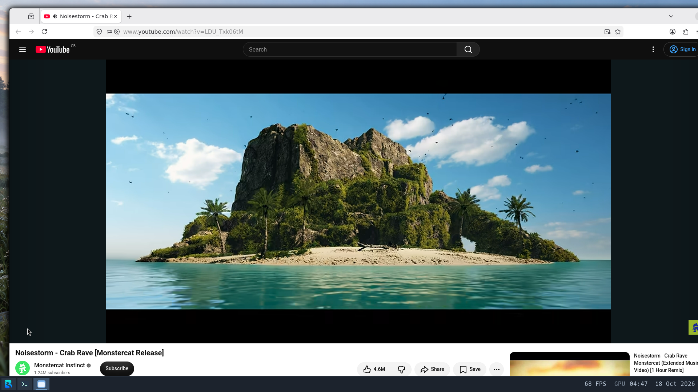</a>
</p>

<p align="center"><em>Firefox playing YouTube with audio through the Brook package — software rendering, native 1920×1080 capture. Intermittent audio gaps remain.</em></p>

<p align="center">
  <a href="docs/images/brook_codium_edit_1080.png">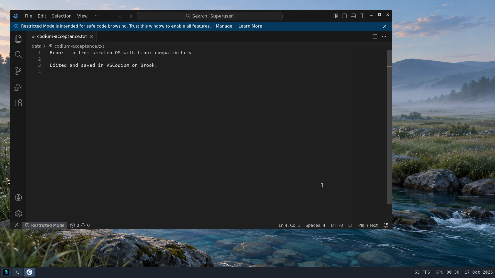</a>
</p>

<p align="center"><em>VSCodium — native editing and file persistence, captured at 1920×1080 with 130% editor zoom</em></p>

<p align="center">
  <a href="docs/images/brook_browser_trio_1080.png">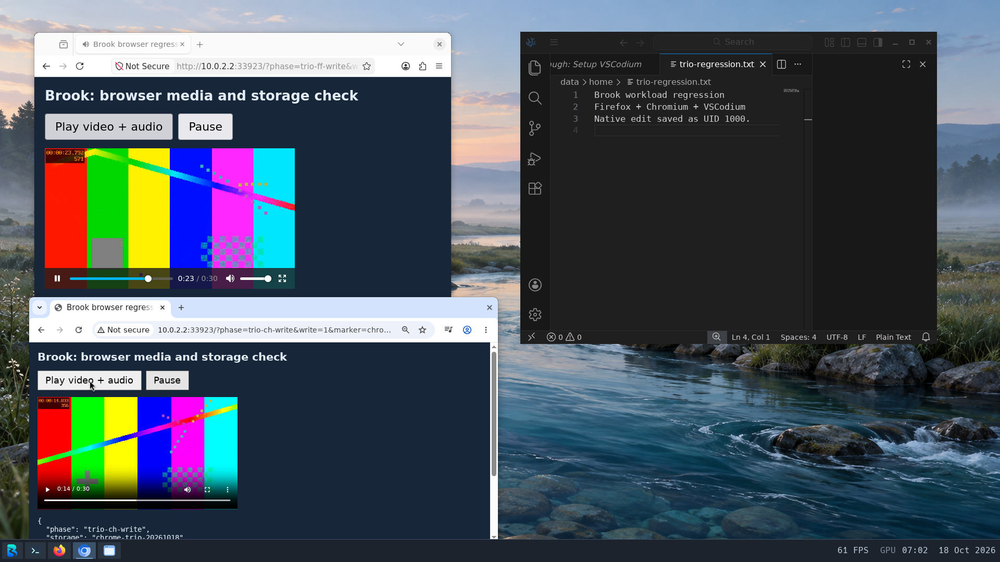</a>
</p>

<p align="center"><em>Firefox, Chromium and VSCodium together — Brook user, software Wayland, 4 GiB VM and native 1920×1080 capture. Document and synthetic site storage survived reboot; normal exits verified.</em></p>

<p align="center">
  <a href="docs/images/brook_gimp_permissions_1080.png">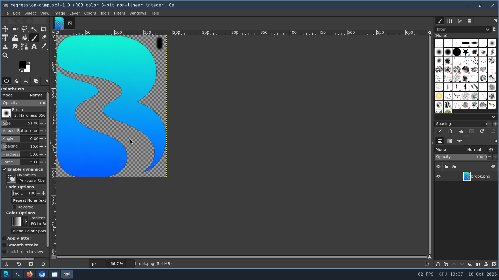</a>
</p>

<p align="center"><em>GIMP 3 — saved XCF reopened on the current permission kernel, captured at native 1920×1080</em></p>

<p align="center">
  <a href="docs/images/brook_settings_midnight_1080.png">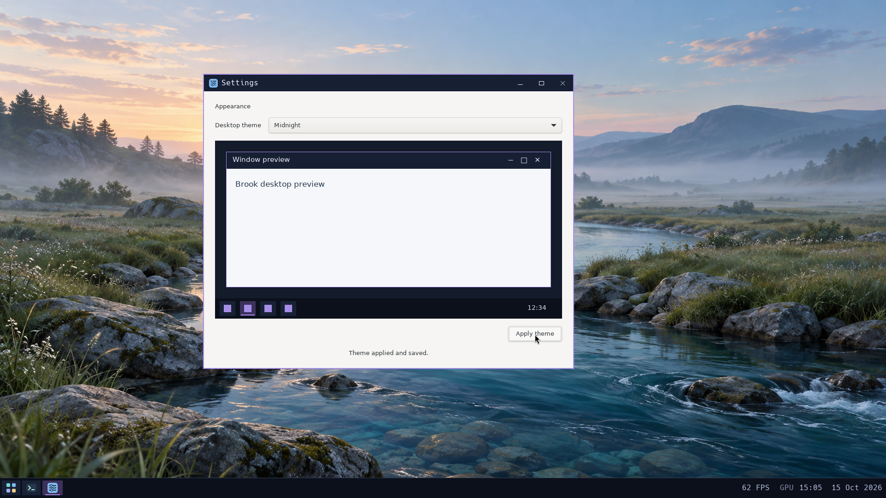</a>
</p>

<p align="center"><em>Settings with native Brook chrome and the Midnight theme — captured at 1920×1080</em></p>

<p align="center">
  <a href="docs/images/brook_desktop_scale_200_1080.png">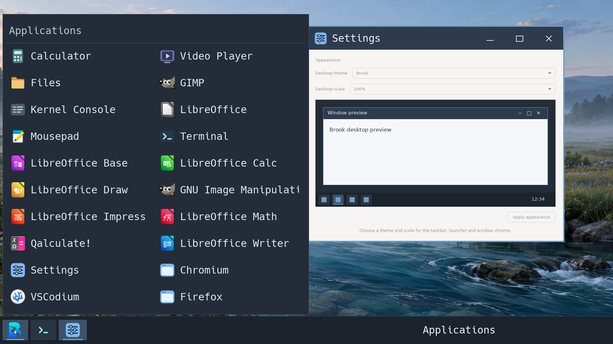</a>
</p>

<p align="center"><em>Native desktop at 200% scale with GPU composition — captured at 1920×1080; application content retains its existing scale</em></p>

<p align="center">
  <a href="docs/images/brook_writer_permissions_1080.png">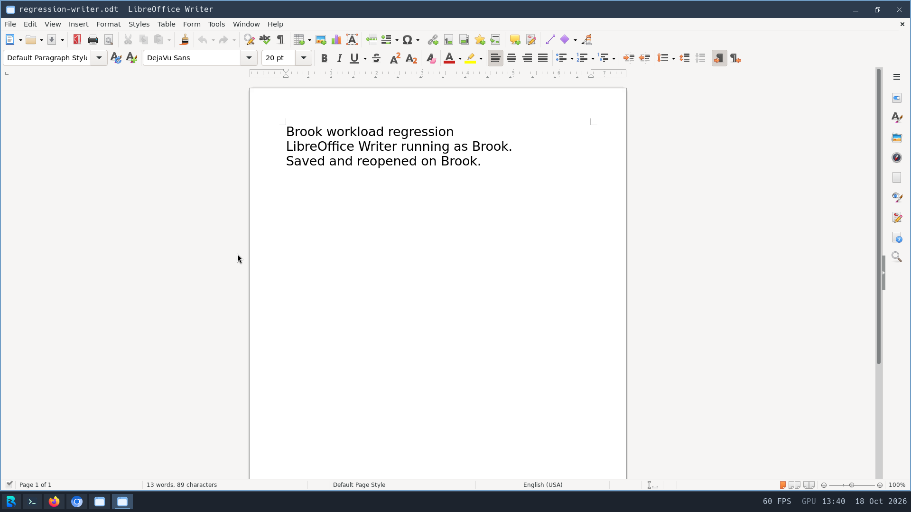</a>
</p>

<p align="center"><em>LibreOffice Writer 25.8.5.2 reopening the preserved document through Wayland — native 1920×1080 capture</em></p>

<p align="center">
  <a href="docs/images/brook_app_gallery_1080.png">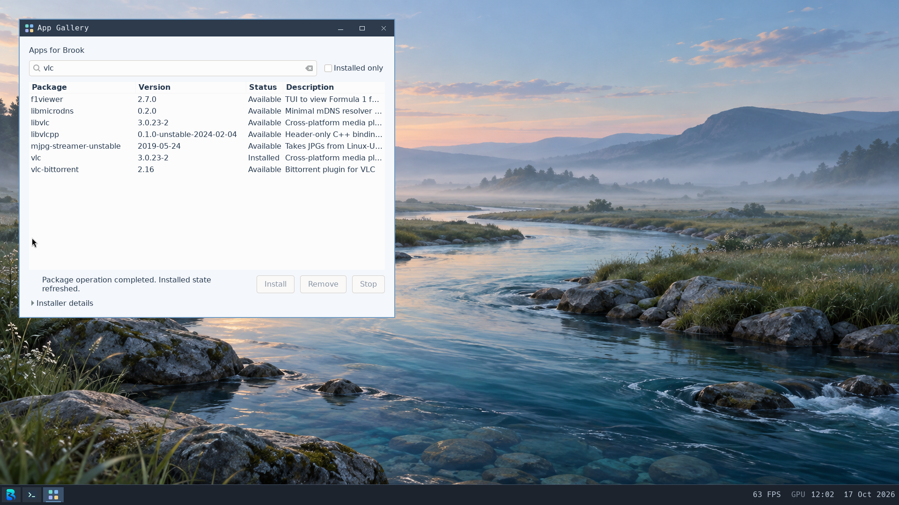</a>
</p>

<p align="center"><em>App Gallery after installing VLC as Brook on freshly generated disks — native 1920×1080 capture; click for full-size text</em></p>

<p align="center">
  <a href="docs/images/brook_boot_logo_1080.png">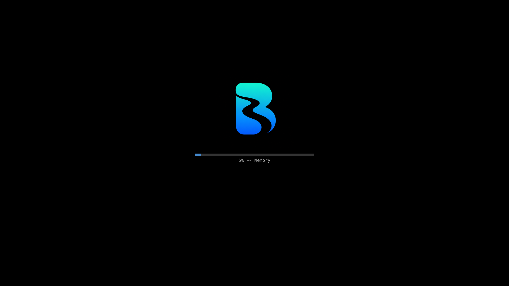</a>
</p>

<p align="center"><em>The new Brook mark on the actual UEFI boot progress screen</em></p>

<p align="center">
  <a href="docs/images/brook_gltron_1080.png">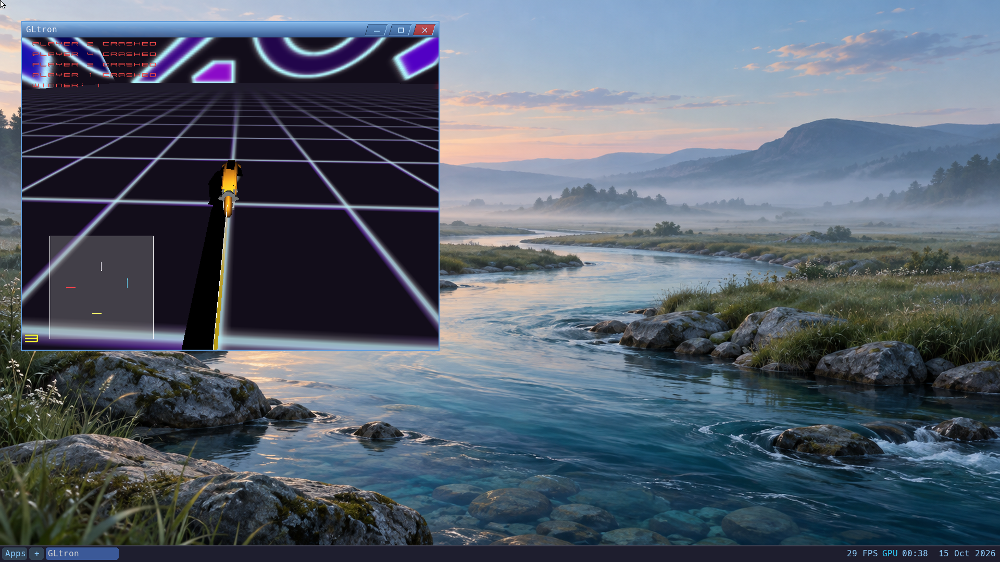</a>
</p>

<p align="center"><em>GLtron installed by Brook's guest package manager and rendered through hardware virgl — sound disabled by its compatibility launcher</em></p>

<p align="center">
  <a href="docs/images/brook_supertuxkart_gl_race_1080.png">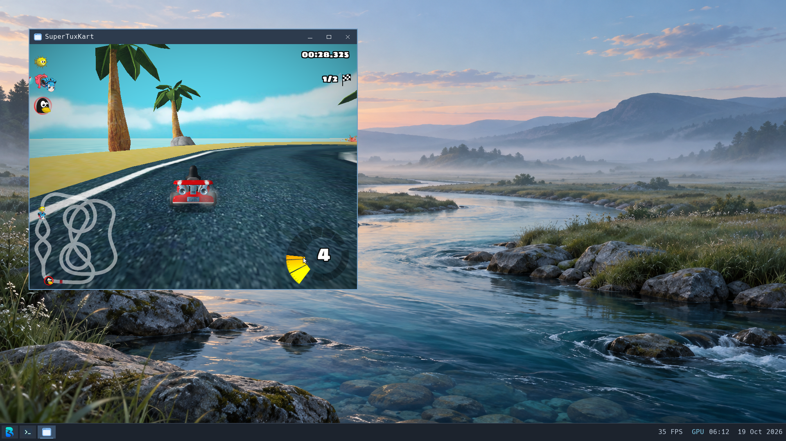</a>
</p>

<p align="center"><em>SuperTuxKart 1.5 racing on Volcan Island after a Quake GL3 run, captured at native 1920×1080; launcher sound is disabled</em></p>

<p align="center">
  <a href="docs/images/brook_vlc_720p_1080.png">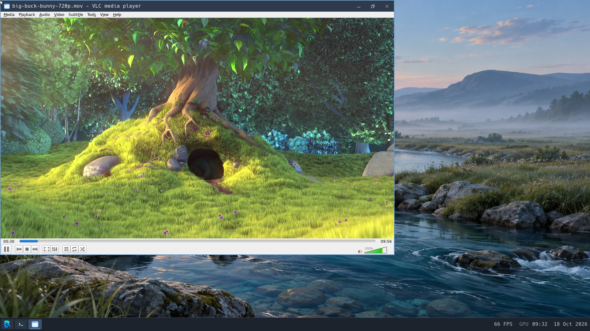</a>
</p>

<p align="center"><em>Guest-installed VLC playing Big Buck Bunny (© 2008 Blender Foundation, <a href="https://peach.blender.org/about/">CC BY 3.0</a>) at 720p — a full 1920×1080 frame from direct VM recording. Playback, minimize/restore and exit/audio cleanup are covered in the <a href="docs/application-regressions.md">application regressions</a>; smoothness and A/V sync remain unaccepted.</em></p>

<p align="center">
  <a href="docs/images/brook_quake2_lan.png">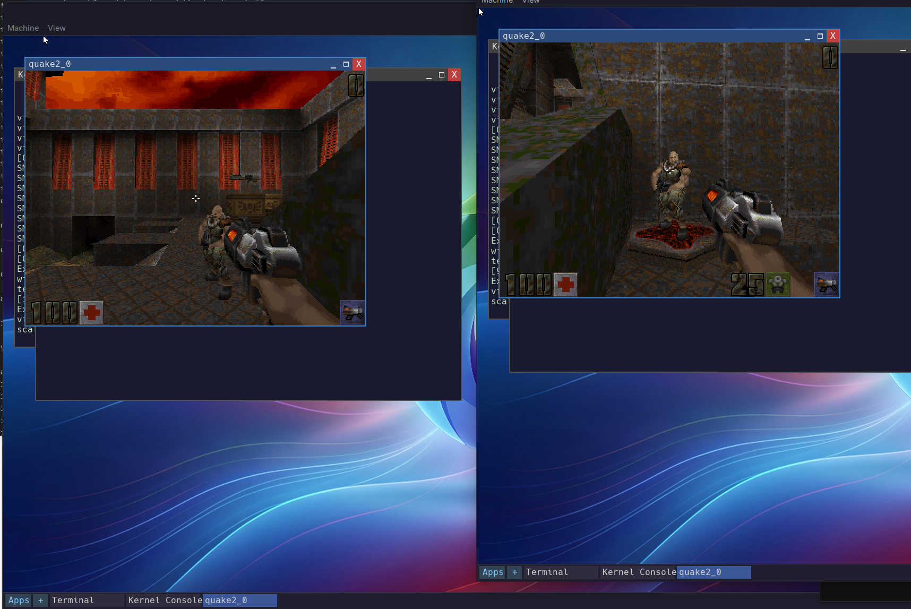</a>
</p>

<p align="center"><em>Two Brook VMs playing Quake 2 LAN deathmatch over a VDE virtual switch — real UDP sockets, static-IP config, multi-NIC kernel routing</em></p>

<p align="center">
  <a href="docs/images/brook_wayland_qalculate.png">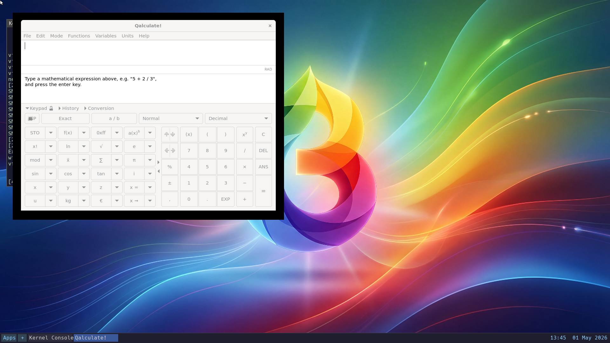</a>
</p>

<p align="center"><em>Qalculate! (GTK3) running natively via Brook's Wayland compositor with client-side decorations</em></p>

<p align="center">
  <a href="docs/images/brook_ladybird_browser.png">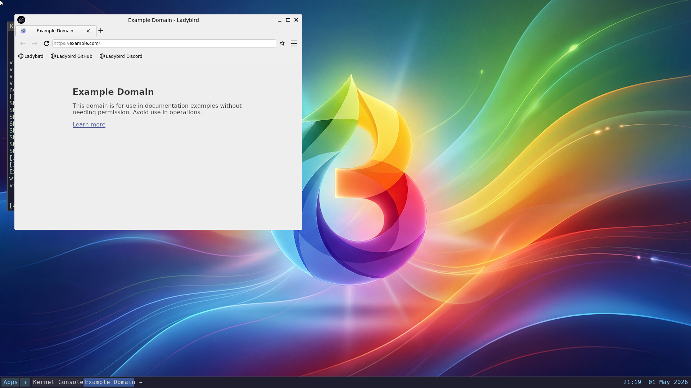</a>
</p>

<p align="center"><em>Ladybird web browser rendering example.com — Wayland display, DNS resolver, TCP/IP stack, all from scratch</em></p>

<p align="center">
  <a href="docs/images/brook_app_launcher.png">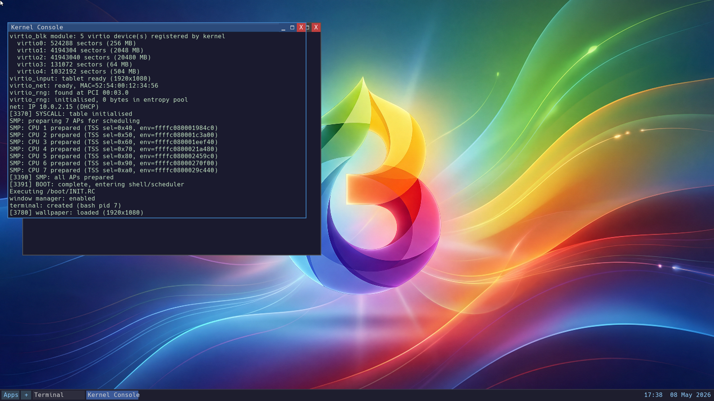</a>
</p>

<p align="center"><em>App launcher grid with desktop entry icons and taskbar</em></p>

<p align="center">
  <a href="docs/images/brook_file_browser.png">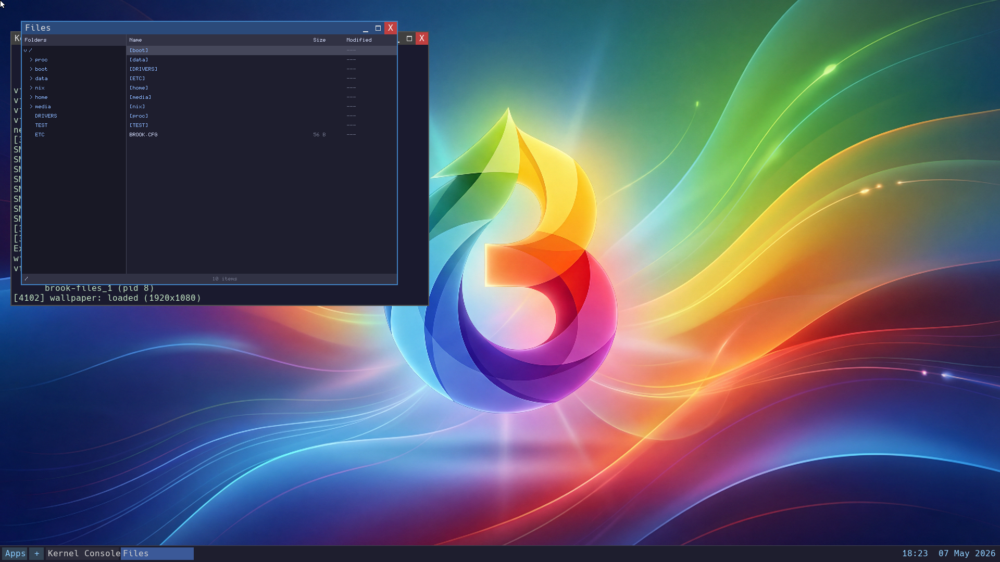</a>
</p>

<p align="center"><em>Brook-native Wayland file browser navigating the filesystem</em></p>

<p align="center">
  <a href="docs/images/brook_panic_qr.png">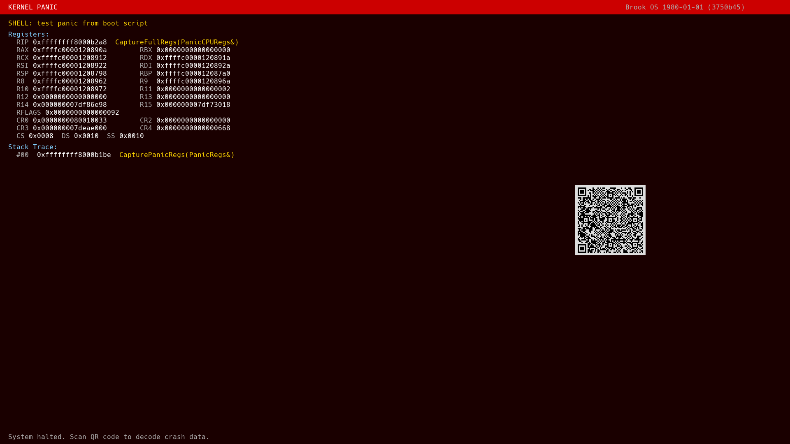</a>
</p>

<p align="center"><em>Kernel panic screen with scannable QR code — decoded by <a href="https://github.com/IanNorris/EnkelCrashDecoder">EnkelCrashDecoder</a> for instant stack traces</em></p>

<p align="center">
  <a href="docs/images/brook_nix_cowsay.png">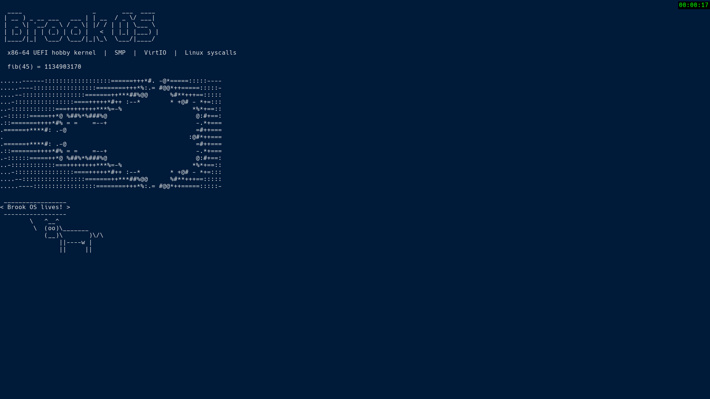</a>
</p>

<p align="center"><em>cowsay fetched from the NixOS binary cache and running unmodified on Brook</em></p>

## Building

### Prerequisites

Everything runs inside the pinned Nix shell — no system-level toolchain
is required.  You only need:

- A recent Linux host with `nix` installed (multi-user or single-user)
- QEMU with OVMF (provided via `shell.nix`)

Everything else — clang/lld, NASM, CMake, Ninja, Python + freetype-py,
mtools, e2fsprogs-fuse2fs, vde2, musl cross-compilers, OVMF — is pinned
in `shell.nix`.

```bash
nix-shell
```

### Build

```bash
./scripts/build.sh          # Debug build
./scripts/build.sh Release  # Release build
./scripts/build_all.sh Release  # Kernel + bootloader + Quake 2 + disk images
```

### Run in QEMU

**Linux:**
```bash
./scripts/run-qemu.sh --release               # Single VM
./scripts/run-qemu.sh --release --script desktop.rc  # Desktop with app launcher
./scripts/vde-up.sh up && \
./scripts/run-qemu-pair.sh --release --script wm   # Two VMs on a VDE switch
```

**Windows:**
```batch
scripts\run-qemu.bat                         # Desktop mode (default)
scripts\run-qemu.bat --script wmdoom.rc      # DOOM + terminal
scripts\run-qemu.bat --no-audio --smp 4      # No audio, 4 CPUs
```

Windows requires [QEMU for Windows](https://www.qemu.org/download/#windows)
installed and on PATH. OVMF firmware is auto-detected from the QEMU install.
Copy `build/release/esp/` and `*.img` files from a Linux build.

### Headless inspection on a Linux host

For a fresh checkout, build the native apps and boot/data disks first. The
optional Nix tools refresh expects an existing Nix disk and a working FUSE
mount; skip it while preparing a small desktop disk:

```bash
nix-shell --run 'BROOK_SKIP_NIX_TOOLS=1 ./scripts/build_all.sh Release'
nix-shell --run './scripts/create_nix_disk.sh 8192 bash curl.bin xz.bin cacert coreutils ./tools/waylandd-pkg ./tools/wayland-calc-pkg'
```

The ext2 data-disk updater and Nix disk creator fall back when FUSE mounts
are denied. Stop the VM before updating or recreating its disks. The small
Nix disk above contains the Wayland server and calculator, rather than the
full default application collection. The calculator is installed at
`/nix/bin/wayland-calc`, so its boot script does not depend on a store hash.

Run with serial logging, localhost VNC, and a dedicated monitor socket:

```bash
nix-shell --run 'env BROOK_SKIP_UPDATE_DISK=1 BROOK_SMP=8 BROOK_USB_KBD=1 SERIAL_OPT="-serial file:/tmp/brook-serial.log" timeout 600 ./scripts/run-qemu.sh --release --headless --vnc 127.0.0.1:97 --no-audio --instance=97 --real-esp --script inspect_desktop'
```

KVM is selected automatically when `/dev/kvm` is accessible. VNC listens on
`127.0.0.1:5997`. From another terminal, inspect or stop this VM:

```bash
python3 scripts/qemu_monitor.py --instance 97 'info status' 'info cpus'
python3 scripts/qemu_monitor.py --instance 97 'screendump /tmp/brook-screen.ppm'
python3 scripts/qemu_monitor.py --instance 97 'quit'
```

The screenshot uses QEMU's standard PPM format. The default headless run uses
the CPU compositor; accelerated virgl runs additionally require the host GPU
configuration described in `scripts/run-qemu.sh`.

Fresh-checkout fixes in this workflow: initialize only required kernel
submodules (optional NetSurf gitlinks lack URLs); fetch Bash's runtime even
when its binary is already checked in; search the correct Nix store depth
for the musl loader; and use FUSE-free image population when mounts are
denied. Host-test failures now fail the full build. The optional
`update_nix_disk.sh --tools` refresh still requires FUSE; use the small disk
recipe above for this environment. Quake 2 data is supplied separately and
kept out of Git. The wallpaper is generated from its tracked PNG source.

For the larger app profile, isolated writable disks, game data, soundtrack,
and Big Buck Bunny playback, see [Experiment disks](docs/experiments.md).

Boot scripts in `data/scripts/` control what runs at startup:

| Script | Description |
|--------|-------------|
| `desktop.rc` | Desktop with app launcher (default) |
| `wm.rc` | Window manager with bash terminal |
| `wmdoom.rc` | Window manager with DOOM + bash terminal |
| `doomfs.rc` | Full-screen DOOM (no WM) |
| `shell.rc` | Direct serial shell (no graphics) |

## Project Structure

```
src/
  bootloader/       UEFI bootloader (PE/COFF, loads kernel ELF)
  kernel/           Kernel (scheduler, VMM, VFS, syscalls, compositor)
  drivers/          Loadable kernel modules (display, input, block, scheduler)
  apps/             Userspace programs (hello, mandelbrot, coremark, ...)
  shared/
    boot_protocol/  Bootloader ↔ kernel handoff structures
    inc_km/         Kernel-mode shared headers
    src_km/         Kernel-mode shared sources
    inc_um/         Usermode shared headers
    src_um/         Usermode shared sources
tools/
  brook-files-pkg/  Native Wayland file browser
  brook-edit-pkg/   Native Wayland text editor (Ctrl+S/F/D)
  brook-console-pkg/ Native Wayland kernel log viewer (Ctrl+F filter)
  wayland-calc-pkg/ Native Wayland interactive calculator
  waylandd-pkg/     Wayland compositor daemon (kernel ↔ wl_shm bridge)
cmake/
  toolchains/       Clang cross-compilation toolchain files
vendor/
  uefi-headers/     UEFI specification headers (submodule)
scripts/            Build, run, and asset conversion scripts
data/
  scripts/          Boot configuration scripts (.rc files)
docs/
  images/           Screenshots and logo
```

### Tests

```bash
ctest --test-dir build/release/host_tests --output-on-failure  # Host-native unit tests
./scripts/run-tests.sh release                                  # Bare-metal test ELFs in QEMU
```

The build also runs a Capstone audit of supported compiled entry/return
templates, with machine-code mutation checks. Its report lists unsupported
paths separately. See [register and stack tests](docs/register-state-tests.md)
for coverage, kernel-only probes and remaining gaps.

## Acknowledgements

- [DOOM Generic](https://github.com/ozkl/doomgeneric) — portable DOOM engine
- [Quake 2](https://github.com/id-Software/Quake-2) — id Software's classic FPS
- [musl libc](https://musl.libc.org/) — C standard library
- [bash](https://www.gnu.org/software/bash/) — Bourne Again Shell
- [busybox](https://busybox.net/) — Unix utilities in a single binary
- [TCC](https://bellard.org/tcc/) — Tiny C Compiler
- [Hack](https://sourcefoundry.org/hack/) — terminal typeface
- [Nix](https://nixos.org/) — reproducible build system and package manager
- [QEMU](https://www.qemu.org/) — machine emulator for development and testing
- [Ladybird](https://ladybird.dev/) — independent web browser
- [NetSurf](https://www.netsurf-browser.org/) — lightweight web browser
- [Qalculate!](https://qalculate.github.io/) — powerful desktop calculator
- [GIMP](https://www.gimp.org/) — GNU Image Manipulation Program
- [LibreOffice](https://www.libreoffice.org/) — open-source office suite
- [stb_vorbis](https://github.com/nothings/stb) — OGG Vorbis decoder

## License

MIT — see [LICENSE](LICENSE).
