<p align="center">
  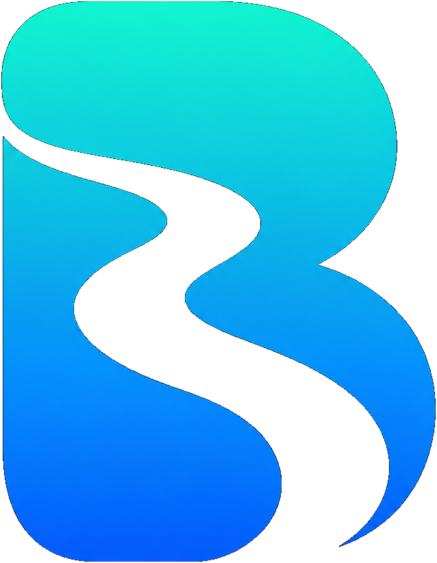
</p>

<h1 align="center">Brook OS</h1>

<p align="center">A hobby x86-64 operating system, written from scratch in C++, that runs Linux software.</p>

<p align="center">
  <a href="docs/images/brook_dell_launcher_openttd_3200.png">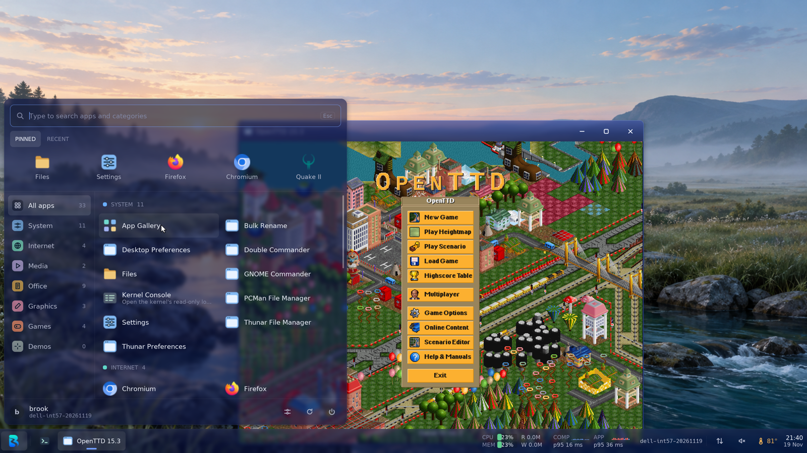</a>
</p>

<p align="center"><em>Brook on a Dell XPS 13 (3200×1800 at 200%): the Clearwater glass launcher over OpenTTD.</em></p>

## What is Brook?

Brook is a complete operating system built from the ground up: its own UEFI
bootloader, SMP kernel, memory manager, file systems, TCP/IP stack, drivers,
window manager and compositor. It isn't based on Linux or BSD, but it speaks
the Linux system-call interface well enough to run unmodified Linux programs,
including Firefox, Chromium, Steam, Wine and games. Software comes from the
Nix package collection, so packages install straight from the NixOS binary cache.

It runs in QEMU and on real hardware: a 2015 Dell XPS 13, with Brook's own
Intel graphics driver.

## Highlights

- **Real hardware.** Brook is installed on a Dell XPS 13 9343's SSD and drives
  its 3200×1800 panel at 200% scaling, with a native Intel Broadwell (HD 5500)
  driver supporting page flipping and zero-copy scanout. The keyboard,
  touchpad, backlight, speakers and USB Ethernet all work.
- **Games on a 2015 laptop GPU.** Quake II runs at about 56 fps full-screen,
  and Stardew Valley is playable through Steam.
- **Clearwater, Brook's own desktop.** A GPU compositor with background
  blur ("glass"), Glass or Opaque materials in Light, Mixed and Dark modes, any
  accent colour, and an app launcher, taskbar and notifications that run as a
  restartable user-mode shell.
- **Linux apps, unmodified.** Wayland apps talk to Brook's own Wayland server,
  and X11 apps run through rootless Xwayland. Firefox and Chromium play
  YouTube, and VSCodium, GIMP, LibreOffice, VLC and GNOME Files all run.
- **Steam and Windows games.** The native Linux Steam client runs inside its
  Steam Runtime container. Windows programs run through Wine, with DXVK for
  Direct3D 11, VKD3D-Proton for Direct3D 12, and Proton (tested in QEMU so
  far).
- **Modern graphics.** OpenGL through Mesa, and Vulkan, both hardware
  accelerated on the laptop and through the host GPU in QEMU.
- **A package manager.** The App Gallery installs packages from the NixOS
  binary cache, and `brook-webapp` turns a website (WhatsApp Web, say) into an
  app with its own icon and window.
- **It can rebuild itself.** A fresh Brook system can install its SDK, clone
  this repository, build a new kernel and boot it.
- **Failures you can debug.** A kernel panic shows a QR code carrying the
  stack trace, bad kernels roll back automatically, and a debug bridge lets
  people and AI agents inspect and drive a running system, in QEMU or on the
  laptop.

## What runs

| | Works | Notes |
|---|---|---|
| **Web** | Firefox, Chromium, web apps | YouTube with audio. Video decodes in software, and browsers run without their sandbox. |
| **Desktop** | GNOME Files, Settings, App Gallery, Terminal, VSCodium, Mousepad, Qalculate!, LibreOffice Writer, GIMP, VLC | GTK4 apps currently draw in software, so they're slower than they should be. |
| **Games** | Quake II, Quake III, DOOM, Stardew Valley, OpenTTD, SuperTuxKart, Factorio, Warzone 2100, Torchlight II | Steam games need Steam running. |
| **Steam** | Sign-in, library, downloads, launching games | Quits when its window closes (no system tray yet). |
| **Windows** | Wine (Notepad), DXVK and Proton (Unity games such as Helltaker), VKD3D-Proton (Veloren) | Tested in QEMU, not yet on the laptop. |
| **Tools** | bash, coreutils, busybox, Vim, git, curl, Python, TCC, Go programs | |

Not working yet: Blender, Flatpak apps and 32-bit programs.

## Known gaps

Brook is a hobby OS, and plenty is missing or rough:

- **No sandboxing.** Brook lacks PID, IPC and network namespaces and seccomp,
  so Flatpak can't run yet and browsers run unsandboxed. This is being worked on.
- **GTK4 apps draw in software by default.** The GPU path works, but GPU
  buffers still take about two frames too long to reach the screen.
- **No system tray** yet, so tray apps such as Steam quit when closed.
- **No hardware video decoding** by default. The laptop's video engine works,
  but isn't yet faster than decoding in software.
- **X11 apps can't use hardware OpenGL**, so a few apps, Blender among them,
  don't run.
- **No Wi-Fi.** The laptop's Broadcom card has no open driver, so Brook uses
  USB Ethernet.
- **No 32-bit programs**, which rules out some older Steam games.
- **Rough edges on the laptop:** touchpad scrolling still needs tuning, audio
  stops after a stream error until a reboot, a rare GPU hang isn't yet
  explained, and there is no suspend.
- **Single user.** There are no accounts or login screen.

## Gallery

Click an image for full resolution. Apart from the image at the top, these
were captured in QEMU before the current desktop design.

<p align="center">
  <a href="docs/images/brook_stardew_valley_1080.png">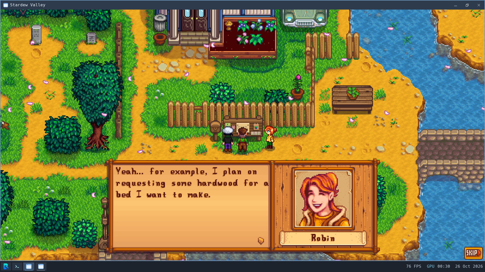</a>
  <a href="docs/images/brook_steam_library_1080.png">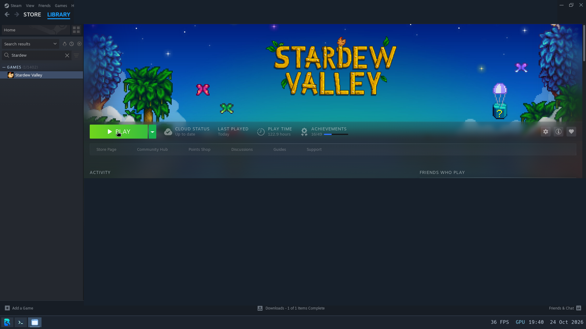</a>
</p>
<p align="center"><em>Stardew Valley through Steam, and the Steam library (account name masked).</em></p>

<p align="center">
  <a href="docs/images/brook_torchlight2_gameplay.png">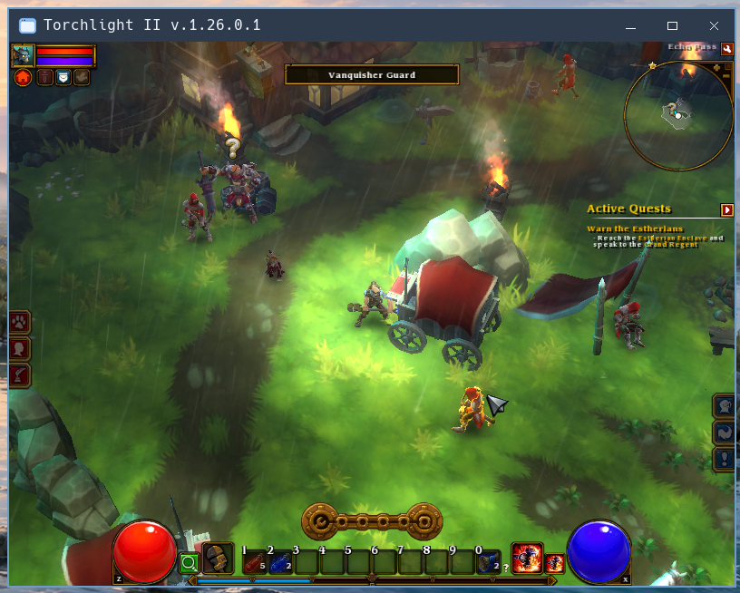</a>
  <a href="docs/images/brook_factorio_tutorial.png">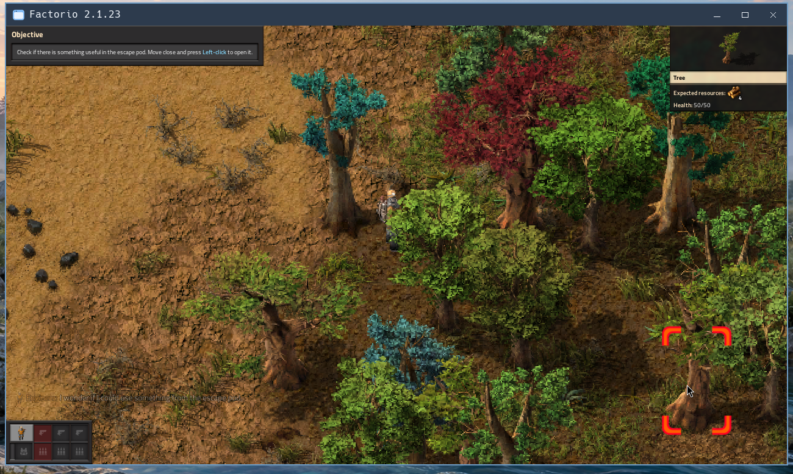</a>
  <a href="docs/images/brook_warzone2100_tutorial.png">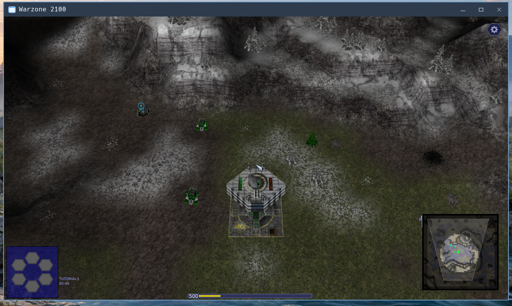</a>
</p>
<p align="center"><em>Native Linux games: Torchlight II, Factorio and Warzone 2100.</em></p>

<p align="center">
  <a href="docs/images/brook_proton_helltaker_1080.png">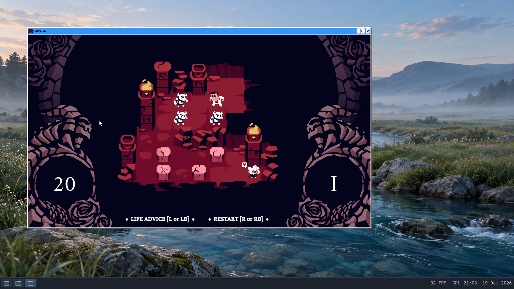</a>
  <a href="docs/images/brook_wine_spaceventure_1080.png">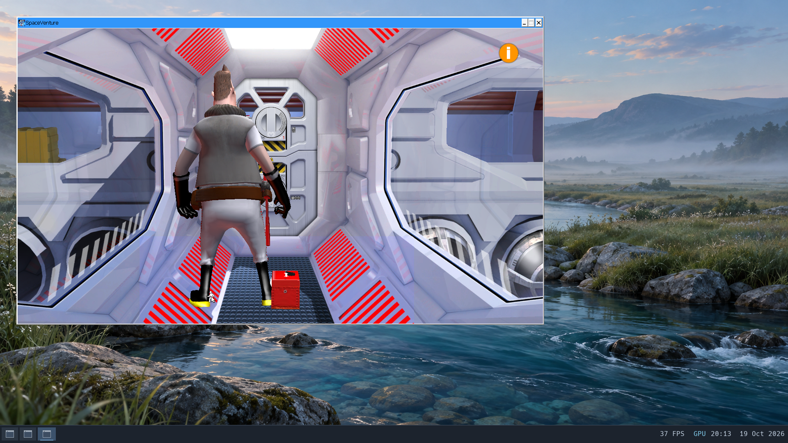</a>
</p>
<p align="center"><em>Windows games: Helltaker through Proton, and SpaceVenture through Wine and DXVK.</em></p>

<p align="center">
  <a href="docs/images/brook_chromium_youtube_1080.png">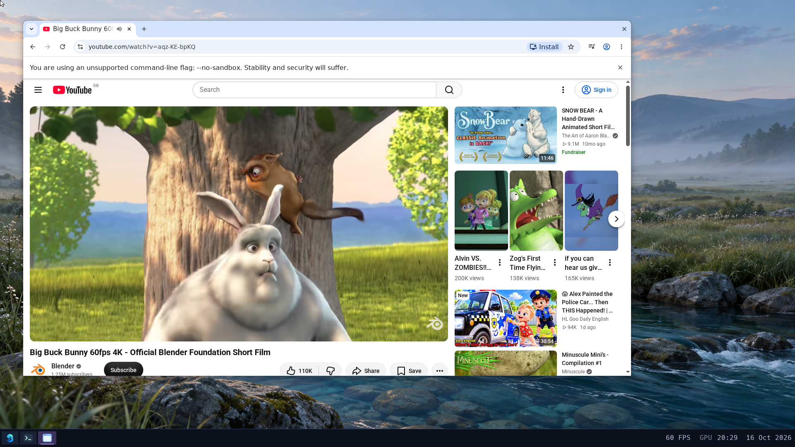</a>
  <a href="docs/images/brook_quake3_rounded_glass_1080.png">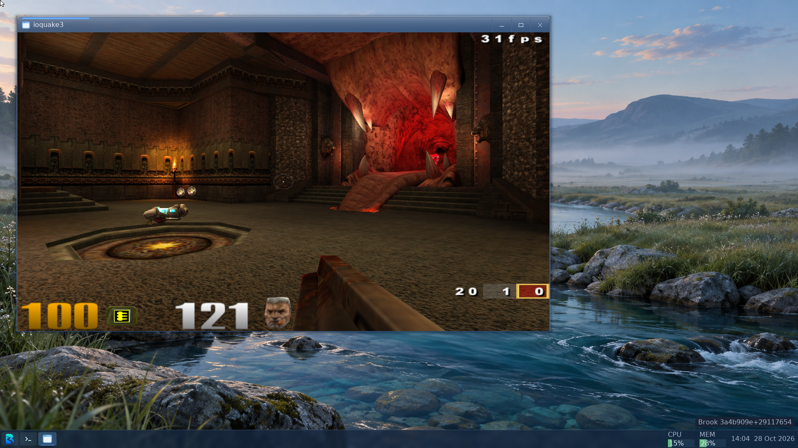</a>
</p>
<p align="center"><em>Chromium playing YouTube with audio (Big Buck Bunny, © Blender Foundation, CC BY 3.0), and the Quake III Arena demo.</em></p>

<p align="center">
  <a href="docs/images/brook_app_gallery_1080.png">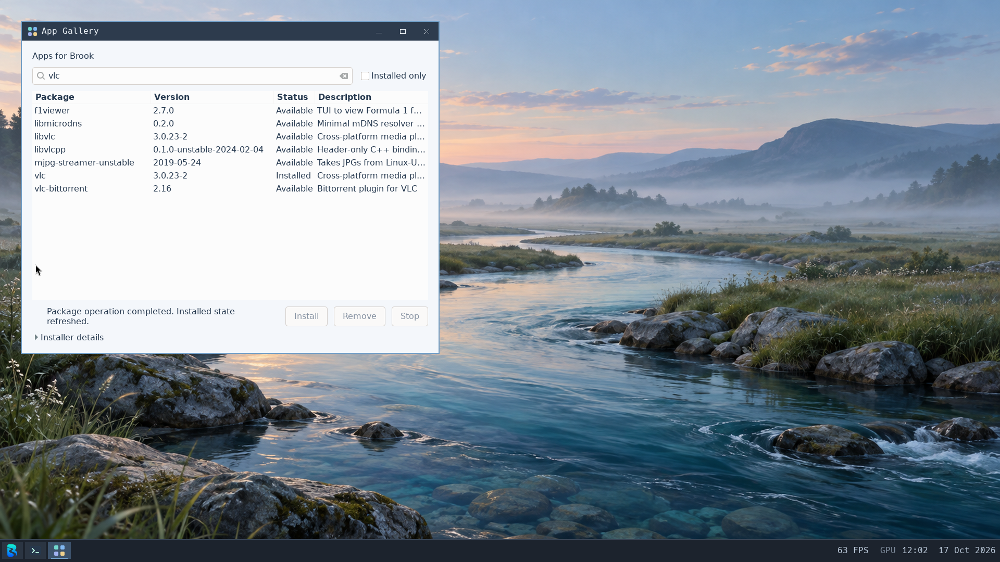</a>
  <a href="docs/images/brook_panic_qr.png">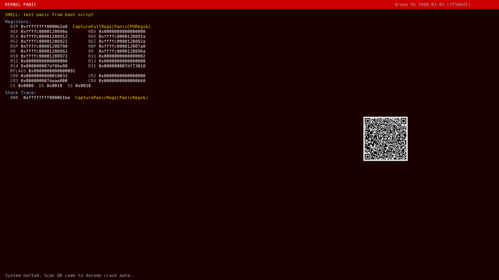</a>
</p>
<p align="center"><em>The App Gallery, which installs packages from the NixOS binary cache, and the panic screen's QR code.</em></p>

## Building and running

Everything builds inside a pinned Nix shell, so the host only needs Linux and
[Nix](https://nixos.org/download).

```bash
nix-shell                                   # toolchain, QEMU and OVMF
./scripts/create_nix_disk.sh                # the app disk (a large download the first time)
./scripts/build_all.sh Release              # kernel, bootloader, drivers and disk images
BROOK_GPU=gl ./scripts/run-qemu.sh --release --script desktop
```

`BROOK_GPU=gl` uses the host GPU through VirGL and needs a GPU render node on
the host; leave it out to use software rendering.
[Building and running](docs/building.md) covers the QEMU options, tests and
the debug bridge. [Hardware support](docs/hardware.md)
covers the Dell XPS 13 and other targets.

## Learn more

- [How Brook is put together](docs/architecture.md)
- [Documentation index](docs/README.md)
- [Past problems and their fixes](docs/past-problems.md)

## Acknowledgements

Brook stands on a lot of open-source work, including
[Nix](https://nixos.org/) and the NixOS package collection,
[Mesa](https://mesa3d.org/), [Wayland](https://wayland.freedesktop.org/) and
Xwayland, [Wine](https://www.winehq.org/), [DXVK](https://github.com/doitsujin/dxvk),
[VKD3D-Proton](https://github.com/HansKristian-Work/vkd3d-proton),
[QEMU](https://www.qemu.org/), [musl](https://musl.libc.org/),
[DOOM Generic](https://github.com/ozkl/doomgeneric),
[Yamagi Quake II](https://www.yamagi.org/quake2/),
[uACPI](https://github.com/uACPI/uACPI), [FatFs](http://elm-chan.org/fsw/ff/),
[LZ4](https://github.com/lz4/lz4), [QR Code generator](https://github.com/nayuki/QR-Code-generator)
and the [Hack](https://sourcefoundry.org/hack/) typeface. Third-party licences
are listed in [THIRD_PARTY_NOTICES.md](THIRD_PARTY_NOTICES.md).

## Licence

MIT. See [LICENSE](LICENSE).
