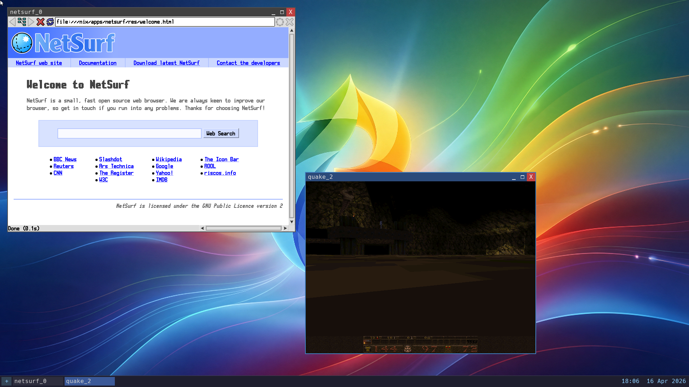
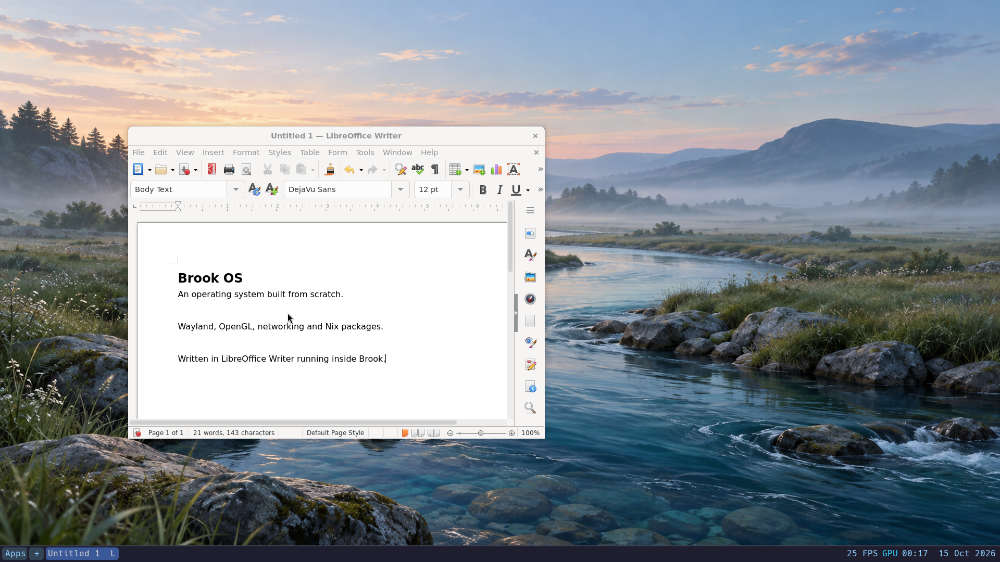

<p align="center">
  

</p>

<h1 align="center">Brook OS</h1>

<h3 align="center">A hobby x86-64 operating system built from scratch</h3>

<p align="center">
  UEFI · C++ · Clang/LLVM · SMP · Wayland · OpenGL · Networking · Nix
</p>

---

<p align="center">
  <a href="docs/images/brook_netsurf_quake2.png"></a>
</p>

<p align="center"><em>NetSurf and Quake 2 running side by side — compositing WM, TCP/IP networking, HDA audio, all on a from-scratch kernel</em></p>

## What is Brook?

Brook is a hobby operating system for x86-64, written from scratch in C++ with
a unified Clang/LLVM toolchain. It boots via UEFI, runs on multiple CPU cores,
has a compositing window manager with a Wayland compositor, and implements
an expanding subset of the Linux syscall ABI to run
unmodified Linux binaries — including web browsers, GTK apps, and games.

This is my second OS project (the first being
[Enkel](https://github.com/IanNorris/Enkel)). Where Enkel was about getting
things working, Brook is about doing it **right** — clean architecture,
modular drivers, and a codebase that's a pleasure to work in.

## Confirmed Working Software

Brook runs Linux ELF binaries using both musl and glibc, including Nix
closures. Some applications use Brook compatibility builds or launchers;
the table distinguishes tested behavior from remaining limitations.

| Software | Version | Status | Notes |
|----------|---------|--------|-------|
| [bash](https://www.gnu.org/software/bash/) | 5.2 / 5.3 | ✅ Working | Bundled shell and Nix Bash closures; readline, job control and scripting |
| [DOOM](https://github.com/ozkl/doomgeneric) | 1.9 | ✅ Working | Runs in a WM window or full-screen, with keyboard input |
| [Quake 2 / Yamagi](https://www.yamagi.org/quake2/) | 8.60 | ✅ Gameplay | Software and hardware virgl GL3 renderers, startup demo, OSS audio and OGG music; mouse capture and intermittent audio timing remain open |
| [GLtron](https://www.gltron.org/) | 0.70 | ⚠️ Experimental | Compatibility launcher installs through guest `nix-install`; hardware virgl menu and light-cycle gameplay verified, with sound disabled |
| [busybox](https://busybox.net/) | 1.36 | ✅ Working | ls, cat, echo, wc, head, tail, grep, and many more |
| [TCC](https://bellard.org/tcc/) | 0.9.27 | ✅ Working | Compiles and runs C programs natively on Brook |
| [CoreMark](https://www.eembc.org/coremark/) | 1.0 | ✅ Working | CPU benchmark, runs to completion |
| [musl libc](https://musl.libc.org/) | 1.2 | ✅ Working | Standard C library, dynamically linked |
| [Go](https://go.dev/) runtime | 1.22 | ✅ Working | Static Go binaries (lazy PROT_NONE heap + on-demand mprotect) |
| Nix binaries | — | ✅ Working | Stock NixOS closures fetched via `nix-install` (cowsay, coreutils, curl, …) |
| [NetSurf](https://www.netsurf-browser.org/) | 3.11 | ✅ Working | Web browser rendering HTML/CSS via custom framebuffer surface |
| [Ladybird](https://ladybird.dev/) | 2026-04-04 | ⚠️ Experimental | HTTPS Google search and Amazon navigation verified; loading/input/scrolling performance remains limited |
| [Qalculate!](https://qalculate.github.io/) | — | ✅ Working | GTK3 calculator via Wayland (CSD decorations) |
| [GIMP](https://www.gimp.org/) | 2.10 | ⚠️ Partial | Launches via Wayland/GTK; plugin loading slow, UAF under investigation |
| [LibreOffice](https://www.libreoffice.org/) | 25.8.5.2 | ⚠️ Experimental | Writer opens via Wayland and edits a real document; startup is slow and window-close behavior needs work |
| [VLC](https://www.videolan.org/vlc/) | 3.0.23-2 | ⚠️ Experimental | Brook compatibility build installs through guest `nix-install`; 720p video and OSS audio verified; window-close/SMP stability remains under investigation |

## Recent progress

- **VM control bridge:** VM-only screenshots and input, guest command launches,
  logs, CPU/context-switch profiles, OS statistics, silent-output PCM capture,
  and bounded post-panic memory/register inspection. See the
  [bridge tools](tools/vm_bridge/README.md).
- **Real workloads:** Ladybird browsing, hardware GL3 Quake demos, Wayland
  office applications, and guest-installed VLC playback. App-specific limits
  and the actual validation evidence are recorded in
  [experiment notes](docs/experiments.md).
- **Self-hosting:** The clean-image acceptance path installs its SDK through
  guest `nix-install`, clones and builds Brook, passes all 13 native tests,
  then boots the guest-built kernel and passes them again. Offline checks of
  both filesystems pass before and after that boot. The prepared-SDK path is
  still being validated; see [bootstrap testing](docs/bootstrap.md).
- **Storage correctness and speed:** unlink-while-open, rename-overwrite,
  directory removal and inode reuse now have guest lifetime checks plus offline
  filesystem verification. A short eight-worker RAM-backed
  [I/O gate](docs/io-benchmark.md) combines large writes, small files,
  reboot persistence, reclamation and timings.

## Features

### Kernel
- **UEFI bootloader** — custom bootloader loads ELF kernel at high virtual addresses
- **SMP** — symmetric multiprocessing with per-CPU run queues and load balancing
- **MLFQ scheduler** — multi-level feedback queue loaded as a kernel module, with configurable policy
- **Virtual memory** — 4-level paging, per-PID ownership tracking, guard pages, lazy mmap w/ PROT_NONE + on-demand mprotect (needed for Go binaries)
- **Kernel heap** — first-fit kmalloc/kfree allocator with coalescing; kmutex, krwlock, ksemaphore
- **Loadable kernel modules** — drivers compiled separately and loaded from disk at boot (Phase 1 from initrd, Phase 2 from /boot/drivers)
- **VFS with FAT and ext2** — virtio-blk backed storage with full read/write support, metadata cache, mount points
- **USB (xHCI)** — USB 3.0 host controller with keyboard, mouse, and mass storage support; interrupt-driven I/O
- **Sampling profiler** — per-CPU ring buffers, ISR hot path, timestamped output files, Speedscope-compatible JSON export
- **Panic decoder** — kernel panics render a scannable QR code with a stack-trace payload that Brook's companion `EnkelCrashDecoder` can read
- **Boot self-test** — cross-checks LAPIC tick rate against a PIT-gated wall-clock window at boot to catch calibration drift
- **Debug socket** — runtime heap + per-PID PMM dumps over a unix-domain socket, for post-hoc inspection without a debugger

### Networking
- **Multi-interface stack** — up to 4 NICs, per-IF ARP, routing, broadcast handling
- **virtio-net driver** — init/TX/RX with feature negotiation
- **DHCP + static IP** — `NET0_MODE=static` / `NET0_IP` / `NET0_NETMASK` / `NET0_GATEWAY` / `NET0_DNS` in `/boot/BROOK.CFG`
- **TCP/UDP** — BSD sockets (socket, bind, connect, listen, accept, send/recv, setsockopt) with loopback and refcounted close
- **DNS** — resolver wired through the UDP stack
- **VDE pair demo** — two Brook VMs on a virtual switch playing Quake 2 LAN deathmatch

### Audio
- **Intel HDA driver** — codec enumeration, DAC/pin discovery, cyclic DMA output (44.1 kHz / 16-bit stereo)
- **OGG Vorbis decoder** — stb_vorbis-based music playback (Q2 OST streams off disk)

### Package Manager (Nix userspace)
- **Nix store** — `/store` laid out as on a real NixOS system, consumed by the Brook dynamic linker
- **`nix-install` helper** — fetches cached closures from a remote binary cache (HTTPS + HTTP) and unpacks NARs
- **Real Nix binaries** — cowsay, coreutils, curl, bash, etc. run unmodified

### Linux Compatibility
- **Linux x86-64 syscall compatibility** — open, read, write, mmap (lazy/PROT_NONE), mprotect, fork, execve, clone, pipe, dup/dup2/dup3, ioctl, poll, select, epoll (create/ctl/wait), socket family (bind, connect, listen, accept, send/recv, setsockopt, sendmsg/recvmsg with **SCM_RIGHTS** fd passing), futex, clock_gettime, nanosleep, rt_sigaction/rt_sigprocmask, signalfd, eventfd, timerfd, **memfd_create**, dirfd-aware *at syscalls, symlinkat/readlinkat, TCGETS2/TCSETS, and more
- **ELF loader** — standard Linux ELF64 with dynamic linking (musl ld.so, glibc closures from Nix)
- **Signals** — full rt_sigaction lifecycle, SIGINT/QUIT/TSTP/CONT/KILL/PIPE/CHLD with signal-safe TTY + AF_UNIX read (SIGCHLD doesn't spuriously EINTR)
- **IPC** — anonymous pipes, **AF_UNIX stream sockets with SCM_RIGHTS**, memfd-backed shared memory (backs `wl_shm`), full address-space cloning on fork
- **Go runtime** — Go binaries run (lazy PROT_NONE reservations, mprotect on demand, thread-shared mmap cursor)

### Window Manager
- **Compositing WM** — desktop wallpaper, window chrome with title bars, z-ordered rendering, drag + resize + maximize (VFB resizes with window)
- **Wayland compositor** — `waylandd` user-mode daemon implements wl_compositor, xdg_shell, wl_seat, wl_shm, wl_output, xdg-decoration; GTK3 apps render natively
- **Terminal emulator** — VT100/ANSI escape sequences (16-colour palette, full CSI A/B/C/D/G/H/J/K/L), cell-grid scrollback, mouse-wheel scroll, connected to bash via a pipe pair
- **Mouse + keyboard** — cursor rendering, click-to-focus, virtio-input absolute positioning, USB HID keyboard/mouse, PS/2 IntelliMouse wheel, Ctrl+C/Z/\ signal keys
- **Per-process framebuffers** — each window renders to its own VFB
- **Upscaling** — configurable per-window scale factor (DOOM renders at 4× to fill the screen)
- **Taskbar** — shows all windows with click-to-raise/minimize, app launcher with desktop entry icons

### Userspace / bundled apps
- **Games** — DOOM (`doomgeneric`), **Quake 2** (single-player + LAN multiplayer over VDE), 2048
- **Web browsers** — NetSurf (custom framebuffer surface), Ladybird (Wayland, experimental)
- **GTK apps** — Qalculate! (calculator), Mousepad (text editor), GIMP (experimental)
- **Shells / tools** — bash, busybox, TCC
- **Brook-native apps** — file browser (`brook-files`), calculator, Wayland smoke tests
- **Smoke tests** — fork/exec, pipe, signals, SCM_RIGHTS fd passing, symlink, epoll, TCP, Wayland client stub

### Drivers (loadable modules)
| Module | Description |
|--------|-------------|
| `xhci` | USB 3.0 host controller — keyboard, mouse, mass storage |
| `bochs_display` | BGA/bochs VBE display driver (1920×1080) |
| `ps2_kbd` | PS/2 keyboard — Shift, Ctrl, Alt, CapsLock |
| `ps2_mouse` | PS/2 mouse driver |
| `virtio_blk` | Virtio block device for disk I/O |
| `virtio_input` | Virtio input tablet for absolute mouse positioning |
| `virtio_net` | Virtio-net — TX/RX, multi-queue ready |
| `virtio_rng` | Virtio entropy source |
| `intel_hda` | Intel HDA audio controller (DAC + pin output) |
| `sched_mlfq` | Multi-level feedback queue scheduling policy |

## Gallery

Click any screenshot to open its original pixels. README previews are smaller
than the captured desktop; UI text is clearest in the full-resolution image.
New captures use native 1920×1080 without upscaling. See
[showcase capture and demo plans](docs/showcase.md).

<p align="center">
  <a href="docs/images/brook_libreoffice_writer_1080.png"></a>
</p>

<p align="center"><em>LibreOffice Writer 25.8.5.2 editing a document through Wayland — native 1920×1080 capture, with no automatically opened debug windows</em></p>

<p align="center">
  <a href="docs/images/brook_boot_logo_1080.png"></a>
</p>

<p align="center"><em>The new Brook mark on the actual UEFI boot progress screen</em></p>

<p align="center">
  <a href="docs/images/brook_gltron_1080.png"></a>
</p>

<p align="center"><em>GLtron installed by Brook's guest package manager and rendered through hardware virgl — sound disabled by its compatibility launcher</em></p>

<p align="center">
  <a href="docs/images/brook_vlc_720p_1080.png"></a>
</p>

<p align="center"><em>Guest-installed VLC playing the Blender Foundation's Big Buck Bunny at 720p; the captured desktop is native 1920×1080. This demonstrates playback, with stability limits recorded in the experiment notes.</em></p>

<p align="center">
  <a href="docs/images/brook_quake2_lan.png"></a>
</p>

<p align="center"><em>Two Brook VMs playing Quake 2 LAN deathmatch over a VDE virtual switch — real UDP sockets, static-IP config, multi-NIC kernel routing</em></p>

<p align="center">
  <a href="docs/images/brook_wayland_qalculate.png"></a>
</p>

<p align="center"><em>Qalculate! (GTK3) running natively via Brook's Wayland compositor with client-side decorations</em></p>

<p align="center">
  <a href="docs/images/brook_ladybird_browser.png"></a>
</p>

<p align="center"><em>Ladybird web browser rendering example.com — Wayland display, DNS resolver, TCP/IP stack, all from scratch</em></p>

<p align="center">
  <a href="docs/images/brook_app_launcher.png"></a>
</p>

<p align="center"><em>App launcher grid with desktop entry icons and taskbar</em></p>

<p align="center">
  <a href="docs/images/brook_file_browser.png"></a>
</p>

<p align="center"><em>Brook-native Wayland file browser navigating the filesystem</em></p>

<p align="center">
  <a href="docs/images/brook_panic_qr.png"></a>
</p>

<p align="center"><em>Kernel panic screen with scannable QR code — decoded by <a href="https://github.com/IanNorris/EnkelCrashDecoder">EnkelCrashDecoder</a> for instant stack traces</em></p>

<p align="center">
  <a href="docs/images/brook_nix_cowsay.png"></a>
</p>

<p align="center"><em>cowsay fetched from the NixOS binary cache and running unmodified on Brook</em></p>

## Building

### Prerequisites

Everything runs inside the pinned Nix shell — no system-level toolchain
is required.  You only need:

- A recent Linux host with `nix` installed (multi-user or single-user)
- QEMU with OVMF (provided via `shell.nix`)

Everything else — clang/lld, NASM, CMake, Ninja, Python + freetype-py,
mtools, e2fsprogs-fuse2fs, vde2, musl cross-compilers, OVMF — is pinned
in `shell.nix`.

```bash
nix-shell
```

### Build

```bash
./scripts/build.sh          # Debug build
./scripts/build.sh Release  # Release build
./scripts/build_all.sh Release  # Kernel + bootloader + Quake 2 + disk images
```

### Run in QEMU

**Linux:**
```bash
./scripts/run-qemu.sh --release               # Single VM
./scripts/run-qemu.sh --release --script desktop.rc  # Desktop with app launcher
./scripts/vde-up.sh up && \
./scripts/run-qemu-pair.sh --release --script wm   # Two VMs on a VDE switch
```

**Windows:**
```batch
scripts\run-qemu.bat                         # Desktop mode (default)
scripts\run-qemu.bat --script wmdoom.rc      # DOOM + terminal
scripts\run-qemu.bat --no-audio --smp 4      # No audio, 4 CPUs
```

Windows requires [QEMU for Windows](https://www.qemu.org/download/#windows)
installed and on PATH. OVMF firmware is auto-detected from the QEMU install.
Copy `build/release/esp/` and `*.img` files from a Linux build.

### Headless inspection on a Linux host

For a fresh checkout, build the native apps and boot/data disks first. The
optional Nix tools refresh expects an existing Nix disk and a working FUSE
mount; skip it while preparing a small desktop disk:

```bash
nix-shell --run 'BROOK_SKIP_NIX_TOOLS=1 ./scripts/build_all.sh Release'
nix-shell --run './scripts/create_nix_disk.sh 8192 bash curl.bin xz.bin cacert coreutils ./tools/waylandd-pkg ./tools/wayland-calc-pkg'
```

The ext2 data-disk updater and Nix disk creator fall back when FUSE mounts
are denied. Stop the VM before updating or recreating its disks. The small
Nix disk above contains the Wayland server and calculator, rather than the
full default application collection. The calculator is installed at
`/nix/bin/wayland-calc`, so its boot script does not depend on a store hash.

Run with serial logging, localhost VNC, and a dedicated monitor socket:

```bash
nix-shell --run 'env BROOK_SKIP_UPDATE_DISK=1 BROOK_SMP=4 BROOK_USB_KBD=1 SERIAL_OPT="-serial file:/tmp/brook-serial.log" timeout 600 ./scripts/run-qemu.sh --release --headless --vnc 127.0.0.1:97 --no-audio --instance=97 --real-esp --script inspect_desktop'
```

KVM is selected automatically when `/dev/kvm` is accessible. VNC listens on
`127.0.0.1:5997`. From another terminal, inspect or stop this VM:

```bash
python3 scripts/qemu_monitor.py --instance 97 'info status' 'info cpus'
python3 scripts/qemu_monitor.py --instance 97 'screendump /tmp/brook-screen.ppm'
python3 scripts/qemu_monitor.py --instance 97 'quit'
```

The screenshot uses QEMU's standard PPM format. The default headless run uses
the CPU compositor; accelerated virgl runs additionally require the host GPU
configuration described in `scripts/run-qemu.sh`.

Fresh-checkout fixes in this workflow: initialize only required kernel
submodules (optional NetSurf gitlinks lack URLs); fetch Bash's runtime even
when its binary is already checked in; search the correct Nix store depth
for the musl loader; and use FUSE-free image population when mounts are
denied. Host-test failures now fail the full build. The optional
`update_nix_disk.sh --tools` refresh still requires FUSE; use the small disk
recipe above for this environment. Quake 2 data is supplied separately and
kept out of Git. The wallpaper is generated from its tracked PNG source.

For the larger app profile, isolated writable disks, game data, soundtrack,
and Big Buck Bunny playback, see [Experiment disks](docs/experiments.md).

Boot scripts in `data/scripts/` control what runs at startup:

| Script | Description |
|--------|-------------|
| `desktop.rc` | Desktop with app launcher (default) |
| `wm.rc` | Window manager with bash terminal |
| `wmdoom.rc` | Window manager with DOOM + bash terminal |
| `doomfs.rc` | Full-screen DOOM (no WM) |
| `shell.rc` | Direct serial shell (no graphics) |

## Project Structure

```
src/
  bootloader/       UEFI bootloader (PE/COFF, loads kernel ELF)
  kernel/           Kernel (scheduler, VMM, VFS, syscalls, compositor)
  drivers/          Loadable kernel modules (display, input, block, scheduler)
  apps/             Userspace programs (hello, mandelbrot, coremark, ...)
  shared/
    boot_protocol/  Bootloader ↔ kernel handoff structures
    inc_km/         Kernel-mode shared headers
    src_km/         Kernel-mode shared sources
    inc_um/         Usermode shared headers
    src_um/         Usermode shared sources
tools/
  brook-files-pkg/  Native Wayland file browser
  brook-edit-pkg/   Native Wayland text editor (Ctrl+S/F/D)
  brook-console-pkg/ Native Wayland kernel log viewer (Ctrl+F filter)
  wayland-calc-pkg/ Native Wayland interactive calculator
  waylandd-pkg/     Wayland compositor daemon (kernel ↔ wl_shm bridge)
cmake/
  toolchains/       Clang cross-compilation toolchain files
vendor/
  uefi-headers/     UEFI specification headers (submodule)
scripts/            Build, run, and asset conversion scripts
data/
  scripts/          Boot configuration scripts (.rc files)
docs/
  images/           Screenshots and logo
```

### Tests

```bash
ctest --test-dir build/release/host_tests --output-on-failure  # Host-native unit tests
./scripts/run-tests.sh release                                  # Bare-metal test ELFs in QEMU
```

## Acknowledgements

- [DOOM Generic](https://github.com/ozkl/doomgeneric) — portable DOOM engine
- [Quake 2](https://github.com/id-Software/Quake-2) — id Software's classic FPS
- [musl libc](https://musl.libc.org/) — C standard library
- [bash](https://www.gnu.org/software/bash/) — Bourne Again Shell
- [busybox](https://busybox.net/) — Unix utilities in a single binary
- [TCC](https://bellard.org/tcc/) — Tiny C Compiler
- [Hack](https://sourcefoundry.org/hack/) — terminal typeface
- [Nix](https://nixos.org/) — reproducible build system and package manager
- [QEMU](https://www.qemu.org/) — machine emulator for development and testing
- [Ladybird](https://ladybird.dev/) — independent web browser
- [NetSurf](https://www.netsurf-browser.org/) — lightweight web browser
- [Qalculate!](https://qalculate.github.io/) — powerful desktop calculator
- [GIMP](https://www.gimp.org/) — GNU Image Manipulation Program
- [LibreOffice](https://www.libreoffice.org/) — open-source office suite
- [stb_vorbis](https://github.com/nothings/stb) — OGG Vorbis decoder

## License

MIT — see [LICENSE](LICENSE).
