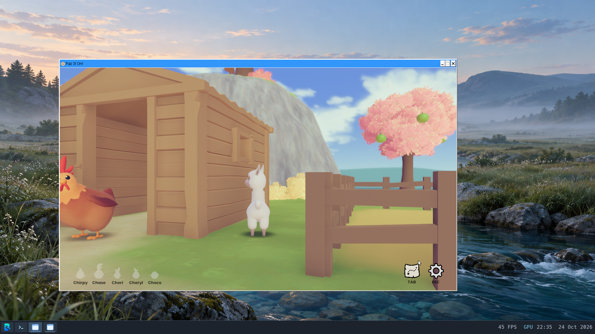

# Alpaca Stacka / Paz It On! smoke test

The developer's free [itch.io Windows build](https://alpacalypsestudios.itch.io/alpaca-stacka)
is named **Paz It On!**. This tests that standalone download, not the current
Steam release or Steam's launch path. The ZIP is 77,638,823 bytes with SHA-256
`82b066edb3b95e15a26083918f34fad67c16fa2958cd961c475749f40ba7194f`.
Its executable is PE x86-64 and the player identifies Unity 2019.4.0f1.
Game files, prefix, audio and raw logs remain private under `build/` or the
VM's dedicated `/data/home/alpaca-stacka-20261024` directory.

The existing [standalone GE-Proton11-10 setup](proton.md) runs it with D3D11,
DXVK and Intel UHD 630 hardware Venus, in a fresh game-specific prefix and
1280x720 window. The current Steam review VM has eight vCPUs, 12 GiB and
capsule v22. Steam remains minimized at its unanswered other-session warning;
the standalone test does not disconnect that session.

Verified behavior:

- The title menu renders and mouse input advances the story screens.
- The 3D island renders; WASD changes the alpaca's position and camera view.
- Escape opens the pause menu. Its Quit button returns zero, with all tracked
  descendants gone and both bridge output streams at EOF.
- The prefix selects Wine's ALSA driver and the existing clocked OSS plugin.
  A menu capture contains 179,072 stereo frames at 44.1 kHz over 4.061 seconds,
  RMS 0.0413. After exit, a two-second capture reports an inactive stream and
  zero frames. This establishes output and cleanup, not smooth audio quality.

The ordinary direct presentation attempt fails before its first visible frame:
the compositor's `DRM_IOCTL_PRIME_FD_TO_HANDLE` returns EOPNOTSUPP for a Venus
buffer and Wine reports `dmabuf import failed`. Its wrapper returning zero
does not count as successful launch. The accepted repeat explicitly sets
`MESA_VK_WSI_DEBUG=sw,noshm`, using Mesa's CPU staging presentation while Vulkan
rendering remains on the hardware adapter. This workaround must not be reported
as direct DMA-BUF acceptance. The compositor/import integration needs follow-up.

The player also logs a missing Plants script, an unsupported terrain-utility
shader and failed Unity analytics connections. No complete playthrough, chick
collection, persistence, mouse capture or performance benchmark is claimed.
No kernel or game-binary changes were required for this bounded test.

