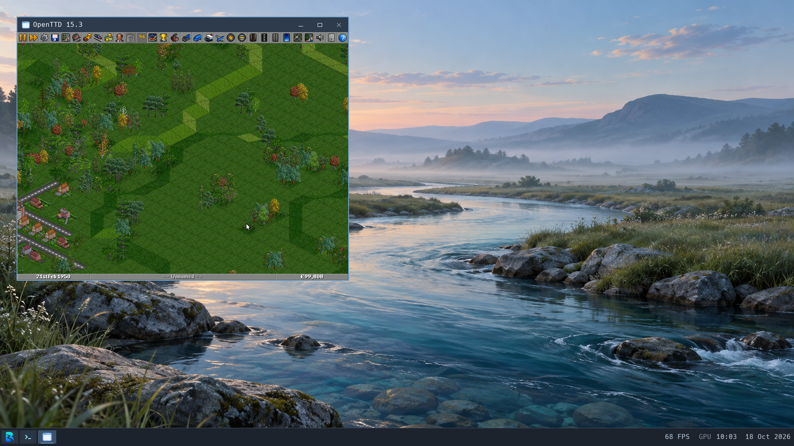

# Application regressions — 2026-10-18

Tests use isolated eight-vCPU, 4-GiB software-Wayland VMs. Earlier runs use
RAM-backed host disks; the access-inquiry and browser-permission follow-ups use
host-backed clones. Applications launch through the installed catalogue as Brook, UID 1000.
These are correctness observations, not matched startup benchmarks.

## GIMP and document persistence

GIMP opened the transparent Brook B PNG, accepted a native brush edit, saved XCF,
exported PNG, and reopened the XCF. An independent PNG decoder found 2,608 newly
nontransparent pixels relative to the source. The PNG signature, dimensions and
all chunk CRCs also passed. Normal close drained the complete UI launch lineage.
A cold boot preserved both saved files' hashes and ownership. The later
full-width ownership kernel also reopened the saved XCF through GIMP's recent
images, displaying the transparent B and the painted mark. Normal close drained
the complete UI launch lineage; the saved XCF/PNG hashes and Brook ownership
were unchanged afterward. That run passed checked sync/stop, QEMU/launcher exit
zero, serial kernel/device/user-fault audits and all three offline filesystem
checks. Its kernel is
`dd601109c01b5f782263491e84883b75d3229abafee971a63dd7bed1f7bf84b5`,
with local evidence under `build/workloads/identity-uid32-20261018/final/`.
This is a cold file-reopen check, not a startup performance comparison.

The [shared path-walk checkpoint](identity.md#shared-component-walk-checkpoint-18-october)
repeated normal catalogue launch, visible XCF reopen and full native-close cleanup
on kernel `424e461dd8d5e1855c4e1268904be43a69fe3714f0bd3b43b63e761cf2d38371`
with module ABI 17. Saved document hashes and independent offline owner checks
passed, followed by checked shutdown and three clean filesystem checks. Its
local evidence is `build/workloads/path-walk-20261018/review/gimp/`.

The [access inquiry checkpoint](identity.md#access-inquiry-checkpoint-18-october)
on kernel `50fe3e571183c246225af8cbe724133394f8bdd3ce71a5afd7dbcdf997be368e`
(ABI 18) passed normal launch and full native-close cleanup. The visible Welcome
window retained the recent-document list; the XCF was not reopened in this run.
After checked shutdown, independent disk inspection verified all four saved
document hashes and Brook ownership, and all three filesystem checks passed.
Local evidence: `build/workloads/access-checks-20261018/acceptance-audit.json`.

The subsequent [permission-kernel browser refresh](browser-trio.md#permission-kernel-refresh)
renewed actual XCF reopen on that same ABI-18 kernel, with Firefox, Chromium and
Codium still open. The saved painted mark was visible; native close drained
GIMP's full lineage. The original ODT also reopened visibly in Writer after
GIMP exited. Both documents retained their hashes and 1000:100 ownership after
the final full-lineage close, checked shutdown, serial and filesystem checks.
Local evidence: `build/workloads/browser-permissions-20261018/cold/`.

Native 1920×1080 capture. The black mark in the upper-right transparent margin
is the saved brush edit used to distinguish this file from its source.

LibreOffice Writer accepted native text entry and saved an ODT. Independent ZIP,
mimetype and XML checks verified the exact three paragraphs. The ODT retained
its hash and Brook ownership across cold boot and reopened visibly in Writer.

Native 1920×1080 capture, with no resizing or post-processing.

An attempted PNG transfer through tracked command stdout exceeded the 64-KiB
retention window. That receipt is rejected as complete output evidence, despite
successful process exit. A separate one-file HTTP transfer with exact size/hash
validation supplied the independently decoded artifact. Binary artifact delivery
should use a dedicated file path rather than the bounded text command channel.

## LibreOffice logging and session-service lifetime

The previous global `SAL_LOG=+INFO.sfx.appl +ERR` is invalid: selectors must be
concatenated and `ERR` is not a logging level. LibreOffice falls back to INFO and
WARN for an invalid selector. Removing the override restores its WARN default.
See the [upstream logging rules](https://docs.libreoffice.org/sal/html/sal_log.html).
A probe against the actual pinned `libuno_sal.so.3` reproduced the invalid,
unset and valid targeted-selector behavior. A five-second idle Writer sample
previously emitted 215 INFO lines; the corrected run emitted zero INFO lines
while warnings remained enabled. Serial byte counts include bridge traffic;
this is not an isolated throughput or startup speedup measurement.

Writer's earlier normal close removed its windows and application workers but
left its automatically spawned `dbus-daemon` in the UI launch lineage. That
run failed the full exit barrier. Desktop startup now starts one `brook-dbus`
as UID 1000/GID 100, outside application launch lineages, and supplies a shared
session address. The pinned package includes the upstream session policy;
startup explicitly selects it because Brook does not provide `/etc/dbus-1`.
The initial package omitted that configuration and failed startup; its serial
log is preserved rather than counted as acceptance.

After the configuration correction, a real libdbus client connected and obtained
a unique bus name and server identity. A direct Unix socket peer-credential
check identified UID 1000. `dbus_connection_get_unix_user` did not expose peer
credentials on the client connection; its initial assertion was rejected and
replaced with the direct socket check, not counted as a successful probe.
Writer then reopened its document and closed with its complete launch lineage
empty, while exactly one launch-zero Brook bus remained. A subsequent cold boot
started the service automatically and repeated the bus, saved-file and Writer
reopen/full-exit checks. Both corrected runs passed checked sync/stop,
authoritative QEMU exit, launcher exit zero, serial panic/device/user-fault
audits and read-only offline FAT and both ext2 filesystem checks.

This is a single desktop session service, not login/accounts or per-app
isolation. D-Bus currently warns about the root-owned `/tmp` runtime directory
and socket chmod. Transient service-directory activation, service recovery,
legacy standalone script launch scopes, and private per-user runtime directories
remain unverified. The global bus address does not establish those capabilities.

## VLC launcher and current-package regression

The installed desktop entry initially launched raw `vlc`, bypassing the
installed `brook-vlc` wrapper. It tried PulseAudio, printed a mutex error and
exited without a window. Both desktop collectors now redirect VLC only when
its real executable and executable compatibility wrapper are present. Bare, absolute and quoted command
paths retain the upstream arguments. This also corrects absolute-path browser
and editor entries in the guest collector. Two host collector tests and all
18 installer tests pass, including real-filesystem missing/disabled-wrapper
and removed-application cases.

The temporary first-window helper once misattributed Writer's new window to a
still-observed failed VLC request. That observation is rejected; explicit
launch-token matching now guards the helper. Writer acceptance uses its actual
title, launch group and independent reopen/exit checks.

The first wrapper run selected the stale cached `vlc-brook-close` package,
store `hlj5f0vyqgcgc0d3r8shn68hijvmjslv-vlc-brook-3.0.23-2`. It predates the
accepted surface-handoff fix and reproduced an invalid `get_viewport` argument.
Its launch group was reclaimed and audio became inactive. This is not evidence
of a regression in the current VLC source. Building the current expression
confirmed output `3x6wrd699l6kmnr9gr5jkq8xlvsh4yi4-vlc-brook-3.0.23-2`.
Guest installation of that exact output under its existing `vlc-brook-window`
cache label verified the active profile target before playback. Existing-name
installation retains its registered store hash; package upgrade acceptance is
separate from this test.

Current-source VLC launched normally as Brook, opened the 1280×720 H.264/AAC
Big Buck Bunny fixture and advanced through distinct video scenes. A six-second
host PCM capture contained 264,980 stereo frames at 44.1 kHz and nonzero audio.
Pause produced zero frames; resume produced 88,364 frames with nonzero samples.
Normal native close drained the complete UI launch lineage and audio became
inactive with zero frames. A separate normal launch played the fixture before
SIGKILL; its entire launch lineage and windows then disappeared and audio again
became inactive. These establish output and cleanup, not smooth playback,
frame rate or A/V sync. Maximize/fullscreen geometry remains unaccepted.
The VM subsequently passed checked sync/stop, authoritative QEMU exit, launcher
exit zero, serial kernel/device/user-fault audit and all three offline filesystem
checks. The earlier stale-package failure remains recorded; this is not a
fresh-image install or package-upgrade acceptance run.

An initial installer check overflowed the bounded stdout channel and then
failed on an unavailable `grep`. Its receipt is not accepted as complete output.
Subsequent installation checks saved verbose output to a guest log and returned
its hash/size, explicit process result and independently checked launcher row.
Staging with Python `shutil.copy2` also exposed unsupported `listxattr` (ENOSYS);
the file contents had already copied, and an independent hash check verified the
executable before it was used. Extended-attribute compatibility remains open.

## OpenTTD follow-up

OpenTTD 15.3 launched normally, generated a 256×256 world and continued advancing
its simulation. Native Save Game wrote an 84,496-byte `OTTX` save as UID 1000
under `/data/home/.local/share/openttd/save/`. Ctrl+A did not replace the generated
filename; the initial exact-name assertion failed. The actual file is
`Unnamed, 1950-02-19brook-regression.sav`, SHA-256
`e8a0614f5863d416d995480304e0773aa0de13806c1853169488568810f790ae`.
An independent check verified those bytes and ownership. A subsequent cold boot
checked the same hash and owner before launching the game; the normal UI then
decoded its metadata and loaded the saved world. Meaningful transport-building
gameplay remains open.

The first mouse click on Exit confirmation left it open. A remaining-task
snapshot initially looked like the reported hang, but settled pixels and the
advancing simulation disproved that inference: the main thread was sleeping
normally between frames. The paused kernel-stack snapshot is diagnostic only,
not proof of a deadlock. A distinct click after a one-second pointer settle
confirmed Exit, and the full 29-task UI launch lineage drained normally. The
cause of the missed interaction is not established. This single normal exit
does not establish that the user's intermittent quit hang is eliminated.

The first run's inactive audio sample did not establish cleanup of playing
music. The cold-boot follow-up captured 220,520 stereo frames at 44.1 kHz with
nonzero samples immediately after normal launch. After loading the world,
Shift+F12 opened the in-game jukebox; native Play produced 132,590 frames with
263,225 nonzero samples over a three-second capture. F11 opens the company league
table in a game: the `music = F11` setting belongs to the scenario editor, not
the in-game toolbar.

Normal quit through its confirmation dialog drained the complete 29-task UI
launch lineage, and a subsequent three-second audio capture was inactive with
zero frames. A separate normal launch produced nonzero music before SIGKILL.
Its full launch lineage and window were reclaimed. The initial assertion that
its first post-exit capture must contain zero frames failed: that three-second
capture held a finite 4,422-frame (0.1003-second) PCM tail. A later three-second
capture was inactive with zero frames and no remaining application tasks.
There was no repeating stale buffer. Capture lacks chunk-arrival timestamps,
so this is not an exact output-stop latency or immediate-silencing guarantee.
Longer-session/repeated quit, music smoothness and broader gameplay remain open.

The cold follow-up passed checked sync/stop, authoritative QEMU exit, launcher
exit zero, serial kernel/device/user-fault audit and all three read-only offline
filesystem checks. Browser audio evidence is documented separately in
[browser-trio.md](browser-trio.md).

The screenshot is an unmodified native 1920×1080 frame; the game is using its
own 800×600 window. It demonstrates reload, not a completed transport network.

Ignored evidence is in `build/workloads/app-regressions-20261018/`, including
`pre-fix-result.json`, `gimp/`, `writer/`, `lo-log-probe.json`,
`session-acceptance/`, `session-cold-acceptance/`, `vlc-launcher/` and
`openttd-cold/`. Kernel SHA-256 for these
session-service tests is
`f14006ec594b239f331d74619d65e554db44b2467c83e2dd08adc7cf807c2a00`.
All 39 hosted suites and the supported compiled entry audit passed before boot.
Both full bootstrap paths were subsequently renewed at `f4066d0`; see the
[matching refresh](bootstrap.md#matching-39-suite-refresh-after-clock-and-desktop-changes-2026-10-18).
Application evidence above retains its own kernel/package identities and scope.
