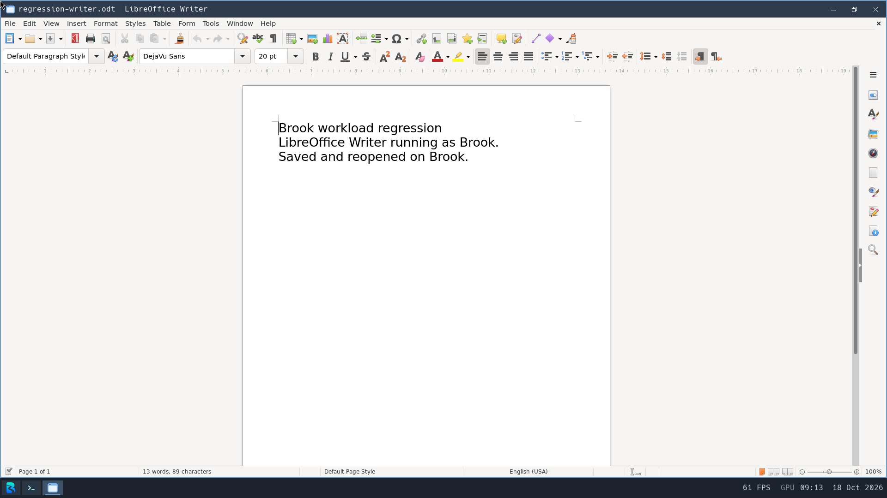

# Application regressions — 2026-10-18

Tests use an isolated eight-vCPU, 4-GiB software-Wayland VM with RAM-backed host
disks. Applications launch through the installed catalogue as Brook, UID 1000.
These are correctness observations, not matched startup benchmarks.

## GIMP and document persistence

GIMP opened the transparent Brook B PNG, accepted a native brush edit, saved XCF,
exported PNG, and reopened the XCF. An independent PNG decoder found 2,608 newly
nontransparent pixels relative to the source. The PNG signature, dimensions and
all chunk CRCs also passed. Normal close drained the complete UI launch lineage.
A cold boot preserved both saved files' hashes and ownership. Cold GUI reopening
of the XCF has not yet been repeated.

LibreOffice Writer accepted native text entry and saved an ODT. Independent ZIP,
mimetype and XML checks verified the exact three paragraphs. The ODT retained
its hash and Brook ownership across cold boot and reopened visibly in Writer.

Native 1920×1080 capture, with no resizing or post-processing.

An attempted PNG transfer through tracked command stdout exceeded the 64-KiB
retention window. That receipt is rejected as complete output evidence, despite
successful process exit. A separate one-file HTTP transfer with exact size/hash
validation supplied the independently decoded artifact. Binary artifact delivery
should use a dedicated file path rather than the bounded text command channel.

## LibreOffice logging and session-service lifetime

The previous global `SAL_LOG=+INFO.sfx.appl +ERR` is invalid: selectors must be
concatenated and `ERR` is not a logging level. LibreOffice falls back to INFO and
WARN for an invalid selector. Removing the override restores its WARN default.
See the [upstream logging rules](https://docs.libreoffice.org/sal/html/sal_log.html).
A probe against the actual pinned `libuno_sal.so.3` reproduced the invalid,
unset and valid targeted-selector behavior. A five-second idle Writer sample
previously emitted 215 INFO lines; the corrected run emitted zero INFO lines
while warnings remained enabled. Serial byte counts include bridge traffic;
this is not an isolated throughput or startup speedup measurement.

Writer's earlier normal close removed its windows and application workers but
left its automatically spawned `dbus-daemon` in the UI launch lineage. That
run failed the full exit barrier. Desktop startup now starts one `brook-dbus`
as UID 1000/GID 100, outside application launch lineages, and supplies a shared
session address. The pinned package includes the upstream session policy;
startup explicitly selects it because Brook does not provide `/etc/dbus-1`.
The initial package omitted that configuration and failed startup; its serial
log is preserved rather than counted as acceptance.

After the configuration correction, a real libdbus client connected and obtained
a unique bus name and server identity. A direct Unix socket peer-credential
check identified UID 1000. `dbus_connection_get_unix_user` did not expose peer
credentials on the client connection; its initial assertion was rejected and
replaced with the direct socket check, not counted as a successful probe.
Writer then reopened its document and closed with its complete launch lineage
empty, while exactly one launch-zero Brook bus remained. A subsequent cold boot
started the service automatically and repeated the bus, saved-file and Writer
reopen/full-exit checks. Both corrected runs passed checked sync/stop,
authoritative QEMU exit, launcher exit zero, serial panic/device/user-fault
audits and read-only offline FAT and both ext2 filesystem checks.

This is a single desktop session service, not login/accounts or per-app
isolation. D-Bus currently warns about the root-owned `/tmp` runtime directory
and socket chmod. Transient service-directory activation, service recovery,
legacy standalone script launch scopes, and private per-user runtime directories
remain unverified. The global bus address does not establish those capabilities.

## Remaining regressions

VLC's installed desktop entry currently launches raw `vlc`, bypassing the
installed `brook-vlc` wrapper. In the observed run it reported stale plugin
cache entries, tried PulseAudio, printed a mutex error, and exited without a
window. The complete launch lineage was empty; this is a diagnosed failed
launch, not a readiness timeout or successful playback test. Both the host and
guest desktop-entry collectors need the compatibility mapping checked.
The temporary first-window helper subsequently misattributed Writer’s new
window to the still-observed VLC request. That observation is rejected; explicit
launch-token matching now guards the temporary helper. Writer acceptance uses
its actual title, launch group and independent reopen/exit checks.
OpenTTD gameplay, VLC playback, and their normal/forced audio cleanup checks
remain pending. Existing browser audio evidence is documented separately in
[browser-trio.md](browser-trio.md).

Ignored evidence is in `build/workloads/app-regressions-20261018/`, including
`pre-fix-result.json`, `gimp/`, `writer/`, `lo-log-probe.json`,
`session-acceptance/` and `session-cold-acceptance/`. Kernel SHA-256 for these
session-service tests is
`f14006ec594b239f331d74619d65e554db44b2467c83e2dd08adc7cf807c2a00`.
All 39 hosted suites and the supported compiled entry audit passed before boot.
Full matching bootstrap acceptance remains at `610592d`; newer kernel changes
still need both complete bootstrap paths rerun.
