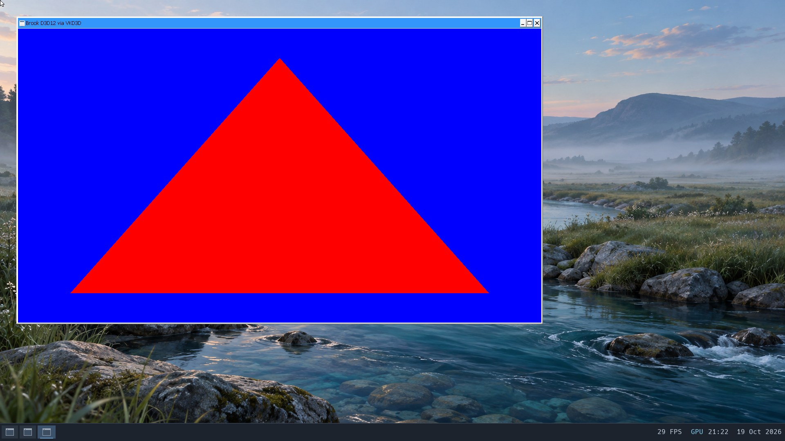
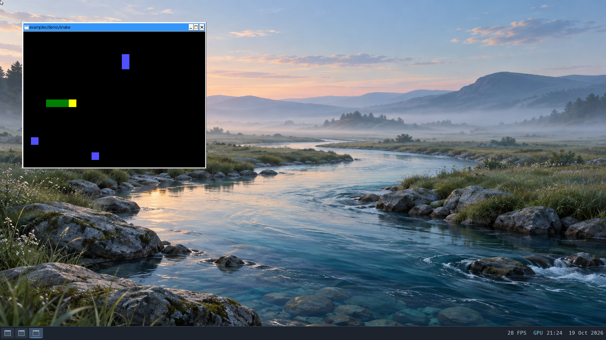

# D3D12 through standalone Proton GE

The first D3D12 checkpoint uses GE-Proton11-10's bundled VKD3D-Proton 3.1.0
(`0bb64c56c8f0dcc+`) on hardware Mesa Venus 26.0.6 / Intel UHD 630.
It passes a deterministic shader/readback probe and the upstream Windows SDL3
Snake example with its D3D12 renderer forced. A 3D game remains the next gate.

## Tested checkpoint

Private evidence is retained in `build/workloads/d3d12-20261019/device/`.
The VM has eight vCPUs, 8 GiB, GPU composition and a silent host audio backend.
It starts from fresh copies of the checked standalone Proton checkpoint.
No kernel or driver changes were needed; the kernel SHA-256 remains
`f932600c7ef0ac9606057f8e976e47b3f397695aae69383dc965a6d342e2f1b3`.

- Hardware D3D12 feature-level 11.0 device creation succeeds. The queried
  resource binding tier is 3 and heap tier is 2.
- A 64 KiB upload/readback copy checks all 16,384 patterned words. An
  event-backed queue fence completes with the expected value.
- Compiled vertex/pixel shaders draw a red triangle on blue. Offscreen
  readback returns center RGBA `255,0,0,255` and corner `0,0,255,255`.
- A two-buffer flip-discard swapchain presents 949 frames. Keyboard-triggered
  resizing from 640x360 to 1280x720 produces the same verified pixel values
  after buffer recreation. Minimize, restore and normal close complete;
  Proton returns zero and all tracked descendants exit.
- The unmodified upstream SDL3 3.4.2 Windows Snake example logs
  `Created renderer: direct3d12`; VKD3D logs hardware Venus and its swapchain.
  Arrow keys are exercised, the game renders, minimize/restore complete, and
  normal close returns zero with no tracked descendants. Its old D3D11/DXVK
  sidecar DLLs are excluded from this separate game directory.
- Native Vulkan compute/triangle readback and persistent OpenGL RGB readback
  pass afterward. GPU backing mapping/byte counts balance, with no remaining
  host blob resources, aperture leases, quarantined resources or failed
  retirements. Heap integrity passes and no application windows remain.
- Orderly shutdown returns QEMU exit zero. All four offline filesystem checks
  pass; twelve saved document fixtures retain their hashes and ownership,
  and four original user profile trees match the accepted seed.

The retained functional and preservation audits both pass. These are bounded
functional checks, not a steady frame-rate benchmark or long-session test.





Both screenshots are native 1920x1080 guest captures.

## Reproduce the probe

Build the Windows x64 executable with the pinned MinGW package:

```sh
nix-build tools/d3d12-probe-pkg -o build/d3d12-probe-result
```

Use the staged GE runtime and launch environment documented in
[the standalone Proton checkpoint](proton.md#required-integration).
VKD3D is already bundled; do not copy the standalone Wine test's DXVK DLLs
beside this executable. Set `VKD3D_FILTER_DEVICE_NAME=Venus` and
`VKD3D_DEBUG=info` to retain device/backend diagnostics. Launch through GE's
`proton run` with a Windows `Z:\...\brook-d3d12.exe` path.

The default mode verifies buffer/fence and offscreen shader readback.
`--device-only` isolates device/copy/fence setup. `--window --frames 6000`
adds a bounded visible presentation loop: press `R` for a 1280x720 client area,
and use Escape or normal close to exit. Readback is repeated after resizing.
A timeout, incorrect pixel, zero rendered frames or failed API call returns
nonzero. The success JSON must be paired with the retained backend logs,
normal process-tree completion and post-run resource checks.

For the existing `tools/windows-snake-pkg` binary, use a separate directory
containing only `brook-snake.exe` and its `SDL3.dll`, with
`SDL_RENDER_DRIVER=direct3d12`, `SDL_VIDEODRIVER=windows` and
`SDL_LOGGING=render=debug`. Require the actual renderer log; a visible window
alone does not establish the selected graphics API.

## Limits and next gate

This does not establish compatibility with a modern 3D D3D12 game, ray tracing,
mesh shaders, asynchronous compute, advanced resource residency or a full
Shader Model 6 feature matrix. Advertised feature support is not equivalent
to workload acceptance. The custom probe uses DXBC shaders compiled as
`vs_5_0` / `ps_5_0`. Snake initializes video only, so it adds no Windows audio
coverage. Steam integration, 32-bit programs and synchronization accelerators
remain outside this standalone Proton checkpoint.

Next, test a small real Windows 3D game with an explicitly selected D3D12
backend, checking gameplay, textures, depth, lighting, normal exit and resource
retirement. Keep its binaries and assets under ignored `build/` paths.
