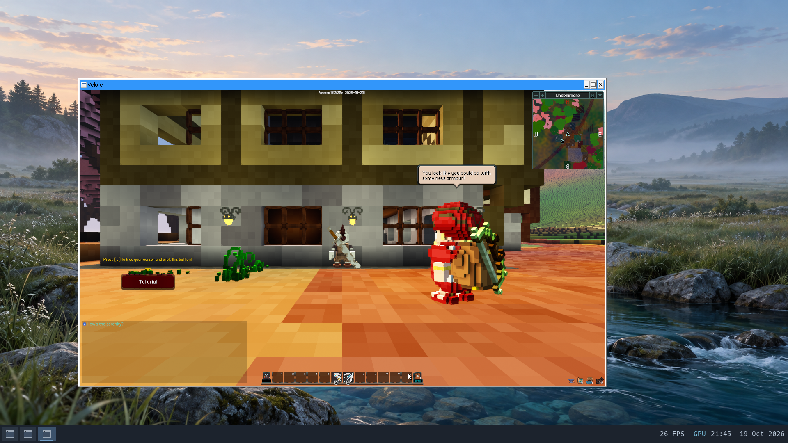

# D3D12 through standalone Proton GE

The first D3D12 checkpoint uses GE-Proton11-10's bundled VKD3D-Proton 3.1.0
(`0bb64c56c8f0dcc+`) on hardware Mesa Venus 26.0.6 / Intel UHD 630.
It passes a deterministic shader/readback probe and the upstream Windows SDL3
Snake example with its D3D12 renderer forced. A separate run below also covers
Veloren's Windows 3D singleplayer path.

## Tested checkpoint

Private evidence is retained in `build/workloads/d3d12-20261019/device/`.
The VM has eight vCPUs, 8 GiB, GPU composition and a silent host audio backend.
It starts from fresh copies of the checked standalone Proton checkpoint.
No kernel or driver changes were needed; the kernel SHA-256 remains
`f932600c7ef0ac9606057f8e976e47b3f397695aae69383dc965a6d342e2f1b3`.

- Hardware D3D12 feature-level 11.0 device creation succeeds. The queried
  resource binding tier is 3 and heap tier is 2.
- A 64 KiB upload/readback copy checks all 16,384 patterned words. An
  event-backed queue fence completes with the expected value.
- Compiled vertex/pixel shaders draw a red triangle on blue. Offscreen
  readback returns center RGBA `255,0,0,255` and corner `0,0,255,255`.
- A two-buffer flip-discard swapchain presents 949 frames. Keyboard-triggered
  resizing from 640x360 to 1280x720 produces the same verified pixel values
  after buffer recreation. Minimize, restore and normal close complete;
  Proton returns zero and all tracked descendants exit.
- The unmodified upstream SDL3 3.4.2 Windows Snake example logs
  `Created renderer: direct3d12`; VKD3D logs hardware Venus and its swapchain.
  Arrow keys are exercised, the game renders, minimize/restore complete, and
  normal close returns zero with no tracked descendants. Its old D3D11/DXVK
  sidecar DLLs are excluded from this separate game directory.
- Native Vulkan compute/triangle readback and persistent OpenGL RGB readback
  pass afterward. GPU backing mapping/byte counts balance, with no remaining
  host blob resources, aperture leases, quarantined resources or failed
  retirements. Heap integrity passes and no application windows remain.
- Orderly shutdown returns QEMU exit zero. All four offline filesystem checks
  pass; twelve saved document fixtures retain their hashes and ownership,
  and four original user profile trees match the accepted seed.

The retained functional and preservation audits both pass. These are bounded
functional checks, not a steady frame-rate benchmark or long-session test.

The subsequent combined-image live review found red and blue reversed in the
D3D12 shader window on the native SDL display, despite correct internal
render-target readback. SpaceVenture showed the same reversal. End-to-end
native-display colour correctness remains unresolved; see the
[live-review follow-ups](backlog.md#native-display-colour-reversal-and-playback-timing).


Both screenshots are native 1920x1080 guest captures.

## Reproduce the probe

Build the Windows x64 executable with the pinned MinGW package:

```sh
nix-build tools/d3d12-probe-pkg -o build/d3d12-probe-result
```

Use the staged GE runtime and launch environment documented in
[the standalone Proton checkpoint](proton.md#required-integration).
VKD3D is already bundled; do not copy the standalone Wine test's DXVK DLLs
beside this executable. Set `VKD3D_FILTER_DEVICE_NAME=Venus` and
`VKD3D_DEBUG=info` to retain device/backend diagnostics. Launch through GE's
`proton run` with a Windows `Z:\...\brook-d3d12.exe` path.

The default mode verifies buffer/fence and offscreen shader readback.
`--device-only` isolates device/copy/fence setup. `--window --frames 6000`
adds a bounded visible presentation loop: press `R` for a 1280x720 client area,
and use Escape or normal close to exit. Readback is repeated after resizing.
A timeout, incorrect pixel, zero rendered frames or failed API call returns
nonzero. The success JSON must be paired with the retained backend logs,
normal process-tree completion and post-run resource checks.

For the existing `tools/windows-snake-pkg` binary, use a separate directory
containing only `brook-snake.exe` and its `SDL3.dll`, with
`SDL_RENDER_DRIVER=direct3d12`, `SDL_VIDEODRIVER=windows` and
`SDL_LOGGING=render=debug`. Require the actual renderer log; a visible window
alone does not establish the selected graphics API.

## Limits

Broader D3D12 game compatibility, ray tracing, mesh shaders, asynchronous
compute, advanced resource residency and a full Shader Model 6 feature matrix
remain untested. Advertised feature support is not equivalent
to workload acceptance. The custom probe uses DXBC shaders compiled as
`vs_5_0` / `ps_5_0`. Snake initializes video only, so it adds no Windows audio
coverage. Steam integration, 32-bit programs and synchronization accelerators
remain outside this standalone Proton checkpoint.

The Veloren smoke test below extends this to a real Windows 3D game. Further
coverage should include longer sessions, cold save/load, audio and other
engines. Keep workload binaries and assets under ignored `build/` paths.

## Veloren 0.18 — real 3D game smoke test

The official standalone Windows x64 [Veloren 0.18 release](https://veloren.net/download-other/)
is the first 3D D3D12 workload. Its 464,592,174-byte archive has SHA-256
`71f07893d842f871c63c726095a92afaeae77941af1d7186e54195032e335866`.
The game reports revision `1d12f35e` (23 January 2026). Downloads, compiler DLLs,
game assets and private images remain under ignored `build/` paths.

`WGPU_BACKEND=dx12` forces the Windows build's D3D12 path. The game logs its
selected backend as `Dx12` and hardware adapter as Intel UHD 630 via Venus;
VKD3D-Proton logs the same device and a 1280x720, three-buffer swapchain. The
separate profile uses view distances of four, low fluid/reflection settings,
minimal clouds, no shadow maps or bloom, a 30 FPS cap and audio disabled.
This cap is a setting, not a measured performance result.

The run reaches its menu, generates a local singleplayer world, creates the
`Brook` character, enters Ondenimore and renders the player, NPCs, buildings,
terrain and lighting. A one-second forward keypress moves the character/camera
closer to the building; NPC motion/dialogue are visible in the retained frames.
Minimize and restore pass. Normal window close shuts down the local client and
server; Proton returns zero with no tracked descendants. The profile includes
settings, world metadata and a 118,784-byte SQLite save database. Cold save/load,
combat, longer play, audio and quantitative frame-rate measurements remain
untested. The game reports some slow world-simulation ticks; performance has
not been tuned, and screenshot inspection is not an exhaustive rendering audit.

Native GL/Vulkan readback still passes after the game exits. GPU backing
mapping/byte counts balance, no host blob/aperture/quarantine resources remain,
and heap integrity passes. The VM shuts down orderly with QEMU exit zero;
the four system disks and additional game-media filesystem pass offline checks.
The saved SQLite database passes a read-only `quick_check`. Twelve original
document fixtures and four original profile trees pass the preservation audit.
Evidence and passing audits are retained in
`build/workloads/d3d12-20261019/veloren/`.



### Shader compiler packaging

The standalone baseline deliberately disables game-specific ProtonFixes. The
pinned GE build has no Veloren-specific rule. Wine's built-in FXC rejects the
UI shader's Shader Model 5.1 resource array. GE's bundled Winetricks recipe
provides the 2013 Windows 8.1 compiler, which instead rejects the `cs_5_1`
target during wgpu's indirect-validation pipeline setup. Neither diagnostic
run is gameplay acceptance evidence.

The successful run uses Microsoft's newer x64 `d3dcompiler_47.dll`
10.0.28000.2705, placed beside **only this private game copy**, with
`WINEDLLOVERRIDES=d3dcompiler_47=n`. Its SHA-256 is
`3e56c1a0867aa04cbca948b3664fcac5d51275865cd044a45a3fd6ce636ee914`
and its size is 4,753,904 bytes. The source is the Microsoft SDK
[cabinet](https://download.microsoft.com/download/38ab8f6d-3676-4860-ae84-3361308b9d7f/KIT_BUNDLE_WINDOWSSDK_MEDIACREATION/Installers/61d57a7a82309cd161a854a6f4619e52.cab),
extracting `fil3585cb2ea5db13cc0838f8d06b5c9679` and renaming it to the DLL.
The source/version issue is documented in
[Winetricks #2522](https://github.com/Winetricks/winetricks/issues/2522).
No compiler binaries are committed and the prefix-wide compiler selection is
unchanged. This is a per-application packaging requirement, not a Brook kernel
repair or automatic Proton compatibility claim.

For this game, `VELOREN_USERDATA=Z:\data\home\veloren-d3d12` and
`VELOREN_ASSETS=Z:\media\veloren\assets` isolate state and select its payload.
Use the game's generated `voxygen/settings.ron` to retain the chosen graphics
settings. RON serializes fixed-size resolution arrays as `(1280, 720)`;
`[1280, 720]` causes recovery to defaults and invalidates a low-settings run.
