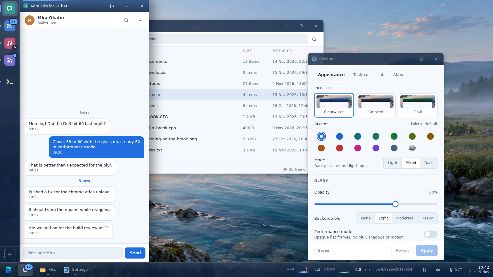
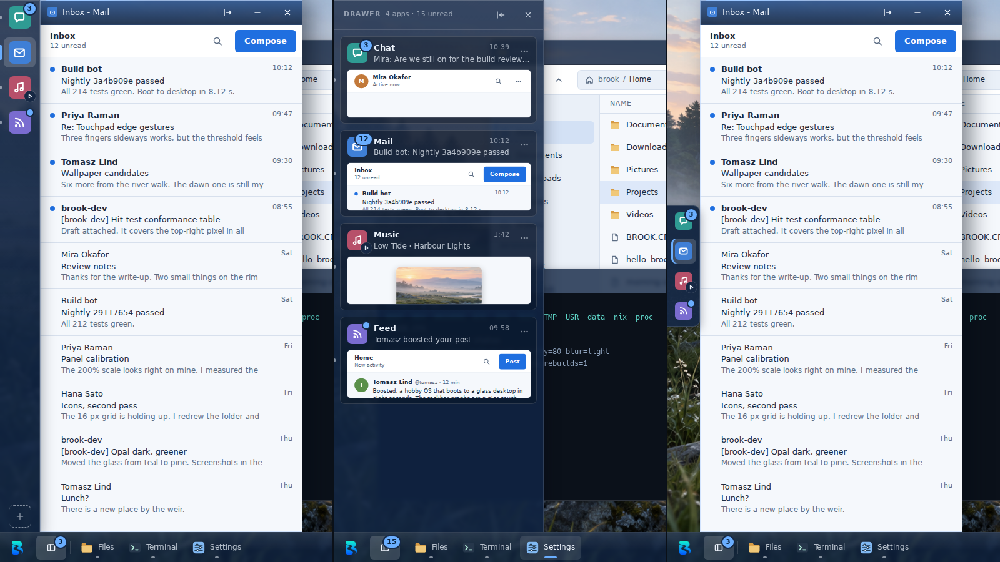
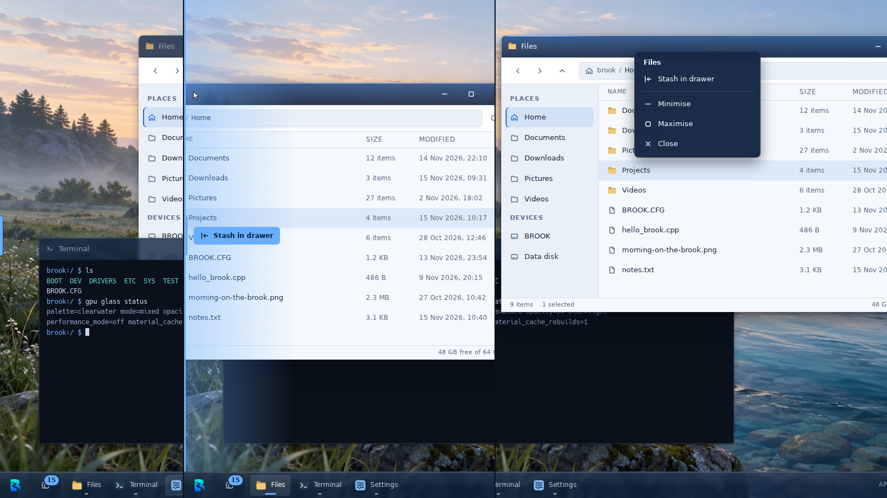
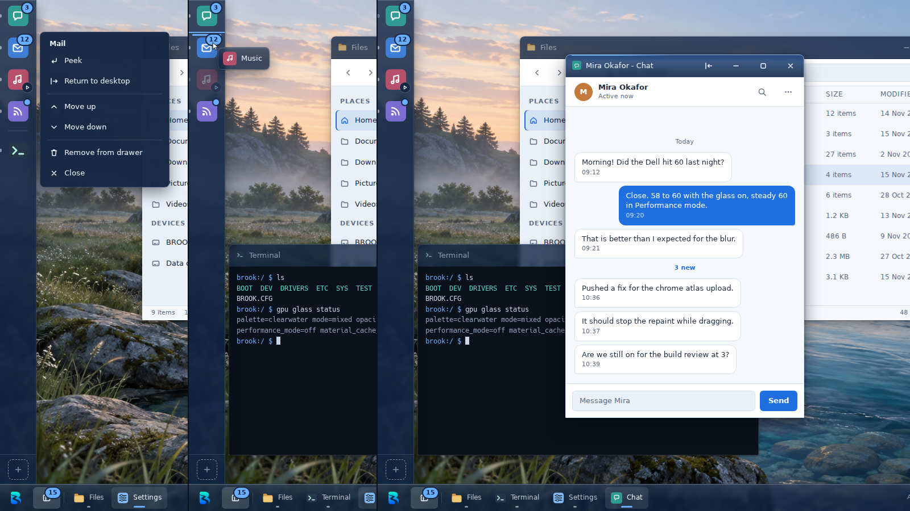
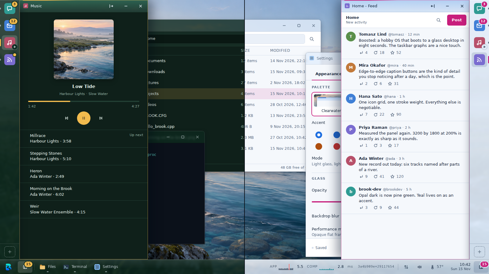

# Clearwater Next

15 November 2026. **Status: final design.** Ian's verdict after three passes: Glass
is the chrome style, with a customisable accent. The other styles stay in
Settings › Lab and in this document as future options.

A browser-rendered design proposal that builds on
the [October glass study](../glass/README.md). Nothing here is a Brook guest
capture or a native change. Main, the VM and the Dell are untouched.

Open `index.html` directly, or serve the folder with any static server. It is one
file with inlined CSS and JS, plus `assets/` (wallpaper, B mark and the built-in
icons, copied from `data/`). There are no network requests and no libraries.

The desktop is a fixed 1600×900 logical stage (the 3200×1800 panel at 200%),
scaled to fit the browser. The bar above it is study chrome, not part of Brook.

Contents:

1. [What you can try](#what-you-can-try)
2. [Second-pass changes](#second-pass-changes) and [Accent colours](#accent-colours)
3. [Design summary](#design-summary)
4. [Hit targets and the WmHitTest spec](#hit-targets-and-the-wmhittest-spec)
5. [Launcher organisation](#launcher-organisation)
6. [Making it pop: six directions](#making-it-pop-six-directions)
7. [Wild ideas](#wild-ideas)
8. [A pluggable, user-mode chrome architecture](#a-pluggable-user-mode-chrome-architecture)
9. [Token sheet](#token-sheet)
10. [Implementation order](#implementation-order) and the [full change list](#native-implementation-in-priority-order)
11. [Ideas backlog](#ideas-backlog): the [side drawer](#side-drawer) concept, not scheduled
12. [Limitations](#limitations) and [Files](#files)

All figures in the prototype are illustrative: boot times, frame times,
temperatures, addresses, file listings, the build label and the three
installable sample apps.

Native costs throughout are estimates. I did not read the compositor or window
manager source. They rest on the October README and on the description given for
this pass: the kernel CPU-rasterises chrome, taskbar, launcher and toasts into
cached textures, and the user-mode Vulkan renderer composites GPU quads.

## What you can try

- **Look.** Palette, accent, mode (Light / Mixed / Dark), opacity, blur and Performance
  mode, from the study bar or Settings. Settings previews live; Apply saves to
  browser storage and Revert restores the saved look.
- **Launcher.** Click the B. Type to search. Drag an app onto a category, between
  rows, onto the pinned row or onto “New category”. Drag categories to reorder.
  Hover an app for its ⋯ menu, or right-click. “Organise” adds tick boxes and
  category editing. The study bar's “Install app” adds a sample app to Unsorted.
- **Launcher keys.** ↑ ↓ move, Enter opens, Alt+↑ ↓ reorders, Alt+Enter opens the
  item menu, Ctrl+Space ticks, Ctrl+Z undoes, Esc backs out one level. On a
  category: Alt+↑ ↓ reorders, F2 edits, Delete removes.
- **Windows.** Drag titlebars, double-click to maximise, minimise, close, restore
  from the taskbar.
- **Tray and HUD.** Network, volume and temperature flyouts. Alt+P cycles the
  performance HUD.
- **Hit areas.** The study bar's “Hit areas” toggle tints every click target and
  draws the resize bands.
- **Lab.** Settings › Lab has the four alternative chrome styles, a reactive rim
  light and touch targets.
- **Side drawer (concept).** Off by default. Settings › Lab › Side drawer, or the
  Drawer group in the study bar. See [Side drawer](#side-drawer).

URL parameters drive the screenshots: `?shot=1` plus any of `palette`, `mode`,
`perf`, `opacity`, `blur`, `hud`, `tab`, `focus`, `accent`, `style`, `rim`, `touch`,
`hits` and `scene` (`boot`, `toasts`, `launcher`, `search`, `organise`, `menu`,
`drag`, `reorder`, `newcat`, `unsorted`, `empty`, `net`, `vol`, `temp`). The
drawer concept adds `drawer`, `dedge`, `dapp`, `dstash` and its own scenes,
listed under [Side drawer](#in-the-prototype).

## Second-pass changes

| Request | What changed |
| --- | --- |
| Mixed as the default | Mixed (dark glass around light apps) is now the default mode. |
| Caption buttons to the chrome edges | Buttons fill the titlebar height and run to the window's outer top and right edges with no gaps. The frame rim is drawn over them, so it no longer takes a pixel of hit area. Spec below. |
| Larger targets | Titlebar 40, caption targets 48×40, taskbar 48 with full-height targets down to the screen edge, launcher rows 48, rail rows 40, segments 32, switches toggle from anywhere on their row. An optional touch density raises everything to 44 or more. |
| Opal dark too teal | Glass moves from teal `12 40 50` to pine green `12 40 30`, and the accent from `#5fd6c8` to `#62d6a0`. Opal light is unchanged. |
| Blur ramp | 0 / 3 / 9 / 18 px, down from 0 / 10 / 20 / 36. Light keeps shapes recognisable, Moderate turns them into soft forms, Heavy leaves colour fields that still vary. Compare `?shot=1&blur=none`, `light`, `moderate` and `heavy`. |
| Launcher organisation | New. See [Launcher organisation](#launcher-organisation). |
| Pop, wild ideas, architecture | New sections, with five chrome styles and two effects mocked in Settings › Lab. |

One consequence of the lighter blur: at Light, text behind a panel stays faintly
legible. Text-heavy panels (launcher, flyouts, HUD, toasts) therefore sit 10
opacity points more solid than the taskbar and titlebars.

One tension to know about: Opal in Mixed mode now pairs green glass with the
teal accent of Opal light's content. It reads as two related greens, not a clash,
but it is the one place the palette is not a single hue.

## Accent colours

The accent is now a setting, separate from the palette. Settings › Appearance has
a swatch row: **Palette default**, eleven fixed hues, and **Wallpaper**.

- Each accent has two values. The bright one is used on dark glass and dark
  content with dark text on it. The deep one is used on light glass and light
  content with white text on it. Mixed mode therefore uses the bright value in the
  chrome and the deep value inside apps.
- Phosphor is the green from the Phosphor style, as a colour only.
- Wallpaper is sampled when the wallpaper is set. The value here is for
  `brook-dawn.png`.
- Palette default keeps each palette's own accent: Clearwater blue, Smoked steel,
  Opal green (dark) and teal (light).

### Derived tokens

| Token | On dark surfaces | On light surfaces |
| --- | --- | --- |
| Accent | The bright value | The deep value |
| Hover | Accent mixed 14% towards white | Accent mixed 12% towards black |
| Pressed | Accent mixed 14% towards black | Accent mixed 24% towards black |
| Text on accent | The accent mixed 88% towards near-black, so it keeps a trace of the hue | White |
| Focus ring | Accent, 2 px, offset 2 px | same |
| Active window rim | Accent at 62% | Accent at 60% |
| Selection tint | Accent at 16% | Accent at 11% |
| HUD APP colour | Accent. For Orange, Red and Hot pink it is neutral secondary ink, because over-budget bars are red. | same |
| HUD COMP colour | Teal `#5fd6c8`; blue `#7db8ff` when the accent is itself green or teal | Teal `#0a7f8a`; blue `#1f6fe0` |

### Values and computed contrast

Contrast is the WCAG 2 ratio, computed by script. “Worst” is the lowest ratio
across all three palettes. The targets were 4.5 for anything used as or under
text and 3.0 for the accent line on the active title gradient. Every row meets
them. The script nudged a starting hue lighter or darker until it did; Hot pink
and the light-surface Blue, Teal, Pine, Lime, Orange and Wallpaper values moved
slightly.

The dark-surface backgrounds tested were each palette's opaque glass fill and
raised content colour, and the top of each active title gradient. The
light-surface backgrounds were each palette's light glass tint, its sunken
content colour, and white. Glass is translucent, so real contrast varies with the
wallpaper behind it; the opaque fill is the reference.

| Accent | On dark: accent | hover | pressed | text on it | text contrast | on glass/raised (worst) | on active title (worst) | On light: accent | hover | pressed | white text contrast | on light surfaces (worst) | white on hover |
| --- | --- | --- | --- | --- | --- | --- | --- | --- | --- | --- | --- | --- | --- |
| Clearwater blue | `#6aaeff` | `#7fb9ff` | `#5b96db` | `#101e2e` | 7.3 | 6.3 | 3.5 | `#1c65cc` | `#1959b4` | `#154d9b` | 5.6 | 4.7 | 6.7 |
| Teal | `#4fd3c4` | `#68d9cc` | `#44b5a9` | `#0d2227` | 9.0 | 7.9 | 4.4 | `#09747e` | `#08666f` | `#075860` | 5.5 | 4.7 | 6.7 |
| Pine green | `#62d6a0` | `#78dcad` | `#54b88a` | `#0f2223` | 9.1 | 8.1 | 4.5 | `#1b7650` | `#186846` | `#155a3d` | 5.6 | 4.7 | 6.8 |
| Phosphor | `#7dff9b` | `#8fffa9` | `#6cdb85` | `#132722` | 12.4 | 11.6 | 6.4 | `#0f7a33` | `#0d6b2d` | `#0b5d27` | 5.5 | 4.6 | 6.6 |
| Lime | `#b4e04a` | `#bee463` | `#9bc140` | `#192419` | 10.5 | 9.5 | 5.3 | `#53710c` | `#49630b` | `#3f5609` | 5.6 | 4.7 | 6.8 |
| Amber | `#f2bb4e` | `#f4c567` | `#d0a143` | `#211f19` | 9.4 | 8.3 | 4.6 | `#8a5a00` | `#794f00` | `#694400` | 5.9 | 5.0 | 7.1 |
| Orange | `#ff9a57` | `#ffa86f` | `#db844b` | `#221b1a` | 8.1 | 7.0 | 3.8 | `#ae4e0f` | `#99450d` | `#843b0b` | 5.4 | 4.6 | 6.6 |
| Red | `#ff7a72` | `#ff8d86` | `#db6962` | `#22171e` | 6.8 | 5.7 | 3.2 | `#c4302b` | `#ac2a26` | `#952421` | 5.5 | 4.7 | 6.7 |
| Hot pink | `#ff6cba` | `#ff81c4` | `#db5da0` | `#221626` | 6.7 | 5.6 | 3.1 | `#c81e7c` | `#b01a6d` | `#98175e` | 5.3 | 4.5 | 6.5 |
| Violet | `#b79cff` | `#c1aaff` | `#9d86db` | `#191c2e` | 7.4 | 6.4 | 3.5 | `#6a43d6` | `#5d3bbc` | `#5133a3` | 6.2 | 5.2 | 7.4 |
| Slate | `#a9bdd6` | `#b5c6dc` | `#91a3b8` | `#181f2a` | 8.6 | 7.6 | 4.2 | `#47607f` | `#3e5470` | `#364961` | 6.5 | 5.5 | 7.7 |
| Wallpaper (dawn) | `#f6b98a` | `#f7c39a` | `#d49f77` | `#211f20` | 9.5 | 8.5 | 4.7 | `#a8511d` | `#94471a` | `#803e16` | 5.4 | 4.6 | 6.6 |

Palette defaults, same tests: Smoked steel passes everything (9.4, 7.8, 4.3 on
dark; 6.2 and 5.3 on light). Opal passes on dark (8.8, 8.1, 4.5), and its light
teal `#0a7f8a` gives 4.8 for white text but 4.0 against Opal's own sunken
surface. That is above 3.0 for a graphic and below 4.5 for text. I left it
because Opal light was approved as it is; the Teal swatch (`#09747e`) is the
compliant version if it matters.

Hover and pressed keep white-text contrast above 4.5 on light surfaces (the last
column shows hover). On dark surfaces the pressed value is darker than the accent,
so dark text on it has less contrast than the figure shown. I did not compute
that state.

### HUD colours

| Accent | HUD APP colour | HUD COMP colour (dark / light) |
| --- | --- | --- |
| Clearwater blue | accent | `#5fd6c8` / `#0a7f8a` |
| Teal | accent | `#7db8ff` / `#1f6fe0` |
| Pine green | accent | `#7db8ff` / `#1f6fe0` |
| Phosphor | accent | `#7db8ff` / `#1f6fe0` |
| Lime | accent | `#7db8ff` / `#1f6fe0` |
| Amber | accent | `#5fd6c8` / `#0a7f8a` |
| Orange | neutral ink | `#5fd6c8` / `#0a7f8a` |
| Red | neutral ink | `#5fd6c8` / `#0a7f8a` |
| Hot pink | neutral ink | `#5fd6c8` / `#0a7f8a` |
| Violet | accent | `#5fd6c8` / `#0a7f8a` |
| Slate | accent | `#5fd6c8` / `#0a7f8a` |
| Wallpaper (dawn) | accent | `#5fd6c8` / `#0a7f8a` |

### Native notes

- Store `accent=<name>` in `[Desktop]`, default `auto`. A table of 12 rows × 2
  values lives beside the palettes in `brook_theme.h`. Hover, pressed, rim and
  selection are computed at material-cache rebuild, which an accent change
  triggers once.
- The Wallpaper row is filled at wallpaper-set time: take the most saturated
  cluster of a downsampled histogram, then run the same lighten-or-darken loop
  until it meets 4.5 on both surface sets.
- Cost: cheap. It is token work plus one GTK swatch row.

## Design summary

This carries over from the first pass, updated for the new sizes.

- **Glass.** One recipe for every shell surface: backdrop blur, tint, a smooth
  sheen gradient over the top 60%, a 1 px inner highlight and a 1 px hairline. No
  saturation pass, no refraction. Client areas are opaque.
- **Window chrome.** A 40 px titlebar. The active window has a title gradient, a
  2 px accent line on the top rim that fades out over 176 px, a brighter rim and a
  deeper shadow. Inactive windows keep the same opacity, with dimmed text and icon.
  Corners are 8 px on top and 2 px at the bottom, because client textures are
  rectangular. The title is one string, as the client sets it.
- **Taskbar.** 48 px. Task buttons show icon and title with a state pill: wide
  accent for focused, short for running, outline for minimised. The tray groups
  network, volume and temperature. The clock is two lines. The build label is a
  monospace chip that can be hidden.
- **Performance HUD.** Off, Compact (a taskbar strip whose top edge is the 16.7 ms
  budget) or Panel (APP, COMP and TEMP graphs with percentiles). Graphs are bar
  quads refreshed at 2 to 4 Hz, so the HUD does not keep the compositor awake.
- **Settings.** A 440 px inspector with tabs, palette cards that double as the
  preview, segmented controls, and a footer with Revert and Apply. All of it is
  expressible in GTK3 CSS.
- **Toasts.** Top-right, at most three. The boot toast leads with the total, then
  a proportional Firmware / Menu / Loader / Kernel bar. No countdown bar.
- **Type and icons.** DejaVu Sans and Hack, Regular and Bold only, 11 px minimum.
  One icon set on a 16 px grid with a 1.5 px stroke.
- **Palettes.** A palette is a hue and a mode is a lightness. Each palette has its
  own accent: Clearwater blue, Opal green (dark) and teal (light), Smoked steel.

## Hit targets and the WmHitTest spec

### Principles

1. A target's hit area and its visual are separate. Visuals stay small; hit areas
   fill the space around them.
2. Targets at a window or screen edge own that edge. The pointer stops at the
   edge, so an edge target is effectively infinitely deep.
3. Adjacent targets share boundaries. There are no dead pixels between caption
   buttons, between taskbar buttons, or between a taskbar button and the screen
   bottom.

### Zones on a normal window

Tested in this order. The first match wins. Sizes are logical pixels.

| # | Zone | Region | Result |
| --- | --- | --- | --- |
| 1 | Outer resize margin | 6 px outside the visible frame on every side. Within 16 px of a corner along either edge it is a diagonal resize. | Resize |
| 2 | Caption buttons | A contiguous run at the right of the titlebar, 48 px each. Each spans y = 0 (the outer top edge) to the titlebar's bottom. Close spans to x = width − 1 (the outer right edge). | Minimise, maximise, close |
| 3 | Inner resize band | 2 px inside the frame along the left, right and bottom edges, and along the top edge to the left of the button run. 8×8 px squares at the top-left, bottom-left and bottom-right corners resize diagonally. | Resize |
| 4 | Titlebar | The rest of the 40 px titlebar. | Drag; double-click maximises |
| 5 | Client | Everything else. | Client input |

The conflict is settled in the buttons' favour inside the frame. Above and to the
right of the button run there is no inner resize band, and the top-right inside
corner is Close. Resizing from the top edge above the buttons, and diagonally
from the top-right corner, comes from the outer margin only. That margin is three
times the depth of the inner band, so the resize target there is larger than it
is today.

The outer margin belongs to its window for z-order purposes. A window above it
still wins, because the window list is walked front to back.

### Maximised, tiled and fullscreen

- **Maximised.** Zones 1 and 3 do not exist. The buttons own y = 0 and the
  rightmost pixel column. The pointer is clamped to the screen, so pushing it into
  the top-right corner lands on Close.
- **Tiled to a screen edge.** Any window edge that touches a screen edge loses its
  resize zones on that edge. A window tiled to the right half therefore has Close
  in the screen corner too.
- **Fullscreen.** No chrome and no zones.

### Themes that move the buttons

The button run should not be hard-coded. WmHitTest reads a small table of parts,
each with a role and a rectangle anchored to window edges. Zone 2 is “any part
with a button role”, and zone 3 excludes the top-edge span covered by such parts.
The [architecture section](#a-pluggable-user-mode-chrome-architecture) describes
how themes supply that table.

### Taskbar and screen edges

- Every taskbar target is the full 48 px high and reaches the bottom screen edge.
- The launcher button is 56 px wide and includes the bottom-left corner pixel.
- The last target on the right should reach the right screen edge. In the
  prototype the clock is not interactive, so nothing claims that corner yet.

### Sizes

| Target | Pointer | Touch density |
| --- | --- | --- |
| Caption button | 48×40, visual pill 36×26 | 52×44 |
| Taskbar target | 48 high, 44 wide minimum, visual pill 38 high | 52 high |
| Launcher app row | 48 high, full column width | 52 |
| Launcher rail row, menu item | 40 and 36 | 44 |
| Icon button | 36×36 | 44×44 |
| Segment, tab | 32 and 40 high | 40 and 44 |
| Switch | 44×24 visual; the whole row toggles, 44 high | 48 |
| Slider | 32 high track target, 20 px thumb | same |
| Files rows | 36 | 44 |

Touch density is a setting with a switch in Settings › Lab. The prototype also
turns it on at the first touch event. Natively I would make it Auto / On / Off,
with Auto switching on at the first touch-down and staying on for the session.
For touch input, zone 1 should grow to 12 px and zone 3 can be dropped.

### In the prototype

“Hit areas” in the study bar tints click targets magenta, outlines the titlebar
drag region in amber, and draws the two resize bands in cyan. Resizing itself is
not interactive in the prototype; only the zones are drawn.
`screenshots/hit-areas.png` shows the overlay.

### Conformance test

A table-driven host test for WmHitTest would cover: the outer top-right pixel in
normal, maximised and right-tiled states; one pixel either side of each button
boundary; y = 0 across the titlebar; the 6 px margin on each side; and the same
set at 100, 150 and 200% scale.

## Launcher organisation

### The model

- **One home per app.** An app lives in exactly one category, or in Unsorted.
- **Pins are references.** The pinned row is a separate ordered list. Pinning does
  not move an app out of its category.

Why one home and not many: “move” is then unambiguous, dragging never has to ask
“copy or move?”, removing an app from a category cannot orphan a duplicate, and
the saved layout is a plain ordered list per category. The need that multiple
homes would serve, reaching an app from two places, is met by pins and by search.

No folders inside categories. Category then app is two levels, and pins and
search are shortcuts across them. A third level hides apps behind one more click
and makes drag targets ambiguous.

### What you can do, and how

Every operation has three paths: drag, click-only, and keyboard. Click-only
matters most on a touchpad, where a long drag is the hardest gesture.

| Operation | Drag | Click-only | Keyboard |
| --- | --- | --- | --- |
| Move an app to another category | Drop on the category in the rail, or on its section in the list | ⋯ menu › Move to | Alt+Enter, then pick; or Alt+↑ ↓ past the end of a category |
| Reorder within a category | Drop between rows; an accent bar shows the slot | ⋯ menu › Move earlier / later | Alt+↑ ↓ |
| Move several apps | Organise, tick them, drag any ticked app | Organise, tick, “Move to…” | Ctrl+Space to tick, Alt+Enter on a ticked app |
| Pin or unpin | Drop on the pinned row, at a position | ⋯ menu › Pin to top | Alt+Enter, Pin |
| Create a category | Drop apps on “New category” | “New category” in the rail, or from a selection | Tab to it, Enter |
| Rename, recolour, change icon | | Right-click the category, or ⋯ in Organise | F2 |
| Reorder categories | Drag in the rail | Up / Down in the editor | Alt+↑ ↓ on the category |
| Delete a category | | Editor › Delete | Delete |
| Undo | | “Undo” in the bar that follows every change | Ctrl+Z, 20 levels |
| Reset | | Organise › Reset to defaults | |

Details that make it pleasant:

- **Spring-loaded categories.** Rest a dragged app on a rail category for 0.7 s
  and that category opens, so the app can be dropped at an exact position.
- **Drag works without a mode.** Organise is only needed for multi-select and for
  the category ⋯ buttons. In Organise, a click ticks an app instead of opening it.
- **Every change is announced and undoable.** A bar names what happened (“Moved
  Quake to Media”) with an Undo button for 8 seconds. Nothing asks for
  confirmation, because nothing is destructive.
- **Deleting never loses apps.** A deleted category's apps go to Unsorted. The
  editor says so before you press Delete.
- **Eight colours and twelve icons** per category. Enough to tell categories apart
  at a glance, few enough to choose in one look.

### Unsorted: the inbox

Newly installed apps land in **Unsorted**, marked “New”. The rail shows Unsorted
with a count badge only while it has something in it.

Each unsorted app carries a one-click suggestion taken from the category its
package declares (“Move to Graphics”), and “Sort all as suggested” files the lot.
Suggestions are offers. The launcher never moves an app on its own, so a layout
the user made is never rearranged behind their back.

A suggestion only appears if the user still has that default category. Renaming
it does not break the link, because suggestions match on the category's ID.

### Defaults and reset

The seven default categories (System, Internet, Media, Office, Graphics, Games,
Demos) are ordinary categories. They can be renamed, recoloured, reordered and
deleted like any other. “Reset to defaults” restores the default set and
membership, sends apps the defaults do not know about to Unsorted, leaves pins
alone, and can itself be undone.

### Search

- Search matches app names first, then the user's own category names, then
  descriptions. Typing “games” lists everything filed under Games, whatever the
  apps are called.
- Matching categories appear as chips above the results. Clicking one opens it.
- Each result shows its category as a chip.
- Results are ranked, so they cannot be reordered by drag. The ⋯ menu still
  works, which makes “search, then file it” a two-step way to organise.

### Empty states

| Where | Text |
| --- | --- |
| No pins | Nothing pinned yet. Drag an app here, or choose Pin to top from its ⋯ menu. |
| Empty category | No apps in *name* yet. Drag apps here, or use Move to in an app's ⋯ menu. |
| Unsorted, empty | Nothing to sort. Newly installed apps land here until you file them. |
| No categories | No categories yet. Create one from the rail, or restore the standard set. With a Reset to defaults button. |
| No search results | Nothing matches “*query*”. Search covers app names, descriptions and your category names. |

Empty categories are hidden in All apps until Organise is on, so an empty
category never pads the list.

### How this compares

- Windows 11's Start menu groups All apps into categories it chooses, which the
  user cannot edit. Brook's defaults are only a starting layout.
- macOS Launchpad organises by dragging one icon onto another to make a folder.
  There is no click-only path, no multi-select and no undo.
- Neither has an inbox for new installs, and neither lets search see the user's
  own groups.

### Persistence

In the prototype the layout is saved to browser storage under
`brook.clearwater-next.launcher.v1`. Natively it belongs in a `[Launcher]`
section of the user settings, keyed by the stable `app_id` the shortcuts already
declare:

```
[Launcher]
version=1
top_row=pinned
pinned=brook-files,terminal,settings,firefox,quake
categories=system,internet,media,office,graphics,games,demos,c1
category.system=System|blue|sliders|brook-files,terminal,settings,kconsole,gallery
category.c1=Writing|green|folder|brook-edit,mousepad
new=inkscape
```

Rules:

- **Unsorted is computed**: installed apps that no category lists. It is never
  written.
- **Unknown IDs are kept.** If an app is uninstalled and later reinstalled, it
  returns to its place. Unknown IDs are skipped when drawing.
- **Writes are atomic and debounced**: write a temporary file, rename, at most
  once a second.
- **A bad or missing section falls back to the defaults.** It is never an error.
- Check the settings parser's line-length limit first. If lines are short, store
  one key per app instead: `app.<id>=<category>,<position>`.
- Shortcuts gain an optional `# category:` line, used only for suggestions.

### Native cost

| Piece | Cost | Notes |
| --- | --- | --- |
| Layout model, `[Launcher]` load and save, Unsorted | Cheap | Pure data. Host-testable. |
| ⋯ menu with Pin and Move to | Moderate | Needs a popup menu component, which toasts and flyouts do not yet provide. |
| Category rail from data, colours, icons, counts | Cheap | Rounded rect plus a tinted mask icon per row. |
| Keyboard reorder and Undo stack | Cheap | Snapshots of a few hundred bytes. |
| Drag and drop: ghost, drop highlight, insertion bar, spring-load, auto-scroll | Moderate | The ghost is one more quad that follows the pointer. Hit-testing rows during a drag is the bulk of the work. |
| Organise mode with multi-select | Moderate | State and a selection bar. |
| Category editor (text field, swatches, icon grid) | Moderate | Needs the same text input the search field needs. |
| Suggestions and Sort all | Cheap | A string compare against the declared category. |

The click-only and keyboard paths deliver everything without drag and drop, so
drag can ship last.

## Making it pop: six directions

Each is distinctive, stays usable all day, and is drawable with rounded rects,
gradients, nine-slices, fixed blur levels and alpha. Three are mocked in
Settings › Lab.

### 1. Brook tabs. Recommended as the signature shape.

- **Borrows from** BeOS and Haiku, where the title is a yellow tab on the frame
  and not a bar across it.
- **In Brook.** The titlebar becomes two glass tabs: icon and title on the left,
  the three controls on the right. The wallpaper shows between them. The content
  frame keeps its hairline rim and shadow. The accent line sits on the title tab.
  Maximised windows revert to a full bar.
- **Why it works.** It is unmistakable in a screenshot, and it shows more
  wallpaper and less chrome. Unlike Haiku, the controls stay in the top-right
  corner, so the edge-to-edge hit targets above still hold.
- **Follow-on.** Haiku's Stack and Tile: drop one window's tab beside another's to
  group them behind one frame. That is window-manager work, not theming.
- **Native cost.** Moderate. Two backdrop bands per titlebar instead of one, a hit
  table with a gap between the tabs (the gap passes clicks through), and a decision
  about dragging by either tab.
- **Mock.** Settings › Lab, or `?shot=1&style=tabs`.

### 2. Wallpaper accent. Recommended, and best with Mixed.

- **Borrows from** Material You's dynamic colour, cut down to a single accent.
- **In Brook.** When the wallpaper is set, sample its most vivid hue and use it for
  the accent: focus rim, accent line, selection, switches, primary buttons. With
  the dawn wallpaper that is a warm peach (`#f6b98a` on dark glass, `#a8511d` on
  light content) against blue glass. Glass tints stay with the palette.
- **Why it works.** A warm accent on cool glass has far more life than blue on
  blue, and changing the wallpaper refreshes the whole desktop. Limiting it to one
  colour avoids Material You's tendency to tint everything into mud.
- **Native cost.** Cheap. One histogram over a downsampled wallpaper when it
  changes, then two contrast-clamped accent values and a material-cache rebuild.
- **Status.** Adopted as the last swatch of the accent row. The value is hard-coded
  for this wallpaper in the prototype.

### 3. Reactive rim light. Recommended as the subtle one.

- **Borrows from** visionOS glass edges and the Vista-era glow, without refraction.
- **In Brook.** The active window's rim takes its colour from the wallpaper behind
  each edge, brightened and saturated. Over the dawn sky the top rim is pale gold;
  over the water the sides are blue. Drag a window and its rim shifts.
- **Why it works.** It makes glass feel lit by the scene for the cost of a
  hairline. It is invisible when you are not looking for it.
- **Native cost.** Cheap to moderate. Sample the existing 480×270 blur target at
  eight points round the window, and set them as per-vertex colours on the rim
  quads. Update only when the window moves or the wallpaper changes. No per-frame
  work at rest.
- **Mock.** Settings › Lab › Reactive rim light, or `?shot=1&rim=1`.

### 4. Flavour packs

- **Borrows from** the Hyprland and r/unixporn tradition of named palettes:
  Catppuccin, Rosé Pine, Nord, Tokyo Night, Gruvbox.
- **In Brook.** Palettes become data files with the same token names as the three
  built-in ones. Two that would suit the wallpaper: a muted rose-and-pine pack and
  a cold slate-and-frost pack. Each defines dark and light glass, content colours
  and one accent.
- **Why it works.** These palettes are popular because they are low-contrast in
  chrome and high-contrast in text, which is exactly what all-day use needs.
- **Native cost.** Cheap once palettes load from a file. Until then, each pack is
  one more entry in `brook_theme.h`.
- **Mock.** None. It is a token change.

### 5. Crisp: a flat mode with character

- **Borrows from** NeXTSTEP, Mac OS Platinum, RISC OS and SerenityOS.
- **In Brook.** Opaque chrome with a 1 px light edge on top and left and a 1 px
  dark edge on bottom and right. The active titlebar gets fine horizontal
  pinstripes; inactive is plain. Corners drop to 3 px. Caption buttons become
  small raised squares.
- **Why it works.** Performance mode is currently just “glass with the effects
  off”. Crisp would make the cheapest mode a look someone might choose.
- **Native cost.** Cheap. Solid rects, four 1 px lines and a tiled 1×2 stripe. No
  blur, no shadow, no alpha.
- **Mock.** None.

### 6. Instrument HUD

- **Borrows from** Teenage Engineering's hardware and software.
- **In Brook.** The performance HUD and tray flyouts only: Hack throughout, labels
  in small capitals, hairline dividers, one orange signal colour, and graphs drawn
  as dot-matrix columns instead of bars.
- **Why it works.** The HUD is a developer instrument. Dressing it as one gives
  Brook a recognisable detail without touching the chrome everyone else sees.
- **Native cost.** Cheap. The same bar quads with a gap every 3 px.
- **Mock.** None. Phosphor (below) shows the monospace HUD.

### Recommendation

Decided: Glass stays the chrome style, and direction 2 grew into the accent row.
Direction 3 remains a Lab switch and is the cheapest of the rest to add later.
Brook tabs is the one I would prototype natively if a signature shape is wanted.

## Wild ideas

Bold and opinionated, but each should survive an hour of real work. Three are
mocked in Settings › Lab. In every case the client area is untouched; only the
chrome and shell change.

| Idea | Pitch | To draw it natively | Cost | Mock |
| --- | --- | --- | --- | --- |
| **Alloy** | Chrome is brushed metal under a fixed light. A highlight band is pinned to the screen, so it slides across a window as you drag it. | A tiled 2 px line texture, a base gradient, and one gradient quad whose texture offset is the window's screen x. Opaque, so no blur. | Cheap | Lab, `style=alloy` |
| **Phosphor** | The chrome is a green CRT. Monospace labels, scanlines and a faint glow, on the chrome only. Apps stay normal. | Scanlines are a tiled 1×3 quad. The glow is a blurred copy of each glyph baked into the glyph atlas. A real bloom pass would be a custom shader. | Cheap with baked glow, expensive with real bloom | Lab, `style=phosphor` |
| **Neon** | Synthwave. Magenta-to-cyan accent line across the whole titlebar, a cyan glow round the active window, a grid on the taskbar. | The glow is one coloured nine-slice. The grid is a tiled quad. The line is a two-stop gradient. | Cheap | Lab, `style=neon` |
| **Tide** | A living theme. The glass tint follows the time of day (pale at noon, amber at dusk, ink at night), and the taskbar's top highlight rises and falls with the audio level. | A tint interpolated between four keyframes and rebuilt every few minutes. The highlight is one quad whose alpha is a uniform fed from the mixer's peak meter at about 15 Hz, only while audio plays. | Moderate. Needs an audio-level feed to the renderer, and it must stop redrawing when silent. | None |
| **Sketchbook** | Hand-drawn chrome on paper. Wobbly ink outlines, a pencil-hatched active titlebar, handwritten-looking caption glyphs. | Three pre-drawn nine-slice variants per part, picked by a hash of the window ID so each window wobbles differently but stays still. A handwriting font for titles. | Cheap to draw, moderate in asset work. A live wobble shader would be expensive and tiring to look at. | None |

Not proposed: blob windows whose outlines morph, and a tilted or isometric
desktop. Both need per-pixel distortion or a perspective transform of client
content, and both make text harder to read, which fails the one-hour test.

## A pluggable, user-mode chrome architecture

The goal: several looks people can pick from, with the code that draws them
living in user mode, and a path there from today's kernel rasteriser.

### Three roles

| Role | Lives in | Owns |
| --- | --- | --- |
| Window manager | Kernel, for now | Geometry, z-order, focus, window state, input routing and the final say on hit-testing. |
| Theme engine | User mode | Turns “this window, in this state, at this size” into a draw list and a hit table. |
| Renderer (VKRENDER) | User mode | Executes draw lists, owns GPU resources, measures cost and enforces budgets. |

### Where theme code runs

**Recommendation: the theme engine is a library inside the renderer process, and
themes are data, not code.**

- The renderer already owns the atlas, the blur targets and the frame clock.
  Drawing chrome there avoids a per-frame hop to another process.
- A declarative theme cannot crash or hang. The failure modes are a parse error
  and a budget overrun, and both are handled in one place.
- The only executable content a theme may bring is a fragment shader for an
  effect slot, which the renderer validates and meters.

A separate decoration service only becomes worthwhile if themes need logic beyond
expressions over window state. I would not start there.

The **shell** is different. The taskbar, launcher, toasts and HUD have real state
and logic, so they belong in a user-mode shell process that draws with the same
primitives and theme tokens, on a privileged layer that may request backdrop
blur. The launcher organisation model and its `[Launcher]` file live there.

### Theme package

A directory:

```
clearwater/
  theme.toml        tokens, metrics, capabilities
  chrome.toml       parts: what to draw, and where the hit regions are
  shell.toml        optional overrides for taskbar, panels, toasts
  atlas.png         nine-slices and textures
  icons.a8          mask icons at 1x and 2x
  effects/*.spv     optional shader slots
```

**Tokens** are the token sheet in this document: colours per mode, radii,
spacing, type sizes, shadow and blur levels, motion timings.

**Primitives**, the whole vocabulary:

| Primitive | Parameters |
| --- | --- |
| `rect` | Rect, per-corner radius, fill (solid or two- to four-stop linear gradient), optional border width and colour |
| `nine_slice` | Rect, atlas region, insets, tint |
| `tile` | Rect, atlas region, offset, tint |
| `glyphs` | Text source (title, clock, literal), font role, size, colour, alignment, elide |
| `icon` | Mask ID or window icon, size, tint |
| `backdrop` | Rect, blur level (none, light, moderate, heavy), tint, opacity |
| `effect` | Rect, shader slot, up to eight float uniforms |
| `clip` | Rounded rect applied to the primitives that follow |

**Expressions.** Geometry and colours may reference window state: `active`,
`maximised`, `tiled_edges`, `urgent`, `hover_part`, `pressed_part`, `width`,
`height`, `scale`, `screen_x`, `screen_y`, `wallpaper_accent`, `rim_sample[0..7]`,
`time_of_day` and, where the user allows it, `audio_level`. Rects are anchored to
window edges, so nothing needs a layout engine.

**Parts and hit regions.** `chrome.toml` lists parts:

```
[[part]]
role   = "close"            # close | maximise | minimise | menu | drag | none
anchor = "top-right"
rect   = [-48, 0, 48, 40]   # x, y, w, h from the anchor, logical px
bleed  = ["top", "right"]   # extend the hit area to the outer edge
draw   = [ ...primitives... ]
```

Themes can therefore move or reshape buttons and still be hit-tested correctly.

### Interface between window manager and theme

1. **Theme to WM, on load and on change:** frame insets per state (how far the
   client sits inside the frame), and the hit table (role, anchor, rect, bleed) for
   each state. Both carry a generation number.
2. **WM validates the table** before accepting it. A Close part and a drag region
   must exist, every button must be at least 24×24 logical pixels and inside the
   frame, and parts must not overlap. A theme that fails is rejected.
3. **WmHitTest evaluates the table** against the window's current size. It stays
   authoritative and never asks user mode during input.
4. **WM to renderer, as today plus state:** the window list with geometry, state
   flags, hovered and pressed part, title, and the hit-table generation it is
   using.
5. **The renderer draws a window's chrome only with the theme generation the WM
   reports**, so what is drawn and what is clickable cannot disagree during a
   switch.
6. **Reserved escapes stay in the kernel:** the keyboard close and move shortcuts
   work regardless of theme.

### Caching and animation

- Draw lists are cached per (theme, state hash, size). A focus change swaps two
  cached lists. Nothing is regenerated per frame.
- Text and icons go through the renderer's glyph and mask atlases.
- Animations are declared (property, from, to, duration, easing) and evaluated by
  the renderer. There is no per-frame IPC, and the frame clock stops when the last
  animation ends.

### Budgets and safety

| Limit | Proposed value |
| --- | --- |
| Primitives per window frame | 64 |
| Backdrop primitives per window | 2 |
| Theme atlas | 8 MiB |
| Effect slots per window, and per shell surface | 1 |
| Shader | No unbounded loops, at most 16 texture samples, reads only declared inputs |
| GPU time for all chrome and shell | 1.0 ms per frame at 3200×1800, averaged over 60 frames, from timestamp queries |

Escalation when over budget for two seconds:

1. Disable the theme's effect slots.
2. Still over: draw the theme's flat variant.
3. Still over, or the theme fails validation at any time: switch to the built-in
   Flat theme and raise a toast naming the theme and the reason.

**If the renderer itself dies**, the kernel keeps a minimal CPU-rasterised frame
(title, Close, a solid bar) for exactly that case. Today's rasteriser, reduced,
becomes this safety net.

**Performance mode** is applied at the primitive level: `backdrop` becomes its
flat fill, `effect` and shadows are skipped, animations are instant. Every theme
gets a performance mode for free, including the wild ones.

**Hot-swap.** Load and validate the new theme off the frame path, build its
atlases, send insets and hit table to the WM, and switch at the frame where the
WM reports the new generation. Windows whose insets changed get one configure.

### Migration, as milestones

Each milestone leaves a shippable desktop and has an exit test.

| # | Milestone | What changes | Exit test |
| --- | --- | --- | --- |
| T0 | Tokenise | The kernel's chrome constants move into one theme struct: tokens, metrics and a hit table. WmHitTest reads the table. The edge-to-edge caption spec lands here. Pixels are still rasterised in the kernel. | Hit-test conformance test passes. Captures are unchanged apart from the intended metrics. |
| T1 | Draw-list chrome | For window frames, the kernel emits primitives instead of pixels, and VKRENDER draws them. The CPU path stays behind a switch. | Captures match the CPU path within tolerance. Compositor frame time is no worse than baseline. Killing the renderer shows the fallback frame. |
| T2 | Themes from disk | The renderer loads `theme.toml` and `chrome.toml` and generates the draw lists itself. The kernel sends state only and receives insets and the hit table. Ship Clearwater, Flat and Brook tabs. | Hot-swap between the three with no mismatched frame. A deliberately broken theme is rejected with a toast. |
| T3 | Shell out of the kernel | Taskbar, launcher, toasts and HUD move to a user-mode shell process using the same primitives. Launcher organisation and `[Launcher]` land here. | Kernel rasteriser code for those surfaces is deleted. Shell crash restarts it without losing windows. |
| T4 | Effect slots | Shader slots with validation and GPU-time budgets. Reactive rim, Alloy and Phosphor ship as themes. | A shader that overruns is disabled within two seconds and the desktop stays at frame rate. |
| T5 | Picker and packaging | Settings lists installed themes with a live preview and a validation report. Themes install per user. | Installing, selecting and removing a theme needs no restart. |

T0 is worth doing even if nothing else follows: it is where the caption hit
areas and the second-pass metrics land.

**Risks to settle early:** text parity between the kernel's rasteriser and a
renderer glyph atlas; keeping WM state and renderer state in step during resizes;
and damage tracking once chrome is no longer a cached texture.

## Token sheet

Values are logical pixels at 200%. Double them for device pixels.

### Glass, by palette and mode

RGB triplets are tints; the opacity setting supplies alpha.

| Token | Clearwater dark | Smoked dark | Opal dark | Clearwater light | Smoked light | Opal light |
| --- | --- | --- | --- | --- | --- | --- |
| Glass tint | 16 36 66 | 22 26 34 | 12 40 30 | 226 237 251 | 235 238 243 | 234 247 247 |
| Active title top | 40 80 138 | 54 62 78 | 28 86 62 | 186 213 248 | 208 215 226 | 190 231 231 |
| Flat fill (Performance) | 22 40 68 | 30 34 43 | 17 46 36 | 226 235 247 | 232 235 240 | 230 243 243 |
| Accent | `#6aaeff` | `#a6c0e2` | `#62d6a0` | `#1f6fe0` | `#44628c` | `#0a7f8a` |
| Text on accent | `#06213f` | `#101a28` | `#05281a` | `#ffffff` | `#ffffff` | `#ffffff` |
| Second graph colour | `#5fd6c8` | `#8fd0c6` | `#7db8ff` | `#0a7f8a` | `#2f7d78` | `#1f6fe0` |
| Active rim | 188 214 255 / 62% | 214 224 240 / 55% | 178 240 208 / 58% | 48 110 210 / 60% | 70 96 136 / 60% | 10 127 138 / 58% |

Mixed mode uses the dark glass column with the light content column.

Shared by all palettes:

| Token | Dark glass | Light glass |
| --- | --- | --- |
| Ink | `#eef4fc` | `#14263d` |
| Ink secondary / tertiary | ink at 74% / 52% | ink at 78% / 62% |
| Outer hairline | white 14% | 20 44 80 at 24% |
| Inner top highlight | white 20% | white 75% |
| Sheen gradient (top to 60%) | white 9% to 0 | white 34% to 0 |
| Titlebar divider | black 28% | 20 44 80 at 13% |
| Hover / pressed fill | white 10% / 17% | 20 50 100 at 8% / 14% |
| Well (search field, graph box) | black 22% | white 50% |
| Opacity floor | 40% | 55% |
| Shadow colour | 3 10 22 | 20 34 56 |

Alpha: the taskbar and inactive titlebars use the opacity setting. Active
titlebars add 8 points. Text-heavy panels add 10. All cap at 100%.

The accent rows above are the palette defaults. The selectable accents are in
[Accent colours](#accent-colours).

Category colours: blue `#6aaeff`, teal `#5fd6c8`, green `#6fd08c`, amber
`#f0b35a`, coral `#ff8a73`, pink `#ee8fc0`, violet `#b9a6f5`, slate `#a9b8cc`.
Category icons sit on these as `#0b1a2b` glyphs, which reads on both glass modes.

### Content, by palette and mode

| Token | Clearwater dark | Smoked dark | Opal dark | Clearwater light | Smoked light | Opal light |
| --- | --- | --- | --- | --- | --- | --- |
| Background | `#111c2b` | `#16181d` | `#0f201a` | `#f5f8fc` | `#f6f7f9` | `#f3fafa` |
| Raised | `#18263a` | `#1f2229` | `#152b23` | `#ffffff` | `#ffffff` | `#ffffff` |
| Sunken | `#0c1522` | `#101216` | `#0a1813` | `#eaf0f8` | `#eceef2` | `#e6f2f2` |
| Line | `#26374f` | `#2d323c` | `#223f34` | `#d7e0ed` | `#dadde4` | `#d2e5e5` |
| Ink | `#e6edf7` | `#e8eaee` | `#e4f1ea` | `#1c2b3f` | `#20242b` | `#17302f` |
| Dim ink | `#93a4bb` | `#9aa1ad` | `#8fada0` | `#5c6d84` | `#626a77` | `#557072` |
| Selection | accent 16% | accent 15% | accent 14% | accent 11% | accent 12% | accent 11% |

Content accents equal the glass accent of the same lightness.

Semantic: ok `#5fcf8f`, warm `#f0b35a`, hot `#ff6f6a`, close hover `#c8414f`.
Boot segments: Firmware `#7db8ff`, Menu `#b9a6f5`, Loader `#5fd6c8`, Kernel `#f0b35a`.

### Geometry

| Token | Value |
| --- | --- |
| Radii | 4 (segments, kbd), 6 (buttons, rows, task pills, category tiles), 8 (window top, cards, search field, menus), 12 (launcher, flyouts, HUD, toasts); window bottom 2; maximised and Performance-mode windows square |
| Spacing | 4, 8, 12, 16, 20, 24, 32 |
| Taskbar | 48 high; targets full height; visual pill inset 5 top and bottom, 2 each side; launcher button 56 wide; task button 48 to 188 wide |
| Titlebar | 40 high; icon 16; caption targets 48×40 with a 36×26 hover pill |
| Controls | Buttons 36, icon buttons 36×36, segments 32, tabs 40, switch 44×24, slider thumb 20 |
| Launcher | 680×648; search 44; pinned tiles with 32 icons; rail 180 with 40 rows; app rows 48 with 28 icons; footer 52 |
| Menu and category editor | Menu 228 wide minimum, items 36; editor 292 wide, swatches and icons 32 high |
| Flyout / HUD / toast | 304 / 348 / 360 wide; 8 from screen edge and taskbar; toasts 16 from the top-right |
| Settings | 440 wide; 20 side padding; rows 44 minimum |
| Resize zones | 6 outside the frame, 2 inside, 8×8 inside corners, 16 along each edge for outer corners |

### Type

DejaVu Sans for UI, Hack for build labels, addresses and the terminal.

| Role | Size | Weight |
| --- | --- | --- |
| Caption, eyebrow (uppercase, +0.08em), HUD labels, chips | 11 | Regular; Bold for eyebrows |
| Secondary text, task labels, clock, hints, small buttons | 12 | Regular |
| Body, window titles, list rows, menu items | 13 | Regular; Bold for toast and tab titles |
| Panel titles, search field | 15 | Bold / Regular |
| Toast hero number, About name | 20 | Regular / Bold |
| Flyout readout | 28 | Regular |

Digits in the clock, HUD, counts, sizes and dates are tabular.

### Shadow and blur

| Token | Value |
| --- | --- |
| Active window | 0 14 32 at 50%, plus contact 0 2 6 black 40% |
| Inactive window | 0 6 16 at 30%, plus contact 0 1 3 black 30% |
| Shell panel | 0 10 24 at 40%, plus contact 0 1 3 black 30% |
| Menu, undo bar | 0 10 24 at 45%; flat fill at 97 to 98%, no blur |
| Taskbar | No drop shadow; inner top highlight only |
| Blur None / Light / Moderate / Heavy | 0 / 3 / 9 / 18 CSS px in the prototype |

Each shadow pair bakes into one nine-slice. Menus use a flat fill so that a menu
over the launcher does not cost a second backdrop.

The blur numbers fix a visual ratio of roughly 1 : 3 : 6, not native radii.
Against the 480×270 blur target, I would start with Light as a single
downsample-and-upsample with no extra passes, Moderate as two ping-pong passes
and Heavy as four, then tune by eye against the prototype at each `blur=` value.

### Motion

| Token | Value | Used for |
| --- | --- | --- |
| Fast | 90 ms | Hover and pressed fills |
| Base | 140 ms | Panels open and close (fade plus 8 px rise), window minimise and close (fade plus 10 px), switches, task indicator width |
| Slow | 220 ms | Toast entry (fade plus 10 px drop) |
| Spring-load | 700 ms | Dwell before a dragged app opens a category |
| Undo bar | 8 s | Time the Undo offer stays |
| Easing | cubic-bezier(.2, 0, 0, 1) | Everything |

Performance mode and reduced-motion remove all transitions.

## Implementation order

The design is settled. This is the order I would build it in natively. Each step
leaves a usable desktop.

1. **Hit table and caption buttons.** WmHitTest reads a part table; caption
   buttons reach the top and right outer edges; the conformance test lands with
   it. Then the new metrics: titlebar 40, taskbar 48 with full-height targets.
2. **Tokens.** Opal dark green, the re-spaced blur ramp, panels 10 points more
   solid, Mixed as the default, and the three-way mode setting.
3. **Accent.** The 12-row accent table, `accent=` in `[Desktop]`, derived tokens
   at cache rebuild, and the swatch row in Settings. Wallpaper sampling can follow.
4. **Glass chrome repaint.** Sheen, fading accent line, active rim, caption glyphs
   and hover pills, radii and the three shadows.
5. **Taskbar.** Task button states, tray group with temperature, build chip, clock.
6. **Launcher data.** The layout model, `[Launcher]` persistence, category rail,
   pinned row and Unsorted, drawn with today's launcher painter.
7. **Launcher interaction.** Search input, the ⋯ menu, keyboard reorder and Undo.
   Drag and drop, Organise mode and the category editor come last.
8. **Toasts, flyouts and the HUD** as bar quads.
9. **Settings restructure**, then motion.

Steps 1 to 5 touch only the window manager's hit test, constants and chrome
painting. Steps 6 to 8 are where a user-mode shell (milestone T3) would pay off,
so decide before step 6 whether to build them in the kernel or wait for it.

## Native implementation, in priority order

The full change list, with costs.

| # | Change | Cost | Notes |
| --- | --- | --- | --- |
| 1 | Caption buttons edge to edge, with the hit-test zones above | Cheap | WmHitTest plus the conformance test. This is milestone T0's first use. |
| 2 | New metrics: titlebar 40, taskbar 48 with full-height targets, launcher button in the corner | Cheap | Layout constants. |
| 3 | Token values: Opal dark green, per-palette accents, rim colours; Mixed as default | Cheap | `brook_theme.h`. One material-cache rebuild per change. |
| 4 | Blur ramp re-spaced; panels 10 points more solid | Cheap | Pass counts per level, tuned by eye. |
| 5 | Titlebar repaint: smooth sheen, 2 px fading accent line, active rim, inactive at equal opacity | Cheap | Baked into the chrome texture. |
| 6 | Caption glyphs and hover pill; radii 8 and 12; three-shadow set | Cheap | Regenerates masks and nine-slices. |
| 7 | Task button states, build chip, tray temperature with warm and hot colours | Cheap | A few quads each. |
| 8 | Selectable accent: 12-row table, derived tokens, swatch row; wallpaper sampling | Cheap | Token work plus a histogram at wallpaper-set time. |
| 9 | Launcher layout model and `[Launcher]` persistence, category rail, Unsorted, suggestions | Cheap to moderate | Data first; drawable with today's launcher painter. |
| 10 | Launcher search with text input and ranking over category names | Moderate | Needs text input in a shell surface. |
| 11 | Launcher ⋯ menu, keyboard reorder, Undo | Moderate | Needs a popup menu component. |
| 12 | Toast component and boot toast; shared flyout for network and temperature | Moderate | |
| 13 | HUD strip and panel as bar quads | Moderate | Replaces per-frame texture upload. |
| 14 | Mode as Light / Mixed / Dark with light glass variants | Moderate | Settings migration from the boolean. |
| 15 | Reactive rim light | Cheap to moderate | Per-vertex colours from the blur target. |
| 16 | Launcher drag and drop, Organise mode, category editor | Moderate | Last of the launcher work; everything is reachable without it. |
| 17 | Settings restructure with the Lab tab | Moderate | GTK3 only. |
| 18 | Touch density, Auto / On / Off | Moderate | Needs touch events to reach the shell. |
| 19 | Motion | Moderate | Fades and short slides only. |
| 20 | Brook tabs and the other chrome styles | Moderate each today; cheap after milestone T2 | The case for the theme architecture. |

### New native capabilities needed

- **A part-based hit table** in the window manager, replacing fixed caption
  geometry.
- **Tinted alpha-mask icons** at 1× and 2×, for system glyphs and category icons.
- **Text input in a shell surface**, for search and the category name.
- **A popup menu component** and **a clipped scrolling list**.
- **Pointer capture for drags inside a shell surface**, with a ghost quad.
- **A toast queue** with timers.
- **Sample history** for temperature and power, and frame-time percentiles.
- **A wallpaper colour sample**: one accent, and eight rim samples per window.
- **A three-way mode setting** and the `[Launcher]` section.
- **Touch events delivered to the shell**, for auto touch density.

Not required: per-pixel refraction, a saturation or colour-matrix pass, client
corner clipping, or a new blur level.

### What would be expensive

- **Animating blurred panels.** A panel that moves over the backdrop resamples its
  blur every frame. Keep slides to 8 to 10 px and under 140 ms, or fade only.
- **HUD refresh.** Redrawing graphs every frame keeps the compositor awake and
  adds to the numbers it reports. Hold the strip and tray at 2 to 4 Hz.
- **Barrier budget.** Launcher, a flyout, the HUD panel and three toasts are each
  a glass surface. With several glass titlebars this approaches the 16-barrier
  cap. Brook tabs doubles the bands per titlebar. Toasts and the HUD should fall
  back to the flat fill first.
- **Real bloom** for Phosphor, and any live distortion for Sketchbook.
- **Rounded bottom corners on windows**, which need a mask on client textures.
- **Dragging** still repaints and uploads the chrome atlas per the October notes,
  until milestone T1 replaces that path.

## Ideas backlog

Ideas raised after the design was settled. Nothing in this section is in the
implementation order or the change list above.

### Side drawer

**Status: concept, not scheduled.** Mocked in the prototype and written up
here so it can be judged. No native work is planned for it.

Ian's idea (15 Nov): “a side drawer for Socials, messaging apps and so on where
you can stash other windows for quick access.”

To see it, open Settings › Lab › Side drawer, or use the Drawer group in the
study bar. It is off by default, and with it off the desktop is the settled
design: `scene=boot` and `scene=launcher` capture pixel-identical with and
without this change.



#### The model

- The drawer holds **entries**, one per app. There are two kinds.
  - A **resident** lives in the drawer: chat, mail, music, a social feed. It is
    saved in `[Drawer]`, keeps its entry when it is closed, and starts in the
    drawer the next time it is launched.
  - A **guest** is any other window stashed for now. Its entry goes when the
    window is closed or returned to the desktop.
  - Residents come first, then a divider, then guests. “Keep in drawer” turns a
    guest into a resident.
- A **stashed** window keeps running. It leaves the taskbar and Alt+Tab, and
  the compositor does not draw it.
- An entry can be **peeked** (shown beside the drawer, which stays open),
  **returned to the desktop** (an ordinary window again) or **removed**.
- The closest precedents are the scratchpad in i3 and sway, which has no
  visible list or badges, and the side panels in Vivaldi and Opera, which hold
  web pages only.

#### Three variants

All three are in the prototype and share the model above.

| | A. Rail and peek | B. Card shelf | C. Edge tabs |
| --- | --- | --- | --- |
| At rest | A 5 px tab on the edge and a count on the taskbar button | The same | One 16 px tab per app, always on screen |
| Open | A 64 px icon rail, flush to the edge | A 336 px list of cards, each with a preview line and a thumbnail | The tabs widen to 52 px under the pointer |
| Choosing an app | It opens beside the rail. The rail stays, so the next app is one click | Its window returns to the desktop where it was. There is no peek | It opens beside the tabs |
| Reply and go back | Open, pick, type, click away | Open, pick, type, stash again | Pick, type, click away |
| Glass | One strip, 64×852 | One panel, 336×852: 5.25 times the blurred area | None. Flat fill |
| Needs from apps | An attention count, or just the urgency hint | The same, plus a text summary to preview | The same as A |
| Needs from Brook | A stashed state and a docked placement | A stashed state and a thumbnail captured at stash time | The same as A |
| Weakness | Icons only: you learn which app, not what it says | The widest, the most to build, and every use moves a window in and out | A strip sits over the edge of every window, all the time |



#### Recommendation: A, on the left edge

1. **It fits the job.** The job is to glance, reply and return. With A that is
   Super+S, a digit, type, and a click away. The window you were in never
   moves. B turns each reply into taking a window out and putting it back.
2. **It is the cheapest surface.** One narrow glass strip, no thumbnails and
   no previews. It works with nothing more than the urgency hint.
3. **It asks nothing of the screen at rest.** C's tabs cover 16 px of the left
   edge of every maximised window, 48 px per app, permanently. A's tab is
   10×112 px in total.
4. **B's strengths need protocols Brook does not have.** A card is only better
   than an icon if the app publishes a summary. A static thumbnail of a chat
   window is mostly stale.

Why the left edge:

- The launcher is at the bottom left, and the drawer and launcher are
  exclusive. Opening one closes the other, so the drawer's glass replaces the
  launcher's and never adds to it.
- The right edge already holds toasts, flyouts and the HUD panel. On a
  maximised window it is also the Close column and the scrollbar.
- The left edge of a maximised window is usually a sidebar, with nothing that
  relies on the edge itself.

Right remains a setting. The drawer button then moves to the bottom-right
corner, which the hit-target spec left unclaimed, and toasts move inboard of
the open drawer.

One thing worth taking from C if A is ever built: a flat tooltip naming the app
and its count when the pointer rests on a rail icon.

The rest of this section describes A.

#### Opening and closing

| Input | Action |
| --- | --- |
| Taskbar button, beside the launcher | Toggles the drawer. It carries the total unread count, so it is also the resting indicator. |
| Edge tab | Click it, or pull it 16 px inward. It turns the accent colour when any entry wants attention. |
| Super+S | Toggles the drawer and puts focus on the first entry. |
| 1 to 9, with the drawer open | Peeks that entry. |
| Touch | Swipe in from the drawer's edge. The swipe starts off-screen, so it needs no target. |
| Touchpad | Three fingers towards the centre opens; back towards the edge closes. |
| Esc | Unwinds one level: menu, then peek, then drawer. |
| Click outside, Super+S, opening the launcher or a flyout | Closes the drawer. |

- There is no scrim. The desktop stays visible and live behind the drawer.
- Esc reaches the drawer only when the rail has focus. When the peeked app has
  focus, Esc belongs to the app, and Super+S or a click outside closes.
- The edge tab is hidden while a window is fullscreen. The key still works.

#### Stashing a window



- **Drag.** Drag a window by its title bar to the drawer's edge. Within 28 px
  the edge lights up with a “Stash in drawer” chip. Release to stash. The
  window later returns to where the drag began.
- **Menu.** Right-click or long-press the title bar or the task button, then
  “Stash in drawer”.
- **Key.** Super+Shift+S stashes the focused window.
- **Rail.** The + at the foot of the rail stashes the focused window.
- **Caption button.** Only residents get one, and only while they are out on
  the desktop: a fourth 48×40 button at the left of the run. Every other
  window keeps three buttons.
- **Feedback.** The window fades and moves 10 px towards the edge, like
  Minimise. The taskbar button and edge tab pulse once. The drawer does not
  open, because stashing means “out of my way”.

#### Peeking and returning

- A peek is the real window, placed by the window manager beside the rail. It
  keeps its own width, clamped to 360 to 720 px, and takes the full height of
  the work area. It keeps that size while stashed, so later peeks do not send a
  configure.
- It keeps its normal title bar. The caption run becomes Return to desktop,
  Hide and Close. There is no Maximise.
- The peeked window takes keyboard focus, so you can type at once. The app
  clears its own attention when it is seen.
- **Return to desktop:** the caption button, the entry menu, Shift+Enter on the
  entry, Super+Shift+S, or drag the entry off the drawer and drop it where the
  window should go.
- A returned resident keeps its entry, marked as out. Clicking that entry
  focuses the window. A returned guest's entry goes.

#### Reordering and removing



- **Reorder:** drag an entry along the rail; a 2 px accent line shows where it
  will land. Or Alt+↑ and Alt+↓, the same keys as the launcher. Or “Move up” and
  “Move down” in the menu. Entries stay within their group.
- **Entry menu** (right-click, long-press, Alt+Enter or the Menu key): Peek or
  Hide, Return to desktop, Move up, Move down, Keep in drawer or Remove from
  drawer, Close.
- **Remove from drawer** (or Delete) drops the entry. If the app is running,
  its window returns to the desktop as an ordinary window.
- **Close** closes the app. A resident's entry stays, dimmed.
- Every drag has a menu path and a keyboard path.

#### States

| Entry state | Shown as |
| --- | --- |
| Stashed and running | Icon, with a 3×6 marker on the edge side |
| Peeked | Pressed pill behind the icon, and the marker grows to 3×24 in the accent |
| Out on the desktop | Hollow marker, as on a minimised task button |
| Not running | Icon at 42%, no marker |
| Attention with a count | Accent badge with the number, capped at 99+ |
| Attention without a count | 10 px accent dot |
| Playing | A neutral play badge at the bottom. It is state, not attention, so it never uses the accent |
| Guest | Below the divider |

| Drawer state | Shown as |
| --- | --- |
| Resting | Edge tab in the flat fill; taskbar button with no badge |
| Resting, attention | Edge tab in the accent; count on the taskbar button |
| Open | Rail; edge tab hidden; taskbar button pressed |
| Open with a peek | Rail plus the docked window |
| Drop target | Accent gradient on the edge with a chip, while a window is dragged near |
| Empty | The + and a flat hint beside it |

Badges use the accent and its text-on-accent colour from the accent table, so
they follow all twelve accents in all three modes with contrast already
checked. `screenshots/drawer-themes.png` shows Opal dark with amber and
Clearwater light with hot pink on the right edge.



#### Sizes and hit targets

| Part | Pointer | Touch density |
| --- | --- | --- |
| Rail | 64 wide, from the top of the screen to the taskbar, flush to the edge | same |
| Rail entry | 64×56 cell, 52×48 pill, 36 icon | 64×60 |
| Stash (+) button | 64×52, down to the taskbar | same |
| Edge tab | 5×72 visual, 10×112 target | not needed: edge swipe |
| Taskbar button | 52 wide, full bar height | 52 high |
| Peek caption buttons | 48×40, as on any window | 52×44 |
| Menu item | 36 | 44 |
| Card (variant B) | Full 336 width, about 150 high | same |
| Edge tab (variant C) | 16 at rest, 52×48 under the pointer | 52×52 |

- Entries tile with no gaps and each owns its stretch of the screen edge, so
  pushing the pointer to the edge always lands on one.
- The rail and the tab are shell surfaces, tested before any window zone.
- The tab takes 10×112 px from whatever is under it. On a maximised or
  left-tiled window that is client edge.
- The peeked window is flush to the top of the screen, so its caption buttons
  own y = 0 like a maximised window's.

#### Motion

| What | Motion |
| --- | --- |
| Rail opens | Fade plus an 8 px slide from the edge, 140 ms. Closes in 90 ms |
| Peek appears, hides | The window's fade plus 10 px, 140 ms |
| Switching the peeked app | A cut. No slide |
| Stash | Fade plus 10 px towards the edge, 140 ms |
| Tab hover, variant C widening | 90 ms, flat fill |
| Attention pulse | 220 ms, twice, on the taskbar button and tab |

- The rail never slides its full width. A blurred surface that moves resamples
  its backdrop every frame.
- Nothing animates at rest. The playing badge is static and badges do not
  bounce.
- Performance mode and reduced motion remove all of it.

#### GPU cost and the glass budget

- **Stashed means not drawn.** The window is removed from the compositor's quad
  list and its frame callbacks are withheld, so the client stops rendering, as
  it would when minimised. Its last buffer is kept so a peek has a frame to
  show at once.
- **At rest the drawer costs no glass.** The tab is a flat quad and the count is
  part of the taskbar's cached texture.
- **Open, it is one glass surface**, 64×852, against the 16-barrier cap.
- **A peek adds no shell glass.** It adds the window's own title bar, which the
  window would have had on the desktop, and one opaque client quad.
- **Worst case.** The launcher and flyouts close when the drawer opens, so rail
  plus peek (two barriers) replaces the launcher (one). Toasts can still sit
  alongside and remain first to fall back to the flat fill.
- **Flat parts.** Menus, the drop chip, the empty hint and the badges use the
  flat fill, like the launcher's menus. The drop highlight is one gradient
  quad.
- **Variant B** would add 5.25 times the blurred area and a thumbnail per entry
  in an atlas.
- **Variant C** would keep a strip in the quad list above every window, always.

#### Native capabilities needed

For variant A. Items marked † are already on the main list for the launcher.

- **A stashed window state** in the window manager: out of the taskbar, Alt+Tab
  and the quad list, frame callbacks withheld, floating geometry and drawer
  size remembered.
- **A docked placement** for the peeked window, with focus rules and a caption
  part table for Return, Hide and Close. This uses the part-based hit table†.
- **A drawer shell surface** (rail and tab) and a count on a taskbar button.
- **A screen-edge drop target** during a window drag.
- **Pointer capture for drags inside a shell surface**†, with a ghost quad.
- **A popup menu component**†, also reachable from title bars and task buttons.
- **An attention signal.** The urgency hint or xdg-activation gives the dot. A
  count needs an app-side protocol, which Brook does not have yet.
- **Launch into the drawer:** match a new window's app id against `[Drawer]`
  before it is first mapped, so a resident never flashes on the desktop.
- **A `[Drawer]` section** beside `[Launcher]`: the edge and the ordered list
  of residents. Guests are not saved.
- **Two global keys**, Super+S and Super+Shift+S.
- **Edge gestures:** a touch swipe from the bezel and a three-finger touchpad
  swipe.

Not required for A: thumbnail capture, a text-summary protocol, media
controls, or any new blur level.

#### Cost

Moderate overall, as an estimate on the same basis as the rest of this
document.

| Part | Cost |
| --- | --- |
| Stashed state, `[Drawer]`, keys, taskbar button and count | Cheap to moderate |
| Rail surface, docked peek, caption parts | Moderate |
| Drag to the edge, entry drag, menus | Moderate, and mostly shared with the launcher's drag and menu work |
| Attention counts | Unknown until a protocol is chosen. The dot is cheap |
| Edge gestures | Depends on the touchpad path |

If it is ever scheduled it should follow the launcher's menu and drag work,
because it reuses both.

#### Open questions

- Should Minimise on a resident stash it, so the drawer is simply where those
  apps go?
- One entry per app or per window, when an app has two windows?
- A toast from a stashed app: should clicking it open the peek? I would say
  yes.
- Which protocol carries the count?
- Should the tab hide under touch density, where the edge swipe replaces it?

#### In the prototype

- **Turn it on:** Settings › Lab › Side drawer, or the Drawer group in the
  study bar. Choose Rail, Cards or Tabs, and Left or Right.
- **Try:** click the taskbar button or the edge tab; click an entry to peek;
  press 1 to 4; drag a title bar to the edge; right-click a title bar, task
  button or entry; drag an entry along the rail, or off it; use the pop-out
  caption button on a peek. “Message” in the study bar raises attention on
  Chat.
- **Keys:** Alt+S stands in for Super+S, because a browser may not receive
  Super. Alt+Shift+S stashes.
- **URL:** `drawer=rail`, `cards` or `tabs`; `dedge=left` or `right`;
  `scene=drawer`, `dpeek`, `dout`, `dmenu`, `dwinmenu`, `dreorder` or `ddrag`;
  `dapp=chat`, `mail`, `music` or `feed`; `dstash=terminal` (a comma-separated
  list of windows to stash first).
- **Self-test:** `index.html?dtest=1` runs 26 checks with real events and
  writes pass or fail to the tab title: opening, peeking, Esc order, the three
  ways to stash, reordering by key and by drag, returning, removing, closing,
  each variant, the right edge and Off. All 26 pass in headless Chromium.

What the prototype does not show:

- Chat, Mail, Music and Feed are invented apps with invented content. They are
  not in the launcher.
- Touch and touchpad gestures. Pulling the edge tab stands in for the swipe.
- Persistence. The drawer's contents reset on reload and when it is turned off.
- Launching a resident from the launcher, and dragging a peeked window out by
  its title bar.
- The browser still lays out stashed windows. It only hides them.
- With the drawer on the right, the expanded HUD panel sits under it.

## Limitations

- Browser rendering, fonts and blur are not evidence of native appearance.
- Not checked on the Dell panel. Sizes assume 200% scale.
- Checked with headless Chromium only. `index.html?selftest=1` drives real
  pointer events through twelve launcher operations (drag to a category, reorder,
  pins, category reorder, multi-drag to a new category, keyboard steps, delete,
  suggestion, search by category, undo back to defaults) and writes pass or fail
  to the tab title. All twelve pass. Nothing was tried by hand in a live browser,
  so feel and timing are unjudged.
- The side drawer has its own headless self-test, `index.html?dtest=1`, with 26
  checks. Its gestures, feel and timing are equally unjudged.
- Window resizing is not interactive; only the zones are drawn.
- Contrast was judged by eye from the screenshots, not measured.
- The wallpaper accent is hard-coded for `brook-dawn.png`.
- Tide, Sketchbook, Crisp, flavour packs and Instrument HUD are described, not
  mocked.
- 100% and 150% scale are selectable in Settings but do not rescale the prototype.
- Network is shown as wired Ethernet; a wireless variant is not designed.

## Files

- `index.html`: the prototype.
- `DESIGN.md`: this document.
- `assets/brook-dawn.png`, `assets/brook-mark.png`, `assets/icons/*.svg`: copies
  of `data/wallpaper/brook-dawn.png`, `data/branding/brook-mark.png` and
  `data/icons/*.svg`.
- `screenshots/`: headless Chromium captures of the final prototype. The set is
  kept small on purpose: twelve at 1600×900 and two at 2×.

| Screenshot | Shows |
| --- | --- |
| `desktop-mixed.png`, `desktop-mixed@2x.png` | The default: Clearwater in Mixed mode, boot toast, compact HUD, accent row in Settings |
| `accent-row@2x.png` | The accent swatch row with Hot pink chosen (crop at 2×) |
| `accent-all.png` | One strip per accent: the search highlight on dark glass beside the Apply button on light content |
| `accent-pink-mixed.png` | Hot pink in Mixed mode, launcher open |
| `accent-phosphor-dark.png` | Phosphor in Dark mode, HUD panel and boot toast |
| `launcher.png` | Launcher with the pinned row and category rail |
| `launcher-organise.png` | Organise mode with three apps ticked and the selection bar |
| `launcher-drag.png` | A drag in progress over a category |
| `launcher-new-category.png` | A category just created from two apps, with the editor open |
| `launcher-unsorted.png` | Unsorted with suggestions and the Undo bar |
| `hit-areas.png` | The hit-area overlay over the whole desktop |
| `hud-panel.png` | HUD panel, Settings › Taskbar |
| `opal-light.png` | Opal light |

The side drawer concept adds five more, all 1600×900, each under 0.75 MB and
3.1 MB together. Four are strips cropped from several views.

| Screenshot | Shows |
| --- | --- |
| `drawer-rail-peek.png` | The recommended variant: rail open, Chat peeked, Terminal stashed as a guest |
| `drawer-variants.png` | Rail and peek, card shelf and edge tabs side by side |
| `drawer-rest-stash.png` | Resting state with the edge tab and count; a window dragged to the edge; the title bar menu |
| `drawer-manage.png` | Entry menu; a reorder drag; a resident out on the desktop with its stash button |
| `drawer-themes.png` | Opal dark with amber, and Clearwater light with hot pink on the right edge |

### Regenerating any other view

Every state is reachable from the URL, so captures are cheap to remake. From
this folder:

```sh
nix-shell -p chromium --run 'chromium --headless=new --hide-scrollbars \
  --window-size=1600,900 --force-device-scale-factor=1 --virtual-time-budget=3000 \
  --screenshot=out.png "file://$PWD/index.html?shot=1&QUERY"'
```

Use `--force-device-scale-factor=2` for 3200×1800. Parameters combine with `&`.

| View | QUERY |
| --- | --- |
| Dark, Light | `mode=dark`, `mode=light` |
| Opal dark (the greener one), Smoked | `palette=opal&mode=dark`, `palette=smoked` |
| Any accent | `accent=teal`; also `auto`, `blue`, `pine`, `phosphor`, `lime`, `amber`, `orange`, `red`, `pink`, `violet`, `slate`, `wallpaper` |
| Blur levels | `blur=none`, `light`, `moderate`, `heavy` |
| Performance mode | `perf=1` |
| Launcher states | `scene=launcher`, `organise`, `menu`, `drag`, `reorder`, `newcat`, `unsorted`, `empty`, `search&q=ga` |
| Flyouts and toasts | `scene=net`, `vol`, `temp`, `boot`, `toasts` |
| HUD panel | `hud=expanded` |
| Hit overlay, touch density | `hits=1`, `touch=1` |
| Lab styles and rim light | `style=tabs`, `alloy`, `phosphor`, `neon`; `rim=1` |
| Side drawer (concept) | `scene=dpeek&dstash=terminal`; `scene=drawer&drawer=cards`; `scene=dpeek&drawer=tabs&dapp=mail`; `drawer=rail`; `scene=ddrag`, `dwinmenu`, `dmenu&dapp=mail`, `dreorder`, `dout`; add `dedge=right` |
| Settings tab, focused window | `tab=appearance`, `taskbar`, `lab`, `about`; `focus=files`, `terminal`, `settings` |
