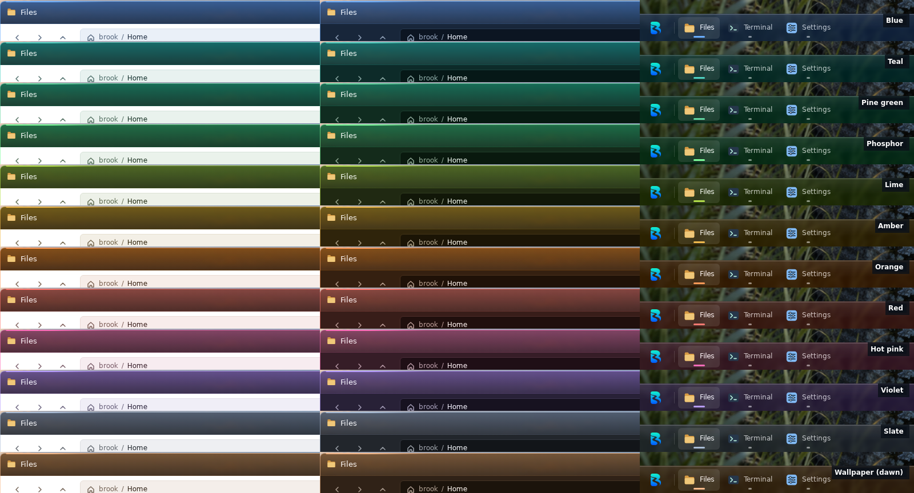
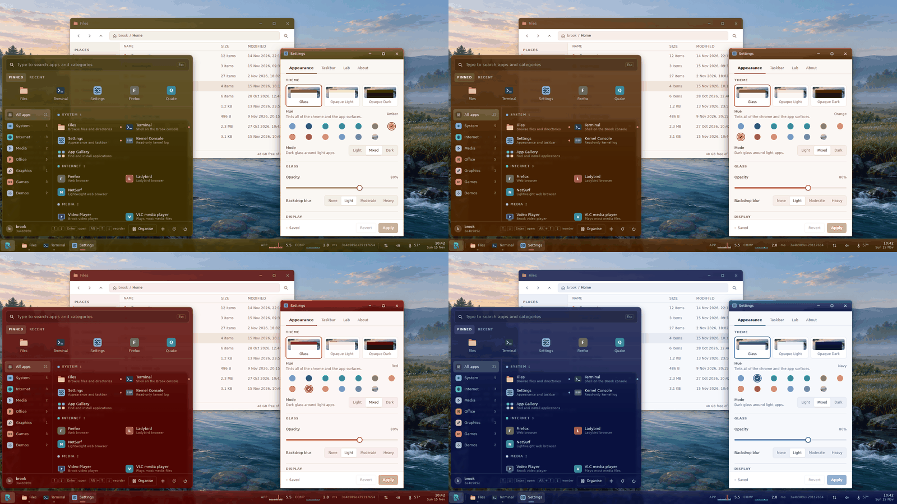
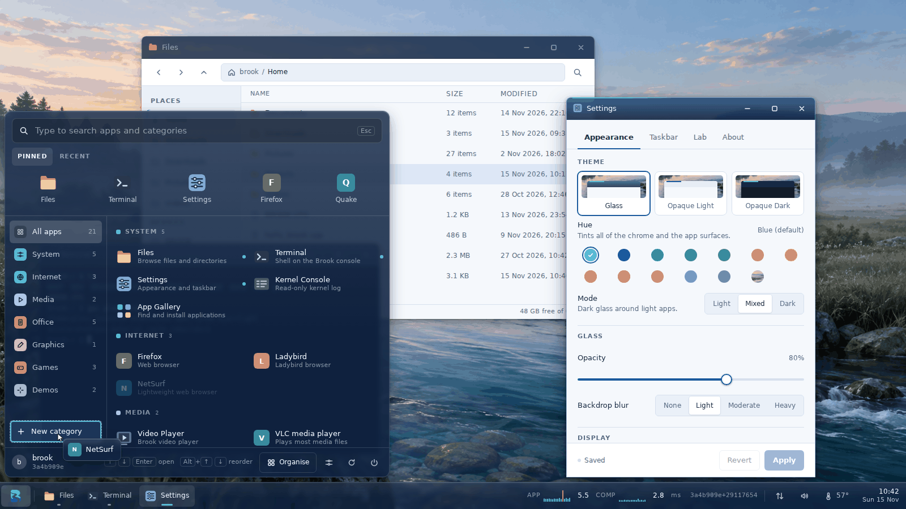
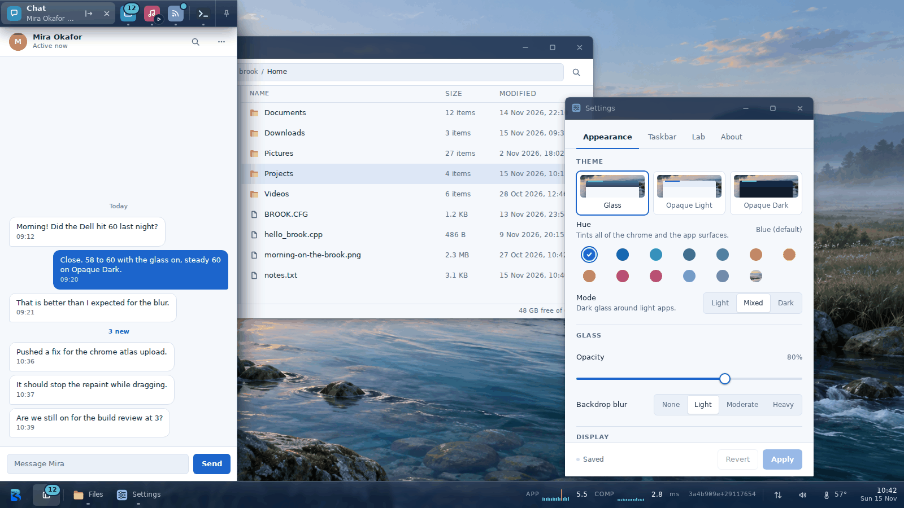
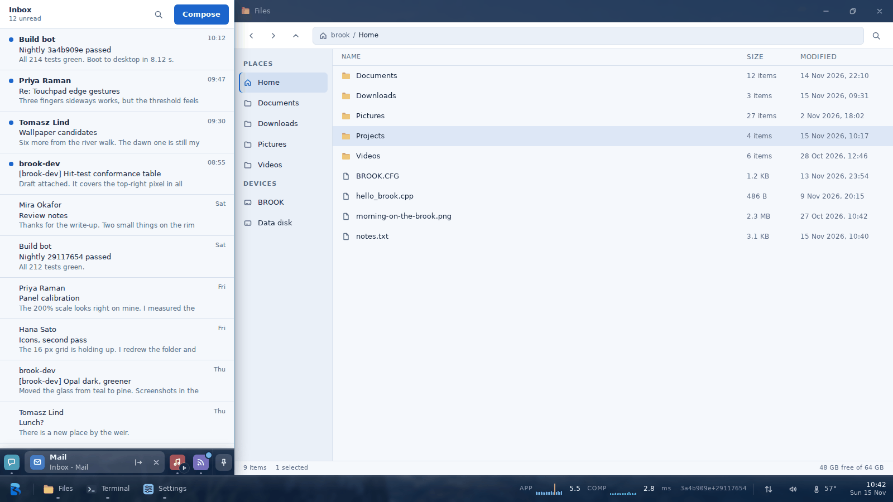
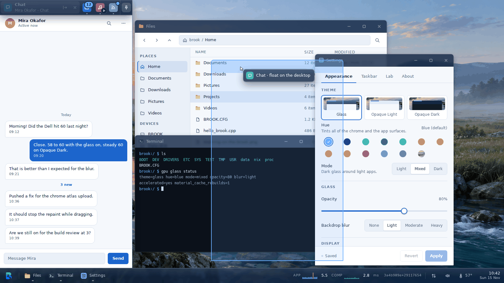
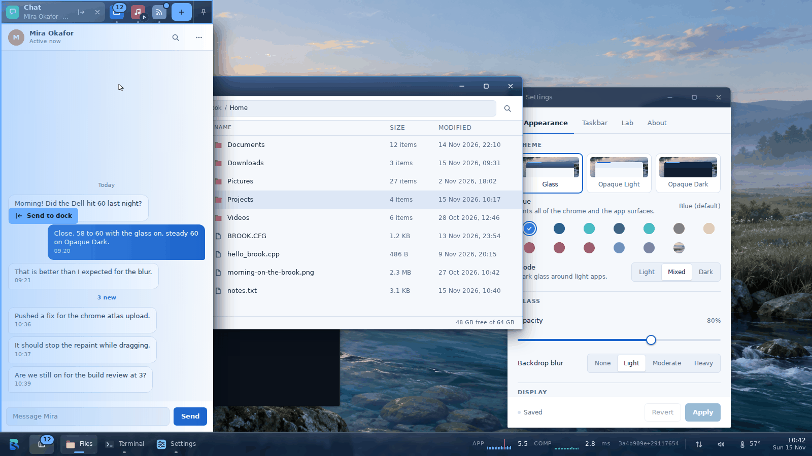
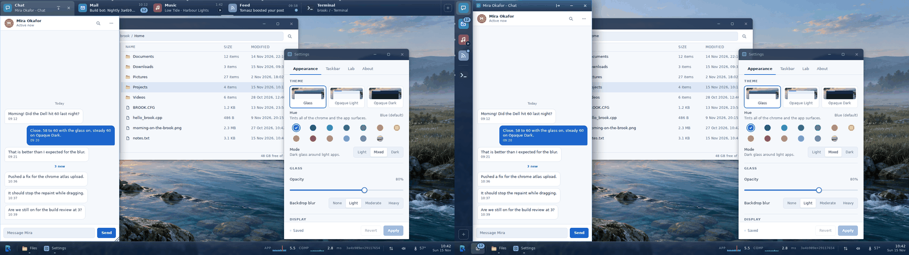

# Clearwater Next

15 November 2026. **Status: final design.** Ian's verdict after three passes: Glass
is the chrome style, with a customisable hue. The other chrome styles stay in
Settings › Lab and in this document as future options.

Two reviews followed the same day. The decisions in them are Ian's, and this
document now describes the result, not the route:

- **One Glass theme, two opaque ones.** The hue tints the whole chrome. Tinted,
  Smoked and Opal are folded into a single **Glass** theme with a hue picker.
  **Opaque** supplies solid fills on any hardware. Glass falls back to Opaque
  when the backend lacks backdrop blur. Both materials offer Light, Mixed
  and Dark modes, thirteen preset hues and a custom accent.
  See [Hue and accent colours](#hue-and-accent-colours).
- **The launcher is organised by dragging.** The right-click menu is Pin or
  Unpin and Uninstall, nothing else. “New category” is a drop target that
  appears while an app is dragged. Typing anywhere searches. See
  [Launcher organisation](#launcher-organisation).
- **The dock concept is a side dock.** Rail and peek, with the dock icons along
  the top or the bottom of the sidebar, everything inside the sidebar's width,
  and an option to pin it open. It is still a concept and is not scheduled.
  See [Dock and side drawer](#dock-and-side-drawer).

A browser-rendered design proposal that builds on
the October glass study. Nothing here is a Brook guest
capture or a native change. Main, the VM and the Dell are untouched.

Open `index.html` directly, or serve the folder with any static server. It is one
file with inlined CSS and JS, plus `assets/` (wallpaper, B mark and the built-in
icons, copied from `data/`). There are no network requests and no libraries.

The desktop is a fixed 1600×900 logical stage (the 3200×1800 panel at 200%),
scaled to fit the browser. The bar above it is study chrome, not part of Brook.

Contents:

1. [What you can try](#what-you-can-try)
2. [Review changes](#review-changes) and [Hue and accent colours](#hue-and-accent-colours)
3. [Design summary](#design-summary)
4. [Hit targets and the WmHitTest spec](#hit-targets-and-the-wmhittest-spec)
5. [Launcher organisation](#launcher-organisation)
6. [Making it pop: six directions](#making-it-pop-six-directions)
7. [Wild ideas](#wild-ideas)
8. [A pluggable, user-mode chrome architecture](#a-pluggable-user-mode-chrome-architecture)
9. [Token sheet](#token-sheet)
10. [Implementation order](#implementation-order) and the [full change list](#native-implementation-in-priority-order)
11. [Ideas backlog](#ideas-backlog): the [dock and side drawer](#dock-and-side-drawer) concept, not scheduled
12. [Limitations](#limitations) and [Files](#files)

All figures in the prototype are illustrative: boot times, frame times,
temperatures, addresses, file listings, the build label and the three
installable sample apps.

Native costs throughout are estimates. I did not read the compositor or window
manager source. They rest on the October README and on the description given for
this pass: the kernel CPU-rasterises chrome, taskbar, launcher and toasts into
cached textures, and the user-mode Vulkan renderer composites GPU quads.

## What you can try

- **Look.** Theme (Glass, Opaque Light, Opaque Dark), hue, mode (Light / Mixed /
  Dark), opacity and blur, from the study bar or Settings. The hue recolours
  the whole chrome in every theme. “Simulate no acceleration” in the study bar
  locks Glass, as Settings would on a machine without an accelerated GPU.
  Settings previews live; Apply saves to browser storage and Revert restores
  the saved look.
- **Launcher.** Click the B and type: there is no need to click the search box.
  Drag an app onto a category, between rows or onto the pinned row. While an
  app is being dragged a “New category” target appears at the foot of the
  rail. Drag categories to reorder. Right-click an app for Pin or Unpin and
  Uninstall. “Organise” adds tick boxes, so several apps can be dragged
  together, and category editing. The study bar's “Install app” adds a sample
  app to Unsorted.
- **Launcher keys.** Any character searches. ↑ ↓ move, Enter opens, Alt+↑ ↓
  reorders, Alt+Enter opens the app's menu, Ctrl+Space ticks, Ctrl+Z undoes,
  Esc backs out one level. On a category: Alt+↑ ↓ reorders, F2 edits, Delete
  removes.
- **Windows.** Drag titlebars, double-click to maximise, minimise, close, restore
  from the taskbar.
- **Tray and HUD.** Network, volume and temperature flyouts. Alt+P cycles the
  performance HUD.
- **Hit areas.** The study bar's “Hit areas” toggle tints every click target and
  draws the resize bands.
- **Lab.** Settings › Lab has the four alternative chrome styles, a reactive rim
  light and touch targets.
- **Dock (concept).** Off by default. Settings › Lab › Dock and drawer, or the
  Dock group in the study bar. Side dock is the first choice; “Icons top /
  Icons bottom” and “Pin dock open” sit beside it. Drag a window to the dock's
  edge, right-click a title bar or task button for “Send to dock”, and drag a
  tile out of the dock to float its window again. The four earlier variants
  are kept for comparison. See [Dock and side drawer](#dock-and-side-drawer).

URL parameters drive the screenshots: `?shot=1` plus any of `theme`, `accent`,
`mode`, `noaccel`, `opacity`, `blur`, `hud`, `tab`, `focus`, `style`, `rim`,
`touch`, `hits` and `scene` (`boot`, `toasts`, `launcher`, `search`, `organise`,
`menu`, `drag`, `dragnew`, `reorder`, `newcat`, `unsorted`, `empty`, `net`,
`vol`, `temp`). The dock concept adds `drawer`, `dpos`, `dpin`, `dockw`,
`dedge`, `dapp`, `dstash` and its own scenes, listed under
[Dock and drawer in the prototype](#dock-and-drawer-in-the-prototype).

## Review changes

Second pass, before the design was settled:

| Request | What changed |
| --- | --- |
| Mixed as the default | Mixed (dark glass around light apps) is the default mode. |
| Caption buttons to the chrome edges | Buttons fill the titlebar height and run to the window's outer top and right edges with no gaps. The frame rim is drawn over them, so it no longer takes a pixel of hit area. Spec below. |
| Larger targets | Titlebar 40, caption targets 48×40, taskbar 48 with full-height targets down to the screen edge, launcher rows 48, rail rows 40, segments 32, switches toggle from anywhere on their row. An optional touch density raises everything to 44 or more. |
| Blur ramp | 0 / 3 / 9 / 18 px, down from 0 / 10 / 20 / 36. Light keeps shapes recognisable, Moderate turns them into soft forms, Heavy leaves colour fields that still vary. Compare `?shot=1&blur=none`, `light`, `moderate` and `heavy`. |
| Launcher organisation | New. See [Launcher organisation](#launcher-organisation). |
| Pop, wild ideas, architecture | New sections, with five chrome styles and two effects mocked in Settings › Lab. |

One consequence of the lighter blur: at Light, text behind a panel stays faintly
legible. Text-heavy panels (launcher, flyouts, HUD, toasts) therefore sit 10
opacity points more solid than the taskbar and titlebars.

Ian's two reviews of the settled design, 15 November:

| Ian said | What changed |
| --- | --- |
| The accent should apply to the rest of the chrome | The hue drives every chrome and app surface. See [What the hue drives](#what-the-hue-drives). |
| “Opal theme doesn't need to exist, we can just fold them all into a Glass theme, then have a opaque light and dark theme alongside it that are for lower end hardware. We can lock Glass off when not accelerated.” | Three themes: Glass, Opaque Light, Opaque Dark. Smoked and Opal are gone as palettes; Slate, Pine green and Teal are the hues that give their looks. Performance mode is gone as a switch; the Opaque themes are what it was. Glass is greyed, with the reason, when the GPU is not accelerated. See [Themes](#themes). |
| “Amber should be a warmer yellow - looks too brown” | Amber is `#ffc233`. Its chrome is lighter and at full chroma, and the picker shows one identity colour per hue instead of the darkened accent. See [What moved, and the limits](#what-moved-and-the-limits). |
| “Orange & Red should be more vibrant” | Orange is `#ff8a3c` and Red is `#ff625a`, with chrome at full chroma. |
| “A darker blue would work well in addition” | Navy, a thirteenth hue. |
| Launcher: “Right-click menu only: Pin/Unpin, Uninstall” | The ⋯ buttons and the Move to menu are gone. See [Launcher organisation](#launcher-organisation). |
| Launcher: categories by drag and drop, no always-visible “New category” | It is a drop target that exists only while an app is dragged. |
| Launcher: typing anywhere searches | Any character typed in the open launcher goes to the search, wherever the focus is. |
| Dock: “The sidebar should stay confined to the sidebar width - icons only, except for the selected 'page'. No need for the blue highlight above indicating it's selected, the lighter shade does that already.” | The dock strip is as wide as the sidebar and no wider. Entries are icons; only the selected page's tile carries a name. The accent bar and marker on the selected entry are removed in every variant. |
| Dock: “Dragging out from the dock also works.” | Dragging a tile out of the dock floats its window where it is dropped, with an outline of where it will land. |
| Dock: “I think the rail and peek idea works the best, but with the dock icons pickable either top or bottom. There should also be an option to pin the dock open.” | The recommended variant is the side dock: hidden at rest and opened on demand like the rail, with the icons along the sidebar's top or bottom, and a pin that keeps it open and takes its width out of the work area. My reading of these three remarks is set out under [How I read the dock feedback](#how-i-read-the-dock-feedback). |

## Hue and accent colours

Settings › Appearance has separate Material and Mode controls. The picker
offers thirteen presets, including Wallpaper, and a custom sRGB accent chosen
with the HSV colour dialog. Swatches show the resolved chrome tint around the
accent and the preview shows the title bar, taskbar and app content.

### Themes

| Material | Surfaces | Cost |
| --- | --- | --- |
| **Glass** | Translucent chrome with backdrop blur, sheen and shadows. Settings exposes opacity and blur for this material. | Requires backdrop blur support |
| **Opaque** | Solid tinted fills with an accent line and rim on the active window. | One opaque quad per surface |

| Mode | System chrome | App content |
| --- | --- | --- |
| **Light** | Light | Light |
| **Mixed** (default) | Dark | Light |
| **Dark** | Dark | Dark |

Both materials offer every mode. The mode applies to title bars, taskbar,
launcher, menus, flyouts, toasts and HUD. When the active backend lacks
backdrop blur, Glass uses Opaque with the selected mode and accent. The saved
material stays Glass so it can take effect when the capability returns.

The earlier prototype screenshots illustrate the three-card layout. The native
Settings page now uses the two independent controls.

### What the hue drives

| On screen | Token | From the hue |
| --- | --- | --- |
| Taskbar, inactive title bars, launcher, flyouts, HUD, toasts, the dock | Glass tint | A tint anchored to the accent swatch hue |
| Active title bar | Active title top, over the glass tint | same |
| Every chrome surface in the Opaque themes; menus, the undo bar and drop chips in Glass | Flat fill | same |
| Text and icons on the chrome | Ink, with its secondary and tertiary alphas | Near white or near black, rotated from Blue with a trace of the hue |
| Hairlines, dividers, hover and pressed fills on light chrome | Line and hover tints | same |
| Window and panel shadows | Shadow colour | same |
| App surfaces: backgrounds, cards, sidebars, lines, text | Content background, raised, sunken, line, ink, dim ink | same |
| Accent line, focus ring, active rim, selection, switches, sliders, primary buttons, badges, task indicator | Accent and its derived tokens | The hue's bright and deep values |

Not driven by the hue: the wallpaper, app icons, category colours, the ok, warm
and hot colours, the red Close hover, the boot bar segments and the Terminal's
own colour scheme.

### How a hue becomes a token set

The Blue set is the reference. It is the look that was approved. For any other
hue:

1. Convert the hue's bright accent to OKLCH and take its hue angle and chroma.
   Blue's `#6aaeff` has hue 254° and chroma 0.14.
2. For glass, flat fill and the active title top, set the hue angle to the
   swatch angle. Scale reference chroma by 1.6 × min(1, swatch chroma ÷ Blue
   accent chroma). For other tokens, rotate each Blue reference by the bright
   accent's hue difference and scale it by the bright accent's chroma factor.
3. Apply the hue's shaping, if it has any (below).
4. Reduce chroma until the colour is inside sRGB.
5. Check the contrast targets. If a surface fails, move its lightness away
   from the text in steps of 0.004 until it passes. Then raise the secondary
   and tertiary ink alphas in steps of 2 points until they reach 4.5.

Step 3 is new. A plain rotation keeps Blue's lightness, and a yellow or a red
at that lightness is a brown. Four hues are shaped:

| Hue | Dark glass and flat fill | Dark title top | Light chrome | Dark app surfaces |
| --- | --- | --- | --- | --- |
| Amber | lightness +0.075, chroma ×3 | +0.11, ×3 | chroma ×2.2 | chroma ×1.25 |
| Orange | +0.05, ×3 | +0.06, ×3 | ×1.7 | ×1.2 |
| Red | +0.03, ×3 | +0.04, ×3 | ×1.6 | ×1.25 |
| Navy | −0.045, ×1.5 | −0.05, ×1.4 | ×1.25 | lightness −0.03, chroma ×1.3 |

“×3” means “as much as sRGB holds”: step 4 cuts it back to the gamut edge. The
contrast loop in step 5 then gives back whatever lightness the text cannot
afford, which is why the figures in the tables are not simply the reference
plus the shaping.

Blue retains the reference. The supported gamut and contrast checks bound
the saturation of each tint. Slate's lower swatch chroma still gives a muted
result, while Hot pink stays pink in Light and magenta in Mixed and Dark.
For Hot pink the light Glass tint changes from `#f8e6ee` to `#ffe5ef` and the
dark Glass tint changes from `#3b1626` to `#450528`.

A custom accent is used at the exact chosen RGB on both light and dark
surfaces. It uses the same tint derivation with default shaping. Ink on the
accent is whichever of black and white has the higher contrast. Hover and
pressed fills adjust towards the opposite ink when needed. Launcher badges
use that ink. Search matches use bold chrome ink if the custom accent has
low contrast against the panel. Chrome and signal text keep their checks. Preset-only accent-as-ink contrast targets
are omitted for custom accents so users can choose any colour.



### Derived tokens

| Token | On dark surfaces | On light surfaces |
| --- | --- | --- |
| Accent | The bright value | The deep value |
| Hover | Accent mixed 14% towards white | Accent mixed 12% towards black |
| Pressed | Accent mixed 14% towards black | Accent mixed 24% towards black |
| Text on accent | The accent mixed 88% towards near-black, so it keeps a trace of the hue | White |
| Focus ring | Accent, 2 px, offset 2 px | same |
| Active window rim | Accent at 62% | Accent at 60% |
| Selection tint | Accent at 16% | Accent at 11% |
| HUD APP colour | Accent. For Orange, Red and Hot pink it is neutral secondary ink, because over-budget bars are red. | same |
| HUD COMP colour | Teal `#5fd6c8`; blue `#7db8ff` when the accent is itself green or teal | Teal `#0a7f8a`; blue `#1f6fe0` |
| Ok / warm / hot | `#5fcf8f` / `#f0b35a` / `#ff6f6a` | `#157040` / `#855400` / `#c0271f` |

- Each hue has two accent values. The bright one is used on dark chrome and
  dark content with dark text on it. The deep one is used on light chrome and
  light content with white text on it. Mixed mode uses the bright value in the
  chrome and the deep value inside apps.
- Each hue also has a **swatch**: the colour that stands for it in the picker,
  the same in every mode. It also sets the hue of the large chrome tints.
- The light ok, warm and hot values are new. The bright ones were being drawn
  on light chrome, where they do not reach 3.0.
- Phosphor is the green from the Phosphor style, as a colour only.
- Wallpaper is sampled when the wallpaper is set. The value here is for
  `brook-dawn.png`.

| Hue | Swatch | Bright | hover | pressed | text on it | text on pressed | Deep | hover | pressed | white on hover | Dark ink, secondary / tertiary | Light ink, secondary / tertiary |
| --- | --- | --- | --- | --- | --- | --- | --- | --- | --- | --- | --- | --- |
| Blue | `#3f8cff` | `#6aaeff` | `#7fb9ff` | `#5b96db` | `#101e2e` | 5.4 | `#1c65cc` | `#1959b4` | `#154d9b` | 6.7 | 74% / 52% | 78% / 66% |
| Navy | `#17409c` | `#739fff` | `#87acff` | `#6389db` | `#111c2e` | 4.9 | `#17409c` | `#143889` | `#113177` | 10.7 | 74% / 52% | 78% / 66% |
| Teal | `#1fb5a8` | `#4fd3c4` | `#68d9cc` | `#44b5a9` | `#0d2227` | 6.6 | `#09747e` | `#08666f` | `#075860` | 6.6 | 74% / 52% | 78% / 66% |
| Pine green | `#2fa56f` | `#62d6a0` | `#78dcad` | `#54b88a` | `#0f2223` | 6.7 | `#1b7650` | `#186846` | `#155a3d` | 6.7 | 74% / 52% | 78% / 66% |
| Phosphor | `#35d45f` | `#7dff9b` | `#8fffa9` | `#6cdb85` | `#132722` | 9.0 | `#0f7a33` | `#0d6b2d` | `#0b5d27` | 6.6 | 74% / 52% | 78% / 66% |
| Lime | `#9acb2b` | `#b4e04a` | `#bee463` | `#9bc140` | `#192419` | 7.7 | `#53710c` | `#49630b` | `#3f5609` | 6.8 | 74% / 52% | 78% / 66% |
| Amber | `#ffc233` | `#ffc233` | `#ffcb50` | `#dba72c` | `#222016` | 7.4 | `#8f5d00` | `#7e5200` | `#6d4700` | 6.7 | 74% / 56% | 78% / 66% |
| Orange | `#ff7a1a` | `#ff8a3c` | `#ff9a57` | `#db7734` | `#221917` | 5.4 | `#b54600` | `#9f3e00` | `#8a3500` | 6.6 | 74% / 56% | 78% / 66% |
| Red | `#f0392f` | `#ff625a` | `#ff7871` | `#db544d` | `#22151b` | 4.5 | `#c9211d` | `#b11d1a` | `#991916` | 6.8 | 74% / 56% | 78% / 66% |
| Hot pink | `#f0389b` | `#ff6cba` | `#ff81c4` | `#db5da0` | `#221626` | 5.0 | `#c71d7b` | `#af1a6c` | `#97165d` | 6.5 | 74% / 52% | 78% / 66% |
| Violet | `#8d63f0` | `#b79cff` | `#c1aaff` | `#9d86db` | `#191c2e` | 5.5 | `#6a43d6` | `#5d3bbc` | `#5133a3` | 7.4 | 74% / 52% | 78% / 66% |
| Slate | `#7088a8` | `#a9bdd6` | `#b5c6dc` | `#91a3b8` | `#181f2a` | 6.4 | `#47607f` | `#3e5470` | `#364961` | 7.7 | 74% / 52% | 78% / 66% |
| Wallpaper (dawn) | `#f6b98a` | `#f6b98a` | `#f7c39a` | `#d49f77` | `#211f20` | 7.0 | `#a8511d` | `#94471a` | `#803e16` | 6.6 | 74% / 52% | 78% / 66% |

### Values per hue

RGB triplets are chrome fills. In Glass the opacity setting supplies alpha to
the glass tint and the title top; the flat fill is always opaque. “Chroma” is
the original bright-accent factor used for detail and app tokens. The hue of
the large chrome tints comes from each swatch.

| Hue | Angle | Chroma | Dark glass | Dark title top | Dark flat fill | Dark app background | Dark app raised | Light glass | Light title top | Light flat fill | Light app background | Light app sunken |
| --- | --- | --- | --- | --- | --- | --- | --- | --- | --- | --- | --- | --- |
| Blue | 254° | 1.00 | 16 36 66 | 40 80 138 | 22 40 68 | `#111c2b` | `#18263a` | 226 237 251 | 186 213 248 | 226 235 247 | `#f5f8fc` | `#eaf0f8` |
| Navy | 264° | 1.00 | 0 17 75 | 0 49 168 | 0 20 83 | `#0c1328` | `#131d38` | 226 236 255 | 188 211 255 | 224 235 255 | `#f6f8fc` | `#ebeff8` |
| Teal | 185° | 0.85 | 0 43 39 | 0 94 86 | 0 48 43 | `#0a201e` | `#0d2b29` | 214 243 239 | 150 228 218 | 216 240 236 | `#f4f9f8` | `#e8f2f0` |
| Pine green | 161° | 0.96 | 0 45 25 | 0 97 60 | 0 49 28 | `#0c2017` | `#102c20` | 218 243 228 | 161 229 190 | 219 240 227 | `#f4f9f6` | `#e9f2ed` |
| Phosphor | 149° | 1.00 | 0 46 12 | 0 98 34 | 0 50 14 | `#0f2014` | `#142b1b` | 221 243 223 | 170 227 177 | 221 240 223 | `#f5f9f6` | `#eaf2eb` |
| Lime | 124° | 1.00 | 28 42 0 | 66 91 0 | 31 46 0 | `#171e0d` | `#202912` | 230 241 215 | 196 222 156 | 229 238 217 | `#f7f9f4` | `#edf1e8` |
| Amber | 83° | 1.00 | 69 49 0 | 142 104 0 | 69 49 0 | `#241a02` | `#312301` | 255 233 192 | 255 202 89 | 255 231 186 | `#faf7f3` | `#f3efe6` |
| Orange | 51° | 1.00 | 81 32 0 | 146 64 0 | 87 35 0 | `#2a1608` | `#381e0b` | 255 230 217 | 255 195 164 | 255 228 214 | `#fbf7f4` | `#f7ede8` |
| Red | 26° | 1.00 | 89 0 1 | 153 0 4 | 96 0 2 | `#2c1310` | `#3b1b16` | 255 229 225 | 255 193 184 | 255 227 222 | `#fcf6f5` | `#f8eceb` |
| Hot pink | 350° | 1.00 | 69 5 40 | 144 14 88 | 71 14 44 | `#28151d` | `#361d27` | 255 229 239 | 255 188 215 | 254 229 238 | `#fbf6f8` | `#f7ecf0` |
| Violet | 295° | 1.00 | 40 22 79 | 88 51 163 | 43 28 80 | `#1d1829` | `#282137` | 236 232 255 | 212 202 255 | 234 231 253 | `#f8f7fc` | `#f0eef7` |
| Slate | 254° | 0.31 | 23 37 56 | 54 82 118 | 28 41 58 | `#181c20` | `#22262c` | 230 236 246 | 195 212 235 | 229 235 243 | `#f7f8f9` | `#eeeff2` |
| Wallpaper (dawn) | 59° | 0.68 | 58 27 0 | 121 64 0 | 62 31 2 | `#231910` | `#302217` | 249 232 220 | 242 201 171 | 247 232 222 | `#faf7f5` | `#f4eeea` |

The full set per hue (ink, lines, shadow, sunken and line colours for both
modes) is in the generated block of `index.html`.

### Computed contrast

Contrast is the WCAG 2 ratio, computed by script and floored to one decimal, so
no figure is flattered by rounding. The targets are 4.5 for anything used as or
under text and 3.0 for the accent line on the active title gradient.

Each chrome figure is the worse of the Glass tint and the Opaque flat fill.
Mixed uses the dark chrome columns and the light app columns. Glass is
translucent, so its visible contrast depends on the backdrop. These checks
use the solid tint as their reference.

Dark chrome and dark apps:

| Hue | Accent | Ink | Secondary ink | Tertiary ink | Ink on title top | Accent on chrome | Accent line on title top | Text on accent | App ink (worst surface) | App dim ink (worst) | Accent on app surfaces (worst) | Ok / warm / hot on chrome |
| --- | --- | --- | --- | --- | --- | --- | --- | --- | --- | --- | --- | --- |
| Blue | `#6aaeff` | 13.3 | 7.9 | 4.6 | 7.2 | 6.4 | 3.4 | 7.3 | 12.9 | 6.0 | 6.6 | 7.6 / 7.9 / 5.4 |
| Navy | `#739fff` | 15.4 | 8.7 | 4.8 | 9.4 | 6.6 | 4.0 | 6.6 | 14.0 | 6.5 | 6.4 | 8.8 / 9.2 / 6.3 |
| Teal | `#4fd3c4` | 13.0 | 7.8 | 4.5 | 6.9 | 7.8 | 4.1 | 8.9 | 12.7 | 6.0 | 8.2 | 7.4 / 7.7 / 5.3 |
| Pine green | `#62d6a0` | 13.0 | 7.7 | 4.5 | 6.8 | 7.9 | 4.1 | 9.1 | 12.7 | 5.9 | 8.2 | 7.4 / 7.7 / 5.3 |
| Phosphor | `#7dff9b` | 13.0 | 7.7 | 4.5 | 6.8 | 11.3 | 6.0 | 12.4 | 12.9 | 6.0 | 11.9 | 7.3 / 7.7 / 5.2 |
| Lime | `#b4e04a` | 13.1 | 7.8 | 4.6 | 6.9 | 9.4 | 5.0 | 10.4 | 12.9 | 6.0 | 9.8 | 7.4 / 7.7 / 5.3 |
| Amber | `#ffc233` | 11.2 | 6.9 | 4.6 | 4.5 | 7.6 | 3.1 | 10.1 | 12.9 | 5.9 | 9.4 | 6.3 / 6.6 / 4.5 |
| Orange | `#ff8a3c` | 11.4 | 6.9 | 4.6 | 6.3 | 5.4 | 3.0 | 7.3 | 13.0 | 5.9 | 6.5 | 6.5 / 6.8 / 4.6 |
| Red | `#ff625a` | 12.5 | 7.1 | 4.5 | 7.9 | 4.7 | 3.0 | 6.0 | 13.1 | 6.0 | 5.2 | 7.2 / 7.5 / 5.1 |
| Hot pink | `#ff6cba` | 13.8 | 8.0 | 4.6 | 7.8 | 5.9 | 3.3 | 6.6 | 12.9 | 5.9 | 5.9 | 7.9 / 8.2 / 5.6 |
| Violet | `#b79cff` | 13.6 | 8.0 | 4.7 | 7.8 | 6.6 | 3.8 | 7.3 | 12.9 | 6.0 | 6.7 | 7.8 / 8.1 / 5.5 |
| Slate | `#a9bdd6` | 13.2 | 7.8 | 4.6 | 7.2 | 7.6 | 4.1 | 8.6 | 12.8 | 5.9 | 7.9 | 7.5 / 7.9 / 5.4 |
| Wallpaper (dawn) | `#f6b98a` | 13.5 | 7.9 | 4.6 | 7.4 | 8.7 | 4.8 | 9.5 | 13.0 | 5.9 | 8.9 | 7.7 / 8.0 / 5.5 |

Light chrome and light apps:

| Hue | Accent | Ink | Secondary ink | Tertiary ink | Ink on title top | Accent on chrome | Accent line on title top | White on accent | App ink (worst surface) | App dim ink (worst) | Accent on app background and sunken (worst) | Ok / warm / hot on chrome |
| --- | --- | --- | --- | --- | --- | --- | --- | --- | --- | --- | --- | --- |
| Blue | `#1c65cc` | 12.7 | 6.7 | 4.6 | 10.1 | 4.6 | 3.6 | 5.5 | 12.4 | 4.6 | 4.8 | 5.0 / 5.3 / 4.9 |
| Navy | `#17409c` | 12.8 | 6.7 | 4.6 | 10.1 | 7.7 | 6.1 | 9.3 | 12.4 | 4.6 | 8.1 | 5.1 / 5.3 / 4.9 |
| Teal | `#09747e` | 12.5 | 6.6 | 4.6 | 10.3 | 4.6 | 3.7 | 5.5 | 12.3 | 4.5 | 4.8 | 5.1 / 5.3 / 4.9 |
| Pine green | `#1b7650` | 12.6 | 6.6 | 4.6 | 10.3 | 4.6 | 3.8 | 5.5 | 12.2 | 4.5 | 4.8 | 5.1 / 5.3 / 4.9 |
| Phosphor | `#0f7a33` | 12.5 | 6.6 | 4.6 | 10.2 | 4.5 | 3.7 | 5.4 | 12.3 | 4.5 | 4.7 | 5.1 / 5.3 / 4.9 |
| Lime | `#53710c` | 12.5 | 6.6 | 4.5 | 10.2 | 4.7 | 3.8 | 5.6 | 12.3 | 4.5 | 4.9 | 5.1 / 5.3 / 4.9 |
| Amber | `#8f5d00` | 12.7 | 6.6 | 4.6 | 10.1 | 4.6 | 3.7 | 5.6 | 12.4 | 4.6 | 4.9 | 5.0 / 5.3 / 4.8 |
| Orange | `#b54600` | 12.7 | 6.7 | 4.6 | 9.9 | 4.5 | 3.5 | 5.4 | 12.5 | 4.6 | 4.7 | 5.0 / 5.3 / 4.8 |
| Red | `#c9211d` | 12.8 | 6.8 | 4.7 | 10.0 | 4.6 | 3.6 | 5.6 | 12.5 | 4.6 | 4.8 | 5.0 / 5.2 / 4.8 |
| Hot pink | `#c71d7b` | 13.0 | 6.8 | 4.7 | 9.9 | 4.5 | 3.4 | 5.3 | 12.7 | 4.7 | 4.6 | 5.1 / 5.4 / 4.9 |
| Violet | `#6a43d6` | 12.7 | 6.6 | 4.6 | 10.0 | 5.1 | 4.0 | 6.2 | 12.5 | 4.6 | 5.3 | 5.0 / 5.3 / 4.8 |
| Slate | `#47607f` | 12.6 | 6.6 | 4.6 | 10.1 | 5.3 | 4.2 | 6.4 | 12.4 | 4.6 | 5.6 | 5.1 / 5.3 / 4.9 |
| Wallpaper (dawn) | `#a8511d` | 12.8 | 6.7 | 4.6 | 10.0 | 4.5 | 3.5 | 5.4 | 12.5 | 4.6 | 4.7 | 5.1 / 5.3 / 4.9 |

The native host test checks the thirteen presets against these tables and
checks custom accents for text contrast. App surfaces and preset accent RGB
values retain their prior tokens.



### HUD colours

| Hue | HUD APP colour | HUD COMP colour (dark / light) |
| --- | --- | --- |
| Blue | accent | `#5fd6c8` / `#0a7f8a` |
| Navy | accent | `#5fd6c8` / `#0a7f8a` |
| Teal | accent | `#7db8ff` / `#1f6fe0` |
| Pine green | accent | `#7db8ff` / `#1f6fe0` |
| Phosphor | accent | `#7db8ff` / `#1f6fe0` |
| Lime | accent | `#7db8ff` / `#1f6fe0` |
| Amber | accent | `#5fd6c8` / `#0a7f8a` |
| Orange | neutral ink | `#5fd6c8` / `#0a7f8a` |
| Red | neutral ink | `#5fd6c8` / `#0a7f8a` |
| Hot pink | neutral ink | `#5fd6c8` / `#0a7f8a` |
| Violet | accent | `#5fd6c8` / `#0a7f8a` |
| Slate | accent | `#5fd6c8` / `#0a7f8a` |
| Wallpaper (dawn) | accent | `#5fd6c8` / `#0a7f8a` |

### Native notes

- `[Desktop]` holds `theme=glass|opaque`, `mode=light|mixed|dark` and either
  a preset key or `#rrggbb` in `accent`. Numeric `theme=1` and `theme=2` and
  named `opaque-light` and `opaque-dark` migrate to Opaque with their fixed
  modes. Glass retains its mode. Older palette aliases still select their
  hues. A saved Performance flag chooses Opaque when no material is named.
- Brook's theme syscall uses ops 6/7 for the selected material, mode, hue and
  optional RGB. Ops 0–3 continue to support old clients. Op 4 reports
  backdrop blur capability and op 5 returns the active app colours.
- Opaque uses the flat fill. Its renderer skips the blur chain and Glass
  sheen. The theme model retains the selected opacity and blur when the
  user switches materials.
- Preset token palettes are derived once per boot. Selecting a custom accent
  updates its cached palettes. Chrome draws from a consistent palette
  snapshot at frame build time.

- App surfaces follow the hue, so the content colours have to reach apps at
  runtime. Settings is GTK3: write them as `@define-color` lines in a small
  generated CSS file and reload it on change. Native Brook apps read them from
  the theme.
- A painter that hard-codes a blue will show up at once under any other hue.
  That is a reason to land the hue before the chrome repaint.
- Cost: cheap to moderate. The Opaque themes add nothing: they remove work.

## Design summary

This carries over from the first pass, updated for the new sizes.

- **Glass.** One recipe for every shell surface: backdrop blur, tint, a smooth
  sheen gradient over the top 60%, a 1 px inner highlight and a 1 px hairline. No
  saturation pass, no refraction. Client areas are opaque.
- **Window chrome.** A 40 px titlebar. The active window has a title gradient, a
  2 px accent line on the top rim that fades out over 176 px, a brighter rim and a
  deeper shadow. Inactive windows keep the same opacity, with dimmed text and icon.
  Corners are 8 px on top and 2 px at the bottom, because client textures are
  rectangular. The title is one string, as the client sets it.
- **Taskbar.** 48 px. Task buttons show icon and title with a state pill: wide
  accent for focused, short for running, outline for minimised. The tray groups
  network, volume and temperature. The clock is two lines. The build label is a
  monospace chip that can be hidden.
- **Performance HUD.** Off, Compact (a taskbar strip whose top edge is the 16.7 ms
  budget) or Panel (APP, COMP and TEMP graphs with percentiles). Graphs are bar
  quads refreshed at 2 to 4 Hz, so the HUD does not keep the compositor awake.
- **Settings.** A 440 px inspector with tabs, theme cards that double as the
  preview, segmented controls, and a footer with Revert and Apply. All of it is
  expressible in GTK3 CSS.
- **Toasts.** Top-right, at most three. The boot toast leads with the total, then
  a proportional Firmware / Menu / Loader / Kernel bar. No countdown bar.
- **Type and icons.** DejaVu Sans and Hack, Regular and Bold only, 11 px minimum.
  One icon set on a 16 px grid with a 1.5 px stroke.
- **Themes and hue.** Glass is the design. Opaque Light and Opaque Dark are the
  same layout in flat fills, for hardware that cannot afford glass. One hue
  from the swatch row tints everything in all three; the default is Blue. A
  mode is a lightness.

## Hit targets and the WmHitTest spec

### Principles

1. A target's hit area and its visual are separate. Visuals stay small; hit areas
   fill the space around them.
2. Targets at a window or screen edge own that edge. The pointer stops at the
   edge, so an edge target is effectively infinitely deep.
3. Adjacent targets share boundaries. There are no dead pixels between caption
   buttons, between taskbar buttons, or between a taskbar button and the screen
   bottom.

### Zones on a normal window

Tested in this order. The first match wins. Sizes are logical pixels.

| # | Zone | Region | Result |
| --- | --- | --- | --- |
| 1 | Outer resize margin | 6 px outside the visible frame on every side. Within 16 px of a corner along either edge it is a diagonal resize. | Resize |
| 2 | Caption buttons | A contiguous run at the right of the titlebar, 48 px each. Each spans y = 0 (the outer top edge) to the titlebar's bottom. Close spans to x = width − 1 (the outer right edge). | Minimise, maximise, close |
| 3 | Inner resize band | 2 px inside the frame along the left, right and bottom edges, and along the top edge to the left of the button run. 8×8 px squares at the top-left, bottom-left and bottom-right corners resize diagonally. | Resize |
| 4 | Titlebar | The rest of the 40 px titlebar. | Drag; double-click maximises |
| 5 | Client | Everything else. | Client input |

The conflict is settled in the buttons' favour inside the frame. Above and to the
right of the button run there is no inner resize band, and the top-right inside
corner is Close. Resizing from the top edge above the buttons, and diagonally
from the top-right corner, comes from the outer margin only. That margin is three
times the depth of the inner band, so the resize target there is larger than it
is today.

The outer margin belongs to its window for z-order purposes. A window above it
still wins, because the window list is walked front to back.

### Maximised, tiled and fullscreen

- **Maximised.** Zones 1 and 3 do not exist. The buttons own y = 0 and the
  rightmost pixel column. The pointer is clamped to the screen, so pushing it into
  the top-right corner lands on Close.
- **Tiled to a screen edge.** Any window edge that touches a screen edge loses its
  resize zones on that edge. A window tiled to the right half therefore has Close
  in the screen corner too.
- **Fullscreen.** No chrome and no zones.

### Themes that move the buttons

The button run should not be hard-coded. WmHitTest reads a small table of parts,
each with a role and a rectangle anchored to window edges. Zone 2 is “any part
with a button role”, and zone 3 excludes the top-edge span covered by such parts.
The [architecture section](#a-pluggable-user-mode-chrome-architecture) describes
how themes supply that table.

### Taskbar and screen edges

- Every taskbar target is the full 48 px high and reaches the bottom screen edge.
- The launcher button is 56 px wide and includes the bottom-left corner pixel.
- The last target on the right should reach the right screen edge. In the
  prototype the clock is not interactive, so nothing claims that corner yet.

### Sizes

| Target | Pointer | Touch density |
| --- | --- | --- |
| Caption button | 48×40, visual pill 36×26 | 52×44 |
| Taskbar target | 48 high, 44 wide minimum, visual pill 38 high | 52 high |
| Launcher app row | 48 high, full column width | 52 |
| Launcher rail row, menu item | 40 and 36 | 44 |
| Icon button | 36×36 | 44×44 |
| Segment, tab | 32 and 40 high | 40 and 44 |
| Switch | 44×24 visual; the whole row toggles, 44 high | 48 |
| Slider | 32 high track target, 20 px thumb | same |
| Files rows | 36 | 44 |

Touch density is a setting with a switch in Settings › Lab. The prototype also
turns it on at the first touch event. Natively I would make it Auto / On / Off,
with Auto switching on at the first touch-down and staying on for the session.
For touch input, zone 1 should grow to 12 px and zone 3 can be dropped.

### In the prototype

“Hit areas” in the study bar tints click targets magenta, outlines the titlebar
drag region in amber, and draws the two resize bands in cyan. Resizing itself is
not interactive in the prototype; only the zones are drawn.
`screenshots/hit-areas.png` shows the overlay.

### Conformance test

A table-driven host test for WmHitTest would cover: the outer top-right pixel in
normal, maximised and right-tiled states; one pixel either side of each button
boundary; y = 0 across the titlebar; the 6 px margin on each side; and the same
set at 100, 150 and 200% scale.

## Launcher organisation

### The model

- **One home per app.** An app lives in exactly one category, or in Unsorted.
- **Pins are references.** The pinned row is a separate ordered list. Pinning does
  not move an app out of its category.

Why one home and not many: “move” is then unambiguous, dragging never has to ask
“copy or move?”, removing an app from a category cannot orphan a duplicate, and
the saved layout is a plain ordered list per category. The need that multiple
homes would serve, reaching an app from two places, is met by pins and by search.

No folders inside categories. Category then app is two levels, and pins and
search are shortcuts across them. A third level hides apps behind one more click
and makes drag targets ambiguous.

### What you can do, and how

Ian's decisions (15 Nov): organising is drag and drop; an app's right-click
menu holds Pin or Unpin and Uninstall, and nothing else; “New category” is not
on screen until an app is being dragged.

| Operation | Pointer | Keyboard |
| --- | --- | --- |
| Open an app | Click | Type, then Enter; or ↑ ↓ and Enter |
| Move an app to another category | Drag it onto the category in the rail, or onto its section in the list | Alt+↑ ↓ past the end of a category |
| Reorder within a category | Drag between rows; an accent bar shows the slot | Alt+↑ ↓ |
| Move several apps | Organise, tick them, drag any ticked app | Ctrl+Space to tick |
| Pin or unpin | Right-click › Pin or Unpin; or drag onto the pinned row, at a position | Alt+Enter, Pin |
| Uninstall | Right-click › Uninstall | Alt+Enter, Uninstall |
| Create a category | Drag an app, or several ticked apps, onto “New category” | |
| Rename, recolour, change icon | Right-click the category, or its ⋯ in Organise | F2 |
| Reorder categories | Drag in the rail | Alt+↑ ↓ on the category |
| Delete a category | Editor › Delete | Delete |
| Undo | “Undo” in the bar that follows every change | Ctrl+Z, 20 levels |
| Reset | Organise › Reset to defaults | |



Details:

- **The menu is two items.** Right-click, long-press, Alt+Enter or the Menu key
  on an app: Pin (or Unpin) and Uninstall. Apps have no ⋯ button. Opening is a
  click, and everything else is a drag.
- **“New category” is a drop target, not a button.** While an app is in flight
  it appears at the foot of the category rail with a dashed outline. Drop on
  it and a category is created holding what was dragged, with its name ready
  to type over. At any other time the rail shows only categories.
- **Uninstall can be undone for eight seconds.** The Undo bar names the app.
  Natively the package is removed when the bar goes, so Undo never has to
  reinstall. Nothing asks for confirmation. Files, Terminal, Settings, Kernel
  Console and App Gallery are part of Brook and show Uninstall disabled.
- **Spring-loaded categories.** Rest a dragged app on a rail category for 0.7 s
  and that category opens, so the app can be dropped at an exact position.
- **Drag works without a mode.** Organise is only needed for multi-select and for
  the category ⋯ buttons. In Organise, a click ticks an app instead of opening it.
- **Every change is announced and undoable.** A bar names what happened (“Moved
  Quake to Media”) with an Undo button for 8 seconds.
- **Deleting never loses apps.** A deleted category's apps go to Unsorted. The
  editor says so before you press Delete.
- **Eight colours and twelve icons** per category. Enough to tell categories apart
  at a glance, few enough to choose in one look.

What the decision costs, so it is on the record:

- **There is no click-only way to move an app.** The earlier design gave every
  operation a drag, a menu and a keyboard path, because a long drag is the
  hardest gesture on a touchpad. Moving is now drag or Alt+arrows. The inbox
  suggestions below still file a new app in one click.
- **There is no keyboard way to create a category.** A keyboard user moves apps
  with Alt+arrows between the categories that exist.

### Unsorted: the inbox

Newly installed apps land in **Unsorted**, marked “New”. The rail shows Unsorted
with a count badge only while it has something in it.

Each unsorted app carries a one-click suggestion taken from the category its
package declares (“Move to Graphics”), and “Sort all as suggested” files the lot.
Suggestions are offers. The launcher never moves an app on its own, so a layout
the user made is never rearranged behind their back.

A suggestion only appears if the user still has that default category. Renaming
it does not break the link, because suggestions match on the category's ID.

### Defaults and reset

The seven default categories (System, Internet, Media, Office, Graphics, Games,
Demos) are ordinary categories. They can be renamed, recoloured, reordered and
deleted like any other. “Reset to defaults” restores the default set and
membership, sends apps the defaults do not know about to Unsorted, leaves pins
alone, and can itself be undone.

### Search

- **Typing anywhere in the open launcher searches at once.** The search box
  shows the query; it never has to be clicked. A character typed while the
  focus is on a category, a row or nothing at all goes to the query, and so
  does Backspace. Space still presses a focused button until there is a query
  to add it to.
- Search matches app names first, then the user's own category names, then
  descriptions. Typing “games” lists everything filed under Games, whatever the
  apps are called.
- Matching categories appear as chips above the results. Clicking one opens it.
- Each result shows its category as a chip.
- Results are ranked, so they cannot be reordered by drag. The right-click menu
  still works on them.

### Empty states

| Where | Text |
| --- | --- |
| No pins | Nothing pinned yet. Drag an app here, or right-click one and choose Pin. |
| Empty category | No apps in *name* yet. Drag apps here. |
| Unsorted, empty | Nothing to sort. Newly installed apps land here until you file them. |
| No categories | No categories yet. Drag an app to New category to make one, or restore the standard set. With a Reset to defaults button. |
| No search results | Nothing matches “*query*”. Search covers app names, descriptions and your category names. |

Empty categories are hidden in All apps until Organise is on, so an empty
category never pads the list.

### How this compares

- Windows 11's Start menu groups All apps into categories it chooses, which the
  user cannot edit. Brook's defaults are only a starting layout.
- macOS Launchpad organises by dragging one icon onto another to make a folder,
  with no multi-select and no undo. Brook is now as drag-led as Launchpad, and
  keeps both of those.
- Neither has an inbox for new installs, and neither lets search see the user's
  own groups.

### Persistence

In the prototype the layout is saved to browser storage under
`brook.clearwater-next.launcher.v1`. Natively it belongs in a `[Launcher]`
section of the user settings, keyed by the stable `app_id` the shortcuts already
declare:

```
[Launcher]
version=1
top_row=pinned
pinned=org.gnome.Nautilus,terminal,settings,firefox,quake
categories=system,internet,media,office,graphics,games,demos,c1
category.system=System|blue|sliders|org.gnome.Nautilus,terminal,settings,kconsole,gallery
category.c1=Writing|green|folder|brook-edit,mousepad
new=inkscape
```

Rules:

- **Unsorted is computed**: installed apps that no category lists. It is never
  written.
- **Unknown IDs are kept.** If an app is uninstalled and later reinstalled, it
  returns to its place. Unknown IDs are skipped when drawing. The prototype is
  simpler: Uninstall drops the app from its category and pins, and Undo puts
  it back.
- **Writes are atomic and debounced**: write a temporary file, rename, at most
  once a second.
- **A bad or missing section falls back to the defaults.** It is never an error.
- Check the settings parser's line-length limit first. If lines are short, store
  one key per app instead: `app.<id>=<category>,<position>`.
- Shortcuts gain an optional `# category:` line, used only for suggestions.

### Native cost

| Piece | Cost | Notes |
| --- | --- | --- |
| Layout model, `[Launcher]` load and save, Unsorted | Cheap | Pure data. Host-testable. |
| Type-anywhere search | Cheap | The launcher surface takes every key while it is open; there is no focus to manage inside it. Still needs text input and a caret. |
| Right-click menu with Pin and Uninstall | Cheap to moderate | Two fixed items. It still needs the popup menu component, which toasts and flyouts do not yet provide. |
| Uninstall | Moderate | A deferred package removal with an undo window, and a list of protected system apps. |
| Category rail from data, colours, icons, counts | Cheap | Rounded rect plus a tinted mask icon per row. |
| Keyboard reorder and Undo stack | Cheap | Snapshots of a few hundred bytes. |
| Drag and drop: ghost, drop highlight, insertion bar, the New category target, spring-load, auto-scroll | Moderate | The ghost is one more quad that follows the pointer. Hit-testing rows during a drag is the bulk of the work. |
| Organise mode with multi-select | Moderate | State and a selection bar. |
| Category editor (text field, swatches, icon grid) | Moderate | Needs the same text input the search field needs. |
| Suggestions and Sort all | Cheap | A string compare against the declared category. |

Drag and drop used to be able to ship last, because menus and keys reached
everything. It is now the only way to create a category and the only pointer
way to move an app, so it ships with the launcher, not after it.

## Making it pop: six directions

Each is distinctive, stays usable all day, and is drawable with rounded rects,
gradients, nine-slices, fixed blur levels and alpha. Three are mocked in
Settings › Lab.

### 1. Brook tabs. Recommended as the signature shape.

- **Borrows from** BeOS and Haiku, where the title is a yellow tab on the frame
  and not a bar across it.
- **In Brook.** The titlebar becomes two glass tabs: icon and title on the left,
  the three controls on the right. The wallpaper shows between them. The content
  frame keeps its hairline rim and shadow. The accent line sits on the title tab.
  Maximised windows revert to a full bar.
- **Why it works.** It is unmistakable in a screenshot, and it shows more
  wallpaper and less chrome. Unlike Haiku, the controls stay in the top-right
  corner, so the edge-to-edge hit targets above still hold.
- **Follow-on.** Haiku's Stack and Tile: drop one window's tab beside another's to
  group them behind one frame. That is window-manager work, not theming.
- **Native cost.** Moderate. Two backdrop bands per titlebar instead of one, a hit
  table with a gap between the tabs (the gap passes clicks through), and a decision
  about dragging by either tab.
- **Mock.** Settings › Lab, or `?shot=1&style=tabs`.

### 2. Wallpaper accent. Recommended, and best with Mixed.

- **Borrows from** Material You's dynamic colour, cut down to a single accent.
- **In Brook.** When the wallpaper is set, sample its most vivid hue and use it for
  the accent: focus rim, accent line, selection, switches, primary buttons. With
  the dawn wallpaper that is a warm peach (`#f6b98a` on dark glass, `#a8511d` on
  light content). The chrome follows it too, as a soft brown.
- **Why it works.** A warm accent on cool glass has far more life than blue on
  blue, and changing the wallpaper refreshes the whole desktop. One hue with
  fixed lightness, capped chroma and checked contrast avoids Material You's
  tendency to tint everything into mud. See
  [How a hue becomes a token set](#how-a-hue-becomes-a-token-set).
- **Native cost.** Cheap. One histogram over a downsampled wallpaper when it
  changes, then two contrast-clamped accent values, the hue derivation and a
  material-cache rebuild.
- **Status.** Adopted as the last swatch of the hue row. The value is hard-coded
  for this wallpaper in the prototype.

### 3. Reactive rim light. Recommended as the subtle one.

- **Borrows from** visionOS glass edges and the Vista-era glow, without refraction.
- **In Brook.** The active window's rim takes its colour from the wallpaper behind
  each edge, brightened and saturated. Over the dawn sky the top rim is pale gold;
  over the water the sides are blue. Drag a window and its rim shifts.
- **Why it works.** It makes glass feel lit by the scene for the cost of a
  hairline. It is invisible when you are not looking for it.
- **Native cost.** Cheap to moderate. Sample the existing 480×270 blur target at
  eight points round the window, and set them as per-vertex colours on the rim
  quads. Update only when the window moves or the wallpaper changes. No per-frame
  work at rest.
- **Mock.** Settings › Lab › Reactive rim light, or `?shot=1&rim=1`.

### 4. Flavour packs

- **Borrows from** the Hyprland and r/unixporn tradition of named palettes:
  Catppuccin, Rosé Pine, Nord, Tokyo Night, Gruvbox.
- **In Brook.** Palettes become data files with the same token names as a
  built-in hue's set. Two that would suit the wallpaper: a muted rose-and-pine pack and
  a cold slate-and-frost pack. Each defines dark and light glass, content colours
  and one accent.
- **Why it works.** These palettes are popular because they are low-contrast in
  chrome and high-contrast in text, which is exactly what all-day use needs.
- **Native cost.** Cheap once palettes load from a file. Until then, each pack is
  one more entry in `brook_theme.h`.
- **Mock.** None. It is a token change.

### 5. Crisp: a flat mode with character

- **Borrows from** NeXTSTEP, Mac OS Platinum, RISC OS and SerenityOS.
- **In Brook.** Opaque chrome with a 1 px light edge on top and left and a 1 px
  dark edge on bottom and right. The active titlebar gets fine horizontal
  pinstripes; inactive is plain. Corners drop to 3 px. Caption buttons become
  small raised squares.
- **Why it works.** The Opaque themes are “glass with the effects off”. Crisp
  would make the cheapest look one someone might choose for itself.
- **Native cost.** Cheap. Solid rects, four 1 px lines and a tiled 1×2 stripe. No
  blur, no shadow, no alpha.
- **Mock.** None.

### 6. Instrument HUD

- **Borrows from** Teenage Engineering's hardware and software.
- **In Brook.** The performance HUD and tray flyouts only: Hack throughout, labels
  in small capitals, hairline dividers, one orange signal colour, and graphs drawn
  as dot-matrix columns instead of bars.
- **Why it works.** The HUD is a developer instrument. Dressing it as one gives
  Brook a recognisable detail without touching the chrome everyone else sees.
- **Native cost.** Cheap. The same bar quads with a gap every 3 px.
- **Mock.** None. Phosphor (below) shows the monospace HUD.

### Recommendation

Decided: Glass stays the chrome style, and direction 2 grew into the accent row.
Direction 3 remains a Lab switch and is the cheapest of the rest to add later.
Brook tabs is the one I would prototype natively if a signature shape is wanted.

## Wild ideas

Bold and opinionated, but each should survive an hour of real work. Three are
mocked in Settings › Lab. In every case the client area is untouched; only the
chrome and shell change.

| Idea | Pitch | To draw it natively | Cost | Mock |
| --- | --- | --- | --- | --- |
| **Alloy** | Chrome is brushed metal under a fixed light. A highlight band is pinned to the screen, so it slides across a window as you drag it. | A tiled 2 px line texture, a base gradient, and one gradient quad whose texture offset is the window's screen x. Opaque, so no blur. | Cheap | Lab, `style=alloy` |
| **Phosphor** | The chrome is a green CRT. Monospace labels, scanlines and a faint glow, on the chrome only. Apps stay normal. | Scanlines are a tiled 1×3 quad. The glow is a blurred copy of each glyph baked into the glyph atlas. A real bloom pass would be a custom shader. | Cheap with baked glow, expensive with real bloom | Lab, `style=phosphor` |
| **Neon** | Synthwave. Magenta-to-cyan accent line across the whole titlebar, a cyan glow round the active window, a grid on the taskbar. | The glow is one coloured nine-slice. The grid is a tiled quad. The line is a two-stop gradient. | Cheap | Lab, `style=neon` |
| **Tide** | A living theme. The glass tint follows the time of day (pale at noon, amber at dusk, ink at night), and the taskbar's top highlight rises and falls with the audio level. | A tint interpolated between four keyframes and rebuilt every few minutes. The highlight is one quad whose alpha is a uniform fed from the mixer's peak meter at about 15 Hz, only while audio plays. | Moderate. Needs an audio-level feed to the renderer, and it must stop redrawing when silent. | None |
| **Sketchbook** | Hand-drawn chrome on paper. Wobbly ink outlines, a pencil-hatched active titlebar, handwritten-looking caption glyphs. | Three pre-drawn nine-slice variants per part, picked by a hash of the window ID so each window wobbles differently but stays still. A handwriting font for titles. | Cheap to draw, moderate in asset work. A live wobble shader would be expensive and tiring to look at. | None |

Not proposed: blob windows whose outlines morph, and a tilted or isometric
desktop. Both need per-pixel distortion or a perspective transform of client
content, and both make text harder to read, which fails the one-hour test.

## A pluggable, user-mode chrome architecture

The goal: several looks people can pick from, with the code that draws them
living in user mode, and a path there from today's kernel rasteriser.

### Three roles

| Role | Lives in | Owns |
| --- | --- | --- |
| Window manager | Kernel, for now | Geometry, z-order, focus, window state, input routing and the final say on hit-testing. |
| Theme engine | User mode | Turns “this window, in this state, at this size” into a draw list and a hit table. |
| Renderer (VKRENDER) | User mode | Executes draw lists, owns GPU resources, measures cost and enforces budgets. |

### Where theme code runs

**Recommendation: the theme engine is a library inside the renderer process, and
themes are data, not code.**

- The renderer already owns the atlas, the blur targets and the frame clock.
  Drawing chrome there avoids a per-frame hop to another process.
- A declarative theme cannot crash or hang. The failure modes are a parse error
  and a budget overrun, and both are handled in one place.
- The only executable content a theme may bring is a fragment shader for an
  effect slot, which the renderer validates and meters.

A separate decoration service only becomes worthwhile if themes need logic beyond
expressions over window state. I would not start there.

The **shell** is different. The taskbar, launcher, toasts and HUD have real state
and logic, so they belong in a user-mode shell process that draws with the same
primitives and theme tokens, on a privileged layer that may request backdrop
blur. The launcher organisation model and its `[Launcher]` file live there.

### Theme package

A directory:

```
clearwater/
  theme.toml        tokens, metrics, capabilities
  chrome.toml       parts: what to draw, and where the hit regions are
  shell.toml        optional overrides for taskbar, panels, toasts
  atlas.png         nine-slices and textures
  icons.a8          mask icons at 1x and 2x
  effects/*.spv     optional shader slots
```

**Tokens** are the token sheet in this document: colours per mode, radii,
spacing, type sizes, shadow and blur levels, motion timings.

**Primitives**, the whole vocabulary:

| Primitive | Parameters |
| --- | --- |
| `rect` | Rect, per-corner radius, fill (solid or two- to four-stop linear gradient), optional border width and colour |
| `nine_slice` | Rect, atlas region, insets, tint |
| `tile` | Rect, atlas region, offset, tint |
| `glyphs` | Text source (title, clock, literal), font role, size, colour, alignment, elide |
| `icon` | Mask ID or window icon, size, tint |
| `backdrop` | Rect, blur level (none, light, moderate, heavy), tint, opacity |
| `effect` | Rect, shader slot, up to eight float uniforms |
| `clip` | Rounded rect applied to the primitives that follow |

**Expressions.** Geometry and colours may reference window state: `active`,
`maximised`, `tiled_edges`, `urgent`, `hover_part`, `pressed_part`, `width`,
`height`, `scale`, `screen_x`, `screen_y`, `wallpaper_accent`, `rim_sample[0..7]`,
`time_of_day` and, where the user allows it, `audio_level`. Rects are anchored to
window edges, so nothing needs a layout engine.

**Parts and hit regions.** `chrome.toml` lists parts:

```
[[part]]
role   = "close"            # close | maximise | minimise | menu | drag | none
anchor = "top-right"
rect   = [-48, 0, 48, 40]   # x, y, w, h from the anchor, logical px
bleed  = ["top", "right"]   # extend the hit area to the outer edge
draw   = [ ...primitives... ]
```

Themes can therefore move or reshape buttons and still be hit-tested correctly.

### Interface between window manager and theme

1. **Theme to WM, on load and on change:** frame insets per state (how far the
   client sits inside the frame), and the hit table (role, anchor, rect, bleed) for
   each state. Both carry a generation number.
2. **WM validates the table** before accepting it. A Close part and a drag region
   must exist, every button must be at least 24×24 logical pixels and inside the
   frame, and parts must not overlap. A theme that fails is rejected.
3. **WmHitTest evaluates the table** against the window's current size. It stays
   authoritative and never asks user mode during input.
4. **WM to renderer, as today plus state:** the window list with geometry, state
   flags, hovered and pressed part, title, and the hit-table generation it is
   using.
5. **The renderer draws a window's chrome only with the theme generation the WM
   reports**, so what is drawn and what is clickable cannot disagree during a
   switch.
6. **Reserved escapes stay in the kernel:** the keyboard close and move shortcuts
   work regardless of theme.

### Caching and animation

- Draw lists are cached per (theme, state hash, size). A focus change swaps two
  cached lists. Nothing is regenerated per frame.
- Text and icons go through the renderer's glyph and mask atlases.
- Animations are declared (property, from, to, duration, easing) and evaluated by
  the renderer. There is no per-frame IPC, and the frame clock stops when the last
  animation ends.

### Budgets and safety

| Limit | Proposed value |
| --- | --- |
| Primitives per window frame | 64 |
| Backdrop primitives per window | 2 |
| Theme atlas | 8 MiB |
| Effect slots per window, and per shell surface | 1 |
| Shader | No unbounded loops, at most 16 texture samples, reads only declared inputs |
| GPU time for all chrome and shell | 1.0 ms per frame at 3200×1800, averaged over 60 frames, from timestamp queries |

Escalation when over budget for two seconds:

1. Disable the theme's effect slots.
2. Still over: draw the theme's flat variant.
3. Still over, or the theme fails validation at any time: switch to the built-in
   Flat theme and raise a toast naming the theme and the reason.

**If the renderer itself dies**, the kernel keeps a minimal CPU-rasterised frame
(title, Close, a solid bar) for exactly that case. Today's rasteriser, reduced,
becomes this safety net.

**The Opaque themes** are applied at the primitive level: `backdrop` becomes its
flat fill, `effect` and shadows are skipped, animations are instant. Every
chrome style gets an opaque form for free, including the wild ones.

**Hot-swap.** Load and validate the new theme off the frame path, build its
atlases, send insets and hit table to the WM, and switch at the frame where the
WM reports the new generation. Windows whose insets changed get one configure.

### Migration, as milestones

Each milestone leaves a shippable desktop and has an exit test.

| # | Milestone | What changes | Exit test |
| --- | --- | --- | --- |
| T0 | Tokenise | The kernel's chrome constants move into one theme struct: tokens, metrics and a hit table. WmHitTest reads the table. The edge-to-edge caption spec lands here. Pixels are still rasterised in the kernel. | Hit-test conformance test passes. Captures are unchanged apart from the intended metrics. |
| T1 | Draw-list chrome | For window frames, the kernel emits primitives instead of pixels, and VKRENDER draws them. The CPU path stays behind a switch. | Captures match the CPU path within tolerance. Compositor frame time is no worse than baseline. Killing the renderer shows the fallback frame. |
| T2 | Themes from disk | The renderer loads `theme.toml` and `chrome.toml` and generates the draw lists itself. The kernel sends state only and receives insets and the hit table. Ship Clearwater, Flat and Brook tabs. | Hot-swap between the three with no mismatched frame. A deliberately broken theme is rejected with a toast. |
| T3 | Shell out of the kernel | Taskbar, launcher, toasts and HUD move to a user-mode shell process using the same primitives. Launcher organisation and `[Launcher]` land here. | Kernel rasteriser code for those surfaces is deleted. Shell crash restarts it without losing windows. |
| T4 | Effect slots | Shader slots with validation and GPU-time budgets. Reactive rim, Alloy and Phosphor ship as themes. | A shader that overruns is disabled within two seconds and the desktop stays at frame rate. |
| T5 | Picker and packaging | Settings lists installed themes with a live preview and a validation report. Themes install per user. | Installing, selecting and removing a theme needs no restart. |

T0 is worth doing even if nothing else follows: it is where the caption hit
areas and the second-pass metrics land.

**Risks to settle early:** text parity between the kernel's rasteriser and a
renderer glyph atlas; keeping WM state and renderer state in step during resizes;
and damage tracking once chrome is no longer a cached texture.

## Token sheet

Values are logical pixels at 200%. Double them for device pixels.

### Chrome, by mode

RGB triplets are fills. In Glass the opacity setting supplies alpha; in the
Opaque themes every surface is the flat fill at 100%. These are the values for
the default hue, Blue. The other twelve hues replace every row; their values
are in [Values per hue](#values-per-hue).

| Token | Dark | Light |
| --- | --- | --- |
| Glass tint | 16 36 66 | 226 237 251 |
| Active title top | 40 80 138 | 186 213 248 |
| Flat fill (Opaque themes, menus, chips) | 22 40 68 | 226 235 247 |
| Accent | `#6aaeff` | `#1c65cc` |
| Text on accent | `#101e2e` | `#ffffff` |
| Second graph colour | `#5fd6c8` | `#0a7f8a` |
| Active rim | 106 174 255 / 62% | 28 101 204 / 60% |
| Ink | `#eef4fc` | `#14263d` |
| Ink secondary / tertiary | ink at 74% / 52% | ink at 78% / 66% |
| Outer hairline | white 14% | 20 44 80 at 24% |
| Inner top highlight | white 20% | white 75% |
| Sheen gradient (top to 60%) | white 9% to 0 | white 34% to 0 |
| Titlebar divider | black 28% | 20 44 80 at 13% |
| Hover / pressed fill | white 10% / 17% | 20 50 100 at 8% / 14% |
| Well (search field, graph box) | black 22% | white 50% |
| Opacity floor | 40% | 55% |
| Shadow colour | 3 10 22 | 20 34 56 |
| Ok / warm / hot | `#5fcf8f` / `#f0b35a` / `#ff6f6a` | `#157040` / `#855400` / `#c0271f` |

Mixed uses the dark chrome column with the light content column in both materials.

Alpha, in Glass: the taskbar and inactive titlebars use the opacity setting.
Active titlebars add 8 points. Text-heavy panels add 10. All cap at 100%.

Category colours: blue `#6aaeff`, teal `#5fd6c8`, green `#6fd08c`, amber
`#f0b35a`, coral `#ff8a73`, pink `#ee8fc0`, violet `#b9a6f5`, slate `#a9b8cc`.
Category icons sit on these as `#0b1a2b` glyphs, which reads on both chrome modes.

### Content, by mode

| Token | Dark | Light |
| --- | --- | --- |
| Background | `#111c2b` | `#f5f8fc` |
| Raised | `#18263a` | `#ffffff` |
| Sunken | `#0c1522` | `#eaf0f8` |
| Line | `#26374f` | `#d7e0ed` |
| Ink | `#e6edf7` | `#1c2b3f` |
| Dim ink | `#93a4bb` | `#5c6d84` |
| Selection | accent 16% | accent 11% |

Content accents equal the chrome accent of the same lightness. These are the
Blue values too; the content colours follow the hue.

Close hover `#c8414f`.
Boot segments: Firmware `#7db8ff`, Menu `#b9a6f5`, Loader `#5fd6c8`, Kernel `#f0b35a`.

### Geometry

| Token | Value |
| --- | --- |
| Radii | 4 (segments, kbd), 6 (buttons, rows, task pills, category tiles), 8 (window top, cards, search field, menus), 12 (launcher, flyouts, HUD, toasts); window bottom 2; maximised and Performance-mode windows square |
| Spacing | 4, 8, 12, 16, 20, 24, 32 |
| Taskbar | 48 high; targets full height; visual pill inset 5 top and bottom, 2 each side; launcher button 56 wide; task button 48 to 188 wide |
| Titlebar | 40 high; icon 16; caption targets 48×40 with a 36×26 hover pill |
| Controls | Buttons 36, icon buttons 36×36, segments 32, tabs 40, switch 44×24, slider thumb 20 |
| Launcher | 680×648; search 44; pinned tiles with 32 icons; rail 180 with 40 rows; app rows 48 with 28 icons; footer 52 |
| Menu and category editor | Menu 228 wide minimum, items 36; editor 292 wide, swatches and icons 32 high |
| Flyout / HUD / toast | 304 / 348 / 360 wide; 8 from screen edge and taskbar; toasts 16 from the top-right |
| Settings | 440 wide; 20 side padding; rows 44 minimum |
| Resize zones | 6 outside the frame, 2 inside, 8×8 inside corners, 16 along each edge for outer corners |

### Type

DejaVu Sans for UI, Hack for build labels, addresses and the terminal.

| Role | Size | Weight |
| --- | --- | --- |
| Caption, eyebrow (uppercase, +0.08em), HUD labels, chips | 11 | Regular; Bold for eyebrows |
| Secondary text, task labels, clock, hints, small buttons | 12 | Regular |
| Body, window titles, list rows, menu items | 13 | Regular; Bold for toast and tab titles |
| Panel titles, search field | 15 | Bold / Regular |
| Toast hero number, About name | 20 | Regular / Bold |
| Flyout readout | 28 | Regular |

Digits in the clock, HUD, counts, sizes and dates are tabular.

### Shadow and blur

| Token | Value |
| --- | --- |
| Active window | 0 14 32 at 50%, plus contact 0 2 6 black 40% |
| Inactive window | 0 6 16 at 30%, plus contact 0 1 3 black 30% |
| Shell panel | 0 10 24 at 40%, plus contact 0 1 3 black 30% |
| Menu, undo bar | 0 10 24 at 45%; flat fill at 97 to 98%, no blur |
| Taskbar | No drop shadow; inner top highlight only |
| Blur None / Light / Moderate / Heavy | 0 / 3 / 9 / 18 CSS px in the prototype |

Each shadow pair bakes into one nine-slice. Menus use a flat fill so that a menu
over the launcher does not cost a second backdrop.

The blur numbers fix a visual ratio of roughly 1 : 3 : 6, not native radii.
Against the 480×270 blur target, I would start with Light as a single
downsample-and-upsample with no extra passes, Moderate as two ping-pong passes
and Heavy as four, then tune by eye against the prototype at each `blur=` value.

### Motion

| Token | Value | Used for |
| --- | --- | --- |
| Fast | 90 ms | Hover and pressed fills |
| Base | 140 ms | Panels open and close (fade plus 8 px rise), window minimise and close (fade plus 10 px), switches, task indicator width |
| Slow | 220 ms | Toast entry (fade plus 10 px drop) |
| Spring-load | 700 ms | Dwell before a dragged app opens a category |
| Undo bar | 8 s | Time the Undo offer stays |
| Easing | cubic-bezier(.2, 0, 0, 1) | Everything |

The Opaque themes and reduced-motion remove all transitions.

## Implementation order

The design is settled. This is the order I would build it in natively. Each step
leaves a usable desktop.

1. **Hit table and caption buttons.** WmHitTest reads a part table; caption
   buttons reach the top and right outer edges; the conformance test lands with
   it. Then the new metrics: titlebar 40, taskbar 48 with full-height targets.
2. **Tokens and themes.** The re-spaced blur ramp, panels 10 points more
   solid, Mixed as the default, the three-way mode setting, and `theme=` with
   Glass, Opaque Light and Opaque Dark, Glass locked when the compositor
   reports no acceleration. The old palette and Performance settings are read
   as aliases.
3. **Hue.** The 13-row accent table, `accent=` in `[Desktop]`, and the
   derivation that turns a hue into the full token set at cache rebuild,
   with the tables in this document as its test vectors. Then the swatch row in
   Settings and the content colours handed to apps. Wallpaper sampling can
   follow. This step grew: it was accent details only. It now has to land
   before step 4, so the repaint is checked against several hues and no blue is
   left hard-coded in the painters.
4. **Glass chrome repaint.** Sheen, fading accent line, active rim, caption glyphs
   and hover pills, radii and the three shadows.
5. **Taskbar.** Task button states, tray group with temperature, build chip, clock.
6. **Launcher data.** The layout model, `[Launcher]` persistence, category rail,
   pinned row and Unsorted, drawn with today's launcher painter.
7. **Launcher interaction.** Type-anywhere search, drag and drop with the New
   category target, the two-item menu, keyboard reorder and Undo. Organise
   mode and the category editor come last.
8. **Toasts, flyouts and the HUD** as bar quads.
9. **Settings restructure**, then motion.

Steps 1 to 5 touch only the window manager's hit test, constants and chrome
painting. Steps 6 to 8 are where a user-mode shell (milestone T3) would pay off,
so decide before step 6 whether to build them in the kernel or wait for it.

**Decided (Ian, 15 November):**
- Launcher organisation waits for the user-mode shell process. It is not
  built in the kernel painter first.
- Glass on the Dell is decided by measurement, once the Vulkan renderer can
  blur.

The compositor work that leads there is in
compositor-refactor-plan.md.

## Native implementation, in priority order

The full change list, with costs.

| # | Change | Cost | Notes |
| --- | --- | --- | --- |
| 1 | Caption buttons edge to edge, with the hit-test zones above | Cheap | WmHitTest plus the conformance test. This is milestone T0's first use. |
| 2 | New metrics: titlebar 40, taskbar 48 with full-height targets, launcher button in the corner | Cheap | Layout constants. |
| 3 | Token values, rim colours; Mixed as default; `theme=` as Glass, Opaque Light or Opaque Dark, with Glass locked when not accelerated; old palette and Performance settings read as aliases | Cheap | `brook_theme.h`, and one flag from the compositor. The Opaque themes are the existing flat-fill path. One material-cache rebuild per change. |
| 4 | Blur ramp re-spaced; panels 10 points more solid | Cheap | Pass counts per level, tuned by eye. |
| 5 | Titlebar repaint: smooth sheen, 2 px fading accent line, active rim, inactive at equal opacity | Cheap | Baked into the chrome texture. |
| 6 | Caption glyphs and hover pill; radii 8 and 12; three-shadow set | Cheap | Regenerates masks and nine-slices. |
| 7 | Task button states, build chip, tray temperature with warm and hot colours | Cheap | A few quads each. |
| 8 | Selectable hue: 13-row accent table and derived accent tokens; the full token set derived from the hue, with shaping for Amber, Orange, Red and Navy; swatch row; content colours handed to GTK and native apps at runtime; wallpaper sampling | Cheap to moderate (was cheap) | OKLCH maths at cache rebuild only, a host test against the tables here, a generated colour file for GTK, and a histogram at wallpaper-set time. Do it before row 5. |
| 9 | Launcher layout model and `[Launcher]` persistence, category rail, Unsorted, suggestions | Cheap to moderate | Data first; drawable with today's launcher painter. |
| 10 | Launcher search, typed from anywhere in the open launcher, with ranking over category names | Moderate | Needs text input in a shell surface. |
| 11 | Launcher right-click menu (Pin or Unpin, Uninstall), keyboard reorder, Undo | Moderate | Needs a popup menu component, and a deferred uninstall. |
| 12 | Toast component and boot toast; shared flyout for network and temperature | Moderate | |
| 13 | HUD strip and panel as bar quads | Moderate | Replaces per-frame texture upload. |
| 14 | Mode as Light / Mixed / Dark with light glass variants | Moderate | Settings migration from the boolean. |
| 15 | Reactive rim light | Cheap to moderate | Per-vertex colours from the blur target. |
| 16 | Launcher drag and drop with the New category target; Organise mode; category editor | Moderate | Drag and drop is now the only way to make a category, so it lands with row 9. Organise and the editor can follow. |
| 17 | Settings restructure with the Lab tab | Moderate | GTK3 only. |
| 18 | Touch density, Auto / On / Off | Moderate | Needs touch events to reach the shell. |
| 19 | Motion | Moderate | Fades and short slides only. |
| 20 | Brook tabs and the other chrome styles | Moderate each today; cheap after milestone T2 | The case for the theme architecture. |

### New native capabilities needed

- **A part-based hit table** in the window manager, replacing fixed caption
  geometry.
- **Tinted alpha-mask icons** at 1× and 2×, for system glyphs and category icons.
- **Text input in a shell surface**, for search and the category name.
- **A popup menu component** and **a clipped scrolling list**.
- **Pointer capture for drags inside a shell surface**, with a ghost quad.
- **A toast queue** with timers.
- **Sample history** for temperature and power, and frame-time percentiles.
- **A wallpaper colour sample**: one accent, and eight rim samples per window.
- **Hue derivation in the theme code**: sRGB to OKLCH and back, a gamut clamp
  and the contrast loop, run at material-cache rebuild.
- **Content colours published at runtime**, so Settings and native apps follow
  the hue.
- **An acceleration flag from the compositor**, so Settings can lock Glass and
  the theme code can fall back to an opaque theme.
- **A three-way mode setting** and the `[Launcher]` section.
- **Touch events delivered to the shell**, for auto touch density.

Not required: per-pixel refraction, a saturation or colour-matrix pass, client
corner clipping, or a new blur level.

### What would be expensive

- **Animating blurred panels.** A panel that moves over the backdrop resamples its
  blur every frame. Keep slides to 8 to 10 px and under 140 ms, or fade only.
- **HUD refresh.** Redrawing graphs every frame keeps the compositor awake and
  adds to the numbers it reports. Hold the strip and tray at 2 to 4 Hz.
- **Barrier budget.** Launcher, a flyout, the HUD panel and three toasts are each
  a glass surface. With several glass titlebars this approaches the 16-barrier
  cap. Brook tabs doubles the bands per titlebar. Toasts and the HUD should fall
  back to the flat fill first.
- **Real bloom** for Phosphor, and any live distortion for Sketchbook.
- **Rounded bottom corners on windows**, which need a mask on client textures.
- **Dragging** still repaints and uploads the chrome atlas per the October notes,
  until milestone T1 replaces that path.

## Ideas backlog

Ideas raised after the design was settled. Nothing in this section is in the
implementation order or the change list above.

### Dock and side drawer

**Status: concept, not scheduled.** Mocked in the prototype and written up
here so it can be judged. No native work is planned for it.

Ian's idea (15 Nov): “a side drawer for Socials, messaging apps and so on where
you can stash other windows for quick access.”

It has been through three shapes. First three side variants: an icon rail with
a peek, a card shelf, and edge tabs. Then, at Ian's request, a dock across the
top edge whose tiles carried the window info. Ian's verdict on those is the
**side dock** described here, which is now the recommended variant. The four
earlier ones stay in Settings › Lab for comparison and are summarised under
[Earlier variants](#earlier-variants).

To see it, open Settings › Lab › Dock and drawer, or use the Dock group in the
study bar. It is off by default. With it off nothing of the dock is drawn and
the work area is the whole screen above the taskbar; the self-test checks
that.



#### How I read the dock feedback

Ian's three remarks were made on the top dock and the rail. This is the reading
the design rests on, so it is stated where it can be corrected.

| Ian said | I took it to mean |
| --- | --- |
| “The sidebar should stay confined to the sidebar width - icons only, except for the selected 'page'.” | The sidebar is the panel the open app sits in. The dock strip must not run across the screen as the top dock's did: it is exactly as wide as that panel. Its entries are icons, and only the selected app's tile carries a name. |
| “No need for the blue highlight above indicating it's selected, the lighter shade does that already.” | The top dock drew an accent bar and marker on the open tile. Both are gone. The lighter tile is the only selection mark, here and in the earlier variants. |
| “I think the rail and peek idea works the best, but with the dock icons pickable either top or bottom.” | Keep what the rail did: nothing on screen at rest, opened on demand, the app peeking at the side. Move the icons off the vertical rail into a strip along the sidebar's top or its bottom, as a setting. |
| “There should also be an option to pin the dock open.” | A pin that keeps the sidebar on screen and takes its width out of the work area. |
| “Dragging out from the dock also works.” | Dragging a tile out of the dock returns that window to the desktop, floating where it is dropped. |

The other reading of “top or bottom” is a dock along the top or bottom *edge of
the screen*. I did not take it, because it contradicts “confined to the sidebar
width” and brings back the strip the first remark rejects. If that is what was
meant, the top dock in Lab is most of it already.

#### The model

- The dock holds **entries**, one per app. There are two kinds.
  - A **resident** lives in the dock: chat, mail, music, a social feed. It is
    saved in `[Dock]`, keeps its entry when it is closed, and starts in the
    dock the next time it is launched.
  - A **guest** is any other window docked for now. Its entry goes when the
    window is closed or returned to the desktop.
  - Residents come first, then a divider, then guests. “Keep in dock” turns a
    guest into a resident.
- A **docked** window keeps running. It leaves the taskbar and Alt+Tab, and
  the compositor does not draw it unless it is the selected page.
- The **sidebar** is one column on the left or right edge, from the top of the
  screen to the taskbar. It holds the **strip** of dock icons and one
  **page**: the selected app's real window, placed by the window manager.
- The closest precedents are the scratchpad in i3 and sway, which has no
  visible list or badges; the side panels in Vivaldi and Opera, which hold web
  pages only; and Slide Over on iPadOS, which holds one app at a time.

#### The sidebar

| Part | What it is |
| --- | --- |
| Width | 420 px by default; Narrow 360, Wide 520; 360 to 720 natively. Everything below stays inside it. |
| Strip | 48 px high, across the sidebar's width, at its top or its bottom. One glass surface. |
| Entry | A 42×48 cell holding a 28 px icon. Badge on the icon. No name. |
| Selected page's tile | The one entry with a name. It takes the width the icons leave, and carries the window's title, Return to desktop and Close. It is the page's title bar. |
| Selection mark | The tile's lighter fill. No accent bar, no marker. |
| Pin | A 38×48 button at the end of the strip. |
| Page | The rest of the column: 420×804. The app's window with no title bar of its own. |

**Icons at the top** (the default): the selected tile sits where a title bar
would, the tiles own the top screen edge, and the page runs down to the
taskbar.

**Icons at the bottom**: the strip sits directly on the taskbar, next to the
dock's taskbar button, so opening the dock and picking an app is one short
move in the corner where the launcher already is. The page starts at the top
of the screen and its own header is the first thing in it. This is the better
choice for people who keep their attention at the bottom of the screen.



The edge is a setting, left by default: the launcher is at the bottom left and
the two are exclusive unless the dock is pinned, and the right edge already
holds toasts, flyouts, the Close column and scrollbars. On the right, the
taskbar button moves to the bottom-right corner and toasts move inboard.

#### Opening, closing and pinning

| Input | Action |
| --- | --- |
| Taskbar button, beside the launcher | Toggles the dock. It carries the total unread count, so it is also the resting indicator. |
| Edge tab | Click it, or pull it 16 px inward. It turns the accent colour when any entry wants attention. |
| Super+S | Toggles the dock and puts focus on the strip. |
| 1 to 9, with the dock open | Selects that entry. |
| Touch | Swipe in from the dock's edge. |
| Click an icon | Shows that app as the page. Its attention clears. |
| Click the selected tile | Hides the dock. Does nothing when pinned. |
| Esc, a click outside, opening the launcher | Hides the dock. Does nothing when pinned. |
| Pin button, or Settings | Pins the dock open, or unpins it. |

- **It opens on a page, not on bare icons.** The last page used comes back, or
  the first running entry. Seeing the chat is one click or one key, not two.
- **At rest it is a 5 px tab and a count.** That is the rail's best property
  and it is kept: the dock costs no screen and no glass until it is wanted.
- **Pinned, the sidebar is outside the work area**, like the taskbar. A
  maximised window runs from the sidebar's inner edge to the far edge, 1180 px
  at the standard width. Tiled windows do the same. Floating windows cannot be
  placed under it and are moved out from under it when it is pinned. The
  taskbar button and the edge tab go, because the strip is always there. The
  launcher opens beside the sidebar, not over it.
- **Unpinned, it floats over the desktop** with a shadow and takes nothing
  from any window.
- True fullscreen covers the sidebar and the taskbar, pinned or not.
- There is no scrim. The desktop stays visible and live beside the dock.

#### Docking a window, and dragging one out



- **Drag in.** Drag a window by its title bar to the dock's edge. With the
  dock shut the target is the last 28 px of the screen; with it open the
  target is the whole sidebar. The edge lights, a slot opens in the strip, and
  a chip reads “Send to dock”. Release to dock it.
- **Menu.** Right-click or long-press the title bar or the task button, then
  “Send to dock”.
- **Key.** Super+Shift+S docks the focused window, or returns the page to the
  desktop.
- **Drag out.** Drag any tile out of the sidebar, the selected one included,
  since it is that window's title bar. An outline shows the window at the size
  it had before it was docked, under the pointer and inside the work area.
  Release and it is an ordinary floating window there. This is Ian's “dragging
  out from the dock also works”.
- **Other ways out.** The Return button in the selected tile; the tile menu;
  Shift+Enter on a tile.
- A returned resident keeps its tile, marked as out; clicking it focuses the
  window. A returned guest's tile goes.
- **Reorder** by dragging a tile along the strip, or Alt+← →. Entries stay
  within their group.
- **Tile menu** (right-click, long-press, Alt+Enter or the Menu key): Open or
  Hide, Return to desktop, Move left, Move right, Keep in dock or Remove from
  dock, Close.
- Docking does not open the dock: it means “out of my way”. The taskbar button
  and edge tab pulse once.



#### States

| Entry state | Shown as |
| --- | --- |
| Docked and running | Icon, with a 4×3 dot under it |
| Selected | The lighter tile, with the name and the window's buttons |
| Out on the desktop | Hollow dot |
| Not running | Icon at 42%, no dot |
| Attention with a count | Accent badge with the number, capped at 99+ |
| Attention without a count | 10 px accent dot on the icon |
| Playing | A neutral play badge. It is state, not attention, so it never uses the accent |
| Guest | After the divider |

The accent is used for attention and for nothing else in the dock. That is
what makes a badge readable at a glance, and it is why the selection mark had
to stop using it.

#### GPU cost and the glass budget

- **At rest: no glass.** The tab is a flat quad and the count is part of the
  taskbar's cached texture.
- **Open: one glass surface of 420×48**, the smallest in the design. The rail
  was 64×852 and the top dock 1600×56.
- **The page is one opaque client quad.** It has no title bar, so it adds no
  glass. Nothing behind it needs blurring.
- **Docked and not selected means not drawn.** The window is out of the quad
  list and its frame callbacks are withheld. Its last buffer is kept so the
  page has a frame to show at once.
- **Pinned, only the wallpaper is ever behind the strip**, so its blurred
  backdrop can be cached until the wallpaper changes.
- **In the Opaque themes** the strip is a flat fill like everything else.
- With no page to show, the page area is one glass pane holding a hint.

#### Native capabilities needed

Items marked † are already on the main list for the launcher.

- **A docked window state** in the window manager: out of the taskbar, Alt+Tab
  and the quad list, frame callbacks withheld, floating geometry remembered.
- **An undecorated docked placement** for the page, at the sidebar's rectangle.
- **A dock shell surface** (strip and tab) and a count on a taskbar button.
- **A side inset on the work area**, applied while the dock is pinned.
- **A screen-edge drop target** during a window drag.
- **Pointer capture for drags inside a shell surface**†, with a ghost quad and
  the landing outline.
- **A popup menu component**†, also reachable from title bars and task buttons.
- **An attention signal.** The urgency hint or xdg-activation gives the dot. A
  count needs an app-side protocol, which Brook does not have yet.
- **Launch into the dock:** match a new window's app id against `[Dock]` before
  it is first mapped, so a resident never flashes on the desktop.
- **A `[Dock]` section**: `edge`, `icons=top` or `bottom`, `pinned`, `width`,
  and the ordered list of residents. Guests are not saved.
- **Two global keys**, Super+S and Super+Shift+S, and an edge swipe.

Not required: thumbnails, a text-summary protocol, media controls, or any new
blur level.

Cost: moderate overall, as an estimate on the same basis as the rest of this
document. The docked state, `[Dock]`, the keys and the work-area inset are
cheap to moderate. The strip, the placement and the drags are moderate and
mostly shared with the launcher's drag and menu work, so it should follow
that. Attention counts are unknown until a protocol is chosen.

#### Open questions

- **Overflow.** Ten entries leave the selected tile no room for its name. The
  prototype lets the name shrink. Natively the strip needs an overflow button.
- Should the sidebar be resized by dragging its inner edge? If so, apply it on
  release, with a guide, so each maximised client is configured once.
- Should each page keep its own width, or the sidebar one width for all? The
  prototype uses one.
- Should Minimise on a resident dock it, so the dock is simply where those
  apps go?
- One entry per app or per window, when an app has two windows?
- A toast from a docked app: should clicking it open the dock on that app? I
  would say yes.
- Which protocol carries the count?

#### Earlier variants

Kept in Lab, and in the prototype's URL, for comparison. The selection accent
is removed from all of them.

| Variant | What it was | Why it is not the recommendation | What the side dock took from it |
| --- | --- | --- | --- |
| **Top dock** | A strip across the whole top edge, 36 to 96 px, outside the work area. Each app's tile carried its name, count and a preview line; the open app hung under its tile | Ian: it should not leave the sidebar's width. It also cost height all the time on a 900 px screen | The tile as title bar; drag onto the dock; “Send to dock”; being outside the work area, as the pin |
| **Rail and peek** | A 64 px icon rail down a side edge, shut at rest; the app peeked beside it with its own title bar | Ian preferred it, with the icons along the top or bottom instead. The rail also added 64 px beside every page | Nothing on screen at rest; the edge tab and taskbar count; open on demand |
| **Card shelf** | A 336 px list of cards with previews and thumbnails; a card returned its window to the desktop | The widest and the most to build; every use moved a window in and out | Nothing |
| **Edge tabs** | One 16 px tab per app, always on the edge | A strip over the edge of every window, all the time | Nothing |



#### Dock and drawer in the prototype

- **Turn it on:** Settings › Lab › Dock and drawer, or the Dock group in the
  study bar: Side dock, then the four earlier variants. “Icons top / Icons
  bottom” and “Pin dock open” are beside it and in Settings, with the edge and
  the width.
- **Try:** click the taskbar button or the edge tab; click icons; click the
  selected tile; pin it and maximise a window; drag a title bar to the edge;
  right-click a title bar, a task button or a tile; drag a tile along the
  strip, or out of the dock. “Message” in the study bar raises attention on
  Chat.
- **Keys:** Alt+S stands in for Super+S, because a browser may not receive
  Super. Alt+Shift+S docks the focused window. F11 toggles fullscreen while
  the concept is on.
- **URL:** `drawer=side`, `dock`, `rail`, `cards` or `tabs`; `dpos=top` or
  `bottom`; `dpin=1`; `dockw=360` to `720`; `dedge=left` or `right`.
  `scene=drawer`, `dpeek`, `dtear` (a tile dragged out, to `dx`, `dy`),
  `ddrag` (a window dragged in; add `dshut=1` for the edge target with the
  dock shut), `dout`, `dmenu`, `dwinmenu`, `dtaskmenu`, `dreorder`, `dmax` or
  `dfull`; `dapp=chat`, `mail`, `music` or `feed`; `dstash=terminal` (a
  comma-separated list of windows to dock first). A scene turns the side dock
  on unless `drawer=` names another variant. The top dock adds `dockh`, `dfs`
  and `scene=dresize`.
- **Self-test:** `index.html?dtest=1` runs 57 checks with real events and
  writes pass or fail to the tab title. 25 cover the side variants and 17 the
  top dock, as before. 14 cover the side dock: hidden at rest; opening on a
  page inside the sidebar's width; icons only except the selected page; no
  accent mark on it; switching pages; closing on a click outside; icons at
  the bottom; pinning and the work area; what a pinned dock ignores; dragging
  a window in; dragging a tile out, with the landing outline; dragging the
  selected page out; the right edge; and Esc. The last checks that Off
  restores the settled desktop. All 57 pass in headless Chromium.

What the prototype does not show:

- Chat, Mail, Music and Feed are invented apps with invented content. They are
  not in the launcher.
- Touch and touchpad gestures. Pulling the edge tab stands in for the swipe.
- Persistence of the dock's contents. They reset on reload and when the
  concept is turned off. The pin, the icon position, the edge and the width
  are saved with the other settings.
- Resizing the sidebar by dragging, and the overflow button.
- Cancelling a window drag with Esc.
- Launching a resident from the launcher.
- The browser still lays out docked windows. It only hides them.

## Limitations

- Browser rendering, fonts and blur are not evidence of native appearance.
- Not checked on the Dell panel. Sizes assume 200% scale.
- Checked with headless Chromium only. `index.html?selftest=1` drives real
  pointer and key events through 21 launcher checks (drag to a category,
  reorder, pins, category reorder, the New category target appearing and
  going, multi-drag onto it, keyboard steps, delete, suggestion, search by
  category, the two-item menu, Uninstall and its Undo, a protected system
  app, typing from anywhere, undo back to defaults), then 9 theme and hue
  checks: the default, the hue reaching the taskbar, title bars, panels and
  app surfaces, both Opaque themes, Glass locked without acceleration and
  restored with it, contrast for thirteen hues in four theme and mode
  combinations, and the swatches. It writes pass or fail to the tab title.
  All 30 pass. Nothing was tried by hand in a live browser, so feel and
  timing are unjudged.
- The dock has its own headless self-test, `index.html?dtest=1`, with 57
  checks. Its gestures, feel and timing are equally unjudged.
- Window resizing is not interactive; only the zones are drawn.
- Contrast is computed for opaque fills. That is exact for the Opaque themes.
  Glass at 80% over a wallpaper is not measured, and neither is any hue on a
  wallpaper other than the dawn one.
- The shaping of Amber, Orange, Red and Navy was judged from screenshots, by
  me. Ian has not seen the result.
- “Simulate no acceleration” is a switch in the study bar. Nothing in the
  prototype detects a GPU.
- The hue derivation was tuned on thirteen hues. A wallpaper hue outside them
  goes through the same steps and checks, and has not been looked at.
- The wallpaper accent is hard-coded for `brook-dawn.png`.
- Uninstall only edits the launcher's list. No package manager is modelled.
- Tide, Sketchbook, Crisp, flavour packs and Instrument HUD are described, not
  mocked.
- 100% and 150% scale are selectable in Settings but do not rescale the prototype.
- Network is shown as wired Ethernet; a wireless variant is not designed.

## Files

- `index.html`: the prototype.
- `DESIGN.md`: this document.
- `assets/brook-dawn.png`, `assets/brook-mark.png`, `assets/icons/*.svg`: copies
  of `data/wallpaper/brook-dawn.png`, `data/branding/brook-mark.png` and
  `data/icons/*.svg`.
- `screenshots/`: headless Chromium captures of the prototype. The set is kept
  small on purpose. All were retaken for this pass, and the captures of the
  Smoked and Opal palettes and of the earlier dock variants' details were
  removed. Each is under 0.9 MB; the whole-desktop ones are reduced to a
  256-colour palette, so gradients in the wallpaper are slightly dithered.

| Screenshot | Shows |
| --- | --- |
| `desktop-mixed.png` | The default: Glass with the Blue hue in Mixed mode, boot toast, compact HUD, theme cards and hue row in Settings |
| `themes.png` | Glass, Opaque Light, Opaque Dark, and Glass locked without acceleration (four views at half size, Amber and Navy) |
| `hue-row@2x.png` | The theme cards and the hue row with Amber chosen (crop at 2×) |
| `hue-warm.png` | Amber, Orange, Red and Navy in Mixed mode, launcher open (four views at half size) |
| `hue-all.png` | All thirteen hues: the Files title bar and toolbar in Mixed and in Dark, and the taskbar |
| `launcher.png` | Launcher with the pinned row and category rail |
| `launcher-drag.png` | An app in flight over the New category target |
| `launcher-menu.png` | The right-click menu: Pin and Uninstall |
| `launcher-new-category.png` | A category just created by a drop, with the editor open |
| `launcher-organise.png` | Organise mode with three apps ticked |
| `launcher-unsorted.png` | Unsorted with suggestions and the Undo bar |
| `hit-areas.png` | The hit-area overlay over the whole desktop |
| `hud-panel.png` | HUD panel, Settings › Taskbar |
| `sidedock-open.png` | The recommended dock: open on Chat, icons along the top, Terminal docked as a guest |
| `sidedock-bottom-pinned.png` | Icons at the bottom, pinned open, with a maximised window beside it |
| `sidedock-drag-out.png` | A tile dragged out of the dock, with the landing outline |
| `sidedock-drag-in.png` | A window dragged onto the open dock |
| `dock-earlier.png` | The top dock and the rail, the two earlier variants the side dock draws on (two views at half size) |

### Regenerating any other view

Every state is reachable from the URL, so captures are cheap to remake. From
this folder, with no display inherited:

```sh
nix-shell -p chromium --run 'env -u WAYLAND_DISPLAY -u DISPLAY chromium --headless=new \
  --hide-scrollbars --window-size=1600,900 --force-device-scale-factor=1 \
  --virtual-time-budget=3000 --screenshot=out.png "file://$PWD/index.html?shot=1&QUERY"'
```

Use `--force-device-scale-factor=2` for 3200×1800. Parameters combine with `&`.

| View | QUERY |
| --- | --- |
| Dark, Light | `mode=dark`, `mode=light` |
| Opaque themes | `theme=opaque-light`, `theme=opaque-dark` |
| Glass locked | `noaccel=1`; with `mode=light` the stand-in is Opaque Light |
| Any hue | `accent=amber`; also `blue`, `navy`, `teal`, `pine`, `phosphor`, `lime`, `orange`, `red`, `pink`, `violet`, `slate`, `wallpaper`. It tints everything, in every theme |
| Blur levels | `blur=none`, `light`, `moderate`, `heavy` |
| Launcher states | `scene=launcher`, `organise`, `menu`, `drag`, `dragnew`, `reorder`, `newcat`, `unsorted`, `empty`, `search&q=ga` |
| Flyouts and toasts | `scene=net`, `vol`, `temp`, `boot`, `toasts` |
| HUD panel | `hud=expanded` |
| Hit overlay, touch density | `hits=1`, `touch=1` |
| Lab styles and rim light | `style=tabs`, `alloy`, `phosphor`, `neon`; `rim=1` |
| Side dock (concept) | `scene=dpeek&dstash=terminal`; add `dpos=bottom`, `dpin=1`, `dedge=right`, `dockw=520`; `scene=dtear`; `scene=ddrag`, and with `dshut=1`; `scene=drawer`; `scene=dmenu&dapp=mail`, `dwinmenu`, `dtaskmenu`; `scene=dreorder`, `dout`; `scene=dmax&dpin=1` |
| Earlier variants (concept) | `drawer=dock&scene=dpeek&dstash=terminal`; `drawer=dock&scene=dresize`; `drawer=rail&scene=dpeek&dstash=terminal`; `drawer=cards&scene=drawer`; `drawer=tabs&scene=dpeek&dapp=mail` |
| Settings tab, focused window | `tab=appearance`, `taskbar`, `lab`, `about`; `focus=files`, `terminal`, `settings` |
| Old parameters | `palette=smoked` and `palette=opal` are read as the Slate and Pine green hues; `perf=1` as an Opaque theme |
