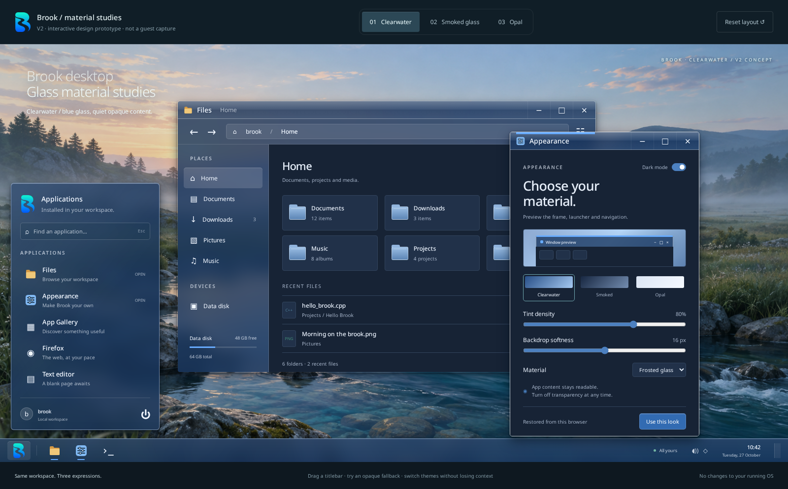
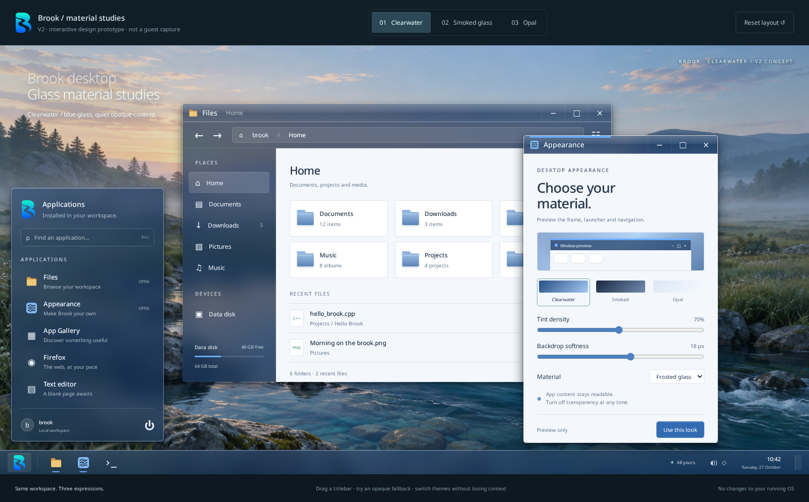
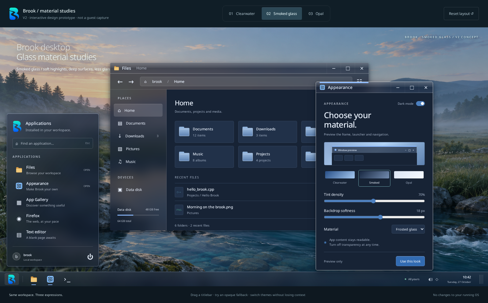
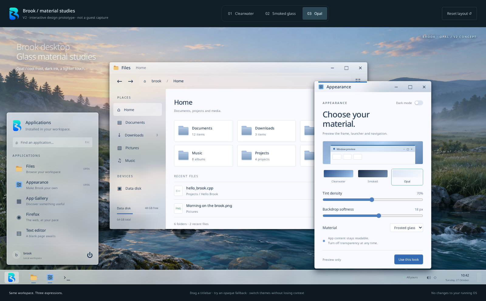

# Brook glass material study — v2

27 October 2026. Browser-rendered concepts, not Brook guest screenshots or
implemented desktop themes. They use Brook's existing wallpaper, B mark and
Files/Settings icons. No Raven code or assets are vendored into the prototype.

Run `python3 docs/design/glass/serve.py` from the repository, then open
<http://127.0.0.1:18872/>. The server exposes only the study and its explicit
public assets. Opening `index.html` directly also works. No third-party network
requests, build step or package installation are needed for the prototype.

Switch the three glass palettes and independent light/dark color mode, adjust
tint/blur, compare solid fallback, search the
launcher, drag titlebars, minimize/maximize/close and restore from the taskbar.
“Use this look” stores only the prototype's appearance in browser local storage.
Files and app listings are illustrative. The prototype never controls the VM or
accesses the user's filesystem. It is an authored HTML/CSS/JS study; CSS blur and
highlights approximate the material without reproducing Raven's refractive rim.

## Native first pass

The captures below remain browser concepts. The native compositor now has the
blue title gradient, active-only 160×4 accent and thin focus edge, 5px corners,
a small cached shadow and rounded task targets. Native Settings opens as a
compact 440-pixel-wide inspector with working palette selection, scale,
persistence and preview. Its height follows the available display area, with
scrollable controls and a fixed Apply footer. Smoked is slate blue and Opal is
icy blue; Clearwater remains the dark default. The browser launcher layout
remains a concept.

Native Settings now offers an independent light/dark switch, glass opacity
from 40–100%, and None / Light / Moderate / Heavy backdrop blur. The defaults
are dark, 80% opacity and Light blur. Opacity affects frame, taskbar and launcher
fills while retaining readable text/icon coverage and opaque app content. None
retains transparency and shadows without blur. Performance mode uses opaque
flat frames without blur or material shadows, retaining the chosen glass
settings for when it is switched off. All choices save in the existing
`[Desktop]` user settings section. Files and App Gallery follow light/dark
changes live; Settings previews them before Apply. Third-party GTK/Qt theme
propagation is not part of this pass.

The GPU path keeps wallpaper, unchanged chrome and cursor images cached rather
than inheriting the taskbar's per-frame upload damage. A client-accepted buffer
resize invalidates chrome geometry explicitly. Normal maximize/restore and
palette save/restore passed native checks. The bounded native material shadow
is a cached nine-slice approximation, not Raven's refractive shader. Opaque
fallback and the material-only `BROOK_GLASS=off` switch retain window controls.
See [frame timing controls](../../gpu-frame-breakdown.md#glass-and-display-backend-control--27-october-2026)
for the matched native/headless measurements and their limitations. True
fullscreen transitions and automatic effect bypass remain a separate follow-up.

## V2 refinement

The shared glass tint and accents now lean blue rather than green/turquoise.
Only the active window gets the 160×4-pixel accent stroke above its icon/title
and the white perimeter. Inactive frames keep a transparent perimeter and no
stroke. Both pointer activation and keyboard focus transfer these treatments.
Windows use a 5-pixel corner radius (previously 10), and the launcher uses 6
(previously 11). Shadows are narrower and darker: the active window uses a
10-pixel vertical offset / 22-pixel blur, plus a compact contact shadow, rather
than the previous 22-pixel offset / 65-pixel blur. The Settings miniature echoes the accent.

The [v1 Clearwater](clearwater.png), [v1 Smoked](smoked.png) and
[v1 Opal](opal.png) captures are retained for comparison.

## Independent dark mode

The Appearance switch changes app surfaces and text without changing the glass
palette or its blue focus accent. All three palettes support both light and dark
content; the selection persists with the other browser-only appearance settings.
Old saved Smoked preferences migrate to dark mode, preserving their earlier look.
The switch supports keyboard activation and exposes its state to accessibility.

This Clearwater dark capture uses 80% tint and 16 px softness to match the review
reference. Defaults remain 70% and 18 px. The 36-pixel titlebar, active-only accent
and outline, 5-pixel corners and tighter shadow are shared with the light variant.

## Three directions

**Clearwater** uses blue tinted glass, a shallow gloss on the frame, a
bright focus edge and pale opaque content. It is the closest to Aero and the
recommended starting point for Brook's identity.

**Smoked glass** keeps the same geometry but uses deeper surfaces, restrained
highlights and light content text. Transparency stays in chrome/navigation;
the file list and settings remain opaque.

**Opal** uses a cool pale tint, dark text and muted blue folders. It explores
a light expression of the same materials, rather than a separate layout.

The study retains 36-pixel titlebars and 46-pixel caption targets. The taskbar
is 48 pixels here versus Brook's current 44; 5-pixel corner radii, proportional
UI text, the content grid and redesigned Settings are proposals. Browser font
rendering, clipping and corner masks are not evidence of native support.

## Raven feasibility

Reviewed upstream commit `abed7e6a695524d41ec73b5e29b46343d5293cb3` from
[oscar-soirey/Raven](https://github.com/oscar-soirey/Raven/tree/abed7e6a695524d41ec73b5e29b46343d5293cb3).
The API is explicitly still evolving. Pin a revision for a real integration.

Raven is a C11 user-space GUI toolkit with an X11 Linux platform and a
runtime-loaded Vulkan backend. There is no native Wayland platform in this
revision. It can create its own Vulkan device or adopt an application's device.
The renderer is behind a backend function table. Thus an initial Brook app
trial can use Xwayland and Mesa Venus; native Wayland or a Brook-specific
backend is an additional port, not a build flag.

Its glass has two different meanings. Within an app, it captures the rendered
scene at glass boundaries and samples sharp/blurred textures through a rounded
rim shader. The shader adds refraction, tint, saturation, highlights and subtle
color dispersion. The Vulkan backend uses a reduced-resolution blur pyramid;
draw-list damage resolution coalesces redundant captures, with a bounded
24-capture limit. Opaque frames bypass this extra work.
[Upstream architecture](https://github.com/oscar-soirey/Raven/blob/abed7e6a695524d41ec73b5e29b46343d5293cb3/docs/ARCHITECTURE.md#glass).

For *desktop* blur, its Linux platform asks the window manager through
`_KDE_NET_WM_BLUR_BEHIND_REGION` and checks WM support. Brook has no handler for
that atom today. Rendering a Raven glass widget does not automatically blur
other apps or the wallpaper behind its top-level window.
[Platform source](https://github.com/oscar-soirey/Raven/blob/abed7e6a695524d41ec73b5e29b46343d5293cb3/src/platform/x11/x11_platform.c).

Raven's Apache-2.0 license permits a source dependency; retain its LICENSE,
NOTICE and third-party notices for any vendored code. Its bundled fonts and
stb components have their own notices. Brook's surrounding source can keep its
existing license; copied Raven implementations must keep their provenance.
This study contains no copied implementation.
[License](https://github.com/oscar-soirey/Raven/blob/abed7e6a695524d41ec73b5e29b46343d5293cb3/LICENSE),
[third-party inventory](https://github.com/oscar-soirey/Raven/blob/abed7e6a695524d41ec73b5e29b46343d5293cb3/THIRD_PARTY.md).

## Where it fits Brook

Brook already has strict back-to-front GPU backdrop barriers, 480×270
ping-pong blur targets and a 16-barrier cap. The current glass path draws a
backdrop for the entire outer window and applies per-window opacity. Its chrome
painter still fills titlebars with opaque palette colors. Whole-window opacity
would fade text, video and game content as well, so it is unsuitable as the
control for this study's chrome-only material.

The relevant implementation is in
[compositor.cpp](../../../src/kernel/src/compositor.cpp),
[window.cpp](../../../src/kernel/src/window.cpp),
[gpu_compositor.h](../../../src/kernel/src/gpu_compositor.h), and
[virtio_gpu_mod.cpp](../../../src/drivers/virtio_gpu/virtio_gpu_mod.cpp).
The shared [palette](../../../src/shared/brook_theme.h) contains RGB colors,
not a material description. The existing [glassdemo](../../../src/apps/glassdemo.c)
is useful for overlap controls, but is not a finished theme.

Files is a custom Wayland/FreeType pixel-buffer app with hard-coded colors.
Settings and App Gallery are GTK3 apps. Raven is therefore an optional toolkit
choice for a rewritten/new app, not a theme plugin for the current three apps.
A shared material/color contract is useful regardless of which toolkit draws
content. GTK/Qt theme integration remains distinct, especially client-side
headerbars; native chrome must not add a second decoration.

Recommended split:

1. **Native material first.** Extend the existing compositor path for titlebar,
   border, taskbar and launcher rectangles. Keep client opacity at 255. Add
   tint, frost, edge highlight and solid-fallback tokens separately from the
   persisted Brook/Dawn/Midnight theme IDs. Reuse caption hit-test geometry.
   Avoid a theme-ID migration merely to try new materials.
2. **One Raven app spike.** Package the pinned source, run the unmodified glass
   example through Brook Xwayland/Venus, then make a small appearance/demo app.
   Check resize, scale, input, font metrics, repeated close and resource cleanup.
   Compare with a solid Raven frame. Do not rewrite Settings or Files before
   that gate passes.
3. **Unify app materials.** Export shared colors/material preferences to native
   clients and toolkit adapters. An app requests a bounded background region;
   only the compositor samples other windows. Add native Wayland support if the
   toolkit trial justifies it. A native Brook renderer port is a larger project.
4. **Refraction last.** Rounded clipping, a signed-distance rim shader and
   optional weak refraction add polish after tint/blur works reliably. Existing
   rect blits alone do not implement the rounded windows in these concepts.

## Performance and acceptance gates

Start with glass on the frame and desktop shell, not every button or list row.
Cache blur where the scene beneath is unchanged. A moving window invalidates
its newly sampled area; damage must expand by the blur's sampling reach. Keep
per-frame barrier/capture and scratch-memory budgets explicit; never sample an
out-of-date lower scene just because a budget was exceeded. An opaque fallback
is preferable. Treat nested/overlapping glass separately from one shared
wallpaper blur. Rebuild shadows from the scene rather than accumulating them.

Measure an empty desktop, an open launcher, overlapping moving windows, then
Quake + Firefox using the existing frame breakdown and identical host settings.
Record p50/p95/p99 frame times, blur captures, GPU waits and allocation counts;
do not use this browser prototype as a performance estimate. Check CPU
composition, GL/Venus app coexistence, resize/minimize/restore, 100/150/200%
scaling and the opaque/reduced-transparency path. New material buffers must
follow the existing frame retirement rules. Text and app pixels remain crisp.

A first native patch should implement tint and blur with the current rectangular
geometry and clear fallback. That is a smaller, testable step than porting the
entire Raven renderer into Brook's kernel compositor.

## Verification performed

Raven built successfully on the host with CMake/Ninja and C11, X11 and Vulkan
headers. `RAVEN_BUILD_WEB=OFF`, `RAVEN_BUILD_TOOLS=OFF` and automatic Vulkan-header
fetching disabled; the OpenGL viewport example was skipped for missing OpenGL
development dependencies. Examples including glass and Vulkan viewport built.
Nineteen tests passed without a display, with the rendering test correctly
skipped. That rendering test then passed separately using a private Xvfb display
and pinned Mesa lavapipe, with Vulkan pixel readback assertions. The user's
desktop was not used. This proves a host source/build control, not Brook guest
compatibility or hardware performance.

The browser prototype passed theme switching, opaque fallback, launcher search,
launch, drag, minimize/restore, maximize/restore, close/reopen, browser-only
persistence and a compact-width overflow check. V2 additionally checks the
active-only stroke/outline, exact stroke and corner dimensions, and transfer
between both windows through pointer activation and keyboard focus in all
three themes. Six palette/mode combinations additionally verify surface tokens
and unchanged accents; browser reload verifies dark mode persistence. Captures are 1600×995 at device
scale 1. No page errors or failed asset loads were observed. The images were
visually checked after theme transitions settled. Main and the VM are unchanged.

Private build/test artifacts are under `build/raven-*` and `build/glass-*`.
The upstream reference checkout remains ignored under `build/references/Raven`.
