# Empty desktop frame breakdown

**Configuration correction:** The generation-351/352 tests immediately below used the default four Wayland buffers: their launcher was capable of eight, but `BROOK_MESA_WAYLAND_BUFFERS=8` was not set. They compare their own arms only. A later corrected eight-buffer run on generation 352 achieved 66.65 and 68.76 completed SDL swaps/s in two bounded demos, but only 120 distinct direct compositor commits were recorded during the 8.74 s observed window (about 13.7/s). That ledger covers nearly the whole window, with 218 later rows dropped over its lifetime. These are not physical scanout counts; the disparity makes visible frame delivery the next question. Exact launcher and evidence are in `docs/agent/HANDOVER.md`.

## Physical compositor workload and GPU interval (generation 352)

The 1280×720 Quake drawable was shown in a 2560×1440 physical window at the provider's 200% output scale. A diagnostic run logged 4,603,760 damaged pixels for 125 game-scene preparations on the 3200×1800 output. Damage includes conservative bounds for all visible windows, chrome and overlays; it is not a count of changed pixels. Its log interval includes game startup and idle rather than exact demo markers.

In a separate serial-partial run, 62 direct compositor frames finishing during the 180-record demo had valid GPU timestamps. Median/p95 TOP_OF_PIPE-to-BOTTOM_OF_PIPE command-buffer interval was 36.317/36.448 ms; submitted-to-observed-completion was 49.5/53 ms. The GPU interval includes command-buffer barriers and dispatches, and possible scheduling effects. It is neither isolated shader execution nor panel scanout, and independently computed percentiles must not be subtracted. The 512-row recorder dropped 147 later rows. Evidence and boot identity are in the current handover and `build/hardware/dell-present-ownership-20261113/gen352-gputime-quake/`.

On the same boot, bounded scanout fairness actually moved 198 eligible render submissions ahead of pending copies, with 198 subsequent forced services. A separate off/on pair measured 29.13/29.39 completed swaps/s under overlapping partial composition; this does not establish a small difference. Reusing the full cached wallpaper instead of copying packed wallpaper tiles measured 40.07/40.23 swaps/s in a serial-partial pair, with 204 distinct observed direct commits per arm. Each comparison is one sequential pair, not proof of visual equivalence or absence of a small effect. Both policies remain opt-in.

## Direct fence wait under serial and overlapping desktop work

On the Dell, the existing direct-`ioctl` and kernel TSC probes reconciled eight complete Quake frame intervals per arm. Serial intervals totaled 98.967 ms; overlap totaled 254.000 ms. Time sleeping in Intel `SYNCOBJ_WAIT` rose from 67.383 to 220.903 ms, accounting for nearly all of the 155.033 ms difference. Median app queue-to-worker-take rose from 3.95 to 53.82 ms across nine matched app submissions per arm. App issue-to-observed-breadcrumb medians were 3.31 and 3.40 ms; matched compositor intervals were 32.90 ms for one serial submission and median 34.33 ms for four overlap submissions. These timings include worker observation and scheduling and the limited samples are not GPU-only execution times. About 31.69/96.41 ms of app fence sleep coincided with observed compositor issue-to-breadcrumb intervals; correlation does not assign the whole wait to those submissions. Both traces reported zero drops. Raw traces and fence IDs are under `build/hardware/dell-present-ownership-20261113/gen350-fence-compare/`.

## Quake with dependent overlap, corrected socket ownership

On generation 350 the renderer and provider ran as the same UID, and the trace matched game-window incarnations and commits. The 600-record control took 10.122 s (601 observed swaps), while dependent overlap took 15.983 s (602). The marker-window sum inside `SDL_GL_SwapWindow` increased from 8.935 to 14.809 s; the remaining window was 1.187 versus 1.174 s. Guest timestamps have 1 ms resolution and marker observation can include a boundary swap. This accounts for the additional wall time at the application API boundary; it does not identify the GPU or a specific wait as its cause.

```mermaid
gantt
    title Measured marker windows (seconds, schematic)
    dateFormat X
    axisFormat %s
    section Serial
    Inside swaps :0, 8.935
    Other time :8.935, 10.122
    section Overlap
    Inside swaps :0, 14.809
    Other time :14.809, 15.983
```

The bounded renderer ledger recorded 125 versus 299 distinct direct commits during those windows, and submission-to-observed-completion medians were 52 versus 74 ms. These are CPU observations of completion and OS presentation acceptance, not hardware execution or panel scanout timestamps. The 512-row ledgers dropped 108 and 548 later rows, respectively; their retained game rows span nearly the whole measured windows. A separate overlap run with a 50 ms minimum admission period still measured 36.40 swaps/s and 18.11 direct commits/s. The earlier root-owned renderer comparisons did not record direct sources; do not use them to characterize the normal direct path. Raw traces and the limits of the comparison are in the current handover.

## Overlapping partial-present dependency design

The existing kernel marks tickets reserved while another is active as full-only. A proposed opt-in successor would instead bind its preparation baseline to the last accepted ticket: reservation must reject a zero or changed baseline. While that ticket remains outstanding, the OS records every rectangle actually written by accepted older tickets; it accepts a partial successor only when its supplied rectangles cover their union. An intervening full present, malformed input, or bounded tracking overflow forces a full successor. Kernel ticket ordering still prevents an older frame from presenting after a newer one. A failed or partially written presentation still follows the existing lease invalidation and scanout-repair path; identity and scene checks remain mandatory.

`desktop_present_dependencies.h` and `DesktopFrameScenes::RecordAccepted` implement bounded bookkeeping and region-union coverage. The checker was compared to an independent pixel oracle over 30,000 randomized cases, and the existing window-surface fixture passed. These helpers are **not connected to the handoff ABI or presentation path**; the existing full-only guard is unchanged. A complete implementation still needs atomic baseline validation at reservation, acceptance recording under the handoff lock for every presentation path, coverage enforcement before scanout, lifecycle and failure tests, and a real matched hardware comparison. The renderer must account for its displayed and pending footprints; the kernel's additional check covers intervening writes, not all changes in the current scene.

The preceding paragraph describes the first groundwork stage. The current local candidate now wires the checks through a new negotiated reservation, while leaving ordinary reservations unchanged. The renderer enables it only with `BROOK_RENDER_EXPERIMENTAL_OVERLAP_PARTIAL` and the capability bit. Kernel and renderer builds and host ordering/coverage tests pass; integrated presentation, recovery and physical performance remain unverified. See the current handover before using the candidate.

## Browser offer versus intervening desktop frames (generation 349)

The all-presented-frame diagnostic matched 117 Chromium direct offers by window, incarnation and commit. Median/p95 offer-to-receipt was 55/61 ms; the union of other successfully presented desktop-frame intervals covered 55/61 ms, with 0/4 ms uncovered. Eighty-one offers arrived during a recorded non-direct frame. Receipt-to-renderer-finish was 39/56 ms and finish-to-provider-ACK 4/15 ms. One initial offer had 37 ms uncovered because recording starts at the first direct frame. The bounded capture retained 512 rows and later dropped 762; all 117 tested offers were matched. Timestamps observe CPU-side events and present acceptance, not GPU execution time or physical scanout. Unsuccessful frames are not recorded.

Across the 395 recorded non-direct frames, preparation was 12/16 ms median/p95, submission to observed completion 9/39 ms, and observed completion to finish 4/5 ms. The corresponding 117 direct frames were 13/14, 21/39 and 4/5 ms. These are separate distributions; their percentiles cannot be added to derive a frame percentile, and completion observation includes polling and scheduling delay.

```mermaid
gantt
    title Typical browser offer in a busy desktop (median ms, schematic)
    dateFormat X
    axisFormat %s
    section Other desktop frame
    Occupies offer-to-receipt interval :0, 55
    section Browser direct frame
    Offer received to renderer finish :55, 94
    Finish to provider ACK :94, 98
```



Evidence: `build/hardware/dell-media-20261113/gen349-allframe-browser/`. This is a scheduling/retirement lead, not proof that removing serialization is safe: earlier overlapping partial frames triggered full-screen damage and degraded Quake throughput.

## Dell i915 and VirGL frame waits (13 November 2026)

The Dell diagnostic ran the uncapped 1280×720 yquake2 GL3 demo on the HD 5500
with the patched Iris library. Eight consecutive completed swaps (indices
67–74) took 1,098.366 ms, with individual intervals of 46.9–354.0 ms. The
kernel recorder retained the first events on each CPU and dropped 2,549
events once CPU 1 filled its buffer. Every reported interval ends before
the earliest per-CPU last retained timestamp, with a margin for cross-core
TSC skew. The app trace had zero drops. The ledger reconciles all 1,098.366 ms
as scheduler residency and elapsed wait classes. Samples and stacks give
locations. CPU residency includes kernel execution and interrupt time.

| Exclusive Quake-thread wall time | Eight frames |
| --- | ---: |
| FAT filesystem mutex | 641.281 ms (58.39%) |
| Offscreen submission mutex | 139.414 ms (12.69%) |
| Poll sleep between swaps | 130.490 ms (11.88%) |
| CPU residency | 121.771 ms (11.09%) |
| Render admission mutex | 33.908 ms (3.09%) |
| Runnable, awaiting dispatch | 16.284 ms (1.48%) |
| Other mutexes and blocking | 15.218 ms (1.39%) |

Most FAT waits are on the common boot-flag path above the ioctl decoder.
In particular, 408.231 ms of the FAT wait time is inside GEM_MADVISE, whose
handler checks the handle and reports retained backing. Another 156.048 ms is
inside SYNCOBJ_WAIT. The trace saw no direct ioctl fence-poll sleep events
during these frames. The apparent cost of that ioctl is mostly the filesystem
gate. The offscreen submission stack passes through the same mutex used by
inline compositor scanout even for Quake's ordinary buffers.

Nine observed Quake render submissions averaged 30.6 ms queued (0.6–155.0 ms),
15.3 ms in device-direction cache maintenance, 6.3 ms in the render device
transaction and 15.3 ms in CPU-direction cache maintenance before fence
publication. These worker intervals run alongside Quake's CPU timeline.
They overlap app elapsed time. Four in-window scanout blits each took
approximately 12.3 ms in the BCS transaction. Immutable kernel fence IDs link
13 retained GPU dependencies to observed producers. One queued consumer in
the selected three-frame diagram arrived 34.4 ms before its producer's
signal. A deadline or synchronization wait that appears only as a poll
stack has no inferred producer in this capture.

The historical 1 ms host-poll VirGL trace completed 617 swap intervals at
44.39/s with 22.04 ms median and 32.93 ms p95. The DRM probe recorded 4,029
EXECBUFFER calls consuming 7.237 s across the capture (about 11.73 ms per
completed interval, with the recorded shutdown-tail bound on between-swap
totals). It recorded 271,472 VIRTGPU_WAIT calls consuming 0.624 s (about
2.30 µs per call and 1.01 ms per completed interval). The control queue
waits for used-ring completion inside EXECBUFFER and adds a real producer
fence for FENCE_FD_OUT. A separate zero-drop profile found Quake command-lock
and PresentBarrier stacks. The VirGL run used a different host, VM and Brook
revision, and its ioctl timings include host scheduling. It establishes
which synchronization survived at usable cadence and gives order-of-magnitude
reference costs. It does not establish the Dell speedup or GPU execution time.

Latching the six runtime opt-in markers at boot while retaining live PCI,
D0 and recovery checks removed the FAT waits in a second eight-interval
trace with zero kernel and userspace drops. The 90-record marked run rose
from 6.64 to 7.36 completed swaps/s. The remaining trace is dominated by
705.366 ms (60.03%) sleeping on Intel syncobj waits and 312.081 ms (26.56%)
in kernel mutexes between swaps, chiefly address-space mutation during
poll, sendmsg and futex argument validation. Six application fences match
733 polls from Quake in the eight-interval window. The first observed wait
to matching signal spans 20–243 ms. These are repeated observations of
six waits on immutable fences.

The queued game submissions now reach the shared worker after a median
154.9 ms (nine observed submissions). They spend a median 39.5 ms between
worker admission and their fence signal. The compositor's seven complete
render transactions spend a median 107.6 ms on the same worker. A separate
scoped timing run on that boot collected 82 compositor transactions without
new drops. It measured a mean 67.6 ms from issue to breadcrumb, 0.072 ms
from breadcrumb to observed retirement, and roughly 15 ms of cache
maintenance in each direction. The issue-to-breadcrumb interval includes
completion observation. The 70 ms compositor device interval is therefore
concentrated inside the render operation. This does not include the separate
BCS scanout copy.

Generation 321 tested an exact shader simplification for 1:1 scaling and
fully opaque pixels. The compositor transaction median moved from 107.6 to
106.3 ms and the marked demo from 7.36 to 7.72 swaps/s (interval p95 268 to
234 ms in one run per build). The eight-frame trace has zero drops and
0.201 ms of unknown initial scheduler state. Quake's 134.6 ms median
submission queue time still dominates the 30 FPS budget. Host Vulkan
renderer/surface oracles and physical Intel compute, triangle, scene and
the seven-sample partial opacity/move/fallback fixture pass. The first two
opacity attempts ran without the root permission required by the capture
syscall. The initial harness result is invalid for pixel acceptance.

Raw data, resolved stacks, resource and fence IDs, frame ledgers and diagrams
are under `build/hardware/dell-present-ownership-20261113/` in
`frame-trace-dell-v2/`, `frame-trace-boot-flags/` and
`frame-trace-composite-shader/`. The October sections below identify the
VirGL timing data and the separate switch profile.

This is the first control for the GPU performance investigation. It measures
the shared compositor/virgl path, not a Vulkan application. No pacing,
buffering, fence, resource lifetime or scheduler-default behavior has changed.


### Broadwell render frequency and retirement

The HD 5500 stayed at 300 MHz under Brook in all 87 sampled points from
14 complete render submissions. The render-frequency request also read
300 MHz on every submission. The earlier Linux i915 capture on the same
Dell had a 480 MHz actual median and 82% render-engine busy median over the
approximately aligned demo window. Linux sampled continuously while the
Brook trace sampled under the existing render forcewake lease.

| CPU-observed event interval | Quake median (8 submissions) | Compositor median (6 submissions) |
| --- | ---: | ---: |
| ELSP issue to GPU breadcrumb observed | 5.41 ms | 63.55 ms |
| Breadcrumb to context switch observed | 0.072 ms | 0.072 ms |
| Context switch to exported fence signal | 16.27 ms | 15.23 ms |

The last interval is dominated by the post-render CPU cache pass. The
clock probe only read MMIO. The same candidate moved that cache pass
outside the render queue lock and changed the compositor output shader to
16×4 workgroups. Its marked run delivered 8.26 swaps/s (217 ms p95). That
single run combines both changes. The physical Intel Vulkan oracles and
the root partial-opacity fixture passed.

The zero-drop eight-frame ledger also accounted for 59.23% of application
wall time in syncobj waits and 26.32% blocked on kernel mutexes between
swaps. The latter stacks again point to user-address-space validation.
The diagram with real fence edges and clock samples is
`build/hardware/dell-present-ownership-20261113/frame-trace-gt-clock/frame-timeline.svg`.


A guarded comparison changed the render frequency request to 500 MHz on AC
power, with the same renderer and cache logic. The PCI device stayed in
D0. The Dell reported a 300 MHz minimum and 950 MHz maximum in the
hardware capability register. All 50 samples across 14 complete render
submissions were 500 MHz. Each submission verified restoration of the prior
300 MHz request before releasing forcewake.

| Matched result | Firmware request, 300 MHz | Temporary request, 500 MHz |
| --- | ---: | ---: |
| Completed swaps per second | 8.26 | 9.63 |
| Swap interval p95 | 217 ms | 197 ms |
| Quake issue to breadcrumb, median | 5.41 ms | 3.36 ms |
| Compositor issue to breadcrumb, median | 63.55 ms | 38.55 ms |
| Quake context switch to fence, median | 16.27 ms | 16.25 ms |
| Compositor context switch to fence, median | 15.23 ms | 15.26 ms |

Both runs completed 91 swaps within the marked demo, with eight complete
swap intervals in each kernel trace. The clock change shortened the render
intervals by 38–39% and increased the measured swap rate by 17% in this
single pair. The post-retirement CPU work stayed near 15–16 ms. The boosted
trace spent 39% of elapsed application time in kernel mutexes between swaps
and 34% in syncobj sleeps. Vulkan compute, triangle, scene and six
partial-opacity samples passed at 500 MHz. The data and updated timeline
are in `frame-trace-gt-rps-posted/` in the same campaign directory. The
temporary request is a diagnostic, with no production governor selected.


### Console-only and bare desktop controls

Generation 330 traced the kernel compositor's cadence markers, context
switches, blocking stacks, worker submissions and scanout copies. No
Quake process was running during these two controls.

| Observation | Console visible | Console minimized |
| --- | ---: | ---: |
| Taskbar cadence p80 | 19 ms | 17 ms |
| Kernel work portion of a cadence interval, p80 | 3.85 ms | 2.99 ms |
| Kernel compositor timer/event sleep across trace | 1,434 ms | 1,815 ms |
| Kernel compositor scanout mutex waits across trace | 383 ms | 4 ms |
| Render issue to breadcrumb, median | 4.42 ms | 1.86 ms |
| BCS worker time, median | 4.09 ms | 3.05 ms |

The kernel work portion includes mutex delays. The fallback timer arms
after the cycle and requests a 16 ms sleep, which events can cut short.
The current GOP blitter writes the live framebuffer and performs no
vblank wait. Taskbar COMP measures kernel cycle cadence.

The bare renderer clears or composites client surfaces, with no wallpaper,
chrome, taskbar, or cursor layer. The clear-only full-screen copy took a
median 14.65 ms on the BCS worker. The matched Quake demo reached 23.91
swaps/s, with p95 75 ms, versus 21.33 swaps/s and 103 ms on the regular
desktop at the same clock and CPU coherency policy. The console process
continued to run, but the bare scene excluded its minimized surface.
Eight fully traced swap intervals attributed 76.8% of application wall time
to sleep inside Intel syncobj waits. For eight paired fence submissions,
Quake waited 41.5–45.9 ms from enqueue until the shared worker took the job.
Quake's GPU issue to breadcrumb took a median 3.17 ms across seven complete
transactions, followed by 0.26 ms from context switch to fence signal.
In submission 153, a full-screen BCS transaction occupied the worker for
the last 12.34 ms of the 42.80 ms queue wait. The timeline in
`build/hardware/dell-present-ownership-20261113/frame-trace-bare-quake/frame-timeline.svg`
shows the overlapping compositor work and the exact app fence IDs.

The full-frame renderer retains wallpaper capture by display and backdrop
generation in each render context. The partial renderer copies wallpaper
pixels into a packed source buffer for each damaged rectangle. The
experimental renderer instead samples the cached wallpaper BO by adjusting
the source coordinates for each output tile.

Generation 334 combined that wallpaper change with the short-lock GOP
present experiment. It recorded zero BCS requests and a 12 ms kernel COMP
p80 on the software desktop. Its Quake rate is excluded from hardware
desktop comparisons. A same-boot run on the restored kernel also failed in
overlay capture with wallpaper reuse disabled, before submitting a
composition. The bare-mode patch had inverted the overlay success check.
The verified full and partial BCS path returned after restoring the
generation 330 kernel and initrd as generation 335.

The corrected renderer completed a same-boot packed/reuse/reuse/packed
comparison with the console visible and overlays included. The diagnostic
serialized desktop frames so each arm completed one full and 179 partial
hardware blits. Across 165 warm partial intervals per arm, packed medians
were 24/24 ms and p95s 26/25 ms. Reuse medians were 24/25 ms and both p95s
were 26 ms. All 720 BCS requests retired. This console-only control
showed no measurable improvement from removing the wallpaper copy.
Results are in `wallpaper-abba-corrected-overlay/` in the same campaign.

Generation 336 kept packed wallpaper and tested the short-lock GOP writer
with the corrected overlay check. In the visible-console trace, the earlier
391 ms of total compositor mutex waits fell to 2.9 ms across a slightly
longer trace. The remaining waits were in window cleanup and launcher
publication. COMP p80 stayed at 19 ms and p95 moved from 21 to 19 ms.
The matched Quake prefix completed 90 swaps in 3.96 seconds (22.73/s)
with a 79 ms p95. The eight-frame ledger still attributes 44.7% of app
time to kernel mutex waits between swaps and 32.0% to Intel fence sleep.
Nine Quake submissions with both queue events spent a median 55.65 ms
queued. The scanout reservation removes lock hold time from desktop input
and drawing while both engines still share one serialized submission worker.
See `desktop-short-lock-overlay/visible/summary.json` and
`frame-trace-short-lock-overlay/frame-timeline.svg`.

### Desktop submission pacing

The two-context renderer admits a full-screen frame when a partial frame
is still pending after its grace period. That adds an expensive full render
and scanout to the shared worker under the same GPU contention that caused
the partial frame to run late. The RAM experiment retained two render
contexts, allowed one desktop frame in flight, and optionally delayed the
next capture until a minimum period had elapsed. It preserved partial
damage, the exact source/commit checks, handoff retirement and hardware BCS.

The four arms used the same generation 337 boot with the backlight
timeout disabled and the same 180-record 1280×720 uncapped demo. Blit
counts cover the launch-to-exit observation, including warmup and drain.

| Desktop submission policy | Completed swaps/s | Swap p95 | Full blits | Partial blits |
| --- | ---: | ---: | ---: | ---: |
| One in flight, 50 ms minimum | 32.87 | 71 ms | 5 | 234 |
| One in flight, 33 ms minimum | 32.12 | 72 ms | 5 | 283 |
| One in flight, no added delay | 36.03 | 68 ms | 5 | 340 |
| Existing two-in-flight policy | 21.02 | 95 ms | 177 | 226 |

An earlier two-in-flight control on the same kernel measured 24.25/s
and 84 ms p95. An interrupted serial arm counted 254 swaps for the
180-record window and was excluded. The short-lock candidate uses one
desktop frame in flight with no added delay. See
`pacing-180-physical-awake/` in the same campaign.

Generation 338 combined that policy with the short-lock scanout writer.
Two physical 600-record windows on the supervised desktop completed
601 swaps in 17.470 s and 602 in 17.509 s (34.40 and 34.38/s). Median
swap intervals were 16 ms in both, p95 was 71 ms, and maxima were 77
and 76 ms. The lowest complete five-second block was 33.0 swaps/s.
Intel HD 5500 GL3, 1280×720, timedemo, zero swap interval and the patched
Iris library were verified. BCS retired 1,278 and 1,215 jobs across the
two launch-to-exit observations, including 1,271 and 1,209 partials.

The first repeat's zero-drop eight-frame trace measured a 30.16 ms
median Quake worker queue residence across nine paired requests, down
from 55.65 ms on generation 336. It attributed 49.36% of elapsed app
time to kernel mutex waits between swaps, mostly user-address-space
validation, 21.25% to Intel fence sleep, and 12.64% to poll sleep. Median
Quake issue to breadcrumb was 3.55 ms at the measured 500 MHz.
See `short-lock-serial-600/frame-timeline.svg` and
`short-lock-serial-repeat-600/summary.json`.

## Host polling baseline

Two private empty-desktop runs use the same frozen kernel/modules, eight
vCPUs/8 GiB, optional MLFQ, GPU composition and 1920×1080 scanout. No app windows
exist at either endpoint. The render node is `/dev/dri/renderD128`, PCI
00:02.0, Intel UHD 630 (`8086:9bc5`); the separate NVIDIA card is not selected.
PipeWire/HDA remain configured but no application plays audio.
The initial device display-info reply advertises 1280×800; the driver then
creates and binds a 1920×1080 primary display and compositor render target.
The final serial inventory verifies the latter dimensions and active GPU DRAW
composition for every cohort; the initial reply is not the tested resolution.

Quiet eight-second host-cost windows, three-second CPU/CS profiles and separate
six-second host traces are kept distinct. Only the private QEMU fallback fence
poll changes between the two runs:

| Measurement | 10-ms host poll | 1-ms host poll |
| --- | ---: | ---: |
| Quiet compositor interval p50 / p95 | 27 / 33 ms | 19 / 20 ms |
| Quiet QEMU process CPU cores | 0.4983–0.4987 | 0.2760–0.2762 |
| Trace compositor fence-response p50 / p95 | 9.544 / 10.012 ms | 1.797 / 2.413 ms |
| Trace response → next submit p50 / p95 | 16.439 / 22.447 ms | 16.794 / 17.716 ms |

These are one ordered pair, not repeated balanced trials. Host fence response
is completion observation, not GPU execution. The source sleeps for 16 ms
**after** rendering; remaining frame work and wakeup latency also contribute
to response→next-submit. Do not add these medians into a synthetic frame.
The 10-ms CPU profile contains 121 compositor samples: 119 include
`SubmitCommand`, and 116 include its completion wait. Most samples on the
other cores are idle. IRQ sampling and profile-writer work prevent treating
those counts as unbiased CPU percentages. Module addresses are resolved using
the exact staged module hashes, recorded load addresses, loader section
placement and bounded function intervals.

Evidence is under `build/reviews/unattended-empty-desktop-gpu-{10,1}ms-fixed-mlfq-a-20261021/`.
All original controllers/VM owners exit zero and all four filesystems per run
check cleanly. This does not establish application performance or recommend a
normal QEMU default change.

## Reconciled native frame recorder

`gpu frame timing on|off|reset|status|frames` exposes an optional 256-row
recorder. The disabled path does not read clocks or acquire recorder locks.
Recording uses stable KVM elapsed time and try-locks; any contention delta,
clock failure or invalid frame rejects analysis. It does not promise a fixed
probe execution bound. Normal controls/exports take a lock and are not panic
inspection commands. Stop before exporting all rows in one response.

The frame starts before deferred captures and scene draining, and ends after
debug polling, immediately before blocking. Nested scopes are exclusive:
their time is removed from their parent, so every retained row must sum to
`end_ns - begin_ns`. The explicit `other` phase covers residual frame work.
Epoch, frame and LIFO tokens prevent stale/control-raced scopes from charging
a later frame. Stop may discard one incomplete frame; overwritten prefixes
remain visible. First/last fence IDs allow correlation with independent host
traces without assuming that response timestamps are actual scanout.

The corrected native review is
`unattended-frame-breakdown-gpu-1ms-fixed-mlfq-b-20261021`, frozen kernel
`3aa630e73001eb5d7edc294560ad236a6ff8f74b9a9aa884055c1daf4c5a38f0`.
It captures 352 complete cycles, retains the last 256 and reports 96 overwritten
rows, no aborted/invalid frames, clock failures or contended records. Every
retained row reconciles exactly. Times below are guest elapsed, including
preemption, host steal and recorder overhead; they are not CPU execution times.

| Interval | p50 | p90 | p95 | Maximum |
| --- | ---: | ---: | ---: | ---: |
| Frame body | 2.558 ms | 2.990 ms | 3.470 ms | 10.890 ms |
| Frame start → next start | 18.005 ms | 19.006 ms | 20.009 ms | 27.006 ms |
| Frame end → next start | 15.533 ms | 16.017 ms | 16.159 ms | 16.983 ms |
| Installed remaining sleep budget | 15.113 ms | 15.172 ms | 15.840 ms | 15.999 ms |
| Resume minus installed deadline | 0.401 ms | 0.871 ms | 0.940 ms | 1.005 ms |

| Exclusive stage | p50 | p95 | Share of total retained body time |
| --- | ---: | ---: | ---: |
| Deferred captures | 0.0072 ms | 0.0091 ms | 0.26% |
| Scene draining | 0.0011 ms | 0.0015 ms | 0.04% |
| Scene/CPU preparation | 0.0685 ms | 0.0848 ms | 4.09% |
| Texture upload residual | 0.0033 ms | 0.0047 ms | 0.13% |
| Quad recording | 0.0014 ms | 0.0019 ms | 0.06% |
| Command-lock acquisition | 0.0009 ms | 0.0010 ms | 0.03% |
| Vertex upload residual | 0.0008 ms | 0.0010 ms | 0.03% |
| Command construction residual | 0.0014 ms | 0.0018 ms | 0.05% |
| Queue setup and response validation | 0.1752 ms | 0.3366 ms | 7.02% |
| Fenced completion wait | 1.9232 ms | 2.5166 ms | 68.55% |
| Ordinary acknowledgement wait | 0.3566 ms | 0.5685 ms | 19.67% |
| Display flush residual | 0.0004 ms | 0.0007 ms | 0.02% |
| Debug capture | 0.0007 ms | 0.0011 ms | 0.03% |
| Debug polling | 0.0003 ms | 0.0005 ms | 0.01% |
| Other/residual | 0.0008 ms | 0.0010 ms | 0.03% |

“Residual” matters: nested queue/wait time appears in separate exclusive rows.
An alternative attribution view groups complete control-call elapsed time by
the calling phase. Those groups reconcile exactly to queue setup + both wait
categories and must **not** be added to the stage table:

| Calling phase | Calls across 256 frames | Per-frame call elapsed p50 / p95 |
| --- | ---: | ---: |
| Texture uploads | 1024 | 0.371 / 0.630 ms |
| Vertex upload | 256 | 0.036 / 0.076 ms |
| Draw construction/submission | 256 | 1.931 / 2.525 ms |
| Display flush | 256 | 0.109 / 0.186 ms |

There are seven control requests per frame and one fenced request. Reported
request bytes are command packet bytes, not transferred pixel/vertex bytes.
The next ownership experiment can overlap independent CPU packet preparation
with the vertex transfer. Its immediate gain is bounded by the smaller of
transfer wait and CPU construction time; it is groundwork for broader overlap,
not a plausible explanation for all the missing presentation throughput.

## Clock-domain correction and verification

An earlier diagnostic build mislabeled `wakeupTick * 1,000,000` as KVM
nanoseconds. APIC elapsed ticks instead use their own `(origin_ms, origin_ns)`.
The source now exports raw deadline ticks. The analyzer requires stable matching
pvclock origins/mode and unchanged rejected-sample count at both endpoints,
then checks `origin_ns + (deadline_ticks - origin_ms) * 1,000,000` for underflow
and overflow. Early dirty/input wakes remain valid signed observations.

The earlier `…-a` review preserves its original export and an explicitly
hash-guarded recovery of raw ticks, with a separate checked origin conversion.
It is not evidence that the original field was correctly labeled. The final
`…-b` run exports raw ticks directly, requires no legacy recovery, and includes
the complete command attribution. The analyzer source is retained per run.

The final off/on/off quiet windows use the same kernel. Host process CPU cores
are respectively 0.2623–0.2625, 0.2847–0.2850 and 0.2823–0.2825. Before/after
millisecond compositor intervals have p50 19/18 ms and p95 20/20 ms. This small
single sequence bounds interpretation rather than proving zero recorder cost.
Original controller/VM owners, heap/runtime gates and all four filesystem
checks pass. No app workload or full rendering-correctness gate is claimed.

The actual model tests cover exclusive nested scopes, owner filtering, ring
overwrite, stale epoch/frame tokens, wrong-order scope exit, control races,
clock failures and command identity. Ten Python tests reject corrupted
exports, lost rows/records, invalid origins, incomplete attribution and
double-counted time. Release build, entry/startup audits and all 78 hosted
suites pass. The two final model edge cases were rebuilt and rerun separately
in the Nix shell. A direct host rebuild failed to locate libc++; its test was
not run, and the failed invocation is retained rather than counted as a pass.
The broader timing/audio/scheduler findings remain open.

To analyze a bundle of acknowledged start/stop replies, clock snapshots and
stopped rows:

```sh
python3 scripts/workloads/analyze_frame_timing.py capture.json \
  --output breakdown.json --csv frame-breakdown.csv
python3 scripts/test_analyze_frame_timing.py
```

The final review's `frame-breakdown-control/` holds `raw-capture.json`,
`capture.json`, `reconciled-breakdown.json`, `frame-breakdown.csv`, off/on/off
cost brackets and the verification receipt. Artifacts remain private below
`build/`; no licensed application data is committed.

## Loaded recorder validation

The first Quake capture exposed two diagnostic problems. Foreign GPU callers
attempted the recorder lock before the model rejected their owner identity;
the stopped frame export also sent each scalar separately. Its export exceeded
60 seconds. That failed capture remains under
`build/reviews/unattended-preparation-overlap-gpu-1ms-fixed-mlfq-b-20261021`.
Frozen rows were recovered read-only after app exit, but the unpersisted original
start/stop acknowledgements prevent accepting it as a normal capture. A bulk
stdout trace download also failed its loss gate. The complete timestamp file
was subsequently recovered from the checked offline private disk; neither
original transport failure is counted as a pass.

Runtime probes now check an atomic owner hint before attempting the lock or
reading the clock, then retain the model's authoritative ownership check under
the lock. Stop/reset clear the hint. Actual-owner contention remains counted
and rejected by the analyzer. Each row is serialized through one bounded reply
buffer, preserving exact JSON while reducing socket writes. Hosted tests compile
the actual wrappers and row serializer, checking foreign admission, genuine
owner loss, reset/stale tokens, unavailable clocks and maximum-value chunking.
Release build, all 81 hosted suites and 11 analyzer tests pass.

Native review
`build/reviews/unattended-loaded-recorder-gpu-1ms-fixed-mlfq-a-20261021`
uses kernel
`f254dca9431761b3ed83befe56138118ae2d3612fd60fb6247208052fe10f0aa`
and unchanged overlap GPU module
`81ab428a1b8f19d2978231343241f4b972012cc2784b26b6f00ebd36d157379b`.
It retains eight vCPUs, 8 GiB, MLFQ, 1920×1080 GPU composition and the private
1 ms host fence poll. Quake GL3, Venus vkcube and vkmark run sequentially, each
with 256 reconciled compositor rows and no recorder contention delta.

| Workload | Actual client | Body p50 | Compositor interval p50 |
| --- | --- | --- | --- |
| Quake 2 GL3 | 1280×720 | 4.185 ms | 11.017 ms |
| Venus vkcube | 800×600 | 4.999 ms | 5.997 ms |
| Venus vkmark | 1280×720 | 6.015 ms | 6.043 ms |

These compositor intervals are not application frame times. Quake's buffered
SDL trace, hash-checked after offline extraction, completes 72 swaps within the
retained 3.225-second guest-clock window (22.33 swaps/s); complete inter-swap
interval p50 is 49.95 ms and p95 61.99 ms. Boundary-crossing gaps remain explicit.
Vkmark reports vertex 37 FPS / 27.027 ms and texture 38 FPS / 26.316 ms, both on
Virtio-GPU Venus backed by Intel UHD 630. Vkcube requested 1280×720 but negotiated
800×600, so it must not be presented as a 720p performance result.

Quake's stopped row export takes 1.42 seconds. Window minimize/restore replies
are separately timed (about 255/137 ms for Quake), including bridge overhead;
they are not input-to-photon measurements. Screenshots, CPU profiles and timing
windows are separate. All owned apps exit with complete output, no remaining
tasks or windows, clean heap/runtime checks, successful original VM owner exit
and four clean offline filesystem checks. This is one candidate cohort without
a matched performance control or comprehensive rendering-correctness verdict.
The outstanding GL/Vulkan comparisons and larger fence/pacing targets remain
open.

## Matched host controls and uncapped Quake benchmark

The loaded experiment repeats the same frozen guest and actual client sizes
with only the matched host fence-poll build changed. The 1 ms → 10 ms → 1 ms
sequence gives:

| Application measurement | 1 ms, A | 10 ms, A | 1 ms, B |
| --- | ---: | ---: | ---: |
| Quake GL3 observed swap completions/s | 22.33 | 11.59 | 21.33 |
| vkmark vertex FPS | 37 | 16 | 37 |
| vkmark texture FPS | 38 | 16 | 37 |

**These Quake runs had VSync enabled.** The saved config explicitly contains
`r_vsync "1"`; they remain application pacing measurements, not uncapped GPU
throughput. `cl_maxfps=60` is the packet limit with Yamagi's default async
rendering, not its render cap. Quake's recorded compositor body p50 is
4.185 ms at 1 ms polling versus 20.026 ms at 10 ms. Separate host traces show
compositor-context fence-response p50 2.049 versus 9.517 ms. That observation
includes host polling/scheduling and is not GPU execution duration. The
host trace analyzer excludes sequential-enable/disable transitions using a
known-enabled clock interval; boundary partials stay explicit and interior
identity/ordering failures remain errors.

At the user's request, a separate fixed-demo benchmark explicitly disables
VSync and bypasses engine frame pacing. The exact Yamagi source uses
`timedemo=1` to skip both packet and render pacing; `vid_maxfps=0` alone would
be clamped to 999. The new `--uncapped` option in
`scripts/workloads/q2_demo_timing.py` sets `r_vsync=0`, `timedemo=1`,
`cl_async=1`, `cl_maxfps=250` and `vid_maxfps=999`. Effective cvar queries and
saved config confirm these values in both runs. The extra queries use a
private config script because the engine's 50-argument limit rejected the
first attempt. That failed launch and a failed verification query remain
retained; the completed benchmark was not rerun to recover its evidence.

| Uncapped Quake measurement | 1 ms host poll | 10 ms host poll |
| --- | ---: | ---: |
| Built-in timedemo, 200 frames | 38.6 FPS | 13.5 FPS |
| Observed steady SDL completions/s | 43.09 | 13.43 |
| Complete inter-swap interval p50 / p95 | 19.04 / 47.32 ms | 75.08 / 100.05 ms |

The built-in numbers include the warmup section. The SDL window uses observed
START through the final available swap; END is observed about 20.58/10.49 ms
after that swap. Strict analysis rejects the original uncovered bounds, so
the adjusted bounds and uncovered tails are explicit. Marker timing is not
an exact GPU frame boundary. Timedemo is unpaced simulation and does not test
normal-speed demo/audio playback. This is one ordered uncapped pair, not a
balanced repeated benchmark or a claim that GPU work itself became 2.9× faster.

Evidence is in private reviews
`unattended-loaded-recorder-gpu-{1,10}ms-fixed-mlfq-{a,b}-20261021`
(only existing combinations), and
`unattended-uncapped-q2-gpu-{1,10}ms-fixed-mlfq-a-20261021`.
The successful 1 ms uncapped run is under `uncapped-q2-retry/`; the 10 ms run
uses `uncapped-q2/`. Both raw traces are hash-checked against guest metadata
after original owner exit and four clean offline filesystem checks. The
VSync-on reversal likewise passes its health, output and disk checks.

`tools/qemu-fence-poll-pkg/default.nix` makes the host controls reproducible.
With the repository's pinned package set, its 1 ms and 10 ms derivations and
realized outputs exactly match the tested binaries. It changes the guarded
single `virtio_gpu_fence_poll` timer site, preserving the shared patches and
configure options. The normal launcher selection remains unchanged. To opt
in before using an existing GL/Venus launch command:

```sh
export BROOK_GPU_QEMU="$(nix-build tools/qemu-fence-poll-pkg \
  --no-out-link --arg fencePollMs 1)"
```

The package is guarded to QEMU 10.2.2 and rejects a changed patch site. The
measured gain belongs to faster host completion observation; the independent
compose storage remains a correctness foundation with no demonstrated material
throughput gain on its own. Additive pacing, remaining app-side waits and
broader input/rendering acceptance still require investigation. Timing, audio
and scheduler findings remain open.

The 1 ms uncapped VM also records one scheduler service clamp of 427 ns
(PID 14, CPU 1); its runtime acceptance gate fails. The debt is subsequently
caught up, but this is retained as an unresolved accounting finding, not
waived by the clean process exit, heap or filesystem checks. The 10 ms
uncapped VM has zero runtime error counters. These throughput observations
therefore do not establish full acceptance or a scheduler-default change.

For the 1 ms uncapped trace, complete frame intervals partition exactly into
41.16% inside SDL swap and 58.84% between calls. The respective p50/p95
durations are 4.05/40.10 ms and 14.77/18.66 ms. Between-call time includes
simulation, rendering, driver calls, kernel waits and scheduling; it is not
a vblank wait or pure CPU time. The detailed compositor stage percentages
above belong to the separate VSync-on capture; a matching uncapped capture
is needed before attributing this residual to framebuffer ownership.

## Uncapped compositor and submission diagnosis

A separate 600-frame-record diagnostic uses the same frozen guest and 1 ms
host poll, with effective VSync/pacing settings checked again. Longer
captures use `--measured-frames`; original embedded packets and frame-number
gaps are preserved and reported. An oversized request and two earlier
helper assumptions failed before launching the game; their jobs remain in
the private review. The successful capture has 601 server-frame deltas over
600 original frame records. It is not pooled with the short throughput pair.

The retained 256 compositor rows reconcile exclusive body time exactly:

| Exclusive stage | Share of body | p50 | p95 |
| --- | ---: | ---: | ---: |
| Fence completion waits | 72.85% | 3.308 ms | 5.068 ms |
| Acknowledgement waits | 9.39% | 0.372 ms | 0.518 ms |
| GPU command-lock acquisition | 6.97% | 0.002 ms | 3.446 ms |
| Queue setup | 5.72% | 0.272 ms | 0.451 ms |
| Scene preparation | 4.37% | 0.188 ms | 0.280 ms |
| Other exclusive stages combined | 0.70% | — | — |

Body p50/p95 is 4.556/8.995 ms; start-to-start p50/p95 is
5.077/13.647 ms. Between-frame gap p50/p95 is 0.000495/9.082 ms,
with 247 of 255 resumes before the installed fallback deadline. The
nominal additive 16 ms fallback is therefore not an unconditional sleep in
this loaded capture. Ring overwrite drops the earlier 213 rows; one
in-flight row is explicitly aborted when recording stops. Retained rows
pass the analyzer's conservation and contention gates.

A separate two-second sample records 1,593 CPU samples and 7,774 context
switches with no producer drops or count mismatch. Quake's main thread has
only 30 CPU samples: 17 include GPU completion waiting, of which 15 include
`AppPresentBarrier`. These are small, biased sample counts, not percentages
of frame wall time. Its 320 outgoing context-switch stacks include 215
`AppSubmit3D` command-lock waits; 247 include a DRM ioctl and mutex lock.
The compositor has 139 command-lock yield stacks. Categories overlap and
must not be added. The profiler writer itself has 58 samples, so this
diagnostic must not be substituted for an uninstrumented throughput run.

Source inspection confirms the mechanism: `GpuCmdGuard` serializes app and
compositor control submissions, and synchronous completion is retained
through the protected operation. `FENCE_FD_OUT` performs a real producer
fence before returning a completed sync file. This is necessary for current
cross-context correctness; removing that wait would falsely signal completion.
The next target is measured app-side lock/completion wall time and a design
for multiple owned in-flight submissions, not assuming extra framebuffers
alone remove these waits.

Evidence: private review
`unattended-uncapped-q2-gpu-1ms-fixed-mlfq-b-20261021/uncapped-diagnostic-d/`.
The original VM/controller exit successfully; heap, runtime counters and
four offline filesystems pass. The raw SDL trace is recovered after shutdown
and hash-checked. No new visual/input or physical-audio acceptance is claimed.

A fresh VM repeats the 600-record unpaced workload with only the existing
main-thread syscall watch enabled for approximately four seconds. Reported
dispatch totals are 2.224 s in 78,672 ioctls, 1.049 s in 108 futex calls,
and 0.698 s in 238 ppoll calls. Elapsed spans include preemption and host
scheduling. The fixed 16-kind recorder overflows 1,986 kind assignments;
therefore this capture **fails full syscall reconciliation** and the listed
totals are partial, not wall-time percentages or a replacement for the
SDL split. No continuity, clock or contention errors are reported.
Request-level GPU ioctl timing is the next diagnostic needed to separate
command-lock acquisition, producer fences and other waits. Evidence is
`unattended-uncapped-q2-gpu-1ms-fixed-mlfq-c-20261021/uncapped-syscalls/`;
original VM/controller exit and four offline filesystem checks pass.

## Request-level client timing and scene completion candidate

`tools/profiling/drm_ioctl_trace.c` is an optional libdrm preload probe. It
uses fixed-size per-thread/request/phase aggregates, logarithmic duration
histograms, explicit overflow/clock/in-flight quality counters and teardown
output. Optional hooks in the SDL2 swap probe classify the swap thread's
calls after 50 skipped swaps; other threads/startup remain unscoped. The
analyzer rejects lost/incomplete/inconsistent aggregates. Histogram percentile
outputs are bucket bounds. Elapsed time includes scheduling, not just CPU.
The eight actual-probe host tests cover phases, errno/return preservation,
concurrent threads, disabled output, overflow/corruption, in-flight teardown,
late RTLD_LOCAL libdrm lookup and actual SDL swap-interval metadata.

In private `unattended-drm-q2-gpu-1ms-fixed-mlfq-a-20261021/drm-q2-retry/`,
618 swaps after the skipped prefix take 17.782 s inside SDL, of which
2.530 s is inside libdrm; the explicit non-DRM residual is 15.252 s. There
are 617 complete between-swap intervals totaling 5.897 s. Outside-swap
libdrm aggregates include shutdown; conservatively bounding that 201.632 ms
tail gives 3.802–4.004 s within the intervals and a 1.893–2.095 s residual.
These are a longer diagnostic scene span, not the earlier short benchmark
or exact observed demo-marker bounds. Probes and different later demo scenes
preclude treating its throughput as a clean performance comparison.

Between-swap EXECBUFFER requests account for 3.367 s across 3,360 calls,
while 267,986 WAIT calls account for 0.531 s. Inside-swap EXECBUFFER calls
account for 2.529 s across 618 calls. Thus submission serialization is real,
but the large inside-swap residual requires investigation of the Wayland
server/callback path as well. The shared queue is not established as the sole
presentation bottleneck. The first launch failed because Mesa loads libdrm
locally; the probe's guarded loaded-library lookup fixes that case, with a
regression test. The failed original job remains retained.

A separate `unattended-drm-q2-gpu-1ms-fixed-mlfq-b-20261021/drm-q2/` capture
queries SDL2's getter: all 668 swaps report interval zero, with no missing
queries, dropped rows or incomplete swaps. This verifies the API state beyond
the saved cvar. Existing Wayland `--trace-frames` is enabled in this capture.
The pinned Mesa 26.0.6 source's `dri2_wl_swap_buffers_with_damage` explicitly
uses a display-sync callback even when the interval is zero, allowing the
server to process commits and buffer releases. This is not a vblank guarantee.
Both diagnostic VMs exit cleanly, with trace hashes checked after four clean
offline filesystem checks and zero runtime error counters.

The next candidate changes scene-job completion notification. Previously the
server's capture and dependent present calls each polled `WaitJob` with 1 ms
sleeps; the worker never woke the waiting caller directly. The candidate
registers a pinned caller under the scene lock, publishes completion under
that same lock, then takes a temporary reference and notifies outside the
lock. Scheduler pending wakes cover completion before block admission.
Notification precedes potentially expensive retirement of the old immutable
root; the worker retains its job reference through retirement. Absolute
timeout and finish-before-return ownership remain. Pending ordinary signals
and already-canceled running jobs retain the previous bounded sleep fallback.

The worker-canceled path also now completes its source-ownership callback
before publishing Done, closing a pre-existing cancellation-ordering race.
Actual service tests cover completion before registration, between registration
and block, after blocking, signal/timer admission races, masked signals,
notifier/caller reference handoff, worker close, running cancellation/timeouts
and uncertain results. The final build passes all 81 hosted tests, eight
preload tests and 15 frame/swap analyzer tests. The first native results below do not demonstrate a performance gain;
the completion-wakeup path remains an opt-in experiment. No GPU fence or scheduler default
is removed or changed. The separately identified legacy AppBufferUpload
attachment/teardown lifetime hazard remains open before wider concurrency.

The always-on candidate's traced 600-record Quake interval is 24.656 s versus
23.564 s in the preceding traced control, with the same probes, driver modules
and actual SDL interval zero. Inside-swap non-DRM residual grows from
15.777 to 16.939 s; between-swap totals remain approximately 5.85 s. This
single ordered pair does not prove a regression, but it does not support a
speedup claim. Its separate loaded cohort reports Quake VSync-on observed
swap completions 20.80/s, vkmark vertex/texture 33/33 FPS, versus earlier
1 ms controls around 21–22/s and 37–38 FPS. Native heap/runtime/output,
original VM/controller exit and four offline filesystem checks pass.
Inspected Quake, vkcube and vkmark snapshots show plausible scenes without
obvious geometry/surface corruption; these are not frame-by-frame goldens.
Minimize/restore acknowledgements include bridge latency and do not establish
input-to-photon responsiveness.

Accordingly, `gpu scene wake on|off|status` controls a **default-off** runtime
experiment. Each WaitJob snapshots the setting; switching it off never
discards an existing registered waiter or its notification. The source
ownership-before-Done cancellation fix remains unconditional. A final build
with the control passes all 81 hosted tests and the same 23 profiling/analyzer
tests, including switching the control off during an active registration.
A same-kernel off/on/off diagnostic is required before reconsidering the
default. Broader concurrency, the legacy upload lifetime hazard, server-side
commit/sync attribution, physical-audio and scheduler acceptance remain open.

The same-kernel off/on/off run completes in 23.853 / 25.182 / 22.562
guest-clock seconds over the observed demo-marker span. All three runs use
the same hash-checked private demo and preload binaries, and all 668 swaps
report actual SDL interval zero. The on run is slower than both adjacent
off controls, chiefly in the inside-swap non-DRM residual (17.609 s versus
15.839 / 14.785 s), while inside-swap DRM is 2.470 s versus 2.544 / 2.526 s.
The native control switch works and remains off after the trial. Heap,
runtime counters, original controllers/VM and four offline filesystem checks
pass; raw traces are hash-checked. This is one ordered trial, not a statistical
regression proof. It gives no reason to promote completion wakes to default.
Evidence is `unattended-scene-wake-control-gpu-1ms-fixed-mlfq-a-20261021/`.

Next, instrument a bounded Wayland commit/scene-control/display-sync/output-
flush timeline with explicit client, surface and callback identity. A protocol
event queued and a flush attempt are not proof of delivery to the client.
Only after attributing this residual should we consider combining capture
and present into a transactional job or allowing more owned GPU submissions.

### Shared Unix-socket poll notification (2026-10-21)

The next experiment followed a more specific clue: the three same-kernel
completion-wake controls all had median SDL completion intervals near 50 ms,
with actual SDL swap interval zero. `PollWait` has a 50 ms fallback and stored
connected Unix-socket pollers in the ordinary single `readerWaiter` slot.
`scripts/workloads/poll_shared_socket.py` keeps a byte unread until all pollers
return, reverses thread launch order, and compares shared, separate and single
socket endpoints. Entry markers are observation bounds, not proof of kernel
registration. These are elapsed times including scheduling, not CPU costs.

On the checked baseline, one of two shared-socket pollers returned promptly
and the other returned about 22–23 ms after the write. With three pollers, two
were delayed about 17–22 ms. Single/separate endpoints returned promptly.
The Linux two-poller control woke both promptly. Sources, raw writer timestamp
bounds and results are retained under `unattended-poll-reader-control-gpu-1ms-
fixed-mlfq-a-20261021/poll-reader-probe/` and
`reboot-resume/poll-readers-linux-control.json` in the ignored experiment tree.

The candidate gives each poll operation exact subscriptions, separate from
ordinary blocking readers/writers and the existing epoll slot. Registrations
retain the process and buffer storage without incrementing open endpoint
counts, so they preserve EOF. Allocation failure unwinds exact registrations
before legacy hooks are installed. Notification snapshots monotonically
ordered subscription identities and takes process references across unlocked
wakeups; no registration pointer survives unlock. A notifier also retains
storage when the last subscriber unregisters during its wake. Cleanup uses
saved backend identity rather than looking up a reused numeric descriptor.
The 50 ms fallback is unchanged. Listening sockets, pipe-backed epoll and
other legacy descriptor hooks are outside this patch's scope.

The first candidate private VM removes the shared-endpoint delay: all two-
and three-poller observations return within about 1.05 ms after the write.
The same 600-record uncapped Quake diagnostic takes 13.557 s between observed
markers, versus 22.562–25.182 s in the recent controls. After the same first
50 swaps are excluded, SDL completion rate is 44.393/s, median interval
22.037 ms and p95 32.933 ms, versus about 24–27/s and a median near 50 ms.
These are guest-clock swap observations, not physical scanout or normal-speed
audio acceptance, and this initial before/after is not an independent host-
load-controlled statistical trial.

The reconciled candidate interval includes 6.581 s inside SDL swap: 2.643 s
inside DRM and 3.938 s residual. Between swaps contributes 7.321 s, of which
DRM is bounded at 5.086–5.307 s after preserving a 0.222 s shutdown-tail bound.
The reduction is chiefly the inside-swap non-DRM residual, previously about
15–18 s. All 668 actual SDL interval queries return zero. Probe quality,
original VM/controller exits, heap, runtime counters and four offline disk
checks pass; raw traces are checked against hashes recorded before shutdown.
Evidence: `unattended-poll-reader-fixed-gpu-1ms-fixed-mlfq-a-20261021/`.

The candidate passes all 82 hosted suites. Its subscription tests execute the
actual registration, notification and destruction implementation under real
competing threads, including repeated/overlapping notification, exact removal,
merged interests, backend replacement, allocation failure, identity exhaustion
and last-subscriber destruction during notification. ASan/UBSan passes. These
hosted tests do not execute the complete `PollWait` admission body; the native
socket reproduction exercises that integration. Desktop/GL/Vulkan validation
and repetition remain required before a broader performance claim.

The subsequent fresh-image desktop/GL/Vulkan cohort also finishes cleanly
(`unattended-poll-reader-loaded-gpu-1ms-fixed-mlfq-a-20261021/`). Representative
Quake, cube and vkmark horse captures show no obvious corruption; this is not
pixel-golden or frame-by-frame validation. Quake's separately controlled normal
demo reaches 35.535 SDL completions/s in the retained compositor-trace window,
versus the previous roughly 21–22/s controls. Its compositor body has median
5.992 ms and p95 9.070 ms. Summed exclusive body shares are about 61.0% fence
wait, 21.0% command-lock wait, 8.4% acknowledgement wait and 5.4% queue setup;
command construction itself is about 0.03%. More frequent work now increases
whole-QEMU CPU use to approximately 0.991 cores (previously about 0.77), so the
throughput gain does not mean lower absolute CPU use.

Vkcube's compositor body median/p95 is 5.071/8.011 ms, with approximately
0.724 cores of whole-QEMU cost. Vkmark reports 38 FPS (vertex, 26.316 ms) and
39 FPS (texture, 25.641 ms), approximately the earlier 37–38 FPS baseline
rather than the Quake-sized improvement. Its compositor body median/p95 is
6.034/10.958 ms, whole-QEMU cost about 0.871 cores. Empty-desktop body median
is 2.591 ms with an 18.147 ms start-to-start median; this trial does not show
an empty-desktop speedup. Quake minimize/restore applied-state acknowledgements
are 170/130 ms and vkcube 334/132 ms; these include bridge round trips and
are not input-to-photon measurements. All app exits, runtime counters, heap
checks and four offline filesystem checks pass. Quake raw swap data is
hash-checked after shutdown. An additional fresh baseline/candidate comparison
remains useful given historical host-environment variability. Scheduler
promotion and unresolved timing/audio findings remain outside these passes.

A fresh baseline/candidate repetition confirms the main effect: marker spans
23.550/13.771 s, post-warmup SDL rates 25.612/43.707 per second, median
49.963/22.470 ms and p95 50.260/33.577 ms. Both actual SDL interval ranges
are zero. The maximum interval is 98.847/117.267 ms, so improved typical
cadence does not establish elimination of long stalls. Original wrappers and
controllers exit zero, raw traces match their saved hashes, runtime counters
are zero and four filesystem checks pass for each image. The ordered repeat
uses the same frozen control and candidate, private host QEMU, probes, demo,
CPU/memory/scheduler/audio configuration and Wayland tracing; it is not a
randomized or statistically powered trial. Receipts and reconciliation are in
`reboot-resume/poll-readers-replication/comparison.json` and the two
`unattended-poll-reader-{control,fixed}-gpu-1ms-fixed-mlfq-b-20261021/` reviews.

### Upload backing ownership before additional overlap (2026-10-21)

Review of the legacy `AppBufferUpload` path found two unsafe lifetime cases:
failed attach/transfer freed pages after an attach command might have reached
the host, and context destroy freed upload pages without resource detach/unref
verification. The upload table now records resource identity, context
incarnation and private backing before publication. A possible backing attach
makes subsequent failure quarantine the allocation. Never-attached private
pages can still be released after a create failure; an uncertain unbacked
host object may remain. This is conservative retention, not complete rollback.

Normal retirement verifies producer/compositor fences, context detach, backing
detach and resource unref before freeing the upload's pages and clearing its
record. Context teardown performs this while its producer context remains
live, then verifies context destruction. Failure retains the context slot;
incarnation checks prevent a retained upload from being claimed by a later
context. The existing command guard is acquired once at the public boundary;
context teardown uses a locked retirement helper. A raw duplicate retirement
request remains subject to the pre-existing issued-ID namespace limitation;
canonical resource owners must exclude duplicate closes. Clearing the upload
record prevents a subsequent context teardown from freeing it twice.

All 83 hosted suites pass. New fault tests compile the actual context create,
upload, resource retire and context destroy bodies, injecting failures at each
publication/retirement stage, partial two-upload retirement and context-slot
reuse with a new incarnation and non-recycled resource IDs. The host fixture
tracks attachment against each resource's allocation, and ASan/UBSan passes.
These are hosted command-failure tests, not native transport-timeout injection
or implementation of device reset/reclamation.

A fresh private VM executes 40 legacy ABI context cycles with two uploads per
cycle. All 80 resource IDs are distinct, the same context slot is reused and
40 verified destroy messages are independently checked in serial output.
Heap and runtime checks pass. The uncapped Quake marker span is 13.687 s,
consistent with the earlier 13.56–13.77 s candidates. Subsequent normal Quake,
vkcube and vkmark controls complete, with representative captures inspected
and no obvious new corruption. Vkmark remains 38/38 FPS; this safety change
is not a throughput optimization. Quake/vkcube window-state acknowledgement
latencies vary substantially (Quake 275/633 ms, cube 804/132 ms), so these
checks do not establish tighter input latency. Original controllers/VM exit
zero, four offline filesystem checks pass and raw swap traces match saved
hashes. Evidence and exact frozen kernel/module manifests are retained in
`unattended-upload-backing-gpu-1ms-fixed-mlfq-a-20261021/` and
`gpu-upload-backing-frozen/` under the ignored experiment tree.


### Experimental GPU completion IRQ waits (2026-10-21)

`gpu completion wake on|off|status` controls a new kernel-owned notification
service, off by default. It can sleep inside the existing validated control
queue completion loop after 50 microseconds of polling. The original command
publication deadline, exclusive command lock, used-entry validation and timeout
quarantine remain authoritative. Notifications do not consume queue entries or
permit more outstanding commands. A ten-millisecond safety wake bounds a missed
notification within the original command deadline; the final submillisecond
remains polling. Early boot, panic, interrupts disabled, pending unmasked signals
and unsuitable process states use polling.

Registration is boot-only for one device without EVENT_IDX. The provider module
is permanently retained, and its ISR/queue mappings and device configuration
must remain valid until reboot. Device reset, unregister and reclamation are
not implemented. A built-in general-register-only ISR reads/clears the device
ISR and retains a process reference before notifying outside the registration
lock. Generation checks prevent stale waiter cleanup from removing a later
registration. Hosted tests exercise actual wait/control bodies, notification
races, cancellation, references, deadlines and malformed completion poisoning.

The first native trial lost GPU notifications after a mode transition. QMP
showed IRQ11 configured edge/high and still asserted while the IRQ count stopped
increasing. This trial is retained as failed evidence in
`unattended-completion-wake-gpu-1ms-fixed-mlfq-a-20261021/`; its original bounded
Quake job failed and was observed to terminal state before clean shutdown.
All four offline filesystem checks pass. It is not a successful enabled trial.

A separate boot option, `-fw_cfg name=opt/irq11-level,string=1`, selects level
triggering for this QEMU platform's shared pin 11 before its first unmask.
Polarity and the neighboring pin are preserved. This is an explicit platform
experiment, not general ACPI/PCI interrupt routing. Repeated unmask now preserves
the original destination and unrelated route bits; that behavior is also a
change without the option. Native QMP confirms pin 11 level/high/vector 50 and
pin 10 edge/high/vector 48. Ten off/on transitions with legacy uploads and
verified disk write/fsync/read pass, with notifications continuing and no
persistent IRQ11 assertion in the retained post-work snapshots.

The first level-route off/on/off trial nevertheless regresses performance:
uncapped Quake marker spans are 13.470/26.276/13.577 seconds, post-warmup SDL
rates 44.716/22.900/44.276 per second and p95 intervals 31.068/51.160/31.952 ms.
Normal Quake whole-QEMU CPU falls from about 1.105 to 0.558 cores, while its
steady SDL rate falls from 39.545 to 28.549 per second, recovering to 38.672
after disabling waits. Enabled notifications reach 52,651 across the loaded
phases; five incomplete resumes reach the safety tick. IRQ latency is measured
from the first qualifying ISR timestamp to post-wait cleanup, not pure dispatch
latency. Block counts measure admission attempts, and a safety expiry does not
prove that the timer caused the wake. Original jobs and VM wrapper exit zero,
raw swap hashes reconcile, and four offline filesystem checks pass. Evidence:
`unattended-completion-level-gpu-1ms-fixed-mlfq-a-20261021/completion-cohort/`.

This slowdown motivates a separate compositor pacing fix. A nested GPU or mutex
wait can consume the scheduler's generic pending-wake latch before the end-frame
wait uses it. A durable compositor work generation now survives those nested
waits. Frame-end admission rechecks the generation and skips its fallback sleep
when a wake occurred during that frame; scheduler admission covers a later wake.
The skipped timer deadline is cleared. A wake may already have been serviced,
so an extra immediate frame is intentional. Generation exhaustion fails busy
rather than wrapping. Tests cover consumed latches, frame-end/admission races,
saturation and concurrent publishers. All 86 hosted suites and the actual pacing
helper under ASan/UBSan pass. Native off/on/off validation must also measure idle
CPU: source analysis alone does not prove this explains the throughput loss.


The next fresh native trial uses that durable generation in all three arms.
Uncapped off/on/off marker spans are 11.952/11.816/12.076 seconds, with actual
SDL swap interval zero throughout. Post-warmup swap rates are
50.274/50.988/49.667 per second; p95 intervals are 25.994/25.001/25.982 ms.
Maximum intervals remain 105.041/119.038/107.043 ms: the CPU improvement does
not eliminate long stalls. Normal 720p Quake's separately sampled steady swap
rates are 53.920/55.421/52.327 per second, using approximately
1.598/1.022/1.606 whole-QEMU cores. Enabled CPU cost is about 36% lower than
the controls while throughput is preserved. Median compositor periods are
5.995/5.993/6.020 ms. Quake minimize/restore acknowledgements are
202/144, 213/140 and 271/137 ms; these are applied-state round trips, not
input-to-photon measurements.

Vkmark reports 59/58/59 FPS for both vertex and texture scenes. Its separate
frame-capture CPU windows use approximately 1.310/0.608/1.322 cores, about
54% less when enabled, at similar six-millisecond compositor periods. The first
enabled Vulkan capture was rejected: one invalid frame, one diagnostic-record
contention event, zero clock failures. Its original job was observed to a clean
terminal exit and the rejected raw measurement remains intact. An independently
labeled retry passes the strict analyzer; it supplies the enabled Vulkan timing
and CPU results. This is not an uninterrupted successful cohort. The recovery
controller, original VM wrapper and all accepted workload jobs exit zero.

Empty-desktop unrecorded CPU ranges overlap (about 0.24–0.33 whole-QEMU cores),
and median frame periods remain 18–19 ms. The generation mechanism does not
produce continuous idle rendering in these windows. Representative Quake and
Vulkan captures show no obvious new corruption. Heap/runtime checks and four
offline filesystem checks pass; raw Quake swap files match their saved hashes.
Evidence is in
`unattended-completion-generation-gpu-1ms-fixed-mlfq-a-20261021/completion-cohort/`,
including `comparison.json`, `measurement-failure.json` and the separately
labeled `on-a-vkmark-retry/`. The frozen kernel/module manifest is in
`gpu-completion-generation-frozen/`.

Enabled IRQ counters across the loaded phases, including both Vulkan attempts,
record 160,186 notifications and 11 incomplete resumes that reach the safety
tick. None of those safety expiries occurs in the uncapped or normal Quake
phases. Mean first-ISR-to-cleanup latency is about 7.54 microseconds, cumulative
maximum 1.640 ms, with 46 invalid latency observations excluded by the counter.
Those safety expiries and the rejected diagnostic capture remain findings to
investigate before default promotion. This ordered same-VM trial supports the
lost-work pacing explanation and a CPU-saving experiment; it does not establish
physical scanout cadence, audio acceptance, cross-platform IRQ routing or
scheduler safety/default promotion.

The remaining normal Quake compositor body is still about 59% elapsed fence
wait, 18% command-lock wait, 13% acknowledgement wait and 4.5% queue setup when
IRQ waits are enabled. Sleeping removes CPU spent spinning but does not remove
those waits or the single outstanding control command. Further throughput work
should target that serialization and command/fence frequency with the existing
ownership and quarantine contracts intact.


### Live audio and manual-launch qualifications (2026-10-21)

Live review reports a substantial Quake frame-rate improvement (roughly
30–42 FPS across observations), but slow/stuttering music remains. Firefox
also drops audio and, once vocals make tempo easier to judge, sounds slow.
Reconnecting the host Audient EVO4 does not resolve it. Negotiated snapshots
show QEMU S16LE/stereo/44.1 kHz into a host S32LE/four-channel/48 kHz sink;
resampling is present, but those formats alone do not establish a fault.

A bounded two-second live Quake profile has 1,590 samples and 11,135 context
switches, no dropped events or event-count mismatch. Exact loaded module
hashes are checked for symbolization. Most samples are idle; independent
scheduler counter deltas over the enclosing 8.262-second observation show
about 0.324 charged cores, 7.190 idle cores and 0.003 steal cores. These
independently sampled counters do not exactly partition the interval and
IRQ-masked execution is not uniformly sampled. Runtime error counters remain
zero. This does not support simple all-core saturation as the audio cause.
GPU waits reach their safety tick 232 times over the enclosing capture.

A same-VM GPU-wait on/off/on comparison records approximately
37,350/37,216/37,327 completed mixer frames per guest-clock second for the
same stream identity/epoch. The user hears no noticeable improvement with
waits disabled. This is negative evidence for the new interrupt-sleep mode
being the cause of the live audio slowdown; it does not prove an alternative
cause. Completion accounting is not a measurement of decoded content tempo
or physical speaker rate. GPU waits are restored on after the comparison.
Evidence is retained in `live-fps-window-gpu-1ms-fixed-mlfq-a-20261021/`,
`live-profile-72060698299309/` and `live-gpu-wake-off-comparison/`.

The manual Quake saved profile also has `r_vsync 1`, `cl_maxfps 60`,
`cl_async 1` and `vid_maxfps 300`; the uncapped timing harness explicitly
uses VSync off. This is an important configuration difference, not proof
that VSync explains the audio or all throughput differences. Controlled
manual-equivalent VSync comparisons remain outstanding. Automated SDL swap
completion rates must not be presented as equivalent to the user's in-game
FPS counter or physical display cadence.

The taskbar compositor rate now uses completed-loop counts over windows of
at least one second, including long gaps and multiple loops per clock tick.
It replaces the eight-frame interval EMA and updates only at window boundaries.
The label still measures compositor cadence, not application FPS/scanout.
The change builds and all 86 hosted suites pass; the frozen live review kernel
is `8d58bcd688797127eb2eafcfe2c7510dcd9fc62da5b225cadfa99026fbec5f36`.
Audio, clock and scheduler acceptance remain open, and GPU IRQ waits and the
platform-specific level-route option remain opt-in.


### Live host fence/audio correlation and remaining acceptance (2026-10-21)

A separate six-second manual Quake host trace pairs 1,330 compositor-context
fences: median 1.837 ms, p95 7.214 ms, maximum 22.894 ms. Its 467 app-context
fences have median 0.019 ms and p95 7.513 ms. These are QEMU control-to-response
observations, not physical GPU duration. The independent trace is retained in
`live-fps-window-gpu-1ms-fixed-mlfq-a-20261021/live-host-cost-72356514854698/`.

A subsequent joint GPU/PipeWire/HDA trace uses a conservative common window
of 6.015193 seconds. QEMU accepts 1,061,120 PCM bytes, approximately 44,101.66
S16LE/stereo frames per host second. All 1,473 interior next-write-index
transitions independently match the inferred accepted byte count, with zero
short writes among 1,474 calls. QEMU's `qpw_write` trace precedes its capacity
clamp, so requested lengths alone would not suffice; both capacity and index
checks are required. See the pinned
[QEMU v10.2.2 PipeWire implementation](https://github.com/qemu/qemu/blob/v10.2.2/audio/pwaudio.c).
Host ring enqueue can include silence and does not measure source continuity,
decoded music tempo or physical speaker output. It therefore does not reconcile
the slower guest stream-completion rate by itself.

The joint trace's compositor fence median/p95/max is 2.237/8.602/50.734 ms,
showing tails remain. Three delayed audio-timer events fall inside the common
window (7/29/7 ms); none is itself inside a retained fenced interval. This
simple overlap check does not establish causality or exclude a common event-loop
cause. The busiest QEMU host threads use about 0.248, 0.231 and 0.190 cores;
the PipeWire data-loop thread uses about 0.015 cores. Measurements include trace
cost and are not an uninstrumented performance control. Raw events, clock
brackets, task counters and reconciliation are retained in
`live-joint-trace-72440545332936/`, particularly `pipewire-write-analysis.json`
and `joint-fence-analysis.json`.

The goal remains open. Command timeout handling currently provides permanent
quarantine and fail-closed containment; it does not reconstruct the queue,
reclaim uncertain backing or restore rendering after a device reset. Hosted
failure injection does not establish native transport-timeout recovery. Input
checks currently prove window-action applied-state responsiveness, rather than
physical input-to-photon latency. Rendering checks support no observed new
corruption in representative captures, not exhaustive correctness. Final live
interaction/rendering acceptance remains pending. That FPS-window VM later
completes its original owner exit and all four filesystem checks; the subsequent
SDL live run is a separate, still-active acceptance run. Within-frame preparation overlap is
demonstrated; triple buffering and multiple outstanding GPU commands are not
required to describe that implementation accurately. Existing timing, audio and
scheduler failures remain open regardless of the GPU throughput gains.


### Manual-equivalent controls and refill-headroom discriminator (2026-10-21)

The completed VSync 1/0/1 cohort checks actual SDL intervals 1/0/1, with no
incomplete/dropped probe records. Its last-256-frame steady SDL rates are
28.428/19.430/19.039 per guest second and p95 intervals
59.790/81.058/90.973 ms. The two on arms differ substantially, so this ordered
trial does not isolate a rendering-speed effect. Audio completion is nearly
invariant at 37,271/37,317/37,266 frames per guest second. The final vkmark
vertex/texture result is 40/36 FPS. All accepted app owners and the original VM
exit zero, raw swap hashes match, heap/runtime checks pass and four filesystem
checks pass. An initial pre-existing-window guard stopped before a benchmark
launch; its failed guard, original client close and recovered controller remain
explicit in `unattended-vsync-window-gpu-1ms-fixed-mlfq-a-20261021/`.

Fresh old/new FPS-display controls use identical explicit Quake cvars and actual
SDL interval 1. Quake rates are 38.713/26.386 swaps per guest second, while
vkmark vertex/texture goes 30/33 to 37/34 FPS. Both builds are well below the
earlier 58–59 FPS vkmark checkpoint, and the directions differ by workload.
This single ordered pair is not proof of a display-counter regression. Source
review finds no FPS-value consumer that controls wake/dirty admission: the
taskbar is cleared/redrawn/marked dirty each frame independently of its text.
The optional host DRM-client sample was collected after the workload finished
and must not be used to exclude contention during it. Source manifests,
original exits, fsck4, raw trace hashes, actual audio/SDL settings and bounded
window acknowledgements are retained in the `unattended-fps-audio-{old,new}-
pipewire-gpu-1ms-fixed-mlfq-a-20261021/` reviews and `matched-cohort/verification.json`.

The queued PulseAudio phase was canceled before any image copy or QEMU launch
when the user requested SDL next. The outer matched-cohort controller therefore
ends nonzero at the exclusive-create cancellation guard; both actual PipeWire
VMs and their workloads complete successfully. There is no PulseAudio playback
result from this sequence. SDL is independently verified by QMP
`query-audiodevs`, with 44.1-kHz S16/stereo, 20-ms requested output buffer,
5-ms timer period and HDA `use-timer=false`. The user reports both Quake and
Firefox slow/stuttering on this verified SDL run.

A six-second Quake QEMU-output capture has 0.795 seconds of exact stereo-zero
runs of at least 32 frames. Firefox captures have 1.139 and 1.409 seconds.
Silence alone is not proof of inserted gaps; source content can be silent.
However, an accompanying Firefox HDA diagnostic records 72 actual silence
reservations totaling 275,552 bytes (about 1.562 seconds at native format),
with zero invalid clock/position, unsafe publication, contention or saturation
counters. Boundaries and hardware buffering differ, so these totals are not an
exact time alignment. Firefox's actual stream capacity is 4,416 frames; Quake's
is 4,096 with 1,024-frame fragments. The unchanged HDA write lead is 12,288
bytes/3,072 frames. Quake consequently has only about 23.2 ms of owned capacity
beyond that lead before new completion/refill is needed. Observed 34–80-ms
accepted-submission gaps support a refill-headroom problem but do not identify
whether source production, worker service or completion discovery was late.

The approved private Quake OpenAL periods 4→8 test changes actual capacity to
8,192 frames while retaining the 1,024-frame fragment, saved profile, SDL
backend, HDA lead and scheduler. The installed wrapper/config is untouched; a
private copied wrapper selects a temporary config. The user reports no
stuttering. Its six-second capture has zero exact-zero runs of 32 frames or
longer, zero HDA silence reservations, zero unsafe/invalid diagnostic counters,
and about 43,979 completed source frames per guest second. This is a promising
bounded candidate, not general latency/scheduling acceptance. Possible queued
latency increases and Firefox's separate logical geometry remain to test.
Evidence is under `live-sdl-window-gpu-1ms-fixed-mlfq-a-20261021/`, including
`quake-periods8-live/`, the earlier Quake/Firefox PCM folders, original job
identity and the prelaunch host-directory failure (no guest request published).
No recorded PCM or commercial game assets are submitted to Git.


### Firefox larger logical buffer and live-run closure (2026-10-21)

A private ALSA OSS module built with `minimumBufferFrames=6174` and a temporary
per-process configuration leaves the installed Firefox wrapper and package
unchanged. Actual native stream capacity is 6,208 frames with 64-frame
fragments, versus the earlier 4,416-frame stream. SDL, the 3,072-frame HDA lead,
GPU completion mode and scheduler remain unchanged. The user reports occasional
drops with pacing feeling right; this is not a measured tempo result.

The six-second capture records 0.574580 seconds of exact stereo-zero runs of
at least 32 frames, across 25 runs with a maximum 84.830 ms. HDA diagnostics
record 31 reservations totaling 101,788 bytes, or 0.577029 seconds at native
format; source completion is 39,859.8 frames per guest second (90.4% of nominal).
Invalid-clock, invalid-position and unsafe-publication counters are zero.
Compared with earlier unmatched Firefox captures (1.139–1.409 seconds of zeros),
this supports improvement but is not a balanced media-matched A/B result.
Capture and device-buffer boundaries differ; silence totals are not exact
sample alignment. See `firefox-buffer6174-live/capture-74467351043704/`.

Astra's read-only review agrees that these results support insufficient refill
tolerance as a contributor, not an established cause of late refills. Capacity
beyond the fixed lead grows from about 23 to 116 ms for Quake, while Firefox's
candidate provides about 71 ms. These are capacity-based ceilings, not measured
post-submission headroom or guaranteed scheduling allowances. The next useful
discriminator is fixed-geometry Firefox worker timing plus delivery-position
observations: distinguish late wake/service from timely service without queued
source data, and compare actual post-submit headroom with DMA advancement.
Do not infer worker sleep from accepted-submission gaps. Neither lowering the
HDA safety lead nor changing scheduler defaults follows from this evidence.
Both larger-buffer candidates remain private; potential queued-latency cost and
longer/mixed-workload continuity are unverified.

The user also reports changing background patterns after selecting 720p.
Six completed-frame captures under `patterns-74576495633379/` retain the
reported smearing and colored patterns. Each capture briefly pauses/copies the
VM frame and is not unperturbed video. Ambient-effect versus rendering-fault
classification remains unresolved; rendering acceptance is qualified. The exact
original Firefox job exits successfully before clean shutdown. The original
VM owner exits zero and all four offline filesystem checks pass. This closes
the run's lifecycle, not the outstanding audio/rendering acceptance gates.


### Reset acknowledgement prerequisite and recovery contract (2026-10-21)

The initialization path now writes device status zero and waits for a read of
zero before ACK/DRIVER and feature negotiation, as required by
[Virtio 1.2 section 4.1.4.3.2](https://docs.oasis-open.org/virtio/virtio/v1.2/virtio-v1.2.html).
`device_reset.inc` uses the existing bounded completion waiter: elapsed stable
clock when available, bounded polling otherwise. Failure stops initialization.
Hosted tests compile the actual primitive and exercise immediate, delayed and
missing acknowledgement, including no clock dependency in early boot and an
elapsed runtime deadline. Source inspection establishes that the caller returns
before ACK/DRIVER on failure; the hosted fixture does not execute the entire
initialization branch. Release build and all 86 hosted suites pass, with logs
`reboot-resume/gpu-reset-ack-{build,tests}.log`. This changes reset ordering at
initialization; no runtime reset/reclamation is enabled.

Astra's recovery review identifies a useful complete contract: restore desktop
rendering and admit fresh GL/Vulkan clients while invalidating every pre-reset
GPU object. Transparent continuation of existing contexts is not assumed.
Implementing that contract still requires all of the following:

- Close admission and mark the device generation lost outside `FinishCommand`;
  allow active callers to unwind before a reset worker acquires exclusive use.
- Quiesce compositor/scene operations and completion waiters/IRQ readers without
  masking a shared interrupt line globally. The present completion binding
  assumes queue/MMIO lifetime until reboot and needs an explicit rebind contract.
- Drain old DRM owners, mappings, imported scene leases and aperture aliases.
  Old Venus host-visible mappings must be revoked with TLB completion, or all
  owners fully reaped, before aperture reuse. Ioctl errors alone are insufficient.
- Observe reset completion under a bound; retain uncertain device-owned pages
  if reset fails. Rebuild transport, scanout and compositor resources only after
  successful reset, invalidate cached resource versions, and verify a draw and
  readback before reopening admission for a new generation.
- Keep stale handles, tokens and old cleanup paths unable to submit resource IDs
  into the rebuilt device. Test concurrent close/submission, delayed completion,
  reset/rebuild failure, mappings/aliases and repeated recovery. Native acceptance
  needs an induced fault followed by restored desktop and successful new GL and
  Vulkan clients, with old objects safely rejected.

These requirements are not satisfied by today's quarantine path or by the new
initialization wait. They remain open alongside final interaction/rendering
acceptance and the independent timing/audio/scheduler investigations.


The reset-acknowledgement native smoke reaches the desktop, passes owned GPU
self-tests and renders Quake GL and vkmark. Original guest jobs ultimately exit
zero, the original VM owner exits zero, raw swap bytes/SHA round-trip correctly,
and all four filesystem checks pass. Representative images show no obvious new
fault; they do not resolve the Firefox background report. Performance acceptance
is **rejected**: the user independently launched Quake during the automated
startup, so the harness initially selected that unrelated window (client 18
versus tracked client 28). Its rejected close led to a controller observation
deadline; refreshed same-client minimize/restore/close actions succeeded and the
original job was collected without duplication. The strict runtime gate also
finds two clamped-service samples, retained rather than waived. No clean timing
or scheduler-safety claim follows from this smoke. The private harness now
requires tracked PID/incarnation for window selection, refreshes that client's
reference before actions, and explicitly rejects unapplied actions. Evidence:
`unattended-reset-ack-gpu-1ms-fixed-mlfq-a-20261021/native/`, especially
`lifecycle-and-rejection.json`. The frozen matched build differs in kernel and
GPU module bytes; manifests record both hashes. An inherited old expected-hash
guard failed before image creation/QEMU and was corrected to the exact fresh
build hash, with the failed prelaunch receipt preserved.


### Measured-interval repeat and timeout re-entry ownership fix (2026-10-21)

The separate `unattended-reset-ack-gpu-1ms-fixed-mlfq-b-20261021/` run retains
another host observation failure: the first controller read a missing guest
PID while the launch was queued. The private harness now waits for published
identity. Recovery resumes the exact original Quake request; it does not launch
a replacement. A fresh measured interval selects the tracked client and verifies
minimize, restore and graceful close. The original jobs and VM exit zero,
heap/runtime checks pass with all quality counters zero, four filesystem checks
pass, and raw SDL trace bytes/SHA match the guest receipt. Its measured SDL rate
is 28.661 swaps per guest second; median/p95/max intervals are
29.068/50.357/65.339 ms. Compositor body median/p95 is 11.972/25.351 ms. vkmark
reports vertex/texture 36/33 FPS. This is a valid separately measured interval,
not uninterrupted controller success or a matched before/after speed claim.
The user still hears stutter with the original small Quake buffer; the private
larger-buffer override is absent. The previous run's runtime clamps and other
unresolved timing/audio/scheduler evidence remain open. See `native/verification.json`.

Review of the timeout path finds a concrete ownership hole: after vertex upload
timeout, `CompEndFrameDraw` could fill the same vertex backing on the next frame
before the next command admission rejected the poisoned queue. Retaining the
command allocation alone did not prevent this write. The actual draw body now
rejects poison or any pending command before touching vertices; frame begin/end
have matching guards under the existing command mutex. No automatic reuse or
recovery is enabled by this change.

Actual-body tests exercise frame entry with an outstanding request, transfer
timeout, and fenced compose timeout. A subsequent frame and then a late used
entry must leave vertex backing, both independent request regions and all
descriptors unchanged, with no packet rebuild or new publication. The new test
against a private pre-fix compose body fails its backing-mutation assertions
(82 assertion failures, not 82 distinct bugs). With the guard, the Release build
and all 86 hosted suites pass; after adding the separate compose-timeout case,
the affected actual-body suite passes again. Logs and negative fixture are in
`reboot-resume/gpu-frame-timeout-reentry-*` and `timeout-reentry-negative/`.
These tests prove the guarded paths in the hosted fixture; native induced-timeout
and fresh-frame recovery acceptance remain to implement. The preceding native
run uses the reset-acknowledgement capsule, not this later ownership fix.

Astra confirms the hole and the guard. A delayed validated completion can be a
scoped transient-timeout recovery route without device reset, provided the
original operation is reconciled before new admission. It must distinguish
timeout from malformed/unowned completions, revalidate the pending identity and
exact used advance/head/length/fence/context, consume once, retain uncertain
operation-specific resources, restore the legacy builder deliberately, discard
abandoned frame assembly and require a fresh complete frame. It must neither
replay the failed operation nor report its abandoned return value as success.
An unfenced acknowledgement is not by itself a GPU-execution fence. Such an
experiment would not restore a permanently nonresponsive device or prove
transparent recovery of arbitrary DRM/Venus operations; those broader recovery
requirements remain open.


### Audio goal: preserve original approximately 4K buffers (2026-10-22)

The user explicitly requires smooth playback with unmodified applications and
original approximately 4K buffers. The earlier larger-buffer tests are diagnostic
probes, not the proposed fix or a default to promote. Preserve truthful source
completion and the current HDA safety guard while investigating why ordinary
refills miss it. Audio stutter and playback-tempo correctness are now explicit
goal requirements in addition to the GPU work.

The unfinished opt-in late-vertex recovery experiment is preserved separately
on local branch `wip/late-vertex-recovery-20261022` (`a9486a7a`). Its build and
86 hosted suites pass, but native injection has not run, and dirty texture
content can be acknowledged before recovery in BeginFrame. That content-refresh
hole and fresh upload/compose/flush coverage must be addressed before claiming
recovery. The active branch is restored to the committed ownership guard;
no experimental recovery is enabled. `build/release` contains the WIP binary,
so use a named frozen capsule or rebuild without any live QEMU before staging.

The private `unattended-firefox-refill-gpu-1ms-fixed-mlfq-a-20261022/` review name
predates the user's baseline clarification. Its actual workload is the installed
original Quake wrapper/config: capacity 4096, fragment/readiness 1024, HDA lead
3072 frames, same SDL backend and MLFQ policy. No application buffering override
is used. A first 12-second diagnostic request was rejected by the bridge's
10-second limit before capture; its finally block restored probes off. The
resumed controller observes the exact same guest job, collecting distinct
plain/diagnostic/plain intervals before successful original job/VM exit and
four passing filesystem checks. See `quake-default4096-refill/capture-retry/`.

Plain six-second captures before/after diagnostics contain 1.438/1.429 seconds
of exact stereo-zero runs of at least 32 frames. Source completions are about
33,443/33,529 frames per guest second; the diagnostic interval is about 33,544.
These do not measure decoded musical tempo. The diagnostic PCM contains 2.402
seconds of zeros in 10.040 seconds; HDA records 146 silence reservations totaling
434,688 bytes (2.464 seconds), with zero invalid-clock/position/unsafe counters.
Control and PCM boundaries differ, so this is not exact sample reconciliation.
The after-control source counter bracket lasts 6.538 guest seconds while its PCM
lasts 5.981 seconds; do not treat them as identical windows.

During the aggregate diagnostic, 1065 mixer cycles have maximum sleep 13.483 ms,
maximum nominal wake lateness lower bound 3.483 ms and maximum service 8.447 ms.
No mixer cycle meets the 20-ms slow threshold. In contrast, the producer has a
97.625-ms maximum gap between completed write brackets, maximum write duration
1.907 ms, zero backpressure time and zero write errors. Top records are selective;
the gaps include code outside writes, syscall tails and instrumentation, not
pure scheduler latency. This supports tracing the producer's intervening syscalls
and ready-queue timing next rather than attributing the interval to large mixer
wake delays. Retain the uninstrumented controls when assessing probe overhead.

Astra's source review also identifies a conditional zero-margin cycle: with a
single 4096-frame endpoint refilled only in full 1024-frame chunks, eligibility
can begin when outstanding source reaches 3072 frames. Without prior reserved
silence, physical pending cannot exceed that source, leaving no margin beyond
the unchanged HDA lead for subsequent production/publication delay. Previously
reserved silence changes that relationship. Determine whether the app enters
write early enough for prefix acceptance or waits outside it; do not manufacture
completion credit, silently enlarge the buffer, or lower the guard on this
argument alone. The next controlled trace should target the actual producer
PID/incarnation and distinguish sleeping, ready-queue delay and time inside
ioctls/write, with capacity and app configuration fixed.


The next private default-buffer run (`…-mlfq-b-20261022`) selects the actual
producer PID/incarnation 21/21 from bounded write records. The syscall watcher
records maximum `poll` dispatch wall time 95.472 ms, versus maximum write
1.961 ms and maximum between-syscall-phase gap 0.647 ms. The selected ready
watch records maximum queue delay 0.225 ms and timer lateness 8 ms, with no
invalid records. Syscall continuity/drops/invalid counters are zero; one poll
is active at the endpoint and excluded from completed spans. This locates the
long write-to-write gaps inside poll for this interval; it does not alone prove
that poll readiness was wrong, because source space can genuinely remain full.
OpenAL 1.24.3's pinned source confirms poll → render fragment → blocking write.
The source was fetched read-only from its exact Nix source path. Original app
and VM exit zero; all four filesystems pass. See `thread-watch/attribution.json`.

The user suggests maintaining one extra buffer ahead. Standard multi-period
rings permit refill while another period is consumed; availability and playout
delay are separate concepts ([ALSA PCM](https://www.alsa-project.org/alsa-doc/alsa-lib/pcm.html)).
A bounded kernel-owned downstream period is a candidate, not yet implemented:
keep client capacity4096, retain true completed-frame counters and all source
in GETODELAY, and separately expose software/in-flight/staging/available counts.
One1024-frame period adds up to23.2ms of outstanding source; it is not unchanged
total buffering. Grant any reuse allowance only after a validated native copy,
keep invariant bounds explicit, and freeze per-stream limits while outstanding
data exists. Update every poll/epoll `capacity-queued` assumption to avoid
unsigned underflow when total source exceeds client capacity. Partial/rejected
receipts, drain, resets, close, multiple streams and format transitions need
actual-body validation. The existing ALSA plugin rejects device delay above its
logical ring, so a Quake result would not establish Firefox compatibility.
Do not casually add shared reserved silence to per-stream GETODELAY.


## Glass and display backend control — 27 October 2026

A matched same-boot GPU-compositor comparison exposed a large display-backend
confounder. At 1920×1080, eight balanced headless captures gave mean empty
compositor work of 9.76 ms flat versus 10.46 ms glass. With Settings open,
10.17 ms became 11.55 ms. About 6.9 ms per frame was attributed to the unfenced
ResourceFlush call, independently of glass and the number of windows.

With the same staged kernel, images, eight vCPUs, Intel render node and audio
disabled, a native `sdl,gl=on` ABBA control instead measured 2.98 ms flat versus
3.91 ms glass on the empty desktop, and 3.41 ms versus 4.97 ms with Settings.
Native flush attribution was only 0.13–0.15 ms. These are guest elapsed work
intervals, including host scheduling; they are not pure GPU execution times.
The separate start-to-start interval also includes the compositor's fallback
sleep and must not be presented as rendering cost. Four native samples per
scene are a bounded control, not a long-run performance guarantee.

QEMU 10.2.2's [headless flush](https://github.com/qemu/qemu/blob/v10.2.2/ui/egl-headless.c)
blits the full framebuffer and calls `egl_fb_read`, whose
[implementation](https://github.com/qemu/qemu/blob/v10.2.2/ui/egl-helpers.c)
uses `glReadPixels` for the whole surface. That is about 8.29 MB of synchronous
readback at 1080p per flush. It explains a substantial headless-only cost;
it is not evidence that an additional guest render target would eliminate it.
Keep render completion and display-consumer lifetime guarantees intact.
Always record the display backend with compositor benchmarks.

The same investigation found avoidable guest uploads: the taskbar's dirty
rows were being applied to wallpaper and chrome textures too, with another
full repaint every 500 ms. The GPU path now invalidates wallpaper and chrome
independently, retains the periodic CPU fallback refresh, and uploads cursor
pixels only when the image changes. Client-accepted VFB resizes explicitly
invalidate chrome geometry. `gpu uploads` exposes cumulative requested bytes
for the four layers; these are not measured PCI/DMA traffic. In a five-second
idle Settings control, desktop, chrome and cursor requested zero uploads;
only the taskbar overlay changed (252 uploads, 85,155,840 requested bytes).

The ignored local evidence is under
`build/workloads/glass-native-20261027/perf-baseline/`,
`perf-native-baseline/` and `idle-upload-verification.json`. One initial
instrumentation-invalid headless sample was retained and excluded. Clean
accepted captures reported no invalid frames or clock failures. Glass remains
independently switchable with `BROOK_GLASS=off` at launch or `gpu glass off`
through the VM debug channel, retaining the same GPU compositor for controls.


After the upload correction and native material pass, a second SDL ABBA control
measured 2.62 ms flat versus 3.41 ms glass on the empty desktop, and 2.88 ms
versus 4.24 ms for the redesigned Settings window. The latter now opens at
440×560 rather than 800×600, so its before/after totals are not an isolated
cache-optimization comparison. The within-run material controls retain the
same geometry and GPU compositor. Steady captures now contain four control
commands per frame rather than seven. Requested desktop/chrome/cursor uploads
stay at zero; the live overlay still updates. Evidence is in the ignored
`perf-native-post-style/` directory beside the earlier controls.

### Runtime appearance controls

Settings now exposes light/dark content mode, 40–100% glass opacity, four blur
presets and Performance mode. None skips backdrop filtering while retaining
transparency and shadows; Light, Moderate and Heavy use one, two and four
horizontal/vertical blur pass pairs. Heavy is an optional quality setting,
not the default used for the measurements above. Performance mode disables
material shadows/blur and makes shell fills opaque without changing the GPU
compositor. Missing GPU blur support selects the same opaque fallback.

The validated appearance word is snapshotted at a compositor frame boundary.
The legacy `gpu glass on|off` command changes only its Performance bit, so it
preserves opacity, blur and light/dark selections. `gpu glass status` reports
the requested word and effective opacity/blur, including fallback state.
`BROOK_GLASS=on|off`, when explicitly supplied, overrides the saved Performance
choice at boot; leave it unset to restore that user preference. Settings can
change it afterward. The earlier timing values are not measurements of every
new blur preset or the taller Settings layout.


### Deferred wake after scheduler handoff

Generation 338's two lossless eight-frame traces attribute 34.36 and 68.94 ms of main-thread lock contention to the same per-address-space mutex. One transferred owner remained off-CPU for 10.29 ms, then ran about 2.46 µs before handing off the lock. Generation 339 checks for a deferred wake after assembly releases the old stack, using the same ready lock as normal unblocking. It also rechecks the wake reason when consuming timer-scan candidates.

Matched 600-record runs moved from 34.40/34.38 to 40.68/39.97 completed SDL swaps/s and from 71 to 54/55 ms p95. In the new eight-frame samples, paired waits on the mutation mutex total 2.12/1.69 ms. Quake now spends 49.86/51.65 ms blocked in PollWait over 176.55/178.13 ms total, with additional wake-to-dispatch time. These are client wait stacks. The dependency on actual buffer releases and frame callbacks still requires a provider-side control.

See `build/hardware/dell-present-ownership-20261113/short-lock-wake-600/` and `short-lock-wake-repeat-600/` for the exact matched traces. The latter contains `frame-timeline.svg` and both contain `mutex-handoff-summary.json`.

With the generation 339 kernel and renderer held constant, generation 340 polled queued Intel producers every 1 ms instead of from the 16 ms frame timer. The same two long demos fell to 29.97 and 29.07 swaps/s, with p95 69 and 71 ms. Client PollWait consumed roughly 82 ms in both eight-frame samples. The first sample's median GPU queue residence and issue-to-breadcrumb remained close to baseline, at 4.15 and 3.11 ms. The provider timer was reverted and the exact generation 339 pair was restored as generation 341. The control does not distinguish client waits for a buffer release from waits for a frame callback.

On the restored provider, a bounded Wayland wire trace recorded 24,630 Mesa
sync round trips for 157 buffer attachments and 154 releases. One
surface frame callback request appeared at shutdown. Mesa 26.0.6's four
locked buffers send repeat round trips in `wait_for_free_buffer()`. Across
154 matched commits/releases the p50 was 129 ms and p95 174 ms with tracing
active. This identifies buffer release as the primary wait condition and
shows the volume of retry traffic. It does not measure uninstrumented
commit-to-release latency. Raw wire and kernel ledger are in
`build/hardware/dell-present-ownership-20261113/gen341-wayland-wire-90/`.

### Wayland release controls

Four 180-record runs on generation 342 used the same rebuilt Mesa EGL vendor,
patched Iris, and normal hardware desktop. Blocking on Wayland events while
all four buffers were busy yielded 37.01 and 36.54 swaps/s, with p95 of 69 and
70 ms. Mesa's usual round trips yielded 38.03 and 36.88 swaps/s, with p95 of
69 and 72 ms. The first event arm's eight-frame ledger attributed 185.77 of
220.20 ms to poll sleep, with about 6% of the interval executing between swaps.
Removing the request churn leaves the release dependency in place. The Mesa
candidate is archived as `source-mesa-wayland-buffer-event.patch`. Captures are
in `egl-event-180-*` under the ownership campaign.

A separate same-boot test held the renderer binary, two contexts, one desktop
submission in flight, and game launch fixed. It compared acknowledging GPU
inputs at the Vulkan fence with the existing acknowledgement after the OS
present result. Early acknowledgement yielded 32.88/33.08 swaps/s and 106
full blits per arm. The controls yielded 35.01/39.34 swaps/s and six/five
full blits. The test preserved output ownership and only advanced the window
commit watermark after present. The increase in full blits is an observed
side effect. It does not establish which overlapping operation caused the
full damage. The early-release source is archived and the verified boot
renderer was restored. See `early-input-release-physical/` and
`source-early-release-complete.patch`.

Generation 343 keeps the generation 342 kernel, renderer and supervisor.
Wayland skips the CPU transition and copy only after the producer fence
and any delivered GPU offer have retired, and only if the pending queue
holds the image's sole reference. Images still retained by a surface
keep their fallback snapshot. Two 600-record runs produced 44.48 and
43.29 swaps/s, with p95 of 51 and 61 ms and a slowest complete five-second
block of 42.6 swaps/s. Both arms reported five full hardware blits and
more than 1,100 partial blits across the game job. Physical Intel Vulkan
compute, triangle and scene checks passed, as did seven compositor
opacity and fallback samples. In two zero-drop eight-frame traces,
Quake's main thread spent 19–20% of the interval in poll sleep, 14% ready
to run, and 45–47% executing between swap calls. See the `short-lock-discard-
superseded*600` captures and the repeat's `frame-timeline.svg`.

Generation 344 added readiness processing for the renderer acknowledgement
socket while keeping the timer fallback and snapshot policy. It measured
41.78 and 34.27 swaps/s with 52 and 55 ms p95. The eight-frame samples
spent 41.39 and 57.41 ms in poll sleep, compared with 41.14 and 45.87 ms
on generation 343. The strict pixel and Vulkan checks passed. The result
favored generation 343 for the default desktop. Generation 344's source
and tests are in `source-short-lock-ack-event.patch` and the two
`short-lock-ack-event*600` capture directories.

The same-boot overlay request comparison on generation 344 moved the
capture request ahead of scene preparation. Median preparation fell from
23/19 to 14/10 ms, while submit-to-observed-completion increased from
38/45 to 44/51 ms. Quake measured 34.28/33.83 swaps/s in the controls and
34.07/33.19 in the overlap arms. One run in each policy produced over 100
full blits. This control supports optimizing the amount of desktop work
and its submission order instead of starting the same work earlier. The
policy was removed. See `overlay-overlap-physical/` and
`source-overlap-overlay-complete.patch`.

Generation 346 tested direct row copying for a retained opaque 1:1 XRGB
fallback snapshot. It kept the original generic path for other scenes and
passed host output, padding and commit-tag checks. Physical Vulkan and
seven strict opacity/fallback samples passed. Matched runs gave 44.13 and
43.31 swaps/s at 60 and 62 ms p95. That is within generation 343's observed
throughput range. The tested path was removed and generation 347 restored
the exact generation 343 payload. See `short-lock-opaque-copy*600` and
`source-short-lock-opaque-copy.patch`.

### Mesa Wayland client buffer depth

On generation 347, the same Mesa EGL binary and patched Iris Gallium ran the
matched 1280×720 demo in four/six/six/four order. The default four-slot mode
kept Mesa's round trips. The six-slot mode used event dispatch when all six
were locked. Each run covered 180 demo records on the boot-supervised
hardware desktop.

| Client buffer slots | Swaps/s | Swap interval p95 |
| --- | ---: | ---: |
| 4 | 41.70 | 63 ms |
| 6 | 55.15 | 49 ms |
| 6 | 56.94 | 49 ms |
| 4 | 40.00 | 64 ms |

The eight-frame traces for six buffers spent 52–74% in `SYNCOBJ_WAIT`
compared with 6–8% in the controls. Between-swap CPU residency fell from
44–46% to 10–11%, consistent with less Wayland round-trip churn. These are
short intervals measured with tracing enabled. The prior event-dispatch
control at four buffers had no throughput gain. The depth-only comparison
keeps the round-trip policy fixed. Completed swaps include frames superseded
before desktop presentation. Six and eight full 1280×720 XRGB images add
about 7.0 and 14.1 MiB of color storage respectively versus four. Eight
matches the provider's global per-tick pending-image budget. See
`egl-buffer-180-*` and `source-mesa-wayland-six-buffers.patch`.

The depth-only runs on the same boot retained Mesa's original round-trip
policy and changed only the hardware Wayland color-buffer allocation limit.
The four-slot control reached 36.96 swaps/s with 65 ms p95. Six slots reached
55.74 and 52.59 swaps/s with p95 of 48 and 51 ms. The closing four-slot
control was repeated after a checked restart when the debug job table filled.
The repeat reached 40.83 swaps/s with 63 ms p95.
The two eight-slot, 600-record runs reached **65.03 and 64.64 swaps/s**.
Both had 44 ms p95. The slowest rolling five-second windows in the
marked intervals were 63.0 and 63.2 swaps/s. The frame ledgers assign
72–79% of the eight-frame samples to sleeping in `SYNCOBJ_WAIT`. In the
first six-slot arm, symbolization resolves the long wait to
`iris_fence_finish`. Mesa's Wayland drawable swap flush submits work and
then throttles on the preceding drawable fence. The same capture has one
long wait per interval, each for a single sync object. The saved PC is
inside Iris, so the trace alone does not include its parent call stack.
See `egl-buffer-600-*` and the second eight-slot run's `frame-timeline.svg`.

After a checked restart into the same generation 347 payload, the isolated
opt-in package repeated eight slots at **70.83 swaps/s** over 600 records,
with 8 ms median, 40 ms p95 and a slowest rolling five-second window of
69.6 swaps/s. The game mapped the package's EGL and Gallium libraries through
the isolated vendor manifest and `$ORIGIN`. The kernel and userspace trace
reported zero drops. The renderer continued hardware scanout blits throughout
the job. The benchmark did not count unique displayed game frames. The installed
launcher still selects stock Mesa. See `gen347-packaged-iris-depth-8-600/`.

Across the three eight-slot traces, the median app issue-to-breadcrumb time
was 3.21–3.41 ms, with eight matched submissions in each sample. Median app
queue residence was 9.06–15.71 ms. Each sample captured one complete desktop
issue-to-breadcrumb interval, ranging from 29.78 to 32.39 ms. These are
host-observed intervals. They include time until the worker observes the
breadcrumb and do not measure engine execution in isolation. The long Iris
waits are consistent with the app sharing the render queue with a much
longer desktop submission.

A final diagnostic on the packaged runtime set Mesa's `disable_throttling`
option for Quake alone. Both packaged libraries were mapped and the calibrated
eight-frame trace showed no `SYNCOBJ_WAIT` sleep, versus 107.67 ms with the
default throttle. The eight-frame time moved principally into CPU execution,
poll and ready-queue waits. The raw 600-record marker window counts 601 swaps
in 7.767 s with a 59 ms p95, versus 70.83 swaps/s and 40 ms p95 with the
throttle. The strict swap analyzer rejected one equal completion timestamp on
the 1 ms guest clock, so the diagnostic has no accepted throughput result.
The observed tail and shift to other waits favor keeping the default throttle.
See `gen347-packaged-iris-depth-8-unthrottled-600/`.

## Chromium source handoff, generation 349

A correlated, instrumented local 720p video run matched 64 provider and renderer
records by window incarnation and commit. The median intervals below are
separately calculated and rounded to milliseconds; they are not an additive
per-frame reconstruction. The provider clock and renderer monotonic clock both
use `CLOCK_MONOTONIC` with millisecond guest resolution.

```mermaid
sequenceDiagram
    participant P as Wayland provider
    participant R as Desktop renderer
    participant G as GPU and presentation
    P->>R: Offer retained buffer and fence
    Note over P,R: 56 ms median until renderer receives offer
    R->>R: Capture and prepare scene, 13 ms median
    R->>G: Submit composition
    Note over R,G: 20 ms median until completion observed
    G-->>R: Composition complete
    R->>G: Present, 4 ms median to acceptance
    R-->>P: SAFE; 4 ms median until provider observes ACK
    P->>P: Retain fallback snapshot and repaint
```

Matched offer-to-ACK was 96 ms median, 112 ms p95. Provider post-copy repaint
with the experimental ARGB path was 12 ms median, 18 ms p95 in this capture.
The first 64 direct-source presentations were retained and 49 later rows were
dropped by the trace's bounded ledger; the matched rows are not a whole-run
distribution. Renderer completion is when its polling observed completion, and
presentation is OS acceptance, not panel scanout. GPU timestamps were invalid.
The current renderer polls the source channel from `render_frame`, which is
entered only when a rendering slot can be prepared; this is consistent with
waiting behind other desktop work but does not by itself identify which work
occupies the 56 ms. The prior standalone trace measured 44 ms median after
receive and no usable GPU timestamps. See
`build/hardware/dell-media-20261113/gen349-correlated-browser/` and
`gen349-chromium-renderer-timeline/`.

On generation 349, the rebuilt launcher package was staged at its exact Nix
store path after independent SHA-256 verification of its four files. A
uid-1000 environment check through `brook-run` and `brook-iris-run` confirmed
that inherited `LIBGL_ALWAYS_SOFTWARE` was cleared and the staged EGL vendor
was selected. The matched uncapped demo through that same launcher chain,
with `BROOK_MESA_WAYLAND_BUFFERS=8`, completed 601 swaps in 8.564 seconds:
70.18 swaps/s, 8 ms median and 41 ms p95. The game reported Intel HD 5500;
the userspace trace mapped the staged EGL and Gallium files. The job exited
zero. This is an opt-in staging result, not proof of persistent package
installation, unique panel frames or a changed system default. Evidence:
`build/hardware/dell-present-ownership-20261113/gen349-normal-iris-launcher-600/`.
# Shared Vulkan image feasibility (generation 354)

The Dell's Intel HD 5500 advertised importable and exportable linear BGRA
DMA-BUF images for sampled and color-attachment use. A physical offscreen
fixture then imported a Brook Intel GEM buffer as a 64×64 Vulkan image,
cleared all 4,096 pixels on the GPU and verified them after synchronization.
The same imported image was used as the color attachment for a graphics
pipeline; seven independent triangle and background samples matched. The
fixture is `tools/vulkan-probe-pkg/external_image_roundtrip.c`; job record
`build/hardware/dell-present-ownership-20261113/gen354-external-image-triangle.json`.
This validates an image target, not sampling an imported producer buffer,
real client layouts, protected scanout handoff, blending, or performance.
See the current handover for the preceding clock and overlay comparisons.
