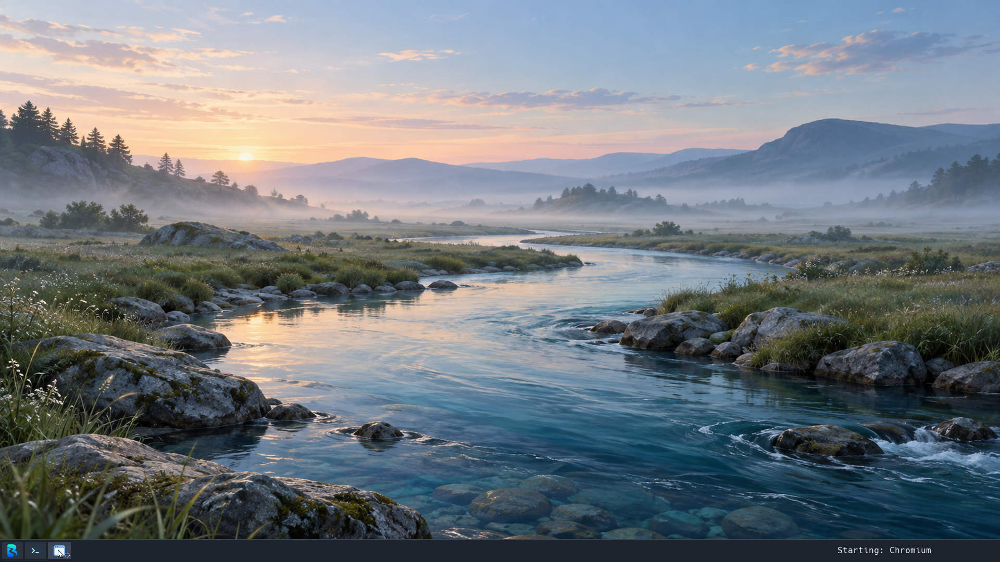

# Launch feedback checkpoint — 17 October 2026

Selecting a launcher entry immediately creates a pending taskbar entry with the
app icon and animated progress dots. Hovering shows `Starting: <app>`. A worker
loads the executable and runs the shortcut; this work no longer runs on the
compositor thread. The launcher's existing maintenance worker consumes up to
eight outstanding requests. Identical pending identities coalesce.

Native windows match an inherited launch token. Wayland windows match the exact
app ID or executable identity from launcher metadata; matching a new window is
allowed once dispatch has started. A pre-existing single-instance app can resolve
the request after successful dispatch. This is evidence of an application window,
not proof that the newly requested process completed successfully. Popups do not
resolve pending entries.

Failed dispatch and a completed process tree without a matching window produce
an exclamation badge and `Launch failed` hover text. A five-minute deadline
changes a pending entry to `Still waiting`; it does not cancel the loader or app.
Notices expire after 15 seconds or can be dismissed by clicking them. Clicking a
busy entry does not cancel its process. If all eight slots are occupied, the
launcher stays open with `Launch queue full` in its header.

Requests own their command, metadata and icon pixels, so launcher refreshes do
not pin old snapshots while an app starts. Shell dispatch is serialized across
launcher, bridge, interactive and nested-script callers. Nested scripts preserve
script mode and propagate errors. Child CWD, trace flags, quiet descriptors and
launch token are set before scheduler publication; the shell returns a captured
PID and never dereferences a potentially reaped child after publication.

## Validation

All 24 hosted suites and the two-pass release kernel build pass. The launch state
suite covers duplicate requests (including legacy shortcuts without IDs), stale
completion after slot reuse, bounded capacity, timeout, native identity precedence,
new versus existing Wayland windows, and failed dispatch. An unrelated new window
cannot erase a request that is still queued, and an existing window cannot hide
a failed dispatch.

Isolated 8-core, 4 GiB CPU-compositor VM sessions:

- `c9d8bc3814324015bff3361e61e4a7f3`: Chromium pending icon and hover label,
  replacement by its real window entry, opening the launcher during Codium
  startup, both apps rendering and closing through native controls, and a
  deliberately broken shortcut producing a visible failure notice. After closure:
  10 tasks, 270,708,736 physical bytes used. Checked shutdown and all three
  filesystem checks passed. This candidate precedes the final legacy-ID duplicate
  fix; the screenshot above is from this session.
- `87bc4c2777f346939bdd898d8f52f020`: final kernel SHA-256
  `c7614e262609a35f67f6b69a775c13398f485fe39e9d3892a3ef4c8733b66ef5`.
  Two quick clicks on a 20-second sleep shortcut produced exactly one dispatch
  and one child. A failing shortcut showed a failure notice; paired captures
  6.6 seconds apart verified explicit dismissal before expiry. Another shortcut
  spawned 100 short-lived `true` children, then sourced the failing script;
  the outer dispatch reported failure without deadlock and the task count
  returned to baseline. Individual success exit statuses are not logged for
  these quiet children. Mousepad's pending entry
  resolved to its normal window entry and it closed natively. All temporary
  shortcuts were removed. Final sample: 10 tasks and 210,870,272 physical bytes
  used. Checked shutdown and all three filesystem checks passed.

Local evidence is under `build/workloads/launch-feedback-20261017/` and the two
session registries. Runtime disk images and fixture shortcuts are not committed.
These are bounded correctness checks, not a startup-performance benchmark.

## Remaining work

- Animated cursor feedback is not connected; animation currently lives in the
  taskbar placeholder. Display scaling remains open.
- Older custom Wayland shortcuts need accurate app ID/executable metadata when
  not replaced by an installed desktop entry. Unknown IDs retain the pending
  entry until process exit or timeout. This is not complete launch correlation
  for every installed app.
- Recheck GPU composition, overflow interaction and full-queue UI in a VM;
  capacity and timeout are currently covered by hosted state tests.
- The native terminal toolbar button still creates its terminal directly;
  the worker change applies to launcher entries.
