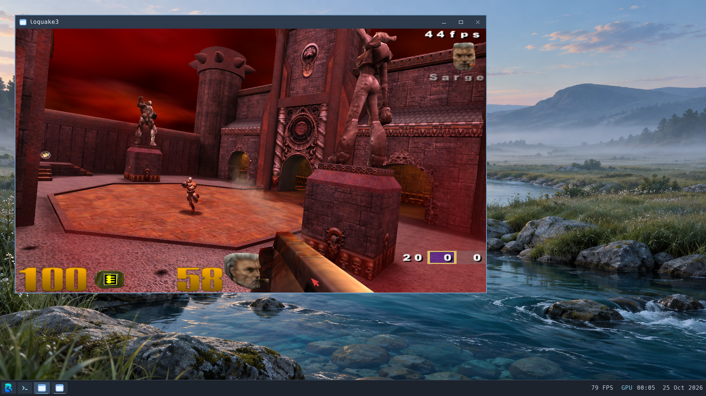

# Quake III Arena demo on Brook

The native64 ioquake3 engine runs a local `q3dm1` match with a Sarge bot on
Brook. This is a bounded smoke test using original demo assets plus public
point-release data, not acceptance of the retail game or multiplayer.
No kernel changes were needed. Data and configuration remain private under
`build/workloads/quake3-20261025` and the guest's dedicated test home.

## Engine and data

The repository's pinned nixpkgs supplies `ioquake3-0-unstable-2025-05-15`, store
output `0hqh1rdawmbyhv488hv7jlkbyrg98dj0`. It was exported using
`scripts/export_guest_package.py` and installed through guest `nix-fetch --deps`
from the private local cache. The native engine and renderer remain unchanged.

The original id Software installers are available from the
[GWDG archive mirror](https://ftp.gwdg.de/pub/misc/ftp.idsoftware.com/idstuff/quake3/linux/):

- `linuxq3ademo-1.11-6.x86.gz.sh`, SHA-256
  `64dee3f69b6e792d1da4fe0ac98fedc7eb1e37ea1027fb609a9fadd06150a4ec`.
- `linuxq3apoint-1.32b-3.x86.run`, SHA-256
  `c36132c5556b35e01950f1e9c646235033a5130f87ad776ba2bc7becf4f4f186`.

Only data is extracted; neither old installer nor its i386 engine is executed.
The demo's `demoq3/pak0.pk3` is placed in the private `baseq3`, alongside the
public patch's pak1 through pak8. Matching native64 `ui`, `cgame` and `qagame`
modules from the ioquake3 package replace use of the incompatible demo QVMs,
with `vm_ui`, `vm_cgame` and `vm_game` set to zero. This follows the demo-data
approach described in the [ioquake3 player guide](https://ioquake3.org/help/players-guide/).
The demo pak itself is unchanged; its SHA-256 is
`e77abad2466f45a0a7ea018445528f9b95a0fe7789fa1abc1a7718bbf0754b08`.
The initial attempt with only pak0 correctly stopped requesting point-release
data; it is excluded from gameplay acceptance. No game data is committed.

## Verified behavior and limits

The test uses the existing capsule-v22 VM with eight vCPUs and 12 GiB.
SDL uses Wayland and the `opengl2` renderer reports Mesa VirGL on Intel UHD 630,
OpenGL 4.6 Core Profile. The window's client area is 1280x720, VSync is off and
the engine cap is 125 FPS. Captured counter readings are approximately 39–44
FPS; these are observations during interactive capture, not a timed benchmark.

The arena, bot, animated scene and HUD render. Keyboard movement changes the
view, firing consumes ammunition, and the bot navigates and frags the player.
Escape opens the game menu. Keyboard navigation selects Exit Game; confirming
Yes displays the credits, and Enter completes a normal zero-status exit.
All tracked descendants exit and both bridge output streams reach EOF.

The initial test disables mouse grabbing with `in_nograb=1`. An absolute bridge click
in the game menu selected a different item from the one under the visible host
cursor; mouse/menu alignment and captured relative input remain unaccepted.
Keyboard menu navigation works. The later native SDL/Wayland control validates
exact relative input and emergency release; the checked Q3 review now uses
`in_nograb=0` and handles normal window close. Native SDL/Xwayland controls also pass with the Brook SDL backport. Physical
host mouse-look remains unaccepted; see [pointer capture](pointer-capture.md).
Fullscreen, persistence, other maps and network play were not tested.

Audio uses SDL's ALSA backend and the existing clocked OSS plugin, with OpenAL
disabled. A four-second gameplay capture contains 179,904 stereo frames at
44.1 kHz, duration 4.079 seconds and RMS 0.0366. A two-second post-exit capture
reports an inactive stream and zero frames. This proves non-silent device
output and cleanup, not subjective pacing or freedom from stutters. The demo
does not contain the requested `music/sonic5.wav` map track; missing grenade
sound warnings also remain. Music playback is not claimed.

## Small-ring audio follow-up

The first live review reports heavy stutter. Its launcher selects a copied
clocked OSS plugin predating the downstream-aware queue bridge used in the
successful Firefox controls. That plugin uses physical unfinished source to
limit logical reuse, so enabling kernel staging alone does not provide the
intended producer headroom.

The updated plugin is selected only for Q3 in a fresh private review. A bounded
kernel extension makes the opt-in downstream budget independent of client
capacity, still limited to 4096 frames. The client FIFO remains 2048 frames
with 64-frame periods. There is no change to HDA publication safety, physical
completion, delay/drain semantics, scheduler settings or application geometry.

Fresh UI launches on one PipeWire-output VM compare the copied legacy plugin,
then the downstream-aware plugin with allowances 1024/4096/1024/4096. Stable
stream-identity/epoch counter brackets report about 20,135 source frames/s for
the legacy setup, 30,129 and 30,118 for the two 1024 controls, and 44,107 and
44,085 for the two 4096 controls. The intended rate is 44,100. These are
physical source-completion rates over guest-clock brackets, not independent
speaker tempo or app framerate measurements. Six-second PCM captures are
retained separately; content silence in this game is not an underrun detector.

The larger-budget snapshots contain about 5,000–6,000 outstanding frames,
including samples accepted by the device, while charged client occupancy stays
within 2048. No sampled stream discontinuity is reported. This repeatable
reversal supports the refill-headroom diagnosis; audible live confirmation,
longer runs and mixed-workload acceptance remain open. Do not call Q3 audio
fully fixed or promote a global staging default from this test.

The actual mixer/HDA suite covers 2048/64/4096 and a 64-frame client, full
admission without fabricated completion, exhaustion, exact drain and immutable
active contracts. Existing rejected/partial-copy, reset/replacement and mixed
stream tests pass. Real libasound tests cover Q3's exact geometry, 6144 physical
frames outstanding, downstream-only delay, logical availability bounds and
exact drain, alongside the 32 sustained conversion cases. Binary, queue,
original launch/close and PCM evidence remains under ignored
`build/workloads/quake3-20261025/audio-budget-native-results.json` and the
`q3-audio-budget-20261025` review. Kernel candidate SHA-256:
`12bb4d4b1c65b530ac277ea9d1975a8b5888a674fe0caa1366a0a8ef8dbd1d65`.
All five Q3 launcher wrappers exit 0 and their exact client groups drain. The
original VM owner exits 0 after acknowledged final sync; all four offline
filesystem checks pass. No game assets or account data are included in Git.

### Independent host-clock check

The later PS/2-only review (`build/reviews/pointer-ps2-20261025`) launches Q3
through its installed shortcut with the same downstream-aware plugin. Three
successive ten-second measurements bracket each audio-stats request with host
monotonic timestamps. Source completions are 441344, 441600 and 441216 frames.
Allowing for each request's full timing uncertainty gives respective rates of
44029–44133, 44073–44159 and 44034–44120 source frames per host second. Every
interval includes the intended 44100 rate. Stream identity and epoch remain
unchanged, with no reported discontinuity; client capacity/period stay 2048/64
and the downstream allowance is 4096.

This independently supports correct aggregate source pacing without relying
on guest timer calibration. It cannot exclude short audible underruns or
prove speaker timing. Four seconds of device capture contains 176640 frames;
normal WM close removes the exact client group and audio stream. After a
two-second settling interval, a separate two-second capture is inactive with
zero frames. Checked VM shutdown and all four offline filesystem checks pass.
Raw counter brackets, output captures and UI operations remain private in that
review. Audible acceptance and mixed-workload smoothness remain unverified.

The subsequent physical review reports that Q3 audio is "much clearer".
It also reports roughly halved FPS when OBS is open on the host. Treat host
recording as a performance-test variable; this observation alone neither
locates the shared resource bottleneck nor measures Brook's isolated FPS.
Sustained freedom from audible stutter has not yet been explicitly confirmed.
