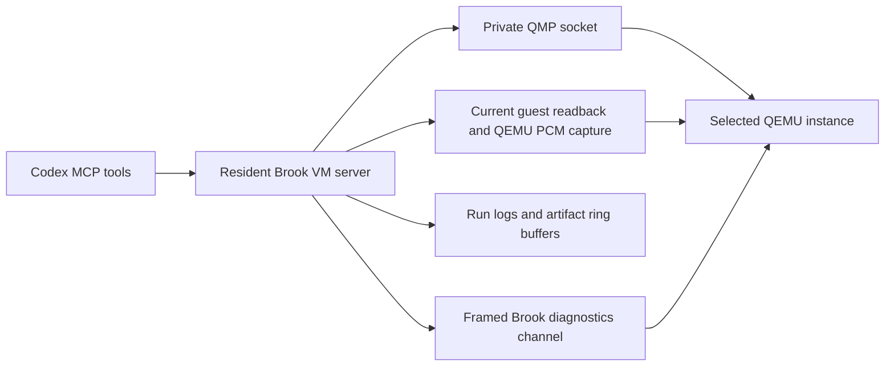

# VM-only computer-use MCP research

Proposed follow-up: [efficiency, artifact delivery and UI control specification](vm-bridge-next.md).
This proposal is separate from implemented behavior.

Research and implementation date: 14 October 2026. A first working bridge is
implemented in [tools/vm_bridge](../tools/vm_bridge/README.md) and registered
as the local `brook-vm` Codex MCP. No existing desktop-control plugin was
installed and no host desktop was accessed. The research below remains the
architecture reference; the README specifies currently available behavior.

Initial 14 October implementation snapshot (later additions are documented in
the bridge README): opted-in user/agent discovery, private QMP, 16 stdio tools, guest
launch/windows/processes, framed guest stats, CPU/context-switch export,
accelerated/CPU screenshots with crop metadata, input cancellation, silent
PCM/waveforms and host-side post-panic inspection. Actual frame capture uses
guest GPU readback plus a brief QEMU pause; audio uses bounded HMP WAV capture.
Private D-Bus listeners, semantic widget actions, command completion/isolated
stdout, correlated event jobs, guest audio timing, full dumps and the recalled
panic pipe remain deferred. See the [month roadmap](roadmap.md).

## Existing patterns

The official Computer Use documentation describes macOS/Windows desktop
support; the Linux preview release notes explicitly exclude Computer Use.
That does not prevent a custom Linux-hosted MCP. The API computer-use guide
supports user-provided UI tools and describes the familiar screenshot/input
loop. Our integration should expose ordinary MCP tools to the current agent,
without adding a separate model/API agent loop. Sources:
[Computer Use](https://learn.chatgpt.com/docs/computer-use),
[Linux preview release notes](https://learn.chatgpt.com/docs/whats-new),
[custom UI tools](https://developers.openai.com/api/docs/guides/tools-computer-use).

The directory search did not identify a matching Linux desktop-control plugin;
results are not exhaustive. The local plugin cache contained no such package.
Public community projects supply more useful reference contracts:

| Reference | Exposed pattern to adapt |
| --- | --- |
| [agent-sh/computer-use-linux](https://github.com/agent-sh/computer-use-linux) | `doctor`, apps/windows/focus, combined screenshot and accessibility state, coordinate or semantic input, explicit screenshot scale/size metadata, bounded captures and serialized input. Its host AT-SPI/portal/uinput implementation is not suitable for Brook. |
| [ilysenko Linux integration](https://github.com/ilysenko/codex-desktop-linux/blob/main/docs/linux-computer-use.md) | Distinguishes richer backend capabilities from a smaller in-app adapter, with compact state/diffing and screenshot limits. This is a community integration, not official Linux Computer Use support. |
| [Roadmvn/linux-computer-use](https://github.com/Roadmvn/linux-computer-use) | Named isolated sessions, pixel and semantic actions, a live view, and a human takeover lease. Its browser/nested-X desktop machinery is a reference only. |
| [wieslawsoltes/LinuxComputerUse](https://github.com/wieslawsoltes/LinuxComputerUse) | Separate local/VM backends, target diagnostics, and screenshot verification after meaningful input. A successful input command is not proof the guest UI reacted. |

Use the action vocabulary and observation contracts, not those projects'
desktop installers or host input/screenshot paths. Brook is a custom OS with
its own compositor and Wayland server. Linux-host AT-SPI trees cannot inspect
Brook applications; semantic guest state needs a new guest channel.

## Recommended architecture

The bridge discovers an explicit launcher-maintained session registry. Each
entry binds a session ID and generation to a run directory, QEMU identity,
private sockets, disk paths, display geometry, selected render node and
capability state. Avoid implicit
attachment to whichever VM or GUI happens to be active. A stopped/restarted
session gets a new generation so an old frame or input request cannot target
its replacement.

### User-started and agent-started VMs

The bridge must attach equally to an opted-in VM launched by a user or by
`vm_start`. Put feature setup in `run-qemu.sh`, not exclusively in the MCP
launcher. A proposed `BROOK_VM_BRIDGE=1` flag enables private control/debug
endpoints and publishes an atomic, versioned session descriptor. This flag
is a proposed implementation, not an existing runner option.

The descriptor includes a random session ID, launch generation, PID and
process-start identity, owner, boot/build identity when known, run directory,
disk paths, QMP/display/debug endpoints and launch provenance. Discovery scans
only the configured Brook registry, validates endpoint ownership and QEMU
identity, and rejects stale or replaced processes. Do not attach by guessing
the default monitor socket, process name or active desktop window.

A reconnecting MCP reuses an opted-in session; it does not restart the guest,
replace its disks, switch display mode or enable speaker output. Descriptor
state records whether the run used clones or user-selected images. MCP
disconnect does not kill an externally launched VM. Lifecycle ownership and
the input/control lease are separate: observation remains available when the
user owns input. Multiple clients need one serialized session broker, shared
capture buffers and independent log cursors. A bridge feature without an MCP
client still leaves the VM usable by its user.

Use a local stdio MCP process with protocol output on stdout and diagnostic
output on stderr. This matches the documented
[local plugin server pattern](https://developers.openai.com/plugins/deploy/desktop-only).
Package it with a workflow skill after the runtime is verified. Installation
of the new VM plugin is a separate step; this research changes no client
plugin configuration.

## Proposed tool surface

Keep common actions compact while exposing deeper capabilities on demand.
Names below are proposals, not currently callable tools.

| Tool | Contract |
| --- | --- |
| `vm_doctor` | Reports detected versus tested capabilities, QEMU/version/render node, guest readiness, input devices, frame/audio backends and limitations. Detection alone never marks a capability verified. |
| `vm_sessions` | Discovers feature-enabled Brook runs regardless of launcher, with generation, provenance, lifecycle ownership and control-lease state. |
| `vm_start` | Runs a named Brook scenario on fresh writable clones; hardware profile and initial resolution are explicit; host playback defaults off. |
| `vm_control` | Pause/resume/reset/stop the selected run; acquire/release control lease; cancel owned jobs. Stop/reset await synchronous guest metadata sync. Explicit `force: true` allows an unsynced panic/unreachable shutdown and reports `guest_sync_completed: false`. Quiesce writing workloads first. |
| `vm_observe` | Returns an image content block plus frame ID, native/display/crop geometry, capture time, renderer identity, focus/window state when available and incremental log offsets. |
| `vm_input` | Executes an ordered batch of typed mouse/key/text/wait actions. Returns acknowledgements, timing and optionally one final observation. Supports cancellation and held-state cleanup. |
| `vm_logs` | Cursor-based serial/QEMU/app log reads; bounded result sizes, filters, truncation and rotation metadata. Await a match with a deadline rather than repeatedly retrieve entire logs. |
| `vm_wait` | Waits for a frame change, log condition or guest event; returns a bounded observation or an explicit timeout. |
| `vm_audio_capture` | Captures a bounded PCM interval independently of speaker output, with stream format, sample indices and monotonic host timestamps. |
| `vm_audio_analyze` | Returns waveform/timing plots, channel metrics and candidate discontinuities, linked to the PCM artifact and capture interval. Detection is not a diagnosis by itself. |
| `vm_guest` | Later: list/focus/resize windows, processes, application launch, guest file transfer and command jobs through a framed guest RPC channel. Advertise unsupported operations initially. |
| `vm_artifacts` | Read/export run-scoped frames, audio and diagnostics by artifact ID. Capture artifacts remain under ignored build directories. |
| `vm_debug` | Typed diagnostic operations with per-operation normal/panic/halted availability: crash records, CPU snapshots, bounded memory reads, page-table walks and targeted region export. No normal guest command fallback after panic. |

Actions should include absolute/relative move, click/double-click, button
down/up, scroll, drag paths with durations, key down/up/chords, text and wait.
Hold/release primitives matter for games, shortcuts and drags. Coordinate
actions use a referenced frame ID. The server maps crop/preview coordinates
back to native guest pixels and rejects mismatched generations/geometry.
Every result states whether it merely injected input or observed a guest
reaction. Keep semantic activation distinct from physical clicks.

Preflight the entire text string against the selected guest keyboard map.
Start with explicitly supported text and reject unsupported characters before
typing any of it; Unicode needs a guest text/clipboard service. Host clipboard
use is excluded. Release held keys/buttons on cancellation or lease loss.
Serialize mutating actions per session and do not replay an action through a
fallback after it may already have been delivered.

## QEMU transport findings

The existing runner exposes HMP, not QMP. Replace command-string parsing with
a persistent QMP client, request IDs and asynchronous event handling. QMP
offers routed key/button/absolute/relative events; its absolute pointer range
is 0–32767, requiring conversion from guest pixels. References:
[QMP input](https://www.qemu.org/docs/master/interop/qemu-qmp-ref.html#input),
[QMP protocol](https://www.qemu.org/docs/master/interop/qmp-spec.html).

A local probe of installed QEMU 10.2.2 used `-machine none -nodefaults
-display none -S -qmp stdio`, without disks or desktop connections. It confirmed
`input-send-event`, `send-key`, `screendump`, `query-status`, `query-mice`,
`query-blockstats`, `query-cpus-fast`, `query-qmp-schema`, `getfd`, `add_client`,
`stop`, `cont` and `quit`. Help output also lists D-Bus display/audio backends.
These are availability checks, not end-to-end VM capture/input validation.

For accelerated output, evaluate QEMU's D-Bus display listener on a private
connection. It provides pixel updates and DMA-BUF scanouts, plus PCM output
listeners with stream-format metadata. This could supply frames and audio
without a host window or desktop capture. Importing DMA-BUFs requires a tested
headless graphics consumer and correct format/modifier/orientation handling.
Newer documented interfaces must be negotiated against installed 10.2.2.
Source: [QEMU D-Bus display](https://www.qemu.org/docs/master/interop/dbus-display).

Existing EGL-headless monitor captures returned `Error: no surface` during
working virgl presentation. Changing HMP to QMP does not itself solve that.
Use D-Bus as the first accelerated-capture experiment; retain Brook's GPU
readback as a fallback, moved off the interleaved serial log. Software-display
`screendump` remains useful. Avoid full-frame base64 dumps over serial during
performance measurements. Fix the runner's stale blanket screendump claims
when the new backend is implemented.

## Audio and guest telemetry

Keep bounded PCM chunks and associated format/sample indices in a ring. Plot
waveform, silence/discontinuity candidates and cumulative sample time beside
callback arrival time. Retain host monotonic time separately from guest time;
do not claim those clocks are synchronized without calibration.

QEMU output observes an emulated-device boundary, not Brook's raw mixer ring.
To identify root causes, add guest counters/timestamps at OSS writes, mixer
queue occupancy, HDA completion and underruns. A delayed host callback may
reflect scheduling or observer backpressure rather than missing audio. Known
injected gaps and stress runs should validate the analysis. Capturing a stream
does not imply playing it, and requires no host microphone or desktop-audio
capture.

The recovered kernel already has a normal-operation TCP debug channel:
`DebugHandleCommand` in `src/kernel/src/net.cpp` exposes `wm list/focus`,
`inject`, `procs`, memory statistics, tracing, profiler and script execution.
The debug overlay listens on guest port 1234; another channel connects outward
to host port 9999. Reuse a scoped subset through a legacy adapter initially,
then version/frame it. Audit reply routing: some handlers, including window
listing, send directly to the outbound socket instead of the requesting
listener. The existing receive path also lacks robust stream request framing.

The structured guest channel should frame messages separately from human logs,
version its schema, and return command/process job IDs with stdout/stderr and
exit status. Window geometry/focus should come from Brook's window manager;
widget trees or semantic actions need app/toolkit support and are a later
capability. Guest commands remain guest commands; a host shell is not an
equivalent fallback. This normal TCP dispatcher is not a panic-safe service.

## Post-panic inspection

The user recalls a kernel command pipe usable after panic. It has not been
located in the surviving checkout or diagnostic-branch panic path. Current
`KernelPanic` halts APs/composition and finishes in a pause-spin; the diagnostic
branch additionally cycles panic QR pages. Normal TCP commands depend on
guest polling/threads and cannot be assumed to survive that transition.
`PANIC_DEBUG_DOCS.md` is historical documentation, not proof of current
post-panic command support. Preserve this recovery requirement explicitly.

Use three distinct capability layers, with runtime-tested availability:

| Layer | Initial scope | Dependency |
| --- | --- | --- |
| Host/QEMU inspection | VM state, preserved logs/crash artifacts, current vCPU registers via debugger, bounded physical-RAM reads and selected region exports | QEMU/QMP/debugger remain responsive; guest threads and networking are unnecessary. |
| Captured panic state | Original fault registers, saved CR3, halted-CPU snapshots, stack snippets and panic/log records | Existing captured records must be found and decoded; distinguish fault-time state from current panic-spin registers. |
| Kernel panic command pipe | Read-only version/status/crash records and fault-tolerant bounded memory/page-table inspection | Recover or implement a polled panic-safe endpoint and safe-read primitive; not yet available/verified. |

Prefer QMP for control and an explicitly enabled QEMU debugger endpoint for
memory/register operations. Keep diagnostic commands typed and bounded. A
virtual read names its CPU/address space or saved CR3; physical reads are
limited to advertised guest RAM ranges. Report inaccessible ranges/holes and
partial reads rather than silently substituting zeroes. Never treat MMIO as
ordinary RAM. Page-table walks must state which address space they inspect.

A future panic handler must use fixed preallocated buffers, bounded polling
and guarded reads, without scheduler, heap, VFS, network or ordinary kernel
locks. Keep input injection, app execution, profiling and window operations
unavailable after panic. Reuse the diagnostic branch's fault-safe probe and
unwind work only after review. QEMU being alive, a serial panic message, and
a working panic command endpoint are separate facts in `vm_doctor`.

The bridge stays resident through a guest panic and preserves the session
generation. It can detach/reconnect without resetting the guest. Observation
identifies stale frames/audio and frozen telemetry; it must not present them
as live. Reset is explicit, never automatic after a failed command.

Start with selected-region dumps and a manifest containing address space,
ranges, missing pages, build ID, fault context and hashes. Full memory dumps
remain deferred: no current full-dump implementation is claimed. Later host
dumps need an explicit size/budget and consistency policy. All dump artifacts
stay in ignored run directories, outside git.

## Scope and iteration plan

No host DISPLAY/Wayland-session discovery, GNOME/KDE portals, AT-SPI bus,
global input devices, desktop screenshot utilities or host clipboard. A
private QEMU D-Bus connection is separate from the user's desktop session bus.
The graphics consumer may use the selected DRM render node solely to import
VM frames; that is not desktop observation.

Keep one resident server, latest-frame caching, bounded capture workers,
cursor-based logs, compact unchanged-state responses, timed action batches and
job handles. Log action/observation sequence IDs to reproduce failures. Human
takeover pauses mutations while preserving observation. Record/replay here
means replaying tool sequences; it is not a claim of deterministic KVM/GPU
execution.

Implement in this order: launcher discovery/session/QMP/log foundation and
host-side post-panic diagnostics; verified full-resolution
frame backend and coordinate calibration; input probes and cancel/hold tests;
silent PCM capture and plots; guest diagnostics; packaging/client discovery.
Detailed acceptance criteria and the deferred branch investigations are in
[backlog.md](backlog.md).
