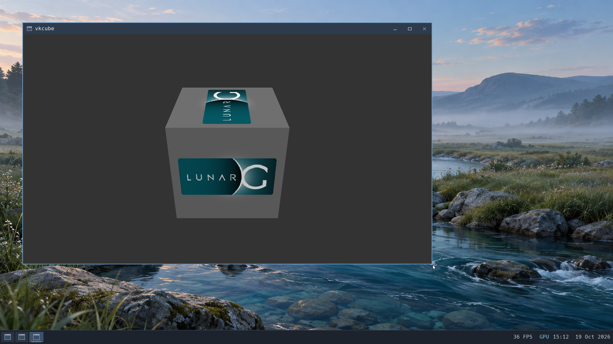
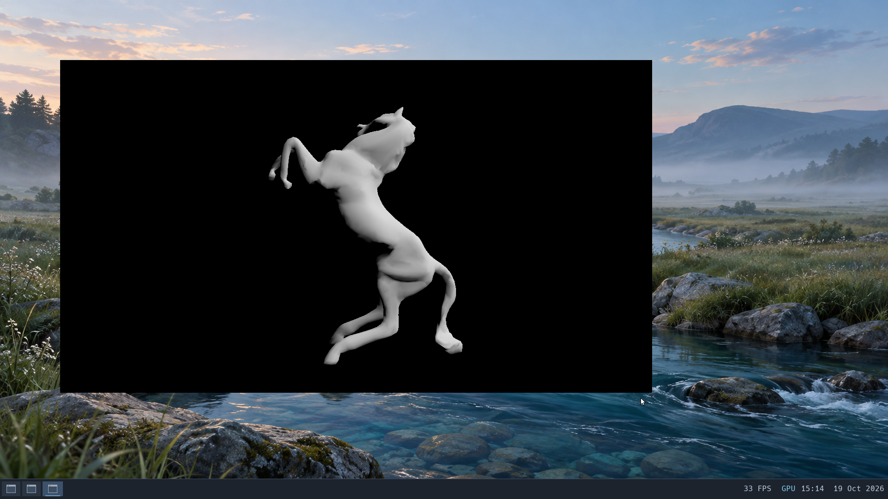

# Hardware Vulkan desktop integration

Active work branch: `wip/vulkan-desktop-20261019`, starting at `f5573cef`.
The initial bring-up proved hardware Venus compute, offscreen rasterization and
native Wayland swapchains with Mesa CPU staging. See [bring-up evidence](vulkan-bringup.md).
This goal additionally requires working direct DMA-BUF presentation and automatic
selection of the supported presentation path. The goal remains incomplete until
those paths and the full acceptance below have passed.

## Goal

Make hardware Vulkan a supported Brook desktop application path. Implement and
validate DMA-BUF presentation and the synchronization required by the pinned
Mesa Venus driver. Applications should launch without manually supplied WSI
debug flags, using an explicit, safe staging fallback where necessary. Compare
direct and staged presentation using the same vkcube and vkmark workloads.
Verify resize, minimize/restore, close/relaunch, concurrent GL/Vulkan use and
complete resource retirement over repeated cycles. Preserve existing application
behavior and saved data; require clean shutdown and filesystem checks. Keep
DXVK/Proton and broader performance optimization outside this goal. Commit tested
checkpoints to a work branch and merge only after approval.

## Required contracts and evidence

| Contract | Required evidence |
| --- | --- |
| DMA-BUF layout | One-plane advertised formats/modifiers, flags, dimensions, stride, offset and actual canonical resource extent validated before host import. Legacy GL metadata cannot be silently replaced with client claims. |
| Descriptor synchronization | Real, immutable sync-file descriptors with correct ownership, FILE_INFO, poll/epoll, seek and CLOEXEC behavior, compared with Linux. Eventfds cannot impersonate sync files. |
| GPU completion | Actual Vulkan queue work followed by an exported semaphore sync_fd; mapped results must match immediately after polling that fd, before ordinary Vulkan fence/idle waits. Preserve the selected queue ring. |
| Shared reservations | DMA-BUF import/export state belongs to the canonical resource across PRIME/GEM/rights aliases. Never omit a pending dependency or treat command-ring acceptance as GPU completion. |
| Cross-API presentation | Import the validated exported allocation into the host GL context, capture an immutable compositor-owned image, fence the compositor access before releasing the producer buffer. Handle unmappable device-local allocations without assuming a CPU mapping. |
| Automatic policy | Ordinary desktop app launches select the proven direct path or explicit staging fallback before swapchain creation. Missing sync ioctls are not a safe fallback signal: Mesa may simply skip synchronization. Force a capability-failure case to verify fallback. |
| Repeated mixed workloads | Same vkcube/vkmark runs under direct and staged policy, resize/minimize/restore/close/relaunch, concurrent GL, correct changing frames, complete byte output and lineage, timings and memory recorded. |
| Preservation and cleanup | Conserved backing/blob/aperture resources, no quarantines or app descendants/windows, heap integrity, checked shutdown, offline fsck and matching saved documents/profiles. |

## Initial implementation

The Wayland params path now retains offset/modifier fields and validates plane
indices, duplicate planes, consumed params, flags, formats, dimensions and row
layout. The shared layout helper supports a final allocation-bound check, which
must be applied by the kernel before Venus image import. Wayland's preliminary
check alone does not prove backing bounds. Existing implicit-modifier GL images
remain distinguishable from explicit linear Venus images.

Completed-only sync files are appropriate while virtgpu submissions synchronously
wait for their requested host timeline. The descriptor must be published only
after that wait, not after an ordinary queue acknowledgement. A ring0-only raw
probe tests descriptor ABI, not Vulkan GPU completion. The stronger compute
probe's optional `BROOK_VULKAN_SYNC_FD=1` path signals and exports a binary
semaphore after 256 dependent dispatches, polls the exported sync file, then
checks exact readback before waiting for the ordinary Vulkan fence.

The existing host renderer implements `PIPE_RESOURCE_SET_TYPE` for importing
untyped DMA-BUF resources into a GL context. Its use still needs kernel ownership,
layout and producer/compositor completion validation and actual presentation
acceptance. Unsupported import must not be hidden by relabeling a staged frame
as a direct one.

### Completed synchronization foundation checkpoint

Linux reference: `build/workloads/vulkan-desktop-sync-20261019/linux3-syncfd/`.
Brook: `build/workloads/vulkan-desktop-sync-20261019/candidate3/`, kernel SHA-256
`1f0b755c197e68ac42363b5f92eb3c581e252ec75050588b5952f3e233fb2070`, ABI 31.
Both pass the same sync-file descriptor probe: FILE_INFO count/detail and
malformed requests, permanent non-consuming read readiness, read-only/CLOEXEC,
invalid read/write and seek, LT/ET/one-shot epoll and MOD rearm, wrong descriptor,
close/dup/fork/SCM_RIGHTS lifetimes after closing the DRM context. The stronger
Vulkan probe passes three 256-dispatch/readback rounds through exported
queue-signaled semaphore sync files, plus triangle rasterization. Brook's actual
hardware GLES RGB/persistent coherent buffer checks also pass.

Brook drains all seven tracked command groups with complete stdout/stderr,
returns blob/aperture/quarantine counts to zero, balances backing mappings and
bytes, passes heap integrity, completes checked shutdown and all four offline
filesystem checks, and preserves the 12 document fixtures and saved profiles.
All 56 host tests and both compiled entry audits pass. The Wayland package's
production parameter-state, layout and existing surface ownership tests pass.
Wayland/kernel image import and automatic fallback are still subsequent work;
this checkpoint does not claim direct presentation acceptance.

The descriptor models a completed fence, not a mutable eventfd counter. The
implementation matches the [Linux sync-file ABI and implementation](https://raw.githubusercontent.com/torvalds/linux/v6.18/drivers/dma-buf/sync_file.c).
New fences are read-only, CLOEXEC and non-seekable; their readiness cannot be
consumed or signaled by the recipient. Only a verified selected-timeline wait
can create them. DMA-BUF reservation ioctls remain unimplemented at this
checkpoint, so native unstaged presentation is not enabled.

### Canonical DMA-BUF reservations checkpoint

Linux reference: `build/workloads/vulkan-desktop-reservation-20261019/linux3-intel/`.
Brook: `build/workloads/vulkan-desktop-reservation-20261019/candidate/`, kernel
SHA-256 `9c95d923c456baf15a549279873a605199e79418334e6499b557910779eb782f`,
ABI 31. The shared raw probe passes import/export READ, WRITE and RW flags,
invalid flags/descriptors, read-only copyout failure without a descriptor leak,
and aliases after closing original GEM/DRM/PRIME descriptors. The completed
reservation belongs to the canonical resource. Listed Venus BO submissions
wait for their selected timeline even when no outgoing fence was requested;
uncertain completion prevents export and safe retirement. Export waits at most
five seconds for admitted submissions and can return EINTR/ETIMEDOUT instead
of Linux's unsignaled fence. This bounded, completed-only subset is intentional.

All seven guest commands pass, including queue-signaled Vulkan semaphore
readback and persistent hardware GL. Resources return to zero, heap integrity,
checked shutdown and four offline filesystem checks pass. All 12 document
fixtures and saved profiles match the checked seed. All 57 host tests pass.

This is not yet sufficient for direct presentation: ordinary Venus shared-ring
commands may omit BO lists. Capture must require a current-frame imported WRITE
fence and enforce producer-buffer release ordering. GL export currently fences
the creating context; it does not prove completion of writes from another
importing GL context. Cross-context rendering must be rejected or tracked before
the new image-import path can claim that guarantee.

### Direct image capture checkpoint

Brook: `build/workloads/vulkan-desktop-import-20261019/direct-candidate4/`,
kernel SHA-256 `4cbe8e41e9e11759a0cbe39625d555b7380d401f5a869529bf530a4f6d813734`,
all 12 modules ABI 32. Pinned Intel/Mesa/QEMU/renderer versions remain unchanged.
Wayland binary SHA-256:
`6cc4a6ec09bcaffce6212cfa9428575fdf59a9510dda5bdc2173d75efab61c83`.

The kernel checks the held GEM capability, canonical allocation extent,
shareable Venus allocation, explicit LINEAR modifier, format/stride/offset and
current imported WRITE fence. A capture-read reservation remains busy through
the actual scene worker's import/copy/completion fence. Conflicting listed BO
submissions are rejected and completed DMA-BUF exports wait. Safe allocation or
cancellation failures preserve the frame's WRITE token for retry. Uncertain
GPU completion stays quarantined. The source lease outlives this callback.

Image preparation runs on the compositor worker, outside desktop frame
assembly. The driver imports through `PIPE_RESOURCE_SET_TYPE`, rejects changed
layouts for an already typed allocation, and never maps device-local images
on the CPU. It does not substitute a GL producer fence for Vulkan completion.
The compositor's own copy is fenced before Wayland releases the producer.
Legacy numeric/capture operations reject Venus resources.

Acceptance passed two full vkcube cycles (800×600, resize to 1280×720,
minimize/restore, maximize to 1916×996 on a 1920×1080 desktop, restore,
close/relaunch), two vkmark runs (1280×720, vertex and texture for 15 seconds
each), and four concurrent hardware GLES RGB/persistent-buffer checks. No WSI
debug flags were supplied to these Vulkan apps. Serial evidence records 44
validated direct allocation imports. Vkmark reports 15 FPS for each scene in
both runs; this is not yet a comparison with staging on the same compositor.

All nine tracked command groups drain complete stdout/stderr and descendants.
The guest rejects 17 malformed/unsupported capture requests without host image
import. Final blob/aperture/quarantine/failed-retirement counts are zero; all 12
backing mappings and 4,325,376 bytes balance. Heap integrity, checked shutdown,
launcher/QEMU exits and all four offline filesystem checks pass. All 12 document
fixtures and saved profile trees match the checked seed. All 57 host tests pass,
including real scene-service queued reservations, cancellation/admission rollback,
worker import failure and exactly-once completion with a live source lease.

Earlier private failures remain preserved: an initial bridge epoch timeout shut
down cleanly before any app launch; a repeat direct run hit a retained-scene
failure and required a forced stop; the first negative probe used an unsupported
raw shareable allocation and failed before WSI. None qualify as acceptance.
The corrected direct candidate above uses fresh clones of the checked seed.

Reproduction uses `scripts/workloads/stage_vulkan_nix.py --wayland PACKAGE` to
install and hash-check the selected server on a new offline image, followed by
`scripts/workloads/vulkan_wayland_check.py --presentation direct --composite gpu
--vkmark build/vulkan-vkmark-wayland-result` with explicit checked seed, Nix seed,
output and matching control arguments. Private images and raw logs stay outside
git. Automatic policy/fallback and the controlled staged comparison remain open.

