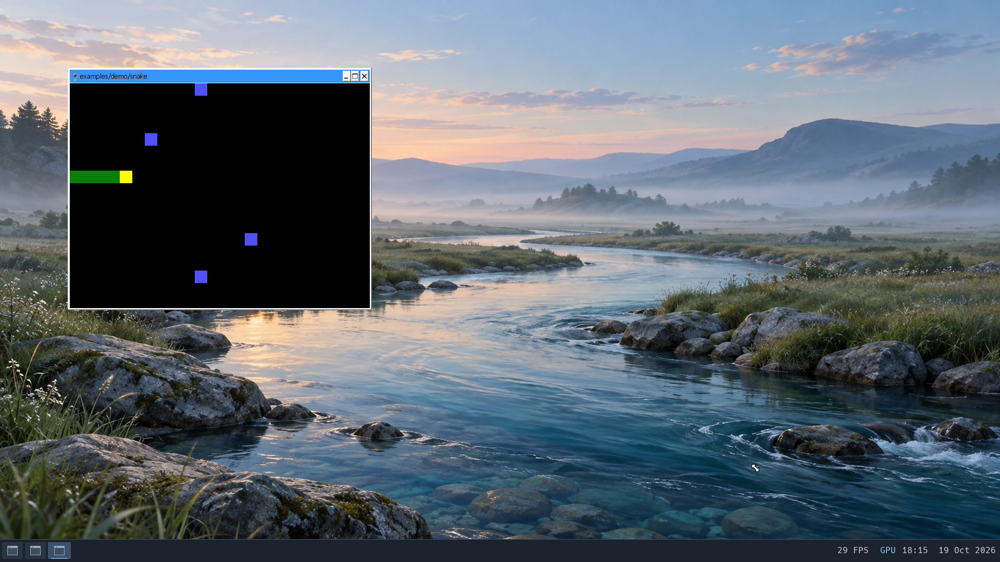
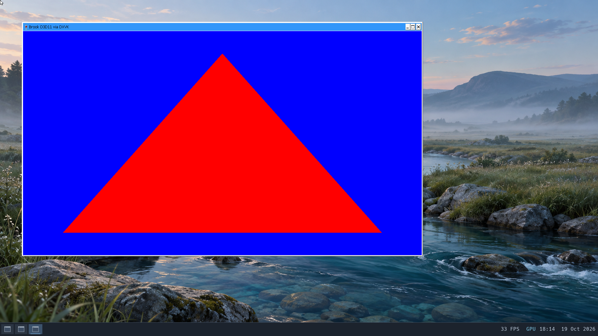

# Wine and DXVK acceptance

Work branch: `wip/wine-dxvk-20261019`, based on Vulkan desktop checkpoint
`6546b611`. Main is unchanged; merging requires approval.

## Scope

Establish a reliable Direct3D 11 application path through Wine and DXVK on
Brook's hardware Vulkan stack. Begin with a deterministic Windows rendering
probe, then a lightweight Windows game or application. Verify rendering,
input, audio where supported, window management, repeated launches, resource
retirement and checked shutdown. Record startup and steady performance and
fix bounded compatibility gaps. Preserve Linux GL/Vulkan acceptance and saved
data. Full Steam/Proton, anti-cheat and broader optimization are excluded.

## Accepted checkpoint — 19 October

The production run `build/workloads/wine-dxvk-20261019/final-candidate3`
passes the bounded acceptance goal. `delivery-audit.json` and
`preservation-audit.json` record the checks. The kernel SHA-256 is
`d35182345d25051743aa56db5be52ddad660c1a98e981be21f301d2cca687833`;
temporary termination diagnostics and process tracing are disabled.

- Three independent offscreen D3D11 launches produce the expected shader
  pixels on hardware Venus and exit normally.
- Two visible cycles verify keyboard input and readback at 640x360, 1280x720,
  a real CSD drag, maximized 1912x1002, and restored geometry. Both finish with
  three key events, five size events and normal close. Resize is a new render,
  rather than a stretched old image.
- The upstream Windows SDL3 Snake example runs through its forced D3D11
  renderer and native DXVK DLLs. Arrow input, minimize/restore and close work.
  A native Linux Vulkan compute/render probe also passes while Snake is open.
- After all Wine processes exit, native persistent EGL readback, Vulkan
  compute/render and a visible 60-frame SDL3 Wayland GL test pass. GPU backing,
  aperture leases and mapping bytes balance; no quarantine or failed retirement
  remains. Heap integrity passes.
- The guest shuts down normally, QEMU returns zero and all four filesystem
  checks pass. Twelve saved document fixtures retain their hashes/ownership;
  the original settings, browser, Codium and Wine profile trees match the seed.
- All 57 host tests and ten Wayland production tests pass for this checkpoint.





The patched DXVK 2.7.1 package accepts identity rotation, the no-op requested
by SDL3, and reports it through `GetRotation`. Invalid enum/null requests
remain errors; actual rotation remains unsupported. The probe verifies that
rejected requests do not mutate the reported state. Astra's read-only review
found no blocker in this bounded change.

### Performance and limits

Host-observed launch-to-window time is 12.46 and 12.26 seconds, including bridge
submission and observation. D3D11 device initialization inside the executable
is 203 and 248 ms. The two automated window sequences render 326 and 311 frames
in 46.36 and 44.14 seconds; these sequences include screenshots, resizing,
minimized periods and control waits, so they are not steady FPS benchmarks.

The 150 ms early-startup profile contains 166 samples and 5,262 context switches,
with 15 CPU samples attributed to observed Wine tasks. The 750 ms Snake profile
contains 587 samples and 7,004 context switches. Both report zero dropped events
and matching event counts. These short captures are mostly idle/kernel samples;
no user-mode CPU samples were recorded. Startup's visible Wine work includes
block I/O submission. This supports further startup investigation, not a precise
user-space or GPU bottleneck attribution. Raw profiles and Speedscope exports
remain with the acceptance artifacts.

Snake initializes video only, so Windows audio is not covered. Networking,
non-identity display rotation, relative-pointer constraints, larger Windows
applications and full Steam/Proton integration remain outside this acceptance.
The test hardware is Intel UHD 630; the second NVIDIA GPU is untested. PID reuse
is deferred within the existing bounded namespace, not replaced by stable pidfd
identity. The clean production run `identity-candidate` also passed functional
acceptance, but its pre-submission startup sample is excluded. The intermediate
`final-candidate` and `final-candidate2` runs are excluded: the former stopped on
an asynchronous submission assertion; the latter rejected a lossy startup
profile. Each completed checked shutdown and filesystem checks.

## Pinned starting point

- Wine64 11.0 and the populated, checked Wine prefix from
  [console/Notepad acceptance](wine-smoke.md).
- DXVK 2.7.1 from the existing pinned nixpkgs, x64 DLLs only. The primary
  [release documentation](https://github.com/doitsujin/dxvk/blob/v2.7.1/README.md)
  identifies `d3d11.dll` and `dxgi.dll` as the D3D11 pair.
- Mesa Venus 26.0.6, QEMU 10.2.2 and bounded virglrenderer 1.3.0 on Intel UHD
  630, using the [accepted desktop presentation path](vulkan-desktop.md).
- Eight vCPUs, 4 GiB, private checked disk clones, GPU composition and silent
  host audio. No host desktop or microphone access.

DXVK DLLs are copied beside the test executable, with native D3D11/DXGI
selection scoped to the test. A separate copy of the populated prefix keeps
the original profile unchanged. Per-app WSI debug flags are not supplied.
DXVK device logs must identify Venus; Wine's builtin OpenGL D3D path is not
accepted as DXVK success.

## First probe

`tools/d3d11-probe-pkg` builds a Windows x64 executable with pinned MinGW.
It requests a hardware D3D11 feature-level 11.0 device, compiles vertex/pixel
shaders, draws a red triangle on a blue target and checks both center and
corner pixels after staging readback. This distinguishes a real shader draw
from successful device creation or a clear-only result. It has an offscreen
mode to isolate rendering from window-system integration, and a windowed mode
with bounded frames and input/size event counters.

The initial diagnostic run is under
`build/workloads/wine-dxvk-20261019/candidate/`; it is not yet application
acceptance. Build with `nix-build tools/d3d11-probe-pkg -o build/d3d11-probe-result`.
Private disks, executables and raw logs remain outside git.

## Completion gates

1. Prove native DXVK selection and hardware Venus rendering with deterministic
   readback; retain exact logs and complete command lineage/output.
2. Exercise a visible D3D11 window, keyboard input, resize, minimize/restore,
   close/relaunch and a lightweight Windows workload. Measure startup and frame
   timings. Observe audio if the selected workload produces it.
3. Repeat with Linux GL/Vulkan regression workloads; require complete resource
   retirement, heap integrity, saved document/profile preservation, checked
   shutdown and offline filesystem checks.
4. Commit tested checkpoints to the work branch. Main requires approval.

## Historical diagnostics

The first prefix preparation failed during Python metadata copying, before
DXVK ran; its traceback exceeded bridge retention. That run is excluded and
its stopped disks are preserved. The retry uses a separate byte/hash/mode
verified prefix copy. The original saved prefix is never the test prefix.

Vanilla Wine 11.0 with DXVK 2.7.1 creates a hardware D3D11 feature-level 11.0
device on Venus and renders/readbacks the expected red triangle and blue corner.
One run then loses the Wine group; another returns zero but a Wine service
faults. Neither is accepted. The fault instruction matches `nsiproxy.so`'s
`update_if_table`, immediately after `if_nameindex()` returns NULL. Brook lacks
AF_NETLINK route queries, which the pinned glibc needs for interface enumeration.
Wine 11 dereferences that failure result without checking it.

`tools/wine-brook-pkg` backports upstream Wine commit
[`08dbf01a`](https://github.com/wine-mirror/wine/commit/08dbf01aaa3689f8c8a8a22276658f372b023b03),
which checks the NULL result and reports the failure. It does not implement
interface enumeration or fabricate a successful netlink response. The patched run
`build/workloads/wine-dxvk-20261019/patched-candidate3/` passes three hardware
D3D11 triangle/readback launches and normal exits, without the former user
fault. Original documents and profiles match the checked seed after shutdown
and offline filesystem checks. This is an offscreen checkpoint, not full
window/game acceptance.

Brook now implements committed `wp_viewporter` crop/destination state, buffer
scale and all eight transforms. Each commit retains a geometry wrapper around
shared immutable pixel storage. Metadata-only commits do not recapture or
release DMA-BUF producers. Cursor selection also uses committed geometry.
CPU sampling and GPU UVs use matching pixel centers, with 64-bit rational UVs
for fractional sources and clipping. Integer scene requests retain their
semantics; optional flags use the existing reserved wire word. The internal
module interface is ABI 33, requiring the kernel and every driver to rebuild
together. Geometry follows the [viewporter specification](https://raw.githubusercontent.com/wayland-mirror/wayland-protocols/main/stable/viewporter/viewporter.xml)
and [core buffer transform/scale contract](https://raw.githubusercontent.com/wayland-mirror/wayland/main/protocol/wayland.xml).

Validation so far:

- All 57 hosted tests passed; the scene test additionally covers fractional
  crops, maximum fixed-point numerators, all transforms, and a combined
  non-square, scale-two, reflected quarter-turn case.
- All ten production Wayland tests pass, including committed/cached viewport
  pixels, shared DMA-BUF storage without duplicate capture/release, cursor
  sampling, destruction/recreation, and ten protocol error scenarios.
- `viewport-candidate` and `viewport-diagnostic2` pass the actual hardware
  compositor boot readback, including fractional crops and all transforms.
- `viewport-diagnostic2/window1-initial.png` shows the D3D11 triangle in a
  correctly cropped 648x394 Wine frame, without the former padded white area.

These remain diagnostic runs, not complete Wine/DXVK acceptance. The second
repeated offscreen launch in `viewport-candidate` is killed with SIGKILL during
device teardown after correct shader readback. No guest fault or renderer error
was recorded. A CSD mouse drag reaches Brook's resize handler and Wine's
configure acknowledgement, but a new frame has not appeared; native dimensions
are 1288x753 while the rendered backing remains at its earlier size. Both runs
completed checked shutdown and offline filesystem checks. Process tracing and
a deterministic Win32 resize are the next diagnostics. Windows Snake, repeated
visible launch/close, profiling, Linux GL/Vulkan regressions and final saved-data
audits remain required before completing this goal.

The `maximize-candidate` diagnostic identified the intermittent SIGKILL. Wine's
server (PID 39/incarnation 244) retained former Wine process PID 61/incarnation 248
for its delayed cleanup timer. Brook immediately recycled ID 61 as a new Mesa
worker (incarnation 322) in D3D process 33/incarnation 242. The server's later
`kill(61, SIGKILL)` therefore killed the D3D group. The serial log records both
the old exec identity and the new fatal target. Thread-directed PID lookup and
fatal group delivery were behaving as expected; recycling the newest freed ID
made the numeric-ID race frequent. The candidate allocator now prefers unused
IDs and recycles free IDs in FIFO order, retaining birth reservations and full
namespace exhaustion behavior. Wraparound, reuse order and concurrent shutdown
reservation tests pass along with all 57 host tests. The first cyclic VM passes
three repeated D3D11 renders and exits; full window/game acceptance remains open. A bounded
numeric PID namespace still permits reuse after a complete cycle; this does
not provide pidfd-style lifetime identity.

A separate configure issue is now isolated: Wine deliberately ignores normal
state size hints. Brook was omitting `MAXIMIZED` when its native WM maximized a
window, so the WM enlarged the presentation without resizing the D3D target.
The candidate carries native maximize state with the resize event and preserves
its desired dimensions during focus changes. CSD mouse-drag resizing still
needs a `RESIZING` transaction; deterministic Win32 `SetWindowPos` resizing to
1280x720 already passes shader readback and normal close in
`fatal-trace-candidate`. That run is diagnostic (temporary kernel logging and
process tracing), and stopped at the assertion detecting the missing native
maximize redraw; it is not full acceptance.

`resize-candidate2` passes one offscreen render and two complete visible D3D11
cycles: identity shader readback at 640x360 and 1280x720, actual CSD drag,
minimize/restore, true maximized redraw, restore to the dragged dimensions,
input and normal exit. Native normal resize/restore now uses a bounded
`RESIZING` transaction. It clears after a successful commit acknowledging the
current configure; activation preserves the desired pair and state, stale
acknowledgements cannot complete a replacement, and a valid smaller client size
is accepted. Protocol tests exercise these ordering cases. Drag actions wait
for Wine to acquire its resize grab before moving the pointer; the earlier
short wait produced a zero-distance drag and is excluded.

At the resize-only checkpoint, the Windows SDL3 Snake executable reaches
D3D11 device/swapchain creation but returns failure because DXVK 2.7.1's `SetRotation` returns `E_NOTIMPL` for the
identity request SDL3 makes. The subsequent package checkpoint adds identity-only
Set/GetRotation handling, following the no-op behavior in
[current upstream DXVK](https://github.com/doitsujin/dxvk/blob/master/src/dxgi/dxgi_swapchain.cpp).
Actual non-identity rotation remains unsupported, and invalid requests retain
errors. The D3D11 probe now tests that contract; the patched package and Snake
subsequently pass the production acceptance recorded above. Temporary kernel termination logging has been
removed from the production candidate; its patch and diagnostic artifacts are
preserved with the workload evidence.

## Reproducing the private acceptance run

This recipe requires the checked Wine seed and Vulkan control manifest from
this workspace, plus a kernel and all twelve modules built together at ABI 33.
It is an acceptance recipe, not a replacement for fresh-image installation.
The runner refuses to start alongside another QEMU instance and creates new
private disks; choose output paths that do not exist.

```sh
nix-build tools/wine-brook-pkg -o build/wine64-brook-result
nix-build tools/dxvk-brook-pkg -o build/dxvk-brook-result
nix-build tools/d3d11-probe-pkg -o build/d3d11-probe-result
nix-build tools/windows-snake-pkg -o build/windows-snake-result
nix-build tools/waylandd-pkg -o build/wine-dxvk-wayland-result
nix-shell --run 'python3 scripts/workloads/stage_vulkan_nix.py \
  --seed build/workloads/wine-clock-20261019/candidate/run/nix.img \
  --output build/workloads/wine-dxvk-local/nix-seed \
  --control build/vulkan-desktop-reservation-control-result \
  --wayland build/wine-dxvk-wayland-result \
  --package build/wine64-brook-result \
  --package build/dxvk-brook-result \
  --package build/windows-snake-result'
nix-shell --run 'python3 scripts/workloads/wine_dxvk_check.py \
  --output build/workloads/wine-dxvk-local/candidate \
  --seed build/workloads/wine-clock-20261019/candidate \
  --nix-seed build/workloads/wine-dxvk-local/nix-seed/nix.img \
  --control build/vulkan-desktop-reservation-control-result \
  --wine build/wine64-brook-result --dxvk build/dxvk-brook-result \
  --probe build/d3d11-probe-result --snake build/windows-snake-result \
  --mouse-resize --profile-startup'
nix-shell --run 'python3 scripts/workloads/wine_dxvk_preservation_check.py \
  --candidate build/workloads/wine-dxvk-local/candidate \
  --seed build/workloads/wine-clock-20261019/candidate'
```

The preservation check also uses the existing shared-mapping document fixture
manifest. It reads stopped images through `debugfs`, without mounting them or
changing their filesystems. It checks twelve saved document fixtures and the
original settings, browser, Codium and Wine profile trees against the seed;
the new experimental prefix is deliberately separate.

The startup sampler waits for the asynchronous guest command to be committed
before recording. Its 150 ms capture must contain an observed Wine task;
creating a retained command request alone does not mean the app is running.
Longer cold-start captures overflowed the context-switch ring and are excluded.
The 750 ms Snake capture also rejects producer drops and mismatched event
counts. CPU, PID and scheduler views in Speedscope describe overlapping data
and must not be added together. Timer sampling cannot represent time spent
with interrupts masked uniformly.
