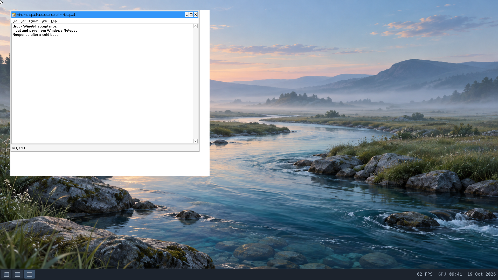

# Wine64 compatibility

Current checkpoint (19 October): Wine64 11.0 runs the console marker and Windows
Notepad as Brook. Keyboard input, save, normal close and reopening the saved
document after a cold boot pass. This is narrow basic-application acceptance;
Vulkan, DXVK, Proton and 32-bit Windows programs remain untested.

## Console and Notepad acceptance — 19 October



The accepted run uses eight vCPUs, 4 GiB, CPU composition, a headless 1920×1080
display and silent host audio. Kernel SHA256:
`e83e7518357603b755f8057896579f5122a023a392f9703a88d2832c4edec8a5`.
All twelve driver modules use ABI29. Each run uses private copies of previously
checked disks, including separate ext2 data, Nix and temporary volumes.

Three further compatibility repairs resolved the startup failures:

- `MAP_FIXED_NOREPLACE` now maps at the exact requested address or returns
  `EEXIST` without replacing overlapping mappings, including `PROT_NONE`
  reservations. Previously Wine's high-address probe repeatedly received a
  different address, unmapped it and retried. Collision checks and publication
  share the existing AS transaction/generation protocol, including races during
  unlocked preparation. Plain `MAP_FIXED` retains replacement behavior.
- `CLOCK_REALTIME_COARSE` now uses the realtime epoch. It previously returned
  uptime despite advertising a usable resolution. Wine converted relative GUI
  waits into absolute deadlines using that value, while wineserver compared
  them against realtime; explorer startup waits expired immediately. A
  Linux-matched 200 ms absolute timerfd test reproduced immediate expiration
  before the repair and approximately 200 ms afterward. This does not complete
  clock-ID validation or process/thread CPU clocks.
- The synthetic hosts file includes Brook's own hostname on loopback. The
  minimal diagnostic image also regained the standard font bundle already
  included by the normal image builder; no font package source changed.

Both commands ran as UID1000/GID100 with the existing persistent prefix
`/data/home/wine-acceptance/prefix-file-trace`, `HOME=/data/home`, `WINEARCH=win64`,
empty `DISPLAY`, `WAYLAND_DISPLAY=wayland-0`, `XDG_RUNTIME_DIR=/tmp`,
`WINEDLLOVERRIDES=mscoree,mshtml=` and `WINEDEBUG=-all,err+all`:

```text
/nix/profile/bin/wine cmd /c echo BROOK_WINE_CONSOLE_PASS
/nix/profile/bin/wine notepad.exe Z:\data\home\wine-notepad-acceptance.txt
```

The console printed exactly `BROOK_WINE_CONSOLE_PASS\r\n` and exited zero.
Its main exit was first observed about 8.8 seconds after submission; Notepad's
window appeared about 7.3 seconds after its separate submission. These are
single-run observations, not isolated benchmarks. Neither command reported the
former five-minute boot-event timeout. The final launch uses normal Notepad,
without the virtual-desktop diagnostic wrapper.

Keyboard input and Ctrl+S wrote a 93-byte CRLF text file owned by Brook, SHA256
`a695edf6085c6cbb55ca732727ad80a7d77f222240be561c4ac3919c2d879249`.
The independent cold boot read the same bytes and showed them in Notepad before
further input. Repeating input/save on the final kernel retained that hash.
All 1,027 prefix entries had UID1000/GID100. Its kernel32, cmd and Notepad binaries
also matched the immutable Wine package byte-for-byte in offline checks.

Notepad closed through its UI with exit zero. Wine services exited naturally;
the original console and Notepad lineages drained completely, with both output
streams retained without gaps. The heap check passed, no application windows
or user application tasks remained, and checked shutdown completed with the
original launcher and QEMU returning zero. All four disks passed offline
filesystem checks. Ten pre-existing document hashes/owners and the prior
shared-mapping persistence fixture were preserved.

Validation includes all 52 host suites and compiled entry audits, nineteen
Linux-matched exact-address checks, seven coarse-clock/deadline checks, hostname
resolution, and twenty shared-file/descriptor-transfer checks in the preceding
mapping candidate. Host mapping tests additionally cover concurrent claims
during preparation and user-address boundary validation.

Evidence: `build/workloads/wine-clock-20261019/candidate/acceptance-audit.json`,
with earlier diagnostics under `wine-notepad-hostname-20261019` and
`wine-noreplace-20261019`. One verbose virtual-desktop diagnostic exceeded bridge
output retention; its gap report and terminal exit/lineage proof are retained
and it is excluded from full-output application acceptance. The final quiet
normal launch has complete output. These runs reuse the populated checked
prefix; fresh-prefix installation, optional Wine services and broader Windows
application compatibility are separate work. Remaining general Linux semantic
gaps are recorded in [the backlog](backlog.md).

## Initial smoke test — 18 October

Wine's Linux loader starts on Brook, but the first Windows console command is
blocked during wineserver setup. This is not Windows application acceptance.
No GUI, graphics, Vulkan, Proton, games or 32-bit executables were tested.

The pinned Nix package is Wine64 11.0:
`/nix/store/bk0lngs3cskihb07w5a2hlv6h2yvl0fc-wine64-11.0`.
Its 361-path closure was exported to an ignored local cache and offered to the
guest's existing `nix-install`, using private RAM-backed copies of the checked
prepared bootstrap disks. Configuration: eight vCPUs, 4 GiB, CPU composition,
headless, no Wayland service, and silent host audio. The candidate kernel SHA256
was `9e64f2783804714a8998f0bdaf2cbe756980fa0e668b98d07c38292615646ccd`;
it also contained the pipe-read ordering fix, whose source hashes are
retained in the audit. Main was not changed.

## Results

- Package download and unpacking reached the Wine payload, whose unpacker
  reported 429,309,728 bytes and exit zero. Installation then failed while
  publishing profile links: `Error: incomplete profile links: Not a directory.`
  Normal package installation therefore did **not** pass; registration may
  already have been published. Preserve this image for recovery diagnosis.
- Using the explicit package path independently of profile links,
  `bin/wine --version` exited zero and printed `wine-11.0` as UID1000.
- `bin/wine cmd /c echo BROOK_WINE_CONSOLE_PASS` exited one with
  `wineserver: /tmp/.wine-1000 is not owned by you`. The expected console marker
  was absent. A Brook-owned prefix directory had been created first.
- A separate boot verified a private ext2 temporary directory was owned by
  UID1000 with mode0700, then retried with `TMPDIR` pointing there. Wineserver
  still rejected `/tmp/.wine-1000`; the Windows command again exited one.

Both console attempts used `WINEARCH=win64`,
`WINEPREFIX=/data/wine-smoke/prefix`, `HOME=/data/wine-smoke`, empty display
variables and `WINEDLLOVERRIDES=mscoree,mshtml=` to avoid optional runtime
installation dialogs. The second additionally used
`TMPDIR=/data/wine-smoke/tmp`. These are diagnostic launch settings, not a
normal desktop launcher or an isolation guarantee.

## Next steps and evidence

First diagnose the ownership/metadata and path handling behind the server
directory rejection, using a rootless temporary-directory regression. Do not
assume ordinary Wine application syscalls are already working: the test stopped
before its first successful Windows command. The small installer repair below
addresses the encountered profile-link failure. Resume with
the same small console command before attempting a graphical Windows program.
Vulkan remains a separate planned effort.

Evidence is under `build/workloads/wine-smoke-20261018/review`, including
`install`, `wine-run`, `wine-run-ownedtmp`, exact command outputs and
`../smoke-audit.json`. All six tracked commands reached their expected terminal
statuses, drained original/full lineages and both output streams without loss.
All three sessions completed orderly sync/shutdown with original launcher and
QEMU exit zero, zero deferred cleanup, passing heap checks, no visible user
faults, and nine passing read-only post-stop filesystem checks. Private images
were retained and RAM copies released. The package-install and Windows-command
failures are negative evidence, not passing workload acceptance.

## Installer recovery verified

Wine's closure includes standalone file outputs, including the Mono MSI.
The installer tried to open `<file-output>/lib` while linking closure libraries,
then treated the resulting `ENOTDIR` as a damaged profile. It now checks the
store output's type before looking for bin/lib/desktop directories. File
outputs have no such directories; an actual malformed `lib` inside a directory
output still fails instead of being silently ignored.

Two new positive host regressions reproduced the old failure: a file/symlink
dependency and a standalone file package. A negative regression preserves
errors for malformed library directories. All 31 installer tests passed,
including existing publication, repair and cancellation checks.

A candidate static installer (`/boot/BIN/NIXWTEST`, not the old bundled helper)
was run on fresh private clones of the failed installation. Both recovery and
an immediate repeated install exited zero. `/nix/profile/bin/wine --version`
then passed as Brook, and passed again after cold boot. Full child logs were
retained as files and matched their reported lengths/SHA256 after shutdown;
the Mono MSI's contents also matched the original host store output. Both
accepted sessions drained all tasks and deferred cleanup, passed heap checks,
and completed orderly shutdown with original launcher/QEMU exit zero and six
passing post-stop filesystem checks. RAM copies were released.

Evidence: `build/workloads/wine-profile-repair-verified-20261018/acceptance-audit.json`.
The first diagnostic recovery returned zero but overflowed bridge output; it
is retained separately and excluded from acceptance. The bundled installer in
the earlier smoke image remains old; future tool/image builds pick up this
source fix. This verifies recovery of an already-unpacked package, not a new
fresh download through the candidate. Wineserver's temporary-directory
ownership rejection and Windows command acceptance remain unresolved. Further
Wine/Proton work is deferred while application stability testing continues.

## Unix temporary disk follow-up

On 19 October, the bounded Wine follow-up used kernel `ac42f03c`, the current
Wayland frontend, eight CPUs, 4 GiB RAM and software composition. Private copies
combined the checked Wine installation with checked application data; the
original images were preserved. A separate ext2 image mounted at `/tmp` through
the existing `BROOK.MNT` boot probe. No Wine binary or kernel check was changed.

Wine 11's server and client use `/tmp/.wine-UID`; this path is hard-coded in
the pinned [server](https://raw.githubusercontent.com/wine-mirror/wine/wine-11.0/server/request.c)
and [client](https://raw.githubusercontent.com/wine-mirror/wine/wine-11.0/dlls/ntdll/unix/server.c).
The earlier FAT-backed directory had no Unix ownership/mode metadata, explaining
why setting `TMPDIR` did not help. On ext2, a Brook-user probe verified UID1000,
GID100, mode0700 and matching path/FD inode identities for a new directory.
The mount root was UID0/GID0 and mode01777. Both Wine attempts passed the former
directory rejection and reached the next blocker.

`wine cmd /c echo BROOK_WINE_CONSOLE_PASS` and `wine notepad` both exited one,
reporting a running server they could not connect to. The console marker was
absent and no Notepad window appeared. Wine checks `lstat("socket")` before
connecting. Brook's bind/listen currently register a string in the Unix socket
registry without creating a filesystem socket inode. This prevents Wine from
discovering the listener. A separate rootless probe isolated the broader gap:

| Pathname socket check | Linux reference | Brook |
| --- | --- | --- |
| Bound node has socket type, caller UID and umask-derived mode | Pass | ENOENT |
| Relative connect reaches an absolute pathname bind in the same directory | Pass | ECONNREFUSED |
| Socket node remains after listener close, until unlink | Pass | ENOENT |

The exact probe is `scripts/workloads/unix_path_socket_check.py`; exit one is
negative evidence. These three cases do not cover the full socket namespace.
A complete implementation also needs ownership/permission enforcement,
symlink lookup, unlink/rebinding, duplicate binds and stale-node behavior.
That work is deferred beyond this small Wine pass. No Windows console or GUI
application acceptance, Vulkan or Proton support is established.

Wine servers outlived the failed main commands. Each was stopped using
`wineserver -k` with the same private prefix, then the original request was
polled again until its full lineage and output drained. All seven recorded
commands reached their expected terminal codes without missing output. Heap
integrity, orderly shutdown, owned launcher/QEMU exit zero and four offline
filesystem checks passed. All ten existing document fixtures retained their
content and ownership, including the latest Codium save.

Evidence: `build/workloads/wine-unix-tmp-20261019/candidate/acceptance-audit.json`,
the console/Notepad records, Linux and guest socket-probe results, and exact
tested helper sources. The initial console controller hit its observation
deadline while the Wine server remained alive; cleanup resumed the original
request rather than launching it again.

### Creating the temporary disk

The reusable helper creates a sparse 128 MiB ext2 image, verifies root ownership
and mode, runs an offline filesystem check and refuses to replace an existing
output:

```sh
python3 scripts/create_tmp_disk.py --output build/experiments/wine-tmp.img
```

The launcher now creates this disk automatically: `run_experiment.sh` uses a
private `tmp.img` per experiment, and `run-qemu.sh` uses `brook_tmp_disk.img`.
Override its absolute path with `BROOK_TMP_DISK`; `none` explicitly disables it.
It has a separate drive slot, preserving optional media, `/data` and `/nix`.
Contents persist across boots; this is a disk-backed
temporary directory, with no automatic boot cleanup. It does not implement
tmpfs or complete the broader temporary-filesystem work.

## Pathname sockets and descriptor ownership — 19 October

Pathname stream sockets now create real ext2 socket inodes with caller
credentials, umask and parent permissions. Connect resolves relative paths and
symlinks, checks write permission, and finds the listener by device/inode.
Listeners retain an inode reference across unlink, so a replacement name can
route to a new listener while existing streams continue using the old one.
Closing a listener leaves its filesystem node until explicit unlink, matching
Linux. Ordinary file opens reject socket nodes. Unsupported filesystems report
EOPNOTSUPP. The new VFS creation callback advances the driver ABI to 28.

Three basic checks and 24 lifecycle/namespace checks pass on Linux and Brook.
They cover duplicate binding before listen, permission denial, symlinks,
rename, stale nodes, unlink/rebinding, old accepted streams and preservation of
unrelated files. These are focused stream tests, not abstract-namespace or
datagram acceptance, cross-UID coverage, or filesystem fault injection.

Wine then exposed missing SCM_RIGHTS support for pipes and eventfds. Snapshots
now retain/release pipe endpoints, eventfds, epoll and timerfds, and support
stateless null/random devices. Closing the receiving socket also releases its
queued descriptors while the sender remains open, including abandoned pending
connections. Detachment is serialized with stream writes; potentially recursive
handle releases happen outside the stream lock. Twenty-two Linux-matched guest
checks cover sender close, EOF after receiver close, discarded rights,
truncation, invalid-group rollback, close-on-exec and usable transferred handles.

The diagnostic `unix_rights_shared_file.py` isolates the next blocker: an
unlinked temporary file is passed with SCM_RIGHTS, and both descriptors retain
the same inode, but writable MAP_SHARED fails with errno 95. Linux passes its
mapping/read/write/msync checks. Wine's protocol trace now reaches successful
`get_handle_fd` for its shared-data section, then reports failure to map it.
The final console request exits one without the expected marker; its Wine
server exits and complete output/lineage is collected before shutdown.
There is no new Windows application success or Notepad screenshot at this stage.

Fixtures: `scripts/workloads/unix_path_socket_lifecycle.py`,
`unix_rights_handles.py` and `unix_rights_shared_file.py`. Evidence is under
`build/workloads/wine-socket-acceptance-20261019/candidate`; earlier negative
socket/queued-descriptor runs remain under `wine-path-sockets-20261019` and
`wine-rights-handles-20261019`. An intermediate `wine-rights-cleanup-20261019`
run passed the socket checks but was stopped before refreshing Wine's recorded
background-task status; it does not satisfy the final command-completion gate.
The shared-file implementation must preserve
canonical pages, ordinary-I/O coherence, permissions, mapped resize/EOF,
writeback and lifetime before enabling the currently rejected operation; see
[the shared-file foundation](file-shared-mappings.md).

The exact candidate passes all 52 host suites and both kernel entry audits.
Its isolated eight-vCPU/4-GiB run uses software composition and silent host
audio. Every recorded request reaches its expected terminal code with zero
live tasks and complete stdout/stderr before checked shutdown. Heap integrity,
owned launcher/QEMU exit zero, four offline filesystem checks and preservation
of all ten existing documents (content and ownership) pass. No application
windows, audio streams or outstanding GPU backing mappings remain.

## Shared-file mappings and first console output — 19 October

The ABI-29 candidate adds coherent shared-file writes, retained writable
publication, msync and periodic writeback. See [the shared-file implementation](file-shared-mappings.md).
All 52 host suites, both kernel entry audits, six Wine-pattern and fourteen
broader Linux-matched mapping checks pass, alongside the 49 socket/rights cases.
An owned 8192-byte fixture with synced and initially unsynced mapped pages retains
its exact hash and UID1000/GID100 after checked shutdown and a separate cold boot.

Wine advances beyond shared-data initialization. Early quiet attempts exit 53
with missing core DLLs in partial prefixes. A separate setup/file trace verifies
full builtin DLL copies; its actual child `wine cmd /c echo BROOK_WINE_CONSOLE_PASS`
exits zero with exactly `BROOK_WINE_CONSOLE_PASS\r\n` in its 25-byte stdout file.
Its server/setup processes are stopped using `wineserver -k`, and the original
tracked request drains to zero live tasks. A subsequent quiet launch against
that prefix stalls during service startup and exits one during normal server
stop. The difference remains unresolved; reliable quiet startup and Notepad
acceptance are not established.

The first verbose bridge attempt lost stderr and is excluded. Later diagnostic
traces use guest files, extracted after shutdown. Final files/hashes are
authoritative because background writers can outlive the main process and its
early hash report. The successful diagnostic's stdout/stderr match the final
extracted hashes. No Notepad screenshot is claimed. Evidence and a lossless
1500-ms CPU/context-switch capture are under
`build/workloads/wine-shared-mapping-20261019/candidate`, including `cold-boot`.

Both boots pass heap/resource cleanup, owned launcher/QEMU exit zero and four
offline filesystem checks. All ten existing documents retain their content and
ownership; the populated prefix's kernel32.dll, cmd.exe and notepad.exe match
their package bytes in both images. `acceptance-audit.json` records the usable
commands and the excluded output-gap attempt separately.
