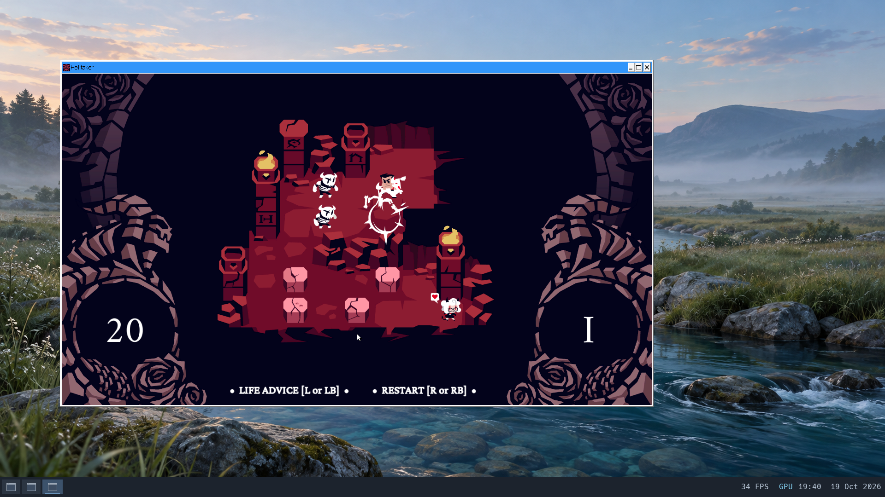

# Windows Unity games through Wine and DXVK

These are bounded gameplay smoke tests on Brook's hardware Venus stack, not
full-game compatibility claims. Game packages and raw logs stay in private
experiment directories; only screenshots are included in the repository.

## Helltaker — Unity 2019.2.9f1

The developer's [free Windows ZIP](https://vanripper.itch.io/helltaker) contains
a 64-bit executable and bundled Mono runtime. The tested archive is 77,857,618
bytes (348,149,001 bytes extracted), SHA-256
`a9dc060ee75e6a45e8200f70780954179243e5a6a509c7093c32d587eefef04f`.
Unity's own player log confirms engine 2019.2.9f1, forced Direct3D 11 at feature
level 11.1, and the Intel UHD 630 Venus adapter. DXVK logs identify version
2.7.1. The [Wine/DXVK checkpoint](wine-dxvk.md) supplies the kernel, Wine and
native DXVK DLLs unchanged.

The private run is `build/workloads/wine-unity-20261019/candidate`, with eight
vCPUs, 4 GiB, GPU composition and silent host audio. Verified behavior:

- The normal Unity configuration dialog selects 1280x720 windowed mode; that
  setting survives closing and reopening the game.
- Intro dialogue, the main menu, New Game and the first puzzle render.
- Arrow input moves the player and kicks skeletons. The move counter falls
  from 23 to 19; `R`, after the movement animation settles, resets the board
  and counter to 23.
- Minimize/restore and normal window close work. The accepted launch returns
  zero and all its tracked tasks exit.
- The clocked ALSA route delivers non-silent 44.1-kHz stereo PCM: the gameplay
  capture has 175,756 frames over 3.985 seconds, RMS 0.1913. An active stream
  snapshot reports `discontinuity=0`. After close, a separate capture is silent.
- Native Vulkan compute/render and persistent EGL pixel readback pass after
  the game exits. GPU resources and mappings balance, heap integrity passes,
  shutdown is orderly and all four filesystem checks pass. Twelve saved
  document fixtures and the original profile trees match the accepted seed.



### Audio configuration

The old ALSA file/null adapter produces `/dev/dsp` broken-pipe errors in this
workload and floods stderr. That first diagnostic launch is excluded from
complete-output acceptance. The accepted repeat selects Wine's ALSA driver and
uses Brook's existing [clocked OSS plugin](../tools/alsa-oss-pkg/README.md).
No new kernel change is needed.

For the experimental prefix, `wine reg add 'HKCU\Software\Wine\Drivers' /v Audio
/t REG_SZ /d alsa /f` selects the driver. `ALSA_PLUGIN_DIR` points to the two
built OSS plugin libraries and `ALSA_CONFIG_PATH` selects this per-app file:

```conf
pcm.brook_oss { type oss device "/dev/dsp" }
pcm.!default {
    type plug
    slave.pcm "brook_oss"
    hint { show on description "Brook default audio" }
}
ctl.!default { type empty }
```

This changes only the test prefix/configuration. The standard native D3D11 and
DXGI DLL overrides remain scoped to the game. Unity is launched with
`-force-d3d11 -screen-width 1280 -screen-height 720 -screen-fullscreen 0` and a
private `-logFile`. Wine stdout/stderr go to retained guest files so an error
flood cannot silently overflow the bridge's output retention.

A 150-ms gameplay profile contains 116 timer samples and 6,414 context switches
without drops. The earlier 500-ms profile overflowed and is excluded. The live
compositor's median interval is 25 ms, p95 49 ms; observations, profiling and
capture affect these counters, so they are not a game FPS benchmark. Audio
capture verifies device PCM delivery; longer listening/latency testing,
controller support, full-game completion and cold-boot progress persistence
remain untested.

## SpaceVenture — Unity 2022.3.62f2

The supplied Windows x64 build (game menu version 2.08.12) is tested locally
from a separate FAT32 image, with eight vCPUs and 8 GiB. The source installation
and paid assets remain private. Unity confirms D3D11 feature level 11.1 on
hardware Venus, with jobified graphics and eight physics workers enabled.

The fixed-kernel run is
`build/workloads/wine-spaceventure-20261019/candidate-ss`. It reaches the main
menu, starts a new game, plays the opening sequence and enters the first 3D
room. Pointer input selects a scene object and changes the character's walking
destination; the game logs walking and metal-footstep events. Minimize/restore
works. The opening-room audio capture contains 176,709 stereo frames over about
four seconds, with nonzero PCM; the live clocked stream reports no discontinuity.
The observed compositor intervals are median 29 ms and p95 46 ms, not a full
rendering benchmark. Later rooms, completion, save/load and longer stability
remain untested. Steam achievements are unavailable without Steam; the supplied
build proceeds into the game without that service.

Normal window close returns zero and leaves no tracked game tasks. Post-close
audio is silent; native Vulkan and persistent EGL readback checks pass, GPU
resources balance and heap integrity passes. Orderly shutdown, all four guest
filesystem checks and the private FAT32 media check pass. The twelve saved
document fixtures and four original profile trees match the accepted seed.


### Signal-context correction

The first run faults inside managed JIT code, then Wine's exception handler
itself faults while treating the context as 16-bit. Brook's Linux signal frame
had named the fourth 16-bit selector slot `__pad0` and left it zero. Linux's
[x86-64 sigcontext](https://raw.githubusercontent.com/torvalds/linux/master/arch/x86/include/uapi/asm/sigcontext.h)
uses that slot for SS, and
[Wine 11's exception setup](https://github.com/wine-mirror/wine/blob/wine-11.0/dlls/ntdll/unix/signal_x86_64.c)
uses it to distinguish the stack mode.

Both signal builders now populate SS: the supported user data selector on
syscall-return delivery and the interrupted SS on synchronous faults. Offset
150 and the 256-byte mcontext size are asserted; the wire layout is unchanged.
Existing ucontext flags remain unchanged. Strict selector restoration and
extended floating-point signal state are separate work, not advertised here.

`tools/signal-context-probe-pkg` provides a native executable with a host Linux
check and three real guest cases: SIGUSR1 via `tgkill`, a null-memory SIGSEGV
whose handler changes RIP to a recovery label, and the same recovery on an
alternate signal stack. It compares saved CS/SS with live selectors, checks
exact saved stack pointers and verifies return to execution. The identical
binary fails all three old-kernel cases only on saved SS (zero versus live
35), then passes all three with the correction. The existing bounded entry and
scheduler mutation audits and all 57 hosted tests pass. The new kernel SHA-256
is `f932600c7ef0ac9606057f8e976e47b3f397695aae69383dc965a6d342e2f1b3`.
SpaceVenture now handles the managed exception and continues into the game.

## Larger private payloads

QEMU's directory-backed virtual FAT drive defaults to about 516 MB. Larger game
folders can fail before the guest boots. `bootstrap_acceptance.launch` now
accepts an optional `media_disk` image inside the experiment's own directory.
A separately checked FAT32 image can hold the private payload without exposing
the user's source folder to guest writes. The default launch path is unchanged.

## Original Windows Quake II

The supplied GOG installer can be inspected with the pinned `innoextract`
package. Its original `quake2.exe` is PE32/i386. The tested Wine package and
Brook user code descriptors are 64-bit only; original-game testing needs a
separate WoW64/compatibility-mode milestone. The existing native Yamagi result
is not Windows compatibility evidence. Installer contents remain local.
